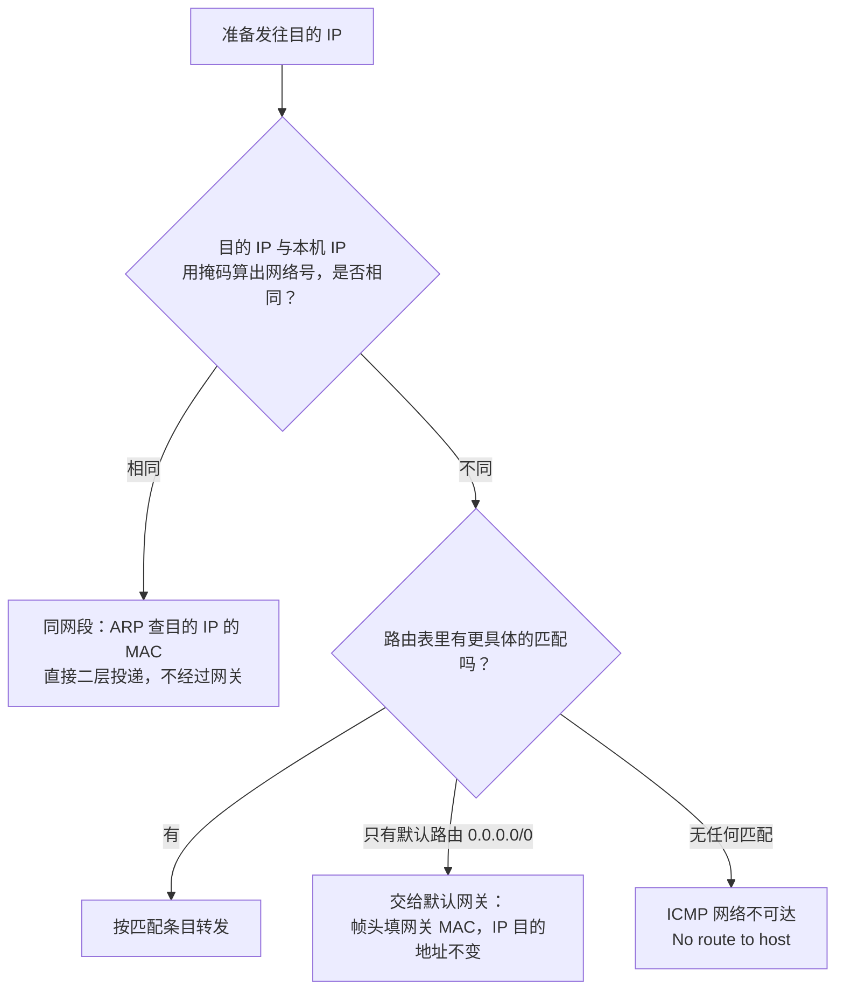
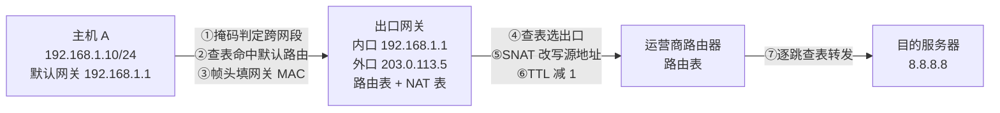

reference:《计算机网络-自顶向下的方法》

# 目录

- [一、计算机网络概述](#一计算机网络概述)
- [二、应用层](#二应用层)
- [三、传输层](#三传输层)
- [四、网络层](#四网络层)
- [五、数据链路层](#五数据链路层)
- [六、物理层](#六物理层)
- [七、网络安全](#七网络安全)

---

# 一、计算机网络概述

## 1.1 因特网概述

### 概念解释

**因特网（Internet）**：全球最大的互联网络，连接了世界各地数以亿计的计算设备。

**网络核心**：由大量网络和连接这些网络的路由器组成的网状结构。

**网络边缘**：端系统（主机）及其应用程序。

### 基本原理

因特网采用**分组交换**技术，将数据分割成小的数据包（packet），每个数据包独立传输，在目的地重新组装。

**三种交换方式对比**：

| 交换方式 | 特点 | 优缺点 |
|---------|------|--------|
| 电路交换 | 建立专用通信路径 | 资源独占，适合实时通信 |
| 分组交换 | 存储转发，统计复用 | 资源共享，适合突发数据 |
| 报文交换 | 整体传输 | 延迟大，已较少使用 |

### 实际应用

- **Web 浏览**：HTTP 协议传输网页内容
- **电子邮件**：SMTP 协议发送邮件
- **视频流媒体**：实时传输音视频数据
- **在线游戏**：低延迟数据传输

## 1.2 网络核心

### 概念解释

**分组交换（Packet Switching）**：将报文分割成较小的数据包，每个分组独立传输。

**存储转发传输**：路由器在转发分组前必须接收完整个分组。

### 基本原理

**分组交换的关键机制**：

1. **统计多路复用**：多个通信流共享同一链路，按需分配带宽
2. **排队延迟**：分组在路由器缓冲区等待转发
3. **丢包**：缓冲区满时丢弃分组

**延迟组成**：

```
总延迟 = 处理延迟 + 排队延迟 + 传输延迟 + 传播延迟

d_nodal = d_proc + d_queue + d_trans + d_prop
```

- **处理延迟**：检查分组首部、确定转发方向
- **排队延迟**：在输出链路队列中等待
- **传输延迟**：将分组推送到链路（L/R，L 为分组长度，R 为链路带宽）
- **传播延迟**：信号在链路上传播（d/s，d 为距离，s 为传播速度）

### 实际应用

- **CDN（内容分发网络）**：利用分组交换就近提供服务
- **负载均衡**：通过分组调度优化网络性能
- **流量工程**：优化网络路径选择

## 1.3 协议分层模型

### 概念解释

**协议（Protocol）**：定义通信实体之间交换报文的格式、顺序、动作的规则。

**分层架构**：将复杂的网络功能分解为多个层次，每层提供特定服务。

### 基本原理

**OSI 七层模型 vs TCP/IP 四层模型**：

| OSI 七层模型 | TCP/IP 四层模型 | 功能 |
|-------------|----------------|------|
| 应用层 | 应用层 | 网络应用协议 |
| 表示层 | 应用层 | 数据格式转换 |
| 会话层 | 应用层 | 会话管理 |
| 传输层 | 传输层 | 端到端传输 |
| 网络层 | 网络层 | 路由选择 |
| 数据链路层 | 链路层 | 链路传输 |
| 物理层 | 物理层 | 比特传输 |

**封装过程**：

```
应用层报文
  ↓ 添加 TCP 首部
传输层报文段（Segment）
  ↓ 添加 IP 首部
网络层数据报（Datagram）
  ↓ 添加链路层首部
链路层帧（Frame）
  ↓ 物理传输
比特流
```

### 实际应用

- **网络故障排查**：逐层分析定位问题
- **协议开发**：各层独立设计和实现
- **网络设备设计**：路由器工作在网络层，交换机工作在链路层

---

# 二、应用层

## 2.1 网络应用原理

### 概念解释

**客户-服务器体系结构（Client-Server Architecture）**：

- **服务器**：持续运行，提供服务的端系统
- **客户**：发起通信，请求服务的端系统

**对等（P2P）体系结构**：

- 无需专用服务器
- 每个节点既是客户又是服务器
- 自扩展性强

### 基本原理

**应用层协议定义内容**：

1. **报文类型**：请求报文、响应报文
2. **报文语法**：字段及其格式
3. **字段语义**：字段含义
4. **处理规则**：发送和接收报文的动作

**应用需要传输层提供的服务**：

| 服务特性 | 说明 | TCP | UDP |
|---------|------|-----|-----|
| 可靠数据传输 | 数据无丢失、无差错 | ✓ | ✗ |
| 吞吐量 | 单位时间传输数据量 | - | - |
| 定时 | 延迟保证 | - | - |
| 安全性 | 数据加密、认证 | ✓（SSL/TLS） | ✗ |

### 实际应用

- **Web 浏览**：客户-服务器模式
- **BitTorrent**：P2P 文件共享
- **视频会议**：需要低延迟和足够吞吐量
- **在线游戏**：实时性要求高，常用 UDP

## 2.2 Web 与 HTTP

### 概念解释

**HTTP（HyperText Transfer Protocol）**：Web 应用的传输协议，定义了浏览器与服务器之间的通信规则。

**URL（Uniform Resource Locator）**：统一资源定位符，标识 Web 资源的位置。

```
http://www.example.com:80/path/to/resource?query=value#fragment
  ↓       ↓               ↓    ↓              ↓
协议    主机名          端口  路径            查询参数
```

### 基本原理

**HTTP 连接类型**：

1. **非持久连接（HTTP/1.0）**：
   - 每个 TCP 连接只传输一个对象
   - 每个对象需要 2 个 RTT（Round-Trip Time）
   - 并行 TCP 连接可提高性能

2. **持久连接（HTTP/1.1）**：
   - 一个 TCP 连接可传输多个对象
   - 默认开启持久连接
   - 流水线技术：无需等待响应即可发送下一个请求

**HTTP 报文格式**：

**请求报文**：

```http
GET /index.html HTTP/1.1          # 请求行：方法 URL 版本
Host: www.example.com             # 首部行
Connection: close
User-agent: Mozilla/5.0
Accept-language: zh-CN

                                  # 空行
[请求体]                           # 实体体（可选）
```

**响应报文**：

```http
HTTP/1.1 200 OK                    # 状态行：版本 状态码 短语
Connection: close                  # 首部行
Date: Tue, 09 Aug 2024 15:00:00 GMT
Server: Apache/2.4.1
Content-Length: 128
Content-Type: text/html

                                  # 空行
<html>...</html>                   # 实体体
```

**常见状态码**：

| 状态码 | 类别 | 示例 |
|-------|------|------|
| 1xx | 信息性 | 100 Continue |
| 2xx | 成功 | 200 OK, 201 Created |
| 3xx | 重定向 | 301 Moved Permanently, 304 Not Modified |
| 4xx | 客户端错误 | 400 Bad Request, 404 Not Found |
| 5xx | 服务器错误 | 500 Internal Server Error, 503 Service Unavailable |

**Cookie 技术**：

```
HTTP 请求 → 服务器 → Set-Cookie 首部 → 浏览器存储 Cookie
下次请求 → 浏览器 → Cookie 首部 → 服务器识别用户
```

**Web 缓存（代理服务器）**：

1. 浏览器向代理服务器发送请求
2. 代理检查是否有缓存
3. 若有且未过期，直接返回
4. 若无或已过期，向源服务器请求并缓存

### 实际应用

- **RESTful API**：基于 HTTP 方法的资源操作
  - GET：获取资源
  - POST：创建资源
  - PUT：更新资源
  - DELETE：删除资源

- **HTTPS**：HTTP + SSL/TLS 加密
  - 数据加密传输
  - 服务器身份认证
  - 数据完整性保护

- **HTTP/2**：
  - 多路复用：单连接并行传输
  - 头部压缩：减少开销
  - 服务器推送：主动发送资源

## 2.3 电子邮件

### 概念解释

**电子邮件系统组成**：

- **用户代理（User Agent）**：邮件客户端软件
- **邮件服务器**：存储和转发邮件
- **SMTP（Simple Mail Transfer Protocol）**：邮件传输协议

### 基本原理

**邮件发送流程**：

```
发送方用户代理 → 发送方邮件服务器 → 接收方邮件服务器 → 接收方用户代理
     ↓                  ↓                    ↓
   SMTP              SMTP                POP3/IMAP
```

**SMTP 协议特点**：

1. 使用 TCP 可靠传输，端口 25
2. 直接传输：发送服务器直接连接接收服务器
3. 三阶段：握手、报文传输、关闭
4. 使用持久连接

**SMTP 命令示例**：

```
HELO client.example.com          # 标识发送方
MAIL FROM: <sender@example.com>  # 发件人
RCPT TO: <receiver@example.com>  # 收件人
DATA                             # 开始邮件内容
Subject: Test Email
This is a test email.
.                                # 结束邮件内容
QUIT                             # 关闭连接
```

**邮件访问协议**：

| 协议 | 端口 | 特点 |
|------|------|------|
| POP3 | 110 | 下载并删除（或保留），离线访问 |
| IMAP | 143 | 服务器端管理，多设备同步 |
| HTTP | 80/443 | Web 邮件（如 Gmail） |

### 实际应用

- **企业邮件系统**：Exchange、Postfix
- **邮件安全**：
  - SPF（Sender Policy Framework）：防止伪造发件人
  - DKIM（DomainKeys Identified Mail）：邮件签名验证
  - DMARC：结合 SPF 和 DKIM 的策略框架

## 2.4 DNS 域名系统

### 概念解释

**DNS（Domain Name System）**：将域名解析为 IP 地址的分布式数据库系统。

**域名结构**：层次化命名，从右到左逐级细化

```
www.example.com.
  ↓    ↓       ↓
三级 二级    顶级  根（隐含）
```

### 基本原理

**DNS 服务器层次结构**：

1. **根 DNS 服务器**：返回顶级域名服务器地址
2. **顶级域名服务器（TLD）**：管理 .com、.org、.net 等
3. **权威 DNS 服务器**：提供域名到 IP 的最终映射
4. **本地 DNS 服务器**：缓存和代理查询

**DNS 解析过程**：

**迭代查询**：

```
主机 → 本地 DNS 服务器 → 根服务器 → TLD 服务器 → 权威服务器
                ↓
              返回 IP 地址
```

**递归查询**：

```
主机 → 本地 DNS 服务器（负责所有查询）→ 最终返回 IP 地址
```

**DNS 记录类型**：

| 类型 | 作用 | 示例 |
|------|------|------|
| A | 域名到 IPv4 地址 | `example.com. A 93.184.216.34` |
| AAAA | 域名到 IPv6 地址 | `example.com. AAAA 2606:2800:220:1:248:1893:25c8:1946` |
| CNAME | 域名别名 | `www.example.com. CNAME example.com.` |
| MX | 邮件服务器 | `example.com. MX 10 mail.example.com.` |
| NS | 权威域名服务器 | `example.com. NS ns1.example.com.` |
| TXT | 文本记录 | 用于 SPF、DKIM 等 |

**DNS 缓存**：

- 本地 DNS 服务器缓存查询结果
- 减少根服务器和 TLD 服务器负载
- 缓存有效期由 TTL（Time To Live）控制

### 实际应用

- **负载均衡**：轮询 DNS，返回多个 IP 地址
- **CDN 加速**：根据地理位置返回最近服务器 IP
- **故障转移**：监控服务器状态，动态更新 DNS 记录
- **安全防护**：
  - DNSSEC：DNS 安全扩展，防止 DNS 欺骗
  - DNS over HTTPS（DoH）：加密 DNS 查询

## 2.5 P2P 应用

### 概念解释

**P2P（Peer-to-Peer）**：对等网络，每个节点既是客户又是服务器。

### 基本原理

**P2P 文件分发**：

- **BitTorrent 协议**：
  - 文件分为多个块（chunk，通常 256KB）
  - 节点互相交换块
  - 稀缺优先策略：优先下载最稀缺的块
  - 激励机制：上传速度快的节点获得更好的下载速度

**分布式哈希表（DHT）**：

- 环形标识符空间
- 每个节点负责一部分键值对
- 查找复杂度 O(log N)

### 实际应用

- **文件共享**：BitTorrent、迅雷
- **区块链**：比特币、以太坊
- **实时通信**：WebRTC（P2P 视频通话）

---

# 三、传输层

## 3.1 传输层服务模型

### 概念解释

**传输层**：为应用层提供端到端的通信服务，运行在端系统上。

**多路复用与多路分解**：

- **多路复用**：多个应用进程使用同一个传输层协议传输数据
- **多路分解**：将传输层报文段中的数据交付给正确的应用进程

### 基本原理

**端口（Port）**：

- 16 位端口号（0-65535）
- 0-1023：知名端口（Well-Known Ports）
- 1024-49151：注册端口
- 49152-65535：动态/私有端口

**套接字（Socket）**：

```
套接字 = (IP 地址, 端口号)

TCP 套接字 = (源 IP, 源端口, 目的 IP, 目的端口)
UDP 套接字 = (目的 IP, 目的端口)
```

**常见应用层协议端口**：

| 协议 | 端口 | 传输层协议 |
|------|------|-----------|
| HTTP | 80 | TCP |
| HTTPS | 443 | TCP |
| FTP | 20/21 | TCP |
| SMTP | 25 | TCP |
| POP3 | 110 | TCP |
| DNS | 53 | UDP/TCP |
| SSH | 22 | TCP |

### 实际应用

- **网络编程**：Socket API 开发网络应用
- **端口扫描**：安全检测和渗透测试
- **防火墙配置**：基于端口的访问控制

## 3.2 UDP 协议

### 概念解释

**UDP（User Datagram Protocol）**：用户数据报协议，提供无连接、不可靠的传输服务。

### 基本原理

**UDP 特点**：

1. **无连接**：无需建立连接，直接发送
2. **无连接状态**：服务器可同时服务大量客户
3. **分组开销小**：首部仅 8 字节
4. **应用层控制**：开发者可精确控制发送时机

**UDP 首部格式**（8 字节）：

```
 0      7 8     15 16    23 24    31
+--------+--------+--------+--------+
|   源端口号   |  目的端口号  |  0-1 字节
+--------+--------+--------+--------+
|    长度      |    校验和    |  2-3 字节
+--------+--------+--------+--------+
|          用户数据（应用层数据）      |
+-----------------------------------+
```

- **源端口**：发送方端口号（可选）
- **目的端口**：接收方端口号
- **长度**：UDP 数据报总长度（首部 + 数据）
- **校验和**：检测传输错误

**UDP 校验和计算**：

1. 添加伪首部（源 IP、目的 IP、协议类型、UDP 长度）
2. 将数据视为 16 位整数序列
3. 计算和的反码作为校验和
4. 接收方重新计算，结果应为全 1

### 实际应用

**适用场景**：

- **DNS 查询**：简单请求-响应，UDP 更高效
- **实时音视频**：容忍少量丢包，追求低延迟
- **在线游戏**：实时性优先于可靠性
- **SNMP**：网络管理，简单高效

**可靠性增强**：

应用层可实现：
- ACK 确认机制
- 超时重传
- 序号和去重

## 3.3 可靠数据传输原理

### 概念解释

**可靠数据传输（Reliable Data Transfer, RDT）**：确保数据无差错、无丢失、按序交付。

### 基本原理

**RDT 协议演进**：

**RDT 1.0：完全可靠信道**

- 假设信道完全可靠
- 无需任何控制机制

**RDT 2.0：有比特差错信道**

- **ARQ（Automatic Repeat reQuest）**协议
- **停等协议（Stop-and-Wait）**：
  - 发送方发送数据，等待 ACK
  - 接收方检测差错，发送 NAK
  - 发送方收到 NAK，重传数据

```
发送方                      接收方
  |--- 数据分组 ------------>|
  |                          | 检查差错
  |<--- ACK/NAK -------------|
  | 重传（若 NAK）            |
```

**RDT 2.1：处理 ACK/NAK 差错**

- 添加**序号（Sequence Number）**
- 区分新分组和重传分组
- 发送方和接收方状态机

**RDT 2.2：无 NAK 协议**

- 接收方发送对上一个正确分组的 ACK（否定确认）
- 发送方收到重复 ACK，重传当前分组

**RDT 3.0：处理丢包**

- 添加**超时重传**机制
- 发送方启动定时器，超时未收到 ACK 则重传

```
发送方                      接收方
  |--- 分组 0 -------------->|
  |   启动定时器              |
  |                          | 收到，发送 ACK 0
  |<--- ACK 0 ---------------|
  |   停止定时器              |
  |--- 分组 1 -------------->|
  |   启动定时器              |
  |   （超时，未收到 ACK）     |
  |--- 分组 1（重传）-------->|
```

**流水线技术**：

停等协议效率低，流水线技术允许发送多个未确认分组：

1. **回退 N 步（Go-Back-N, GBN）**：
   - 发送方维护窗口大小 N
   - 接收方只按序接收，丢弃失序分组
   - 超时后重传所有已发送未确认分组

2. **选择重传（Selective Repeat, SR）**：
   - 发送方和接收方各维护窗口
   - 接收方缓存失序分组
   - 只重传丢失的分组

```
GBN 示例（窗口大小 N=4）：
发送方: [0, 1, 2, 3] 已发送，等待 ACK
若分组 1 丢失，接收方丢弃 2, 3
超时后重传 1, 2, 3

SR 示例（窗口大小 N=4）：
发送方: [0, 1, 2, 3] 已发送
若分组 1 丢失，接收方缓存 2, 3
只重传分组 1
```

### 实际应用

- **TCP 可靠传输**：基于流水线和选择重传思想
- **无线网络**：链路层 ARQ 机制
- **卫星通信**：长延迟环境下的可靠传输

## 3.4 TCP 协议

### 概念解释

**TCP（Transmission Control Protocol）**：传输控制协议，提供面向连接、可靠的字节流传输服务。

### 基本原理

**TCP 特点**：

1. **面向连接**：传输前需建立连接
2. **可靠传输**：无差错、无丢失、无重复、按序
3. **全双工**：双向同时传输
4. **点对点**：一对一通信
5. **字节流**：无消息边界

**TCP 首部格式**（20 字节固定 + 选项）：

```
 0      7 8     15 16    23 24    31
+--------+--------+--------+--------+
|   源端口号   |  目的端口号  |        0-1 字节
+--------+--------+--------+--------+
|           序号（Sequence Number）  |  2-5 字节
+--------+--------+--------+--------+
|        确认号（ACK Number）        |  6-9 字节
+--------+--------+--------+--------+
|首部长度|保留|U|A|P|R|S|F|  窗口大小  |
|  (4位) | 6位|G|C|S|S|Y|I|           |
+--------+--------+--------+--------+
|   校验和    |   紧急指针   |       12-15 字节
+--------+--------+--------+--------+
|          选项（可选）               |
+-----------------------------------+
```

**关键字段**：

- **序号（Sequence Number）**：数据字节流的字节序号
- **确认号（ACK Number）**：期望收到的下一个字节序号
- **标志位**：
  - SYN：同步，建立连接
  - ACK：确认
  - FIN：结束，关闭连接
  - RST：重置连接
  - PSH：推送，立即交付应用层
  - URG：紧急指针有效
- **窗口大小**：接收窗口，流量控制

**TCP 连接管理**：

**三次握手（建立连接）**：

```
客户端                          服务器
  |--- SYN, seq=x -------------->|  1. 客户端请求建立连接
  |                              |     SYN_SENT 状态
  |<-- SYN, ACK, seq=y, ack=x+1 -|  2. 服务器同意建立连接
  |                              |     SYN_RCVD 状态
  |--- ACK, seq=x+1, ack=y+1 --->|  3. 客户端确认
  |                              |     ESTABLISHED 状态
```

**四次挥手（关闭连接）**：

```
主动关闭方                      被动关闭方
  |--- FIN, seq=u -------------->|  1. 请求关闭
  |                              |     FIN_WAIT_1 状态
  |<-- ACK, ack=u+1 -------------|  2. 确认关闭请求
  |                              |     CLOSE_WAIT 状态
  |                              |     FIN_WAIT_2 状态
  |<-- FIN, seq=v ---------------|  3. 请求关闭
  |                              |     LAST_ACK 状态
  |--- ACK, ack=v+1 ------------>|  4. 确认关闭
  |                              |     TIME_WAIT 状态（2MSL）
  |                              |     CLOSED 状态
```

**为什么需要 TIME_WAIT？**

1. 确保最后的 ACK 到达对方
2. 等待旧连接的重复分组在网络中消失

**TCP 可靠传输机制**：

1. **序号和确认**：
   - 每个字节有序号
   - 累积确认：确认号表示期望收到的下一个字节

2. **超时重传**：
   - 自适应超时时间：RTT 估计
   - `TimeoutInterval = EstimatedRTT + 4 * DevRTT`
   - `EstimatedRTT = 0.875 * EstimatedRTT + 0.125 * SampleRTT`

3. **快速重传**：
   - 收到 3 个重复 ACK，立即重传
   - 无需等待超时

```
发送方                      接收方
  |--- 分组 1 -------------->|
  |--- 分组 2 -------------->|  丢失
  |--- 分组 3 -------------->|
  |<--- ACK 1 ---------------|  期望收到 2
  |--- 分组 4 -------------->|
  |<--- ACK 1 ---------------|  重复 ACK（收到 3）
  |--- 分组 5 -------------->|
  |<--- ACK 1 ---------------|  重复 ACK（收到 4）
  |                          |  收到 3 个重复 ACK
  |--- 分组 2（重传）-------->|  快速重传
```

**流量控制**：

- 接收方在 ACK 中通告窗口大小
- 发送方维护发送窗口：`LastByteSent - LastByteAcked <= rwnd`
- 防止发送方淹没接收方

**拥塞控制**：

TCP 发送方维护拥塞窗口（cwnd），动态调整发送速率。

**四种算法**：

1. **慢启动（Slow Start）**：
   - 初始 cwnd = 1 MSS
   - 每个 RTT cwnd 加倍（指数增长）
   - 达到慢启动阈值 ssthresh 后转为拥塞避免

2. **拥塞避免（Congestion Avoidance）**：
   - 每个 RTT cwnd 增加 1 MSS（线性增长）
   - 检测到拥塞后：
     - 超时：ssthresh = cwnd/2，cwnd = 1，重新慢启动
     - 3 个重复 ACK：ssthresh = cwnd/2，cwnd = ssthresh + 3，快速恢复

3. **快速重传（Fast Retransmit）**：
   - 收到 3 个重复 ACK，立即重传

4. **快速恢复（Fast Recovery）**：
   - cwnd = ssthresh + 3
   - 每收到重复 ACK，cwnd 增加 1
   - 收到新 ACK，cwnd = ssthresh，进入拥塞避免

```
cwnd
  ^
  |           慢启动      拥塞避免
  |          /------/------------- 
  |         /      /             
  |        /      /  快速恢复    
  |       /      /  /----\       
  |      /      /  /      \      
  |     /      /  /        \     
  |----/------/--/----------\----> 时间
        超时重传  3个重复ACK
```

### 实际应用

- **Web 浏览**：HTTP/1.1 持久连接，TCP 优化
- **文件传输**：FTP、SFTP 可靠传输
- **数据库连接**：MySQL、PostgreSQL 客户端连接
- **TCP 性能优化**：
  - TCP Fast Open：减少握手延迟
  - BBR 拥塞控制：基于带宽和 RTT 的拥塞控制
  - 窗口扩大因子：支持高速网络

---

# 四、网络层

## 4.1 网络层概述

### 概念解释

**网络层**：负责将数据报从源主机传输到目的主机，核心功能是路由选择。

**数据报（Datagram）**：网络层的传输单元，包含 IP 首部和数据。

**转发（Forwarding）**：将分组从输入接口移动到正确的输出接口。

**路由选择（Routing）**：确定分组从源到目的的路径。

### 基本原理

**网络层功能**：

1. **转发**：路由器查表决定输出端口
2. **路由选择**：路由算法计算最佳路径
3. **连接建立**：某些网络架构（如 ATM）需要

**数据平面 vs 控制平面**：

| 数据平面 | 控制平面 |
|---------|---------|
| 本地操作，转发分组 | 网络范围，路由选择 |
| 纳秒级处理 | 秒级计算 |
| 路由器硬件实现 | 路由器软件实现 |

### 实际应用

- **路由器**：网络层核心设备
- **三层交换机**：支持 IP 路由的交换机
- **SDN（软件定义网络）**：控制平面与数据平面分离

## 4.2 IPv4 协议

### 概念解释

**IPv4（Internet Protocol version 4）**：当前广泛使用的网络层协议，32 位地址。

### 基本原理

**IPv4 数据报格式**：

```
 0      7 8     15 16    23 24    31
+--------+--------+--------+--------+
|版本(4)|首部长度|服务类型|  总长度   |  0-3 字节
+--------+--------+--------+--------+
|   标识字段   |标志|  片偏移   |  4-7 字节
+--------+--------+--------+--------+
|  生存时间  |  协议   |  首部校验和 |  8-11 字节
+--------+--------+--------+--------+
|          源 IP 地址               |  12-15 字节
+--------+--------+--------+--------+
|          目的 IP 地址              |  16-19 字节
+--------+--------+--------+--------+
|          选项（可选）               |
+-----------------------------------+
```

**关键字段**：

- **版本**：IPv4 为 4
- **首部长度**：以 4 字节为单位，最小 5（20 字节）
- **服务类型（TOS）**：区分服务
- **总长度**：首部 + 数据，最大 65535 字节
- **标识、标志、片偏移**：IP 分片
- **TTL（Time To Live）**：生存时间，每经过路由器减 1，防止循环
- **协议**：上层协议（TCP=6, UDP=17, ICMP=1）
- **首部校验和**：检测首部错误

**IPv4 地址**：

- 32 位，点分十进制表示：`192.168.1.1`
- **网络号 + 主机号**：网络号标识网络，主机号标识主机

**IP 地址分类**：

| 类别 | 范围 | 网络号位数 | 主机号位数 | 用途 |
|------|------|-----------|-----------|------|
| A | 1.0.0.0 - 126.255.255.255 | 8 | 24 | 大型网络 |
| B | 128.0.0.0 - 191.255.255.255 | 16 | 16 | 中型网络 |
| C | 192.0.0.0 - 223.255.255.255 | 24 | 8 | 小型网络 |
| D | 224.0.0.0 - 239.255.255.255 | - | - | 组播地址 |
| E | 240.0.0.0 - 255.255.255.255 | - | - | 保留地址 |

**地址的两个组成部分**：

IP 地址 = **网络号 + 主机号**。关键在于：网络号占多少位并不写在地址里，而是由外部的**子网掩码 / 前缀长度**临时指定。同一个 `192.168.1.10`，配 `/24` 是 `192.168.1.0/24` 里的一台普通主机，配 `/25` 就落到了 `192.168.1.0/25` 网段——**地址本身没变，网段归属变了**。

掩码、前缀长度、CIDR 三者说的是同一件事的三种写法：

| 表达方式 | 写法 | 使用场合 |
|---------|------|---------|
| 点分十进制掩码 | `255.255.255.192` | 设备配置界面、`ipconfig` |
| 前缀长度（CIDR） | `/26` | 路由配置、云平台、文档 |
| 通配符掩码（反掩码） | `0.0.0.63` | ACL、OSPF `network` 语句 |

子网划分的完整计算方法见 [4.3 CIDR 与子网划分](#43-cidr-与子网划分)。

**私有地址**：

| 范围 | CIDR | 用途 |
|------|------|------|
| 10.0.0.0 - 10.255.255.255 | 10.0.0.0/8 | A 类私有 |
| 172.16.0.0 - 172.31.255.255 | 172.16.0.0/12 | B 类私有 |
| 192.168.0.0 - 192.168.255.255 | 192.168.0.0/16 | C 类私有 |

**私有地址与 NAT**：

私有地址不能出现在公网上，内网访问互联网必须经过 NAT 转换。网关、路由表与 NAT 三者的完整机制见 [4.4 网关、路由表与 NAT](#44-网关路由表与-nat)。

**IP 分片**：

- MTU（Maximum Transmission Unit）：链路层最大传输单元
- 以太网 MTU = 1500 字节
- IP 数据报大于 MTU 时需分片
- 目的主机重组分片

```
原数据报：4000 字节
MTU：1500 字节

分片：
- 片 1：标识=x, 标志=1（更多片）, 偏移=0
- 片 2：标识=x, 标志=1（更多片）, 偏移=185
- 片 3：标识=x, 标志=0（最后一片）, 偏移=370
```

### 实际应用

- **地址规划**：按业务规模选择前缀长度（详见 4.3）
- **IP 地址管理**：DHCP 动态分配，避免手工配错掩码与网关
- **私有地址复用**：家庭、企业、云 VPC 全靠 RFC 1918 三段私有地址 + NAT

## 4.3 CIDR 与子网划分

### 概念解释

**CIDR（Classless Inter-Domain Routing，无类别域间路由）**：1993 年提出（RFC 1519，后由 RFC 4632 更新）的地址分配与路由机制，用**任意长度的网络前缀**取代传统 A/B/C 类地址的固定边界，因此称为"无类别"。

**记法**：`网络地址/前缀长度`

```text
192.168.10.0/26
└──────┬─────┘ └┬┘
    网络地址    前缀长度 n：前 n 位是网络号，后 32-n 位是主机号
```

**与子网掩码的关系**：`/26` ≡ `255.255.255.192`，前缀长度就是掩码中连续 1 的个数。所以分类编址并不是另一套体系，它只是 CIDR 的三个特例（`/8`、`/16`、`/24`）——**前缀长度固定 vs 可变**，就是"有类别"与"无类别"的唯一区别。

**CIDR 要解决的两个问题**：

| 问题 | 分类编址的困境 | CIDR 的对策 |
|------|--------------|------------|
| 地址浪费 | 一个组织需要 500 个地址，只能申请 1 个 B 类（65534 个），浪费严重 | 按需分配 `/23`（510 个），粒度自由 |
| 路由表膨胀 | 每个 C 类网段一条路由，骨干路由表条目爆炸 | 多条连续前缀聚合成一条，路由表大幅缩减 |

**分类编址 vs CIDR**：

| 对比项 | 分类编址（Classful） | CIDR（Classless） |
|--------|---------------------|-------------------|
| 前缀长度 | 只能是 8 / 16 / 24 位 | 1-32 位任意值 |
| 网络边界判定 | 看首字节落在哪个区间 | 完全由前缀长度（掩码）决定 |
| 地址利用率 | 低 | 高 |
| 路由聚合 | 不支持 | 支持（可跨类聚合） |
| 典型写法 | `192.168.1.0` + 掩码 `255.255.255.0` | `192.168.1.0/24` |

### 基本原理

#### 1. 前缀、掩码与块大小

CIDR 的三种等价表达：**前缀长度**（`/26`）、**子网掩码**（`255.255.255.192`）、**地址块大小**（64）。三者一一对应：

```text
前缀长度 n     →  掩码：前 n 位为 1，其余为 0
块大小         →  2^(32-n)      （一个网段包含的地址总数）
可用主机数     →  2^(32-n) - 2  （扣掉网络地址与广播地址）
```

**网络地址与广播地址**（主机号全 0 / 全 1）：

```text
192.168.10.128/26
主机号全 0 → 192.168.10.128   网络地址（代表整个网段）
主机号全 1 → 192.168.10.191   广播地址（发往本网段所有主机）
可用范围   → 192.168.10.129 ~ 192.168.10.190   共 62 个
```

#### 2. 由 IP + 前缀求网络地址（按位与）

```text
IP   ：192.168.10.130   11000000.10101000.00001010.10000010
掩码 ：/26              11111111.11111111.11111111.11000000
     ─────────────────────────────────────────────────────
AND  ：192.168.10.128   11000000.10101000.00001010.10000000
```

**心算技巧**：只看掩码不为 255 的那个字节（这里是第 4 字节 192）。块大小 = 256 - 192 = 64，把 0-255 按 64 切成 4 段（0/64/128/192），130 落在 128 那段，所以网络地址是 `192.168.10.128`，广播地址是 `.191`。

#### 3. 子网划分（借位）

把一个网段切小，就是从主机号里**借位**给网络号，前缀变长：

```text
10.24.0.0/16  需要划分出至少容纳 500 台主机的子网
  ↓  2^h - 2 ≥ 500  →  h = 9（510 个）
新前缀 = 32 - 9 = 23
  ↓
子网：10.24.0.0/23、10.24.2.0/23、10.24.4.0/23 …（共 128 个）
```

等长划分速查（以一个 `/24` 为例）：

| 新前缀 | 掩码 | 地址块大小 | 可用主机数 | 一个 /24 可切出 |
|--------|------|-----------|-----------|----------------|
| /25 | 255.255.255.128 | 128 | 126 | 2 |
| /26 | 255.255.255.192 | 64 | 62 | 4 |
| /27 | 255.255.255.224 | 32 | 30 | 8 |
| /28 | 255.255.255.240 | 16 | 14 | 16 |
| /29 | 255.255.255.248 | 8 | 6 | 32 |
| /30 | 255.255.255.252 | 4 | 2 | 64 |

**VLSM（可变长子网掩码）**：同一主网内允许不同长度的前缀。例如 `10.0.0.0/16` 下，骨干互联用 `/30`、办公网用 `/24`、服务器区用 `/23`——这是 CIDR 思想的自然延伸，也是现代企业网、云 VPC 的标准做法。

#### 4. 路由聚合（超网，Route Aggregation / Supernetting）

把多条连续的短前缀合并成一条长网段，前缀变短：

```text
172.16.0.0/24 ┐
172.16.1.0/24 ├─ 第 3 字节 0~3 只差最后 2 位 → 合成 /22
172.16.2.0/24 │
172.16.3.0/24 ┘
        ↓
172.16.0.0/22     （一条路由代表 1024 个地址）
```

**聚合的前提是块对齐**：`/22` 的块大小是 4，起始地址的第 3 字节必须是 4 的倍数。若强行把 `172.16.2.0/24` ~ `172.16.5.0/24` 聚合成 `/22`，会连带覆盖 `172.16.0.0` 和 `172.16.1.0`——把不属于自己的地址宣告出去，是 BGP 路由泄露的典型成因。

#### 5. 最长前缀匹配（Longest Prefix Match）

路由器转发表中可能有多条前缀都"匹配"同一目的地址，此时**选前缀最长（最具体）的那条**，与配置顺序无关：

| 目的前缀 | 下一跳 | 命中的目的地址示例 |
|---------|--------|------------------|
| `10.0.0.0/8` | A | `10.9.9.9`（仅命中这条时走 A） |
| `10.1.0.0/16` | B | `10.1.9.9` |
| `10.1.2.0/24` | C | `10.1.2.5` → 同时命中三条，选 /24 走 C |
| `0.0.0.0/0` | D | 默认路由，前缀最短，最后兜底 |

```text
查找 10.1.2.5：
  10.0.0.0/8      匹配 ✓（前缀 8）
  10.1.0.0/16     匹配 ✓（前缀 16）
  10.1.2.0/24     匹配 ✓（前缀 24）← 最长，胜出
  0.0.0.0/0       匹配 ✓（前缀 0）
```

这也是**默认路由 `0.0.0.0/0` 的含义**：掩码全 0，任何地址都"匹配"，但前缀长度为 0，优先级最低。

#### 6. 特殊前缀备忘

| 前缀 | 含义 |
|------|------|
| `0.0.0.0/0` | 默认路由（任意目的） |
| `127.0.0.0/8` | 环回地址，本机 |
| `169.254.0.0/16` | 链路本地地址（DHCP 失败时自动配置） |
| `100.64.0.0/10` | 运营商级 NAT（CGNAT）共享地址 |
| `224.0.0.0/4` | 组播地址 |
| `240.0.0.0/4` | 保留（原 E 类） |
| `x.x.x.x/32` | 主机路由，仅匹配单个地址 |
| `x.x.x.x/31` | 点对点链路，2 个地址都可用（RFC 3021，无网络/广播地址） |

> **IPv6 同样使用 CIDR**：`2001:db8::/32` 是地址块分配单位，`/64` 是标准子网（主机号 64 位），`/128` 表示单个接口地址。

### 实际应用

**1. 云上 VPC 与子网规划**

```text
VPC：172.16.0.0/16（65534 个可用地址）
├─ 172.16.0.0/24     公有子网（负载均衡、堡垒机）
├─ 172.16.1.0/24     应用子网
├─ 172.16.2.0/23     数据库子网（510 个地址）
└─ 172.16.4.0/28     容器节点管理网
```

规划要点：子网之间**不能重叠**，且要为跨 VPC 对等连接、专线、K8s Service 网段预留不冲突的空间。

**2. 访问控制规则**

```nginx
# Nginx：只允许内网访问管理后台
allow 10.0.0.0/8;
allow 192.168.0.0/16;
deny  all;
```

```bash
# iptables：放行来自 172.16.0.0/12 的 3306 端口
iptables -A INPUT -p tcp -s 172.16.0.0/12 --dport 3306 -j ACCEPT
```

**3. 容器与编排网络**

| 组件 | 默认网段 |
|------|---------|
| Docker bridge | `172.17.0.0/16` |
| Kubernetes Pod CIDR | `10.244.0.0/16` |
| Kubernetes Service CIDR | `10.96.0.0/12` |

规划集群前必须确认这些网段与办公网、IDC 网段不冲突，否则 Pod 无法访问内网服务。

**4. 排障与校验命令**

```bash
# 计算网段、广播地址、可用主机范围
ipcalc 192.168.10.130/26

# 查看某目的地址实际走哪条路由（验证最长前缀匹配结果）
ip route get 10.1.2.5

# 查看路由表（前缀长度一目了然）
ip route show
```

**5. 常见错误**

| 错误 | 说明 |
|------|------|
| 把网络地址配到接口上 | `192.168.10.130/26` 的网段是 `.128/26`，`.130` 是合法主机地址；但配置 `192.168.10.128/26` 到网卡是错的（那是网络地址） |
| 忘记扣掉 2 个地址 | `/30` 只有 2 个可用地址，不是 4 个 |
| 聚合块不对齐 | 宣告出去的网段覆盖了别人的地址，造成流量黑洞或路由泄露 |
| 掩码不连续 | `255.255.0.255` 这类掩码非法，CIDR 要求前 n 位连续为 1 |
| 忽视 `/31`、`/32` 例外 | 点对点链路可用 `/31` 省地址；`/32` 常用于主机路由和回环 |

---

## 4.4 网关、路由表与 NAT

### 概念解释

**网关（Gateway）** 有两层含义，日常沟通中最容易混淆：

| 语境 | 含义 |
|------|------|
| 协议栈教科书 | 连接两个不同协议体系、做协议转换的设备（邮件网关、VoIP 网关、应用层网关） |
| `ipconfig` 里的"默认网关" | **本网段通往外部的出口路由器接口地址**，也就是"下一跳" |

工程上说"配网关"，几乎都是第二种。它不是一种特殊硬件——本质就是**路由表里 `0.0.0.0/0` 那条默认路由所指向的下一跳**。

**路由表（Routing Table）**：一组 `{目的前缀, 下一跳, 出接口, 度量值}` 条目，回答"这个目的地址该从哪个口出去、交给谁"。

**NAT（Network Address Translation，网络地址转换）**：在转发路径上改写 IP 首部（以及 TCP/UDP 端口）的机制，让私有地址能借用公网地址出行。

**一个比喻把六者串起来**：

| 概念 | 类比 |
|------|------|
| IP 地址 | 门牌号：谁的地址、住在哪 |
| 子网掩码 | 判断"是否在同一个小区"的规则 |
| CIDR | 门牌号的编排规则（区号长度可变） |
| 网关 | 小区大门：出小区必经的出口 |
| 路由表 | 门卫手里的地图：去某个地方走哪条路、交给哪个下一站 |
| NAT | 出门时换的统一对讲机编号：外面只看到小区的总机号 |

### 基本原理

#### 1. 网关的本质：一条默认路由

主机上的"默认网关"在系统内部就是一个路由条目：

```text
Destination     Gateway         Genmask         Iface
0.0.0.0         192.168.1.1     0.0.0.0         eth0    ← 默认网关 = 0.0.0.0/0
192.168.1.0     0.0.0.0         255.255.255.0   eth0    ← 直连网段，直接二层投递
```

所以"网关"和"路由表"不是两个东西：**网关是路由表里一条特殊记录**。反过来，一台只配了 IP 和掩码的主机，路由表里只有第二条——内网能通，外网全断。

#### 2. 主机的转发判定：先比掩码，再查路由表



关键点：**主机只做"同网段 / 跨网段"的二选一**。跨网段之后的路怎么走，它不关心，全交给网关；真正的多跳选路由路由器按自己的路由表逐跳决定。

#### 3. 路由表的五个字段

| 字段 | 含义 | 示例 |
|------|------|------|
| 目的网络 / 前缀 | 匹配的目标范围 | `10.1.2.0/24` |
| 下一跳（Next Hop） | 交给谁 | `10.1.0.1`、`direct`（直连）、`on-link` |
| 出接口（Interface） | 从哪张网卡出去 | `eth0`、`eth1` |
| 度量值（Metric） | 同前缀长度下比较优劣 | 跳数、带宽、延迟、开销 |
| 标志 / 来源 | 这条路由怎么来的 | `C` 直连、`S` 静态、`O` OSPF、`B` BGP |

**查表的三级优先级**：

1. **最长前缀匹配**优先——`/24` 胜过 `/8`，与配置顺序无关
2. 前缀长度相同，比**度量值**，越小越优
3. 全都相同，构成**等价路径**（ECMP），可做负载分担

#### 4. 路由表条目从哪来

| 来源 | 谁生成 | 典型场景 |
|------|--------|---------|
| 直连路由 | 配置 IP 后内核自动生成 | 每张网卡所在网段 |
| 静态路由 | 人工配置 | 小网络、默认路由、兜底路由 |
| 动态路由 | OSPF / BGP / RIP 协商 | 企业骨干、运营商网络 |
| 策略路由 | ACL、策略表 | 多出口选路、按源地址分流 |

#### 5. NAT：为什么需要、怎么工作

**要解决的问题**：私有地址（`10/8`、`172.16/12`、`192.168/16`）不允许出现在公网上，而 IPv4 公网地址早已耗尽。NAT 让成百上千台内网主机共用少量公网地址。

**核心机制：一张转换表 + 改写首部**

```text
内网                         NAT 网关（203.0.113.5）              外网
192.168.1.10:51234   ──▶   转换表：192.168.1.10:51234
                                    ↔ 203.0.113.5:40001     ──▶   8.8.8.8:53
                             回包反查同一张表，还原成内网地址
```

| 内网源 | 内网端口 | 转换后源 | 转换后端口 |
|--------|---------|---------|-----------|
| 192.168.1.10 | 51234 | 203.0.113.5 | 40001 |
| 192.168.1.11 | 51234 | 203.0.113.5 | 40002 |

第二行值得注意：两台内网主机的**源端口恰好都是 51234**，全靠改写成不同端口才不冲突——这就是 **NAPT / PAT（端口复用）**，家用路由器和小型出口全用这种。

**四种常见形态**：

| 类型 | 方向 | 改写内容 | 典型用途 |
|------|------|---------|---------|
| SNAT（源 NAT） | 出 | 源 IP | 内网访问互联网 |
| NAPT / MASQUERADE | 出 | 源 IP + 源端口 | 家用、企业出口（最常用） |
| DNAT（目的 NAT） | 入 | 目的 IP / 端口 | 端口映射、对外发布内部服务 |
| 双向 NAT | 双向 | 两端都改 | 地址重叠的网络合并、多云互联 |

**NAT 的代价**（设计评审和考试都会问）：

- 破坏**端到端透明性**：外部无法主动连接内部主机，必须先配端口映射
- 需要 **ALG**（应用层网关）处理 FTP、SIP 这类把 IP 写进载荷的协议
- **溯源困难**：日志里全是同一个公网 IP，要反查端口映射表才能定位到人
- P2P、视频通话要靠 STUN/TURN 打洞
- 转换表是有状态的，设备重启后已建立的连接全部中断

#### 6. NAT 与网关的关系

```text
内网包 ──▶ ①查路由表决定出接口 ──▶ ②在出接口上做 NAT 改写 ──▶ ③发出
```

- NAT **一定**运行在网关或路由器上——只有转发路径上的设备才能改首部
- 但网关**不一定**做 NAT：企业专线出口、纯路由转发都不做
- 反向也成立：做 NAT 的设备一定在转发路径上，也就是某种意义上的网关

### 实际应用

**1. 看懂本机配置里三个值的对应关系**

```bash
# Linux / macOS
ip addr show eth0
#   inet 192.168.1.10/24        ← IP + 前缀长度（等价于掩码 255.255.255.0）

ip route
#   default via 192.168.1.1 dev eth0   ← 默认网关，即 0.0.0.0/0 的下一跳
#   192.168.1.0/24 dev eth0 proto kernel scope link src 192.168.1.10  ← 直连网段
```

```powershell
# Windows
ipconfig
#   IPv4 地址 . . . . . . . . . : 192.168.1.10
#   子网掩码  . . . . . . . . . : 255.255.255.0
#   默认网关  . . . . . . . . . : 192.168.1.1

route print -4
#   0.0.0.0          0.0.0.0      192.168.1.1    192.168.1.10     25
#   192.168.1.0  255.255.255.0        在链路上       192.168.1.10    281
```

**2. 把一台 Linux 配成带 NAT 的网关**

```bash
# 开启转发；不开的话内核直接丢弃跨网段数据包
sysctl -w net.ipv4.ip_forward=1

# 出接口做源地址转换（MASQUERADE 自动取出口网卡 IP）
iptables -t nat -A POSTROUTING -s 192.168.1.0/24 -o eth1 -j MASQUERADE

# 放行转发流量
iptables -A FORWARD -i eth0 -o eth1 -j ACCEPT
```

**3. 云与容器里的同构体现**

| 场景 | 网关 | NAT 体现 |
|------|------|---------|
| Docker 容器 | `172.17.0.1`（docker0 网桥） | 出容器 MASQUERADE；`-p 8080:80` 就是 DNAT |
| Kubernetes Pod | 节点上的 CNI 网桥 | 出集群 SNAT；Service 本质是 DNAT（kube-proxy / IPVS） |
| 云 VPC | 子网网关 | NAT 网关、弹性公网 IP 绑定 |

**4. 排障套路：按层次递进定位**

```bash
ping 192.168.1.1     # 1. 网关通不通？不通 → 二层链路、网线、掩码问题
ping 8.8.8.8         # 2. 公网 IP 通不通？不通 → 路由或 NAT 问题
ping www.baidu.com   # 3. 域名通不通？不通 → DNS 问题
traceroute 8.8.8.8   # 4. 具体在哪一跳断掉
```

**5. 常见配置错误**

| 错误 | 后果 |
|------|------|
| 网关地址与本机不在同一网段 | 系统判定网关不可达，跨网段通信全断 |
| 掩码写错（该 `/24` 写成 `/16`） | 误判为同网段，包直接发本网段而不交给网关，最终无人应答 |
| 双网卡各配一个默认网关 | 回程路由不对称，连接时通时不通 |
| 只配 IP 不配网关 | 内网通、外网不通 |
| 做了 SNAT 但没放行 FORWARD 或回程 | 出得去回不来 |

---

## 4.5 综合：六者的关系与一次跨网访问

### 六者一览

| 概念 | 解决的问题 | 配在哪里 | 谁在使用 |
|------|------------|---------|---------|
| IP 地址 | 我是谁、我要找谁 | 网卡 | 所有转发设备 |
| 子网掩码 | 目的地址是否与我同在一个网段 | 网卡（随 IP 一起配） | 主机、路由器接口 |
| CIDR | 地址怎么切分、路由怎么聚合 | 地址规划、路由配置 | 地址分配方、路由器 |
| 网关 | 出本网段该找谁 | 主机（默认路由） | 主机 |
| 路由表 | 到某目的走哪个口、交给谁 | 主机与路由器 | 转发决策 |
| NAT | 私有地址如何借用公网地址出行 | 出口网关 | 边界路由器 |

### 一次跨网访问的完整链路



| 步骤 | 发生了什么 | 涉及的概念 |
|------|-----------|-----------|
| ① | 用**掩码**算出目的地址不在 `192.168.1.0/24` 内 | 子网掩码 |
| ② | 查**路由表**，命中 `0.0.0.0/0`，下一跳是网关 | 路由表、网关 |
| ③ | ARP 查网关 MAC 填入帧头；**IP 目的地址不变** | 网关 |
| ④ | 网关查自己的路由表选出口，条目可能是 CIDR 聚合结果 | 路由表、CIDR |
| ⑤ | 出口做 SNAT，源地址 `192.168.1.10` → `203.0.113.5` | NAT |
| ⑥ | TTL 递减，首部校验和重算 | IPv4 首部 |
| ⑦ | 后续路由器只看目的前缀逐跳转发，与 NAT 无关 | CIDR、路由表 |
| 回程 | 回包目的地址是 `203.0.113.5`，NAT 查表还原为 `192.168.1.10` | NAT |

**两句话记住全程**：

- **IP 地址**决定"从哪来、到哪去"，除 NAT 改写外**全程不变**
- **MAC 地址**只负责"这一跳交给谁"，**每跳都变**

### 五个常见误解

| 误解 | 事实 |
|------|------|
| 掩码会随包发给对方，两端必须一致 | 掩码**不上线**，纯本地配置；两端不一致会造成一方认为同网段、另一方认为跨网段，表现为单向通或完全不通 |
| 同网段通信也要过网关 | 同网段直接用 ARP 找对方 MAC，**不经过网关**；网关只在本网段内被 ARP |
| 网关是一种特殊硬件 | 任何配了 IP 且开启转发的设备都能当网关；网关 = 一条默认路由的下一跳 |
| 路由表里应有叫"网关"的字段 | 没有这个字段，"默认网关"就是 `0.0.0.0/0` 那条的下一跳 |
| NAT 只改源 IP | 入方向 DNAT 改目的 IP；NAPT 还改端口；FTP 等协议需要 ALG 配合 |

---

## 4.6 IPv6 协议

### 概念解释

**IPv6（Internet Protocol version 6）**：下一代 IP 协议，128 位地址，解决 IPv4 地址枯竭问题。

### 基本原理

**IPv6 地址格式**：

- 128 位，冒号十六进制表示
- `2001:0db8:85a3:0000:0000:8a2e:0370:7334`
- 简化规则：
  - 连续的 0 可用 `::` 表示（只能用一次）
  - 前导 0 可省略
  - 示例：`2001:db8:85a3::8a2e:370:7334`

**IPv6 数据报格式**：

```
 0      7 8     15 16    23 24    31
+--------+--------+--------+--------+
|版本(6)| 流量类型 |    流标签      |  0-3 字节
+--------+--------+--------+--------+
|    有效载荷长度    |下一个首部|跳数限制|  4-7 字节
+--------+--------+--------+--------+
|          源地址（128 位）           |
|                                   |
|                                   |
|                                   |
+-----------------------------------+
|          目的地址（128 位）        |
|                                   |
|                                   |
|                                   |
+-----------------------------------+
|          扩展首部（可选）           |
+-----------------------------------+
```

**IPv6 特点**：

1. **更大的地址空间**：2^128 个地址
2. **简化的首部**：固定 40 字节，提高处理效率
3. **无分片**：路由器不分片，由源主机负责
4. **内置安全**：IPsec 支持
5. **更好的 QoS**：流标签支持流量识别

**IPv4 到 IPv6 迁移**：

1. **双栈（Dual Stack）**：同时支持 IPv4 和 IPv6
2. **隧道（Tunneling）**：IPv6 数据报封装在 IPv4 数据报中
3. **协议转换**：NAT64 转换 IPv6 和 IPv4 地址

### 实际应用

- **下一代互联网**：IPv6 普及
- **物联网**：海量设备需要大量 IP 地址
- **5G 网络**：IPv6 为基础

## 4.7 路由算法

### 概念解释

**路由算法**：确定分组从源到目的的最佳路径。

**链路状态（Link State, LS）算法**：掌握全局网络拓扑信息。

**距离向量（Distance Vector, DV）算法**：只知道邻居节点信息。

### 基本原理

**链路状态算法（Dijkstra 算法）**：

1. 每个节点广播链路状态（连接的邻居及费用）
2. 所有节点构建完整的网络拓扑图
3. 使用 Dijkstra 算法计算最短路径

```
初始化：
  N' = {u}  // 已知最短路径的节点集合
  对所有节点 v：
    D(v) = c(u, v)  // u 到 v 的费用

循环：
  找出不在 N' 中且 D(w) 最小的节点 w
  将 w 加入 N'
  对 w 的每个邻居 v：
    D(v) = min(D(v), D(w) + c(w, v))
  直到 N' 包含所有节点
```

**距离向量算法（Bellman-Ford 方程）**：

```
dx(y) = min { c(x, v) + dv(y) }
       所有邻居 v

dx(y)：x 到 y 的最短距离
c(x, v)：x 到邻居 v 的费用
dv(y)：邻居 v 到 y 的最短距离
```

**算法特点**：

| 特性 | 链路状态 | 距离向量 |
|------|---------|---------|
| 全局/局部 | 全局信息 | 局部信息 |
| 消息复杂度 | O(nE) | 收敛时交换 |
| 收敛速度 | O(n^2) | 可能慢，可能震荡 |
| 健壮性 | 节点计算错误影响局部 | 错误传播全网 |

**距离向量算法的问题**：

**无穷计数问题**：

```
初始：
  A --1-- B --1-- C
  A 到 C 的距离 = 2

若 B-C 链路断开：
  B 认为 A 到 C 距离为 2，所以 B 到 C = 1 + 2 = 3
  A 认为 B 到 C 距离为 3，所以 A 到 C = 1 + 3 = 4
  ... 无限循环
```

**解决方法**：

1. **毒性逆转**：如果 A 通过 B 到达 C，则 A 告诉 B 自己到 C 的距离为无穷大
2. **定义无穷大**：将无穷大定义为较小值（如 16）

### 实际应用

- **OSPF 协议**：链路状态算法
- **RIP 协议**：距离向量算法
- **BGP 协议**：路径向量算法

## 4.8 路由协议

### 概念解释

**自治系统（AS）**：在单一技术管理下的一组路由器。

**内部网关协议（IGP）**：AS 内部路由协议（OSPF、RIP）。

**外部网关协议（EGP）**：AS 之间路由协议（BGP）。

### 基本原理

**OSPF（Open Shortest Path First）**：

- **链路状态协议**
- **特点**：
  - 洪泛链路状态信息
  - Dijkstra 算法计算最短路径
  - 支持层次化路由
  - 快速收敛
  - 支持负载均衡

**OSPF 区域**：

```
         骨干区域（Area 0）
              |
    +---------+---------+
    |         |         |
 Area 1   Area 2    Area 3
```

**BGP（Border Gateway Protocol）**：

- **路径向量协议**
- **AS 间路由**：
  - 每个 AS 有唯一 AS 号
  - BGP 路由器交换可达性信息
  - 路径包含经过的 AS 序列

**BGP 路由选择策略**：

1. 本地偏好值
2. 最短 AS 路径
3. 最近的下一跳
4. 其他标准

### 实际应用

- **企业网络**：OSPF 内部路由
- **互联网**：BGP AS 间路由
- **数据中心**：定制化路由协议

## 4.9 ICMP 协议

### 概念解释

**ICMP（Internet Control Message Protocol）**：互联网控制消息协议，用于网络层差错报告和诊断。

### 基本原理

**ICMP 报文类型**：

| 类型 | 报文 | 说明 |
|------|------|------|
| 0 | Echo Reply | ping 响应 |
| 3 | Destination Unreachable | 目的不可达 |
| 8 | Echo Request | ping 请求 |
| 11 | Time Exceeded | TTL 超时 |
| 12 | Parameter Problem | 参数错误 |

**ICMP 应用**：

1. **ping**：测试主机可达性
   - 发送 ICMP Echo Request
   - 接收 ICMP Echo Reply

2. **traceroute**：追踪路由路径
   - 发送 TTL=1 的数据报，第一跳路由器返回 ICMP Time Exceeded
   - 发送 TTL=2 的数据报，第二跳路由器返回 ICMP Time Exceeded
   - ... 直到到达目的主机

### 实际应用

- **网络诊断**：ping、traceroute
- **路径 MTU 发现**：ICMP Destination Unreachable（需要分片）
- **路由重定向**：ICMP Redirect

---

# 五、数据链路层

## 5.1 链路层服务

### 概念解释

**链路层**：负责在单个链路上传输数据帧，将网络层的数据报封装成帧。

**节点（Node）**：主机和路由器。

**链路（Link）**：连接相邻节点的通信信道。

**帧（Frame）**：链路层的传输单元。

### 基本原理

**链路层服务**：

1. **成帧**：将网络层数据报封装成帧
2. **链路接入**：协调帧的传输（MAC 协议）
3. **可靠交付**：差错检测和纠正
4. **差错检测**：检测传输错误

**链路层实现位置**：

- 主机的网络接口卡（NIC）
- 路由器的接口卡

### 实际应用

- **以太网**：有线局域网
- **Wi-Fi**：无线局域网
- **PPP**：点对点协议

## 5.2 差错检测与纠正

### 概念解释

**差错检测**：检测传输过程中的比特错误。

**差错纠正**：不仅检测错误，还能纠正错误。

### 基本原理

**差错检测技术**：

**1. 奇偶校验（Parity Check）**：

- **单比特奇偶校验**：添加 1 位，使 1 的个数为偶数（偶校验）或奇数（奇校验）
- **二维奇偶校验**：行列都添加校验位，可检测并纠正单比特错误

```
数据：
1 0 1 1 | 1  (行偶校验)
0 1 1 0 | 0
1 1 0 1 | 1
-------+--
0 0 0 0 | 0  (列偶校验)
```

**2. 循环冗余检测（CRC, Cyclic Redundancy Check）**：

- 发送方和接收方约定生成多项式 G(x)
- 数据 D(x) 左移 r 位（r 为 G(x) 的阶）
- 计算 R(x) = D(x)·x^r mod G(x)
- 发送 D(x)·x^r + R(x)
- 接收方用 G(x) 除，余数为 0 则无错

**CRC 示例**：

```
数据：1101
生成多项式：G(x) = x^3 + x + 1 → 1011

1101000 ÷ 1011 = 1011 余 001
余数 001 即为 CRC

发送：1101001
```

**3. 前向纠错（FEC, Forward Error Correction）**：

- 发送方添加冗余信息
- 接收方可直接纠正错误，无需重传
- 适用于高延迟或高误码率环境

### 实际应用

- **以太网**：CRC-32 校验
- **Wi-Fi**：更强的纠错编码
- **存储系统**：RAID、ECC 内存

## 5.3 多路访问协议

### 概念解释

**多路访问问题**：多个节点共享同一广播信道，如何协调传输。

**多路访问协议**：协调多个节点在共享信道上的传输。

### 基本原理

**三类多路访问协议**：

**1. 信道划分协议**：

- **频分多路复用（FDM）**：每个节点分配固定频带
- **时分多路复用（TDM）**：每个节点分配固定时隙
- **码分多路访问（CDMA）**：每个节点分配唯一编码

**2. 随机接入协议**：

**ALOHA 协议**：

- **纯 ALOHA**：有数据就发送，冲突后随机等待重发
  - 最大效率：18%
- **时隙 ALOHA**：在时隙开始时发送
  - 最大效率：37%

**CSMA（载波侦听多路访问）**：

- **1-坚持 CSMA**：信道空闲立即发送，忙则持续侦听
- **非坚持 CSMA**：信道忙则随机等待后重试
- **p-坚持 CSMA**：信道空闲以概率 p 发送

**CSMA/CD（以太网使用）**：

```
1. 侦听信道
2. 若空闲，开始发送
3. 发送时持续检测冲突
4. 若检测到冲突：
   - 发送干扰信号
   - 二进制指数退避
   - 重传
```

**二进制指数退避**：

```
第 n 次冲突后，从 {0, 1, 2, ..., 2^n - 1} 中随机选择 K
等待 K·512 比特时间后重传
```

**3. 轮流协议**：

- **轮询协议**：主节点轮流询问从节点
- **令牌传递协议**：节点持有令牌才能发送

### 实际应用

- **以太网**：CSMA/CD
- **Wi-Fi**：CSMA/CA（冲突避免）
- **蜂窝网络**：FDMA、TDMA、CDMA

## 5.4 以太网

### 概念解释

**以太网（Ethernet）**：最广泛使用的有线局域网技术。

### 基本原理

**以太网帧格式**：

```
前导码   目的地址   源地址   类型    数据       CRC
8 字节   6 字节    6 字节   2 字节  46-1500   4 字节
```

- **前导码**：同步时钟（7 字节前导 + 1 字节 SFD）
- **目的地址/源地址**：MAC 地址（48 位）
- **类型**：上层协议类型（IP=0x0800, ARP=0x0806）
- **数据**：46-1500 字节（最小 46 字节，不足需填充）
- **CRC**：循环冗余校验

**MAC 地址**：

- 48 位，全球唯一
- 前 24 位：厂商标识（OUI）
- 后 24 位：厂商分配

**以太网技术演进**：

| 标准 | 速率 | 传输介质 | 最大距离 |
|------|------|---------|---------|
| 10Base-T | 10 Mbps | 双绞线 | 100m |
| 100Base-TX | 100 Mbps | 双绞线 | 100m |
| 1000Base-T | 1 Gbps | 双绞线 | 100m |
| 10GBase-T | 10 Gbps | 双绞线 | 100m |

**以太网特点**：

1. **无连接**：无需建立连接
2. **不可靠**：无 ACK、无重传
3. **CSMA/CD**：冲突检测（全双工模式已不用）

### 实际应用

- **局域网**：企业、家庭网络
- **数据中心**：服务器互联
- **工业以太网**：工业自动化

## 5.5 链路层交换

### 概念解释

**交换机（Switch）**：链路层设备，根据 MAC 地址转发帧。

**交换机表**：记录 MAC 地址与端口的映射。

### 基本原理

**交换机转发过程**：

1. 接收帧，提取源 MAC 地址，学习端口映射
2. 查找目的 MAC 地址：
   - 找到：转发到对应端口
   - 未找到：泛洪到所有端口（除源端口）

**交换机表自学习**：

```
1. 收到帧：源 MAC = A，端口 = 1
2. 记录：MAC A → 端口 1
3. 表项老化时间：通常几分钟
```

**交换机 vs 集线器**：

| 特性 | 交换机 | 集线器 |
|------|--------|--------|
| 工作层次 | 链路层 | 物理层 |
| 转发方式 | 基于 MAC 地址 | 广播 |
| 冲突域 | 每端口独立 | 所有端口共享 |
| 带宽 | 端口独享 | 所有端口共享 |

**虚拟局域网（VLAN）**：

- 逻辑上划分局域网
- 一个物理交换机可划分多个 VLAN
- 隔离广播域，提高安全性

### 实际应用

- **企业网络**：多交换机互联
- **数据中心**：大规模交换网络
- **网络隔离**：VLAN 划分安全区域

---

# 六、物理层

## 6.1 物理层概述

### 概念解释

**物理层**：网络体系结构的最底层，负责在物理介质上传输比特流。

### 基本原理

**物理层功能**：

1. 定义电气特性：电压电平、数据速率
2. 定义机械特性：接口形状、引脚数量
3. 定义功能特性：各引脚功能
4. 定义规程特性：传输时序

**传输介质**：

**导引型介质**：

1. **双绞线**：
   - 无屏蔽双绞线（UTP）：便宜，易受干扰
   - 屏蔽双绞线（STP）：抗干扰，价格高
   - 类别：Cat5（100Mbps）、Cat6（1Gbps）、Cat7（10Gbps）

2. **同轴电缆**：
   - 基带同轴电缆：数字信号
   - 宽带同轴电缆：模拟信号

3. **光纤**：
   - 单模光纤：长距离，激光光源
   - 多模光纤：短距离，LED 光源
   - 优点：高速、抗干扰、安全

**非导引型介质**：

1. **无线电波**：全向传播，穿透能力强
2. **微波**：直线传播，需要中继
3. **卫星**：覆盖范围广，延迟大

### 实际应用

- **家庭网络**：双绞线、Wi-Fi
- **骨干网络**：光纤
- **移动通信**：无线电波

## 6.2 编码与调制

### 概念解释

**编码**：将数字数据转换为数字信号。

**调制**：将数字数据转换为模拟信号。

### 基本原理

**数字编码方式**：

1. **不归零编码（NRZ）**：
   - 高电平 = 1，低电平 = 0
   - 问题：连续 0 或 1 时无法同步

2. **曼彻斯特编码**：
   - 位周期中间跳变：低→高 = 1，高→低 = 0
   - 以太网使用
   - 优点：自同步
   - 缺点：带宽利用率低

3. **差分曼彻斯特编码**：
   - 位周期中间总有跳变
   - 位开始有跳变 = 0，无跳变 = 1

**模拟调制方式**：

1. **调幅（AM）**：载波幅度随信号变化
2. **调频（FM）**：载波频率随信号变化
3. **调相（PM）**：载波相位随信号变化

**数字调制方式**：

1. **幅移键控（ASK）**：幅度表示 0/1
2. **频移键控（FSK）**：频率表示 0/1
3. **相移键控（PSK）**：相位表示 0/1

### 实际应用

- **以太网**：曼彻斯特编码
- **Wi-Fi**：QAM（正交幅度调制）
- **光纤**：光强度调制

---

# 七、网络安全

## 7.1 网络安全基础

### 概念解释

**网络安全**：保护网络系统免受攻击、破坏、窃取。

**安全目标**：

- **机密性（Confidentiality）**：只有授权方可以访问
- **完整性（Integrity）**：数据未被篡改
- **可用性（Availability）**：服务正常可用

### 基本原理

**常见攻击类型**：

1. **窃听攻击**：截获通信内容
2. **篡改攻击**：修改传输数据
3. **重放攻击**：重复发送旧数据
4. **拒绝服务攻击（DoS）**：耗尽资源，使服务不可用
5. **中间人攻击**：冒充通信双方

**密码学基础**：

**对称加密**：

- 加密和解密使用相同密钥
- 算法：AES、DES、3DES
- 优点：速度快
- 缺点：密钥分发问题

**非对称加密**：

- 公钥加密，私钥解密
- 算法：RSA、ECC
- 优点：解决密钥分发问题
- 缺点：速度慢

**混合加密**：

- 使用非对称加密交换对称密钥
- 使用对称加密传输数据

### 实际应用

- **HTTPS**：SSL/TLS 加密
- **VPN**：虚拟专用网络
- **数字签名**：身份认证和完整性

## 7.2 加密与认证

### 概念解释

**加密**：将明文转换为密文。

**认证**：验证身份或数据来源。

### 基本原理

**对称加密算法**：

**AES（Advanced Encryption Standard）**：

- 分组加密，分组长度 128 位
- 密钥长度：128、192、256 位
- 工作模式：
  - ECB：电子密码本模式（不安全）
  - CBC：密码分组链接模式
  - CTR：计数器模式

**非对称加密算法**：

**RSA**：

- 基于大数分解难题
- 密钥生成：
  1. 选择两个大素数 p, q
  2. 计算 n = p·q
  3. 计算 φ(n) = (p-1)(q-1)
  4. 选择公钥 e，满足 gcd(e, φ(n)) = 1
  5. 计算私钥 d，满足 e·d ≡ 1 (mod φ(n))
- 加密：c = m^e mod n
- 解密：m = c^d mod n

**消息摘要（哈希函数）**：

- 输入任意长度，输出固定长度
- 单向性：不可逆
- 抗碰撞性
- 算法：MD5（已不安全）、SHA-1（已不安全）、SHA-256

**数字签名**：

```
发送方：
1. 计算消息摘要：H(m)
2. 用私钥签名：Sign = (H(m))^d mod n
3. 发送消息和签名

接收方：
1. 用公钥验证签名：H(m) = Sign^e mod n
2. 验证消息完整性
```

**数字证书**：

- 由证书颁发机构（CA）签名
- 包含：公钥、持有者信息、CA 签名、有效期
- 证书链验证

### 实际应用

- **HTTPS**：证书 + SSL/TLS
- **SSH**：公钥认证
- **区块链**：数字签名

## 7.3 防火墙与入侵检测

### 概念解释

**防火墙**：控制网络访问的安全设备。

**入侵检测系统（IDS）**：检测网络攻击。

**入侵防御系统（IPS）**：检测并阻止攻击。

### 基本原理

**防火墙类型**：

1. **包过滤防火墙**：
   - 基于 IP 地址、端口号过滤
   - 无状态，效率高

2. **状态检测防火墙**：
   - 维护连接状态表
   - 可识别关联的分组

3. **应用层网关（代理防火墙）**：
   - 检查应用层内容
   - 深度包检测（DPI）

**防火墙规则**：

```
规则示例：
允许：源 IP 192.168.1.0/24，目的端口 80
拒绝：源 IP 任意，目的端口 23
```

**IDS/IPS 技术**：

1. **基于特征**：匹配已知攻击特征
2. **基于异常**：检测异常行为

### 实际应用

- **企业网络**：边界防火墙
- **Web 应用**：WAF（Web 应用防火墙）
- **云安全**：安全组、网络 ACL

---

# 总结

## 关键概念速查表

| 层次 | 核心协议 | 关键概念 |
|------|---------|---------|
| 应用层 | HTTP, SMTP, DNS | 客户-服务器, P2P, URL |
| 传输层 | TCP, UDP | 端口, 套接字, 可靠传输, 拥塞控制 |
| 网络层 | IP, ICMP, OSPF, BGP | 路由, 转发, IP 地址, CIDR/子网划分, 网关, 路由表, NAT |
| 链路层 | Ethernet, PPP | MAC 地址, 帧, CSMA/CD, 交换机 |
| 物理层 | - | 比特, 编码, 调制, 传输介质 |

## 协议对比

| 协议 | 层次 | 可靠性 | 连接性 | 应用场景 |
|------|------|--------|--------|---------|
| HTTP | 应用层 | 依赖 TCP | 无连接 | Web 浏览 |
| TCP | 传输层 | 可靠 | 面向连接 | 文件传输、邮件 |
| UDP | 传输层 | 不可靠 | 无连接 | DNS、流媒体 |
| IP | 网络层 | 不可靠 | 无连接 | 网络互联 |
| Ethernet | 链路层 | 不可靠 | 无连接 | 局域网 |

## 学习建议

1. **自顶向下学习**：从应用层开始，理解实际应用
2. **抓包实践**：使用 Wireshark 分析协议
3. **动手实验**：搭建网络环境，配置路由器、交换机
4. **阅读 RFC**：深入理解协议细节

---

# 参考资料

- 《计算机网络：自顶向下方法》- James F. Kurose, Keith W. Ross
- 《计算机网络》- 谢希仁
- RFC 文档：[https://www.rfc-editor.org/](https://www.rfc-editor.org/)
- Wireshark 网络分析：[https://www.wireshark.org/](https://www.wireshark.org/)