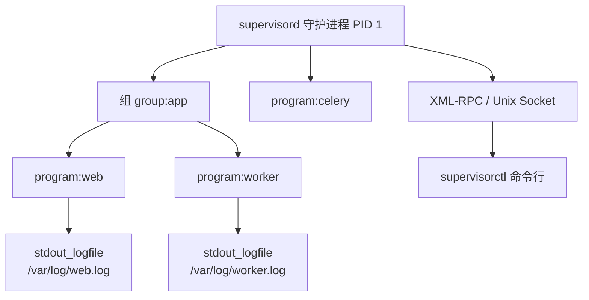

# Supervisor 进程管理实战

适用于 Supervisor 4.2.x（Python 3）。Supervisor 4.0 起不再支持 Python 2；CentOS 7 仓库里的
`python2-supervisor` 是 3.x，配置项写法基本一致，但 `stdout_logfile=AUTO` 等行为有差异。

## 1. 它解决什么问题

`nohup cmd &` 能后台跑，但**进程挂了不会自己起来、没有统一的状态视图、日志到处散落**。
Supervisor 就是一个用 Python 写的进程管理守护进程：把普通程序变成受管服务，
负责自动重启、统一日志、批量启停。

核心定位一句话：**它是"用户态的多进程保姆"，不是 init 系统。**



### 1.1 和 systemd、nohup 的取舍

| 维度 | Supervisor | systemd | nohup / & |
|------|-----------|---------|-----------|
| 自动重启 | ✅ 可配策略与重试次数 | ✅ 更强 | ❌ |
| 日志管理 | ✅ 内置切割（按大小） | ✅ journald（按时间/大小） | ❌ 手动重定向 |
| 进程组批量操作 | ✅ `[group]` | ✅ `slice` / `target` | ❌ |
| 依赖其他服务启动 | ⚠️ 仅 `priority` 排序，无真依赖 | ✅ `After`/`Requires` | ❌ |
| 容器内可用 | ✅ 常作 PID 1 | ❌ 默认不可用 | ✅ 但不管理 |
| 热加载配置 | ✅ `reread` + `update` 不中断 | ⚠️ 需 `daemon-reload` + `restart` | ❌ |
| 资源限制（cgroup） | ❌ | ✅ | ❌ |
| 学习成本 | 低 | 中 | — |

**选择建议**：

- 物理机 / 云主机上的系统服务 → 用 systemd（见 [[systemctl|systemctl 与 systemd 服务管理]]）。
- **Docker 容器里要跑多个进程**、或应用目录固定、需要快速改配置重启的 Python/Node
  项目 → 用 Supervisor。
- 两者**不要叠加**：systemd 管 supervisord、supervisord 再管子进程，重启策略会互相打架，
  故障时排查链路也翻倍。

## 2. 安装与初始化

```bash
# Debian / Ubuntu
sudo apt install -y supervisor

# RHEL / Rocky / Alma
sudo dnf install -y supervisor

# 任意发行版（pip，版本更新）
sudo pip3 install supervisor

# 生成一份带完整注释的配置模板（pip 安装后必须手动生成）
sudo mkdir -p /etc/supervisor/conf.d
echo_supervisord_conf | sudo tee /etc/supervisord.conf > /dev/null
```

发行版包会自动注册服务；pip 安装的**不会**，需要自己写 unit 或用 `supervisord -c` 启动。

```bash
# 发行版包安装后
sudo systemctl enable --now supervisor

# 手动指定配置文件（容器里最常用）
supervisord -c /etc/supervisord.conf -n     # -n = nodaemon，前台运行，容器 PID 1 必须加
```

配置文件查找顺序（不传 `-c` 时依次尝试）：

```text
$CWD/supervisord.conf
$CWD/etc/supervisord.conf
/etc/supervisord.conf
/etc/supervisor/supervisord.conf
../etc/supervisord.conf（相对 Python sys.prefix）
../supervisord.conf
```

## 3. 配置结构

一个典型的生产目录布局：

```text
/etc/
├── supervisord.conf              # 主配置：全局 + 控制接口
└── supervisor/
    ├── conf.d/
    │   ├── order-api.conf        # 每个程序一个文件
    │   ├── celery-worker.conf
    │   └── nginx.conf
    └── supervisord.log
```

主配置 `/etc/supervisord.conf`：

```ini
[unix_http_server]
file=/var/run/supervisor.sock     # supervisorctl 通过这个 socket 通信
chmod=0700                        # 只允许属主访问；改成 0770 时务必同时设 chown

[supervisord]
logfile=/var/log/supervisord.log
logfile_maxbytes=50MB
logfile_backups=10
loglevel=info
pidfile=/var/run/supervisord.pid
nodaemon=false                    # 容器里设为 true（等价于 -n）
minfds=65535                      # 文件句柄上限，高并发必调
minprocs=8192
user=root                         # 降权开关，非 root 启动时生效

[rpcinterface:supervisor]
supervisor.rpcinterface_factory = supervisor.rpcinterface:make_main_rpcinterface

[supervisorctl]
serverurl=unix:///var/run/supervisor.sock

[include]
files = /etc/supervisor/conf.d/*.conf
```

> **`%(here)s` 是你的朋友**：配置里可以用 `%(here)s` 表示"当前这个配置文件所在目录"，
> 写相对日志路径时用它，比硬编码绝对路径更耐迁移。

### 3.1 program 段：核心参数

```ini
[program:order-api]
command=/opt/order-api/venv/bin/gunicorn -w 4 -b 127.0.0.1:8000 app:app
directory=/opt/order-api
user=appuser
autostart=true
autorestart=true
startsecs=5
startretries=3
stopsignal=TERM
stopwaitsecs=30
stopasgroup=true
killasgroup=true
redirect_stderr=true
stdout_logfile=/var/log/order-api/access.log
stdout_logfile_maxbytes=50MB
stdout_logfile_backups=10
stdout_capture_maxbytes=1MB
environment=PYTHONUNBUFFERED="1",PATH="/opt/order-api/venv/bin:%(ENV_PATH)s"
priority=100
```

| 参数 | 默认 | 说明 |
|------|------|------|
| `command` | 必填 | 启动命令。**必须前台运行、不能 daemonize**，否则会被判定为已退出 |
| `directory` | 无 | 工作目录，影响相对路径与 `app.py` 之类的导入 |
| `user` | 无（= supervisord 的用户） | 运行身份，非 root 启动 supervisord 时此项无效 |
| `autostart` | `true` | supervisord 启动时是否自动拉起 |
| `autorestart` | `unexpected` | `false` / `true` / `unexpected`（仅当退出码不在 `exitcodes` 中才重启） |
| `exitcodes` | `0,2` | 视为"正常退出"的退出码，影响 `unexpected` 判定 |
| `startsecs` | `1` | 启动后需存活多少秒才算成功，**短命进程调小或置 0** |
| `startretries` | `3` | 启动失败重试次数，用尽后进入 `FATAL` |
| `stopsignal` | `TERM` | 停止时先发的信号 |
| `stopwaitsecs` | `10` | 等待优雅退出的秒数，超时后 SIGKILL |
| `stopasgroup` | `false` | 停止时给整个进程组发信号，**有 shell 包装或子进程时必须开** |
| `killasgroup` | `false` | 强杀时同样作用于整个进程组 |
| `redirect_stderr` | `false` | 把 stderr 并入 stdout（4.x 推荐做法） |
| `stdout_logfile` | `AUTO` | 日志路径；`AUTO` 仅在 `nodaemon=true` 时可用，`NONE` 表示不记录 |
| `stdout_logfile_maxbytes` | `50MB` | 单文件大小上限，超出即轮转；设 `0` 关闭轮转 |
| `stdout_logfile_backups` | `10` | 保留几个历史文件 |
| `environment` | 无 | 追加/覆盖环境变量，**不会继承登录 shell 的 `PATH`**，这条最容易踩坑 |
| `priority` | `999` | 启停顺序，值小的先启动、后停止 |
| `umask` | 继承 | 进程的 umask |
| `numprocs` | `1` | 起几个副本，配合 `process_name` 使用 |

### 3.2 多实例：numprocs + process_name

```ini
[program:celery-worker]
command=/opt/app/venv/bin/celery -A tasks worker -Q default -c 4
process_name=%(program_name)s_%(process_num)02d
numprocs=4
autostart=true
autorestart=true
stopasgroup=true
killasgroup=true
stdout_logfile=/var/log/celery/worker-%(process_num)02d.log
```

生成四个进程：`celery-worker_00` … `celery-worker_03`，日志也按编号分开。
`supervisorctl restart celery-worker:*` 可一次操作整组。

### 3.3 进程组：一组当整体操作

```ini
[group:order]
programs=order-api,celery-worker
priority=999
```

```bash
supervisorctl restart order:*      # 组内所有进程
supervisorctl status order:*
```

注意两条限制：`[program:x]` 名不能与 `[group:x]` 同名，同一个 program 也只能属于一个组。

## 4. supervisorctl 常用命令

```bash
supervisorctl status                  # 全量状态，最常用
supervisorctl status order-api        # 单程序状态
supervisorctl start order-api
supervisorctl stop order-api
supervisorctl restart order-api
supervisorctl restart order:*         # 整组
supervisorctl signal HUP order-api    # 发任意信号（优雅重载日志等）
supervisorctl pid order-api           # 查主进程 PID
supervisorctl tail -f order-api stdout   # 跟踪 stdout 日志，排障主力
supervisorctl tail order-api stderr
supervisorctl help                    # 交互模式里也能用
```

```bash
# 不带参数进入交互式 shell，连续操作更顺手
supervisorctl
order-api                    RUNNING   pid 1284, uptime 2 days, 3:41:12
> restart order-api
order-api: stopped
order-api: started
> quit
```

```bash
# 连远程 / 指定 socket
supervisorctl -c /etc/supervisord.conf -s unix:///var/run/supervisor.sock status
supervisorctl -s http://127.0.0.1:9001 -u admin -p secret status
```

### 4.1 状态值含义

| 状态 | 含义 | 处理 |
|------|------|------|
| `RUNNING` | 正常在跑 | — |
| `STARTING` | 处于 `startsecs` 观察期 | 观察期过后转 RUNNING |
| `BACKOFF` | 启动后立刻退出，正在按 `startretries` 重试 | 看对应 stderr 日志找崩溃原因 |
| `FATAL` | 重试用尽，放弃启动 | 修配置后 `start`，或 `update` 重新加载 |
| `STOPPING` | 正在等 `stopwaitsecs` | 卡住说明进程不响应 TERM，考虑 `stopasgroup` |
| `STOPPED` | 已停止（`autostart=false` 的初始状态也是这个） | — |
| `EXITED` | 正常结束（一次性任务预期状态） | — |
| `UNKNOWN` | 状态丢失，通常 socket 连不上 supervisord | 检查 supervisord 是否存活 |

## 5. 改配置不重启全局：reread + update

这是 Supervisor 最爽的一点——**加新程序、改参数都不用停掉其他服务**。

```bash
sudo vim /etc/supervisor/conf.d/order-api.conf
supervisorctl reread     # 重新读配置，只报告变化，不执行
supervisorctl update     # 应用变化：新增的启动、删除的停止、修改的重启
```

| 命令 | 作用 |
|------|------|
| `reread` | 扫描配置，把"新增/删除/变更"列出来 |
| `update` | 执行上述变更（不带参数 = `update all`） |
| `update order-api` | 只更新指定程序 |
| `update` 后仍不生效 | 说明改动只涉及 `[supervisord]` 全局段——**必须整体重启** |
| `reload` | 等价于 `shutdown` + 重新启动 supervisord（会中断所有子进程） |

> 修改了 `[supervisord]`、`[unix_http_server]`、`[include]` 这些全局段，
> `reread`/`update` **无效**，只能 `systemctl restart supervisor` 或重启容器。

## 6. 日志管理

Supervisor 只负责**收割子进程的 stdout/stderr** 并按大小轮转，不做格式处理。

```ini
# 单程序：直接写文件 + 轮转
redirect_stderr=true
stdout_logfile=/var/log/app/app.log
stdout_logfile_maxbytes=100MB
stdout_logfile_backups=5
```

三种落盘方式的选择：

| 方式 | 配置 | 适用 |
|------|------|------|
| 写文件（推荐） | `stdout_logfile=/path/x.log` | 需要长期留存、外部采集（filebeat/fluentd） |
| 交给容器 stdout | `stdout_logfile=/dev/stdout` | 容器环境，配合 `docker logs` 与日志驱动 |
| 不记录 | `stdout_logfile=NONE` | 程序自己已写日志文件 |

容器场景的常见写法：

```ini
[program:web]
command=/usr/local/bin/gunicorn -b 0.0.0.0:8000 app:app
redirect_stderr=true
stdout_logfile=/dev/stdout
stdout_logfile_maxbytes=0      # 必须关轮转，否则会截断 stdout
stderr_logfile=/dev/stderr
stderr_logfile_maxbytes=0
```

> **别让程序自己再做一次轮转**。logback / logrotate / Python `RotatingFileHandler` 与
> Supervisor 的 `maxbytes` 同时生效，会出现"日志被删了但句柄还在"导致磁盘不释放。

## 7. 容器里用 Supervisor 作 PID 1

这是 Supervisor 目前最主流的用法：一个镜像里跑 Nginx + 应用 + 定时任务。

```dockerfile
FROM python:3.11-slim

RUN apt-get update && apt-get install -y --no-install-recommends supervisor nginx \
    && rm -rf /var/lib/apt/lists/*

COPY deploy/supervisord.conf /etc/supervisord.conf
COPY deploy/conf.d/ /etc/supervisor/conf.d/
COPY . /app
WORKDIR /app
RUN pip install --no-cache-dir -r requirements.txt

EXPOSE 8000
# nodaemon=true 已在配置里，无需 -n；-c 显式指定配置
CMD ["supervisord", "-c", "/etc/supervisord.conf"]
```

容器版配置要点：

```ini
[supervisord]
nodaemon=true             # PID 1 必须前台，否则容器启动即退出
logfile=/dev/null         # 容器内日志走 stdout，别写文件占空间
logfile_maxbytes=0
pidfile=/var/run/supervisord.pid

[unix_http_server]
file=/var/run/supervisor.sock
chmod=0700

[program:nginx]
command=/usr/sbin/nginx -g "daemon off;"    # nginx 必须 daemon off
autorestart=true
priority=10
stdout_logfile=/dev/stdout
stdout_logfile_maxbytes=0
redirect_stderr=true

[program:web]
command=gunicorn -b 127.0.0.1:8000 app:app
priority=20
autorestart=true
stdout_logfile=/dev/stdout
stdout_logfile_maxbytes=0
redirect_stderr=true
```

三点注意：

1. **信号转发**：supervisord 作为 PID 1 会正确转发 SIGTERM 给子进程，但子进程若在
   `stopwaitsecs` 内不退出就会被 SIGKILL。给业务进程留足优雅退出时间（`stopwaitsecs=30`）。
2. **PID 1 不收尸**：supervisord 会 wait 自己 fork 的子进程，但对"孙子进程"（程序内部再 fork
   的孤儿）处理不如 `tini` 干净。有大量短命子进程时，用 `docker run --init` 或改用 `tini`。
3. **一个进程原则**：能拆成多个容器的就别在一个容器里塞三个服务——Supervisor 只是
   权宜之计，不是容器编排。

## 8. 常见坑与排错

### 8.1 环境变量不继承（最高频）

`supervisord` 由 systemd 或容器启动，**没有你的 `~/.zshrc`、没有 `source venv/bin/activate`、
没有 pyenv/conda 的 PATH**。表现是手动跑正常、supervisor 报 `can't find command`。

```ini
[program:app]
; 方案一：命令写绝对路径（最稳）
command=/opt/app/venv/bin/python /opt/app/main.py

; 方案二：显式补 PATH 与虚拟环境变量
environment=PATH="/opt/app/venv/bin:%(ENV_PATH)s",VIRTUAL_ENV="/opt/app/venv"
```

调试时先确认它眼里的环境：

```bash
supervisorctl tail -f app stderr
# 或临时把 command 换成打印环境
# command=/bin/bash -c "env > /tmp/env.txt; sleep 30"
```

### 8.2 程序 daemonize 了

Nginx、Apache、Gunicorn（默认前台，OK）、部分 Java 启动脚本会 fork 到后台并让父进程退出。
Supervisor 看到父进程退出 → `BACKOFF` → 重试用尽 → `FATAL`。

```bash
# 反例：nginx 默认 daemon on，supervisor 会认为它立刻退出了
command=/usr/sbin/nginx
# 正解
command=/usr/sbin/nginx -g "daemon off;"
```

同理，`command` 里不要加 `&`、不要 `nohup`。

### 8.3 停不干净、残留子进程

Gunicorn/uWSGI/Celery 会派生 worker，只给 master 发 TERM 时 worker 可能变孤儿继续占端口。

```ini
stopasgroup=true
killasgroup=true
stopwaitsecs=30
```

### 8.4 其他高频报错

| 现象 | 原因 | 处理 |
|------|------|------|
| `ERROR (spawn error)` | command 不存在 / 无执行权限 / 依赖缺失 | 用 `supervisorctl tail x stderr` 看真实错误；`ls -l` 查权限 |
| `BACKOFF (process exited with status 1)` | 程序启动即崩 | 手动以同用户同目录执行 `command` 复现 |
| `FATAL (too many start retries too quickly)` | 重试用尽 | 修根因后 `start`；临时调大 `startretries` |
| `unix:///var/run/supervisor.sock no such file` | supervisord 未启动，或 socket 路径不一致 | `ps -ef \| grep supervisord`；核对 `[unix_http_server] file` 与 `serverurl` |
| `[Errno 13] Permission denied`（连 socket 时） | socket 权限 `0700` 与当前用户属主不匹配 | `chmod 0770` 并 `chown` 给运维用户 |
| `reread` 没检测到新文件 | `[include] files` 路径写错 / 无读权限 | `supervisorctl reread` 看输出；确认 glob 能匹配 |
| 改了配置 `update` 无反应 | 改的是 `[supervisord]` 全局段 | 整体重启 |
| 启动容器秒退 | 忘了 `nodaemon=true` | 容器里必须前台 |
| 日志文件不增长 | `stdout_logfile=AUTO` 但非 nodaemon，或 `NONE` | 显式指定路径 |
| `supervisorctl` 卡住无响应 | supervisord 进程被 SIGSTOP / 磁盘满 | `ps -o stat -p <pid>` 看状态；查磁盘 |
| 时间/时区不对 | 容器或 supervisord 环境无 `TZ` | `environment=TZ="Asia/Shanghai"` |
| 程序读到空配置 | `directory` 不对，相对路径失效 | 显式设 `directory=` |

```bash
# 一套通用排查顺序
supervisorctl status                      # 1. 看状态：BACKOFF/FATAL/ERROR
supervisorctl tail -100 app stderr        # 2. 看程序自己的报错
tail -50 /var/log/supervisord.log         # 3. 看 supervisord 的 spawn 记录
sudo -u appuser bash -lc 'cd /opt/app && <你的 command>'  # 4. 换用户手动复现
```

## 9. 生产实践建议

- **配置文件按程序拆分**，放 `conf.d/`，别塞进一个 800 行的主配置；改一个服务不碰其他。
- **命令一律用绝对路径**（解释器、venv、脚本），减少环境差异导致的 `spawn error`。
- **一定要配 `stopasgroup`/`killasgroup`**，尤其是 gunicorn、celery、node 集群模式。
- **`startsecs` 按真实冷启动时间调**：JVM 项目 5-10 秒，Python/Node 1-3 秒，一次性脚本设 `0`。
- **敏感环境变量不要写进配置文件**：`environment=` 会出现在 `ps` 与配置里，改用
  `command=/bin/bash -c 'source /etc/app/env && exec ...'`，或直接用容器 secret。
- **`[inet_http_server]` 默认不要开**：它在 9001 端口暴露无认证的 Web 控制台
  （`http://host:9001`），要用必须配 `username`/`password` 并限制监听地址为 `127.0.0.1`。
- **配合 systemd 只在一处**：Linux 主机用 systemd 直接管业务进程；确实需要 Supervisor
  （如需它的热加载与统一日志）时，只让 systemd 管 `supervisord` 一个进程。
- **监控**：Supervisor 自身不做告警，`supervisorctl status` 的输出要接给监控系统
  （简单做法：`supervisorctl status | grep -v RUNNING` 非空即告警）。

## 10. 速查表

| 目的 | 命令 |
|------|------|
| 看全部状态 | `supervisorctl status` |
| 只启动一个 | `supervisorctl start app` |
| 重启整组 | `supervisorctl restart order:*` |
| 改配置后生效 | `supervisorctl reread && supervisorctl update` |
| 跟踪日志 | `supervisorctl tail -f app stdout` |
| 发信号（重开日志） | `supervisorctl signal USR1 app` |
| 查 PID | `supervisorctl pid app` |
| 重载全部（会中断） | `supervisorctl reload` |
| 关闭 supervisord | `supervisorctl shutdown` |
| 前台调试启动 | `supervisord -c /etc/supervisord.conf -n` |
| 生成配置模板 | `echo_supervisord_conf > /etc/supervisord.conf` |

## 相关笔记

- [[systemctl|systemctl 与 systemd 服务管理]] — 主机场景的正统方案，两者别叠加
- [[process-management|进程管理]] — `ps`/`top`/`kill`，排查 BACKOFF 前后的进程状态
- [[docker|Docker 笔记]] — 容器内 PID 1、日志驱动与 `--init` 的关系
- [[nginx|Nginx 笔记]] — `daemon off;` 是容器 + Supervisor 组合的前提
- [[netstat-ss-command|netstat 与 ss]] — 进程反复重启时确认端口占用与释放情况

## 参考

- [Supervisor 官方文档](http://supervisord.org/)
- [配置文件全部参数说明](http://supervisord.org/configuration.html)
- [supervisorctl 命令手册](http://supervisord.org/running.html)
- [Supervisor GitHub](https://github.com/Supervisor/supervisor)
