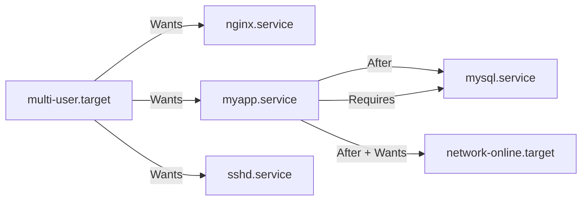

# systemctl 与 systemd 服务管理

适用于 systemd 245+（CentOS 8+/Rocky 8+/Ubuntu 20.04+/Debian 11+）。
老系统（CentOS 6 及以前）用的是 SysV init 与 `service`、`chkconfig`，命令不通用。

## 1. 先搞清楚三个概念

| 概念 | 说明 | 举例 |
|------|------|------|
| **systemd** | PID 1 进程，系统与服务管理器，负责开机引导、服务拉起、日志收集 | 内核启动后第一个用户态进程 |
| **unit（单元）** | systemd 管理的最小对象，用 `.service`、`.timer`、`.mount` 等后缀区分类型 | `nginx.service` |
| **target（目标）** | 一组 unit 的集合，相当于"运行级别" | `multi-user.target` ≈ runlevel 3 |

历史上 `chkconfig` 管服务、`init` 管运行级别，现在统一收敛到 `systemctl`：
**管服务、管开机自启、管运行级别、管日志（配合 `journalctl`）全靠它**。

### 1.1 unit 类型

| 后缀 | 用途 |
|------|------|
| `.service` | 后台服务（最常用） |
| `.socket` | socket 激活，有连接才拉起对应服务 |
| `.timer` | 定时任务，替代 cron |
| `.target` | 单元组 / 运行级别 |
| `.mount` / `.automount` | 挂载点 |
| `.path` | 监控文件或目录变化 |
| `.slice` | 资源控制分组（配合 cgroup） |
| `.device` | 硬件设备（由 udev 自动生成） |

### 1.2 unit 文件存放在哪

| 路径 | 优先级 | 说明 |
|------|--------|------|
| `/etc/systemd/system/` | 最高 | 管理员自定义，**自己写的服务放这里** |
| `/run/systemd/system/` | 中 | 运行时生成，重启丢失 |
| `/usr/lib/systemd/system/`（= `/lib/systemd/system/`） | 最低 | 软件包安装的原始文件，**不要直接改** |

同名 unit 高优先级覆盖低优先级。修改软件包自带的服务，正确做法是用 `systemctl edit`
写 drop-in（见 [6.2](#62-用-drop-in-覆盖而不是改原文件)），而不是编辑 `/usr/lib`
下的文件——否则包升级会覆盖你的修改。

```bash
# 查某个 unit 到底用的是哪个文件
systemctl cat nginx.service

# 列出所有已安装的 unit 文件及其开机自启状态
systemctl list-unit-files --type=service

# 只列出正在运行的服务
systemctl list-units --type=service --state=running
```

## 2. 服务生命周期：最常用的 10 条命令

| 操作 | 命令 |
|------|------|
| 启动 | `systemctl start nginx` |
| 停止 | `systemctl stop nginx` |
| 重启 | `systemctl restart nginx` |
| 重载配置（不中断连接） | `systemctl reload nginx` |
| 状态（最常用） | `systemctl status nginx` |
| 开机自启 | `systemctl enable nginx` |
| 取消开机自启 | `systemctl disable nginx` |
| 立即启动并设自启 | `systemctl enable --now nginx` |
| 是否自启 | `systemctl is-enabled nginx` |
| 是否运行 | `systemctl is-active nginx` |

```bash
# 部署后一条命令搞定"启动 + 开机自启"
sudo systemctl enable --now myapp.service

# reload 只在 unit 里定义了 ExecReload 时才可用；没有就退化成 restart
sudo systemctl reload nginx

# 健康检查：返回码 0=运行中 / 3=未运行 / 4=无此 unit
systemctl is-active --quiet myapp.service && echo "OK" || echo "DOWN"
```

> **注意**：`enable` 只影响开机自启，不会启动服务；`start` 只启动当前，不影响开机。
> 这两个是正交的，也是新手最常见的误解。

### 2.1 三种"禁用"的区别

| 命令 | 效果 | 适用场景 |
|------|------|----------|
| `systemctl stop` | 当前停止，下次开机仍会自启 | 临时停一下 |
| `systemctl disable` | 取消自启，但还能被其他服务依赖拉起 | 暂时不用某服务 |
| `systemctl mask` | 软链到 `/dev/null`，**谁都无法启动** | 明确禁止（如禁用 firewalld 换 iptables） |

```bash
# 彻底封死，连依赖它的服务也拉不起来
sudo systemctl mask firewalld
sudo systemctl unmask firewalld   # 撤销
```

被 mask 的服务启动会报 `Unit firewalld.service is masked`，这是设计如此。

## 3. status 输出怎么读

```bash
$ systemctl status nginx
● nginx.service - A high performance web server and a reverse proxy server
     Loaded: loaded (/lib/systemd/system/nginx.service; enabled; preset: enabled)
     Active: active (running) since Thu 2026-11-19 10:12:03 CST; 2h 41min ago
       Docs: man:nginx(8)
   Main PID: 1284 (nginx)
      Tasks: 5 (limit: 4915)
     Memory: 8.9M
        CPU: 1.204s
     CGroup: /system.slice/nginx.service
             ├─1284 "nginx: master process /usr/sbin/nginx -g daemon on; master_process on;"
             └─1286 "nginx: worker process"

Nov 19 10:12:03 web01 systemd[1]: Starting A high performance web server...
Nov 19 10:12:03 web01 nginx[1284]: nginx: configuration file /etc/nginx/nginx.conf test is successful
```

| 字段 | 含义 | 排查要点 |
|------|------|----------|
| `Loaded` | unit 文件路径 + 自启状态 + preset | `not-found` = 文件不存在或没 `daemon-reload` |
| `Active` | 当前状态 + 启动时间 | `failed` / `activating (auto-restart)` 要往下看日志 |
| `Main PID` | 主进程 PID | 空或 `(code=exited)` 说明进程已退出 |
| `Tasks` / `Memory` / `CPU` | cgroup 统计的资源占用 | 内存异常增长 → 查泄漏 |
| `CGroup` | 该服务下所有进程 | 能看到子进程，比 `ps` 更聚焦 |
| 末尾日志 | 最近 10 行 | 真正的报错通常在这里 |

关键状态值：

| Active 值 | 含义 |
|-----------|------|
| `active (running)` | 正常运行 |
| `active (exited)` | 一次性任务执行完正常退出（`Type=oneshot` 常见） |
| `inactive (dead)` | 未运行 |
| `failed` | 启动失败或运行中崩溃 |
| `activating (auto-restart)` | 正在按 `Restart=` 策略重试 |
| `reloading` | 正在执行 reload |

## 4. 自己写一个 service 单元

### 4.1 最小可用模板

```ini
# /etc/systemd/system/myapp.service
[Unit]
Description=My App Service
Documentation=https://example.com/docs
# 网络真正就绪后再启动（不要用 network.target，那个不代表网卡可用）
After=network-online.target
Wants=network-online.target

[Service]
Type=simple
User=appuser
Group=appuser
WorkingDirectory=/opt/myapp
Environment="JAVA_OPTS=-Xms512m -Xmx512m"
# ExecStart 不经过 shell，需要用 shell 特性时必须显式调 bash -c
ExecStart=/usr/bin/java $JAVA_OPTS -jar /opt/myapp/app.jar --spring.profiles.active=prod
ExecReload=/bin/kill -HUP $MAINPID
Restart=on-failure
RestartSec=5s
StandardOutput=journal
StandardError=journal
SyslogIdentifier=myapp

[Install]
WantedBy=multi-user.target
```

写完必须执行：

```bash
sudo systemctl daemon-reload      # 不执行则 systemd 看不到新文件/改动
sudo systemctl enable --now myapp
sudo systemctl status myapp
```

> `ExecStart` 里的 `$JAVA_OPTS` 由 systemd 自己展开（不是 shell），支持 `${VAR}` 与 `$VAR`；
> 但管道、重定向、`&&` 这些语法**必须**写成 `ExecStart=/bin/bash -c '...'`。

### 4.2 [Unit] 段常用指令

| 指令 | 作用 |
|------|------|
| `Description` | 人类可读描述，`systemctl status` 与 `list-units` 显示 |
| `After=` | 仅排序：在本 unit 之后启动，**不产生依赖** |
| `Before=` | 仅排序：在本 unit 之前启动 |
| `Wants=` | 弱依赖：对方失败不影响自己 |
| `Requires=` | 强依赖：对方失败/停止，自己也停止 |
| `Conflicts=` | 互斥：启动本 unit 会停掉对方 |
| `ConditionPathExists=` | 条件启动，路径不存在则跳过（不报 failed） |
| `StartLimitIntervalSec=` / `StartLimitBurst=` | 启动频率限制（systemd 230+ 在此段），默认 10 秒内 5 次 |

**排序 ≠ 依赖**：`After=mysql.service` 只保证顺序，MySQL 挂了你的服务照样起。
要强依赖得同时写 `Requires=`。

### 4.3 [Service] 段常用指令

| 指令 | 说明 |
|------|------|
| `Type=` | 启动类型，见下表 |
| `ExecStart` | 启动命令，**必须是绝对路径**；只能有一个（除非 `Type=oneshot`） |
| `ExecStop` | 停止命令，缺省时 systemd 直接发 SIGTERM |
| `ExecReload` | reload 命令，缺省则 `reload` 不可用 |
| `User` / `Group` | 运行身份，**强烈建议不要用 root** |
| `WorkingDirectory` | 工作目录，影响相对路径 |
| `Environment` / `EnvironmentFile` | 环境变量；后者适合存放密钥（`-` 前缀表示文件不存在也不报错） |
| `Restart` | `no`（默认）/ `on-failure` / `always` / `on-abnormal` |
| `RestartSec` | 重启前等待秒数，避免疯狂重试打满日志 |
| `TimeoutStopSec` | 停止超时，超时后发 SIGKILL |
| `KillSignal` / `KillMode` | 信号与杀进程范围；`KillMode=mixed` 先 TERM 主进程再 KILL 组 |
| `LimitNOFILE` | 文件句柄上限，高并发服务必调（默认可能只有 1024） |
| `StandardOutput=journal` | 输出进 journald，用 `journalctl` 查 |

### 4.4 Type 怎么选（最容易踩坑）

| Type | 行为 | 典型场景 |
|------|------|----------|
| `simple`（默认） | 执行 `ExecStart` 即认为启动成功，**不检查进程是否真的可用** | 前台常驻进程：Java、Go、Node、Python |
| `exec` | 等 `execve()` 成功才算启动 | 比 `simple` 更准，推荐的默认选择 |
| `forking` | 进程自己 fork 到后台，父进程退出才算启动 | 传统守护进程（nginx、sshd）；需配 `PIDFile=` |
| `notify` | 等进程 `sd_notify()` 发 READY=1 | 支持 systemd 集成的程序（如 Gunicorn `--enable-stdio-inheritance`） |
| `oneshot` | 执行完退出才算完成，可配 `RemainAfterExit=yes` 保持 active | 初始化脚本、挂载、一次性任务 |
| `idle` | 等其他任务都空闲了再执行 | 控制台输出类任务 |

常见误区：Spring Boot / Node / Python 这类前台进程用 `simple` 或 `exec`（**不要**用
`forking`），程序自己不要 `daemonize`、不要 `&`，否则 systemd 认为主进程已退出，
会被判为 failed 并反复重启。

### 4.5 [Install] 段

| 指令 | 作用 |
|------|------|
| `WantedBy=multi-user.target` | 挂到多用户 target，`enable` 时在 `multi-user.target.wants/` 建软链 |
| `RequiredBy=` | 强依赖挂载 |
| `Alias=` | 给 unit 起别名 |

没有 `[Install]` 段的服务 `enable` 会报 "The unit files have no installation config"，只能手动建软链：

```bash
sudo ln -s /etc/systemd/system/myapp.service /etc/systemd/system/multi-user.target.wants/myapp.service
```

## 5. 依赖与 target



```bash
# 看某个 unit 依赖谁、被谁依赖
systemctl list-dependencies myapp.service
systemctl list-dependencies --reverse myapp.service

# 查看当前默认运行级别
systemctl get-default                 # 通常是 multi-user.target 或 graphical.target
sudo systemctl set-default multi-user.target   # 服务器不需要图形界面时省内存

# 切到救援模式（单用户）
sudo systemctl isolate rescue.target
```

| target | 对应旧 runlevel | 说明 |
|--------|-----------------|------|
| `poweroff.target` | 0 | 关机 |
| `rescue.target` | 1 | 单用户，只挂根分区 |
| `multi-user.target` | 3 | 多用户无图形（服务器标配） |
| `graphical.target` | 5 | 图形界面 |
| `reboot.target` | 6 | 重启 |

## 6. 修改 unit 的两种正确姿势

### 6.1 新建 vs 覆盖

- **自己的服务**：直接写 `/etc/systemd/system/xxx.service`。
- **软件包自带的服务**：不要改 `/usr/lib/systemd/system/xxx.service`，用 drop-in。

### 6.2 用 drop-in 覆盖，而不是改原文件

```bash
# 打开编辑器，自动创建 /etc/systemd/system/nginx.service.d/override.conf
sudo systemctl edit nginx

# 如果要基于原文件全文修改（少见，容易跟丢上游更新）
sudo systemctl edit --full nginx
```

```ini
# /etc/systemd/system/nginx.service.d/override.conf
# 只写要覆盖的项；想清空某个列表型指令要先置空
[Service]
LimitNOFILE=65535
Restart=always
RestartSec=3

# 列表型指令（ExecStart、Environment 等）追加时用空值重置
[Service]
ExecStart=
ExecStart=/usr/sbin/nginx -g 'daemon on; master_process on;'
```

改完照例 `daemon-reload` + `restart`。`systemctl cat nginx` 会把主文件和所有 drop-in
一起列出来，方便确认最终生效内容。

## 7. 日志：journalctl

systemd 服务默认把 stdout/stderr 交给 journald，别再自己 `> app.log 2>&1`。

| 场景 | 命令 |
|------|------|
| 实时跟踪某服务 | `journalctl -u myapp -f` |
| 最近 200 行 | `journalctl -u myapp -n 200 --no-pager` |
| 只看错误级别 | `journalctl -u myapp -p err -b` |
| 本次开机以来 | `journalctl -u myapp -b` |
| 时间范围 | `journalctl -u myapp --since "2026-11-19 10:00" --until "2026-11-19 12:00"` |
| 关键字过滤 | `journalctl -u myapp --grep "OutOfMemory"` |
| 只输出消息正文 | `journalctl -u myapp -o cat` |
| 磁盘占用 | `journalctl --disk-usage` |
| 清理到 500M | `sudo journalctl --vacuum-size=500M` |

```bash
# 典型排障组合：看服务最近一次启动至今的全部日志，且只要错误
journalctl -u myapp -b -p warning --no-pager | tail -50
```

限制 journal 占用（编辑 `/etc/systemd/journald.conf`）：

```ini
[Journal]
SystemMaxUse=1G
SystemMaxFileSize=100M
MaxRetentionSec=2week
```

```bash
sudo systemctl restart systemd-journald
```

## 8. 定时任务：用 timer 替代 cron

`timer` 与 `service` 成对出现，优势是有日志、能查状态、支持 `Persistent`
（关机错过的任务开机补跑）。

```ini
# /etc/systemd/system/backup.service —— 只定义"做什么"
[Unit]
Description=Nightly database backup

[Service]
Type=oneshot
User=backup
ExecStart=/opt/scripts/backup-db.sh
```

```ini
# /etc/systemd/system/backup.timer —— 只定义"什么时候做"
[Unit]
Description=Run database backup every night

[Timer]
OnCalendar=*-*-* 02:30:00
RandomizedDelaySec=300
Persistent=true
Unit=backup.service

[Install]
WantedBy=timers.target
```

```bash
sudo systemctl daemon-reload
sudo systemctl enable --now backup.timer

systemctl list-timers --all          # 查看下次触发时间
systemctl start backup.service       # 手动跑一次验证
journalctl -u backup -n 50
```

`OnCalendar` 快速对照：

| 表达式 | 含义 |
|--------|------|
| `daily` | 每天 00:00 |
| `*-*-* 02:30:00` | 每天 02:30 |
| `Mon *-*-* 09:00:00` | 每周一 09:00 |
| `*-*-01 04:00:00` | 每月 1 号 04:00 |
| `*:0/15` | 每 15 分钟 |

## 9. 生产实战：托管 Spring Boot 服务

```ini
# /etc/systemd/system/order-api.service
[Unit]
Description=Order API (Spring Boot)
After=network-online.target redis.service
Wants=network-online.target
# 大 JVM 冷启动慢，关掉启动频率限制（该指令属于 [Unit] 段）
StartLimitIntervalSec=0

[Service]
Type=exec
User=appuser
Group=appuser
WorkingDirectory=/opt/order-api

# 敏感配置放独立文件，权限 600，不进 git
EnvironmentFile=/etc/order-api/env
Environment="SPRING_PROFILES_ACTIVE=prod"
Environment="JAVA_OPTS=-XX:MaxRAMPercentage=75 -XX:+UseG1GC -Duser.timezone=Asia/Shanghai"

ExecStart=/usr/bin/java $JAVA_OPTS -jar /opt/order-api/order-api.jar
ExecStop=/bin/kill -TERM $MAINPID
SuccessExitStatus=143

# 高并发必备：句柄数与进程数上限
LimitNOFILE=65535
LimitNPROC=8192

Restart=on-failure
RestartSec=10
TimeoutStopSec=30

# 安全加固（可选，按需开启）
NoNewPrivileges=true
PrivateTmp=true
ProtectSystem=full
ProtectHome=true

[Install]
WantedBy=multi-user.target
```

```bash
# 部署流程（可放进 CI 脚本）
sudo install -m 644 order-api.service /etc/systemd/system/
sudo systemctl daemon-reload
sudo systemctl enable order-api
sudo systemctl restart order-api
sleep 15 && systemctl is-active --quiet order-api || { journalctl -u order-api -n 100 --no-pager; exit 1; }
```

几个关键点：

- `SuccessExitStatus=143`：Spring Boot 收到 SIGTERM 后以 143 退出（128+15），
  不加这行 `stop` 会被记为 failed，触发 `Restart=on-failure` 变成"停不下来"。
- `-XX:MaxRAMPercentage` 代替固定 `-Xmx`，容器/机型变更时不用改 unit。
- 日志用 logback 写文件做滚动，或直接 `StandardOutput=journal` 交给 journald 统一收集，
  **不要**再写 `nohup.out`。

## 10. 排错对照表

| 现象 | 原因 | 处理 |
|------|------|------|
| `Unit xxx.service not found` | 文件不在搜索路径，或没 `daemon-reload` | 确认路径为 `/etc/systemd/system/`，执行 `systemctl daemon-reload` |
| `Unit xxx.service is masked` | 被 mask 到 `/dev/null` | `systemctl unmask xxx` |
| `Job for xxx failed because the control process exited with error code` | 进程启动即失败 | `journalctl -u xxx -n 100` 看真实报错；手动以同用户跑一遍 `ExecStart` |
| `status=203/EXEC` | 路径错、无执行权限、shebang 有问题 | `ls -l` 查权限，脚本首行加 `#!/bin/bash` |
| `status=200/CHDIR` | `WorkingDirectory` 不存在 | 建目录或修正路径 |
| `status=217/USER` | `User=` 指定的用户不存在 | `useradd` 或改用已有用户 |
| `status=226/NAMESPACE` | 沙箱/权限限制（常出现在容器内） | 去掉 `Protect*`/`PrivateTmp` 等加固项 |
| `start request repeated too quickly` | 反复重启触发 rate limit | 看日志找根因；必要时调 `RestartSec` / `StartLimitBurst` |
| 改了 unit 但行为没变 | 只改文件没 reload，或只 reload 没 restart | `daemon-reload` → `restart` |
| `enable` 报 no installation config | 缺 `[Install]` 段 | 补 `WantedBy=multi-user.target` |
| 服务启动后端口不通 | 程序绑定 `127.0.0.1`，或启动慢但 `Type=simple` 已报成功 | 改监听地址；换 `Type=exec` 并加健康检查 |
| 手动能跑，systemd 跑不了 | 环境变量/工作目录/用户不同 | 用 `Environment=` 补齐；`systemd-run --uid=...` 复现 |
| `reload` 无效 | unit 没定义 `ExecReload` | 补 `ExecReload=`，或改用 `restart` |
| 日志里 `Failed to ...: Permission denied` | 文件属主/SELinux | `chown` 修正；`ausearch -m avc -ts recent` 查 SELinux 拒绝 |

```bash
# 复现 systemd 的执行环境（排查"手动能跑、服务不行"的利器）
sudo systemd-run --uid=appuser --gid=appuser --working-directory=/opt/myapp -t /bin/bash -lc 'env; ./start.sh'
```

## 11. 速查表

| 目的 | 命令 |
|------|------|
| 看所有运行中的服务 | `systemctl list-units --type=service --state=running` |
| 看所有失败的服务 | `systemctl --failed` |
| 看 unit 最终配置 | `systemctl cat xxx` |
| 看 unit 全部属性 | `systemctl show xxx` / `systemctl show -p FragmentPath xxx` |
| 重载 unit 定义 | `systemctl daemon-reload` |
| 查某端口被哪个服务占 | `sudo ss -lntp \| grep 8080` → 再用 `systemctl status <pid>` 反查 |
| 查服务属于哪个 unit | `systemctl status <PID>` 或 `cat /proc/<PID>/cgroup` |
| 临时改 unit（重启丢） | `systemctl edit --runtime xxx` |
| 开机耗时分析 | `systemd-analyze blame` / `systemd-analyze critical-chain` |
| 重载 systemd 自身（极少数场景） | `systemctl daemon-reexec` |

## 12. 与容器的关系

- Docker 容器里 systemd 通常**不是** PID 1，`systemctl` 会报
  `System has not been booted with systemd as init system`。容器内用 `supervisord`、
  `tini` 或直接前台运行主进程，不该套 systemd。
- 需要用 systemd 管容器时，正确姿势是 `docker run --restart=always` 或 k8s 的
  `restartPolicy`，而不是写 `ExecStart=/usr/bin/docker run ...`
  （容器生命周期与 unit 绑定后，两套重启策略会互相打架）。
- 只想要"开机拉一个容器"的简单场景，可以用 `podman generate systemd`
  （Podman 4.x 后用 Quadlet）生成规范的 unit。

## 相关笔记

- [[process-management|进程管理]] — `ps`/`top`/`kill`，理解 systemd 管的进程在系统里的位置
- [[supervisord|Supervisor 进程管理]] — 容器内多进程托管的替代方案，与 systemd 的分工边界
- [[fhs-directory-layout|FHS 目录配置]] — `/etc`、`/usr/lib`、`/var/log` 的分工
- [[file-permissions|文件权限管理]] — unit 文件与 `EnvironmentFile` 的权限要求
- [[netstat-ss-command|netstat 与 ss]] — 服务起来了但端口不通时怎么查
- [[docker|Docker 笔记]] — 容器场景为什么不建议套 systemd

## 参考

- [systemd.service 官方手册](https://www.freedesktop.org/software/systemd/man/latest/systemd.service.html)
- [systemctl 手册](https://www.freedesktop.org/software/systemd/man/latest/systemctl.html)
- [journalctl 手册](https://www.freedesktop.org/software/systemd/man/latest/journalctl.html)
- [systemd.time — OnCalendar 语法](https://www.freedesktop.org/software/systemd/man/latest/systemd.time.html)
