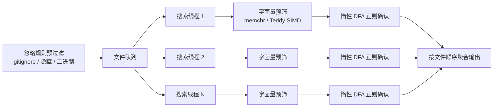

# ripgrep 技术文档

`ripgrep`（命令名 `rg`）是 Andrew Gallant（BurntSushi）用 Rust 写的**递归正则搜索工具**，定位是 grep 的现代替代品：
默认递归搜索当前目录，自动遵守 `.gitignore`、跳过隐藏文件与二进制文件，配合无回溯的正则引擎与多线程并行，
在大仓库里的搜索速度常年稳居第一梯队。VS Code 的搜索内核、fzf 的默认命令、大量 AI 编程工具的检索底座都是它。

- [ripgrep 仓库与 README](https://github.com/BurntSushi/ripgrep)
- [rg 完整命令行指南 GUIDE.md](https://github.com/BurntSushi/ripgrep/blob/master/GUIDE.md)
- [FAQ：为什么我搜不到某个文件](https://github.com/BurntSushi/ripgrep/blob/master/FAQ.md)
- [作者的性能对比博客](https://blog.burntsushi.net/ripgrep-first-look/)

> 本文示例输出均在 `ripgrep 14.1.1 + PCRE2`（Apple Silicon）上实际运行验证；
> 涉及 16.0 新特性的位置会单独标注「16.0+」。当前最新版为 2026-11-22 发布的 16.0.0，见[版本演进](#2-安装与版本)。

## 目录

1. [定位与核心特性](#1-定位与核心特性)
2. [安装与版本](#2-安装与版本)
3. [为什么这么快](#3-为什么这么快)
4. [命令语法与默认行为](#4-命令语法与默认行为)
5. [常用选项速查](#5-常用选项速查)
6. [正则表达式](#6-正则表达式)
7. [文件过滤](#7-文件过滤)
8. [输出控制与上下文](#8-输出控制与上下文)
9. [统计与文件列表](#9-统计与文件列表)
10. [多行与压缩搜索](#10-多行与压缩搜索)
11. [替换与批量处理](#11-替换与批量处理)
12. [配置文件与别名](#12-配置文件与别名)
13. [退出码与脚本集成](#13-退出码与脚本集成)
14. [与其他搜索工具的对比](#14-与其他搜索工具的对比)
15. [常见坑与排错](#15-常见坑与排错)
16. [典型场景实战](#16-典型场景实战)
17. [参考资料](#17-参考资料)

---

## 1. 定位与核心特性

一句话：`rg 模式 [路径]`，递归搜索 + 默认过滤 + Rust 全速。四个核心卖点：

| 特性 | 说明 |
|------|------|
| 快 | 有限自动机正则引擎（无回溯、最坏线性时间）+ SIMD 字面量预筛 + 多线程并行 |
| 省心 | 默认递归、默认遵守 `.gitignore`、自动跳过隐藏文件与二进制文件 |
| Unicode 友好 | `\w` 天然匹配中文、UTF-16 BOM 自动识别、`\p{Han}` 等属性类可用 |
| 生态通用 | VS Code / fzf / 大量 AI 命令行工具的内置搜索底座 |

对 grep 用户来说，最大的心智转变是：**grep 需要你显式告诉它"搜什么、搜哪里、排除什么"，
rg 默认把这些都做对了**——代价是你得先知道它默认忽略了什么（见第 15 节的坑）。

---

## 2. 安装与版本

```bash
# macOS（Apple Silicon 安装在 /opt/homebrew/bin/rg，Intel 在 /usr/local/bin/rg）
brew install ripgrep

# Debian / Ubuntu（发行版仓库版本可能落后较多）
sudo apt install ripgrep

# 从源码构建（默认不含 PCRE2，需要 -P 前后视时必须加 --features pcre2）
cargo install ripgrep --features pcre2

# Windows
scoop install ripgrep        # 或 winget install BurntSushi.ripgrep.MSVC
```

查看版本信息，重点看两行：

```bash
$ rg --version
ripgrep 14.1.1 (rev 4649aa9700)
features:+pcre2
simd(compile):+NEON
simd(runtime):+NEON
```

- `features:+pcre2`：该构建支持 `-P`（PCRE2 引擎）。没有这行，用 `-P` 会直接报错（见第 15 节）。
- `simd(compile/runtime)`：SIMD 加速是否编入、CPU 是否实际启用。Apple Silicon 上是 NEON，x86 上是 SSE/AVX2。

### 版本演进

| 版本 | 时间 | 关键变化 |
|------|------|----------|
| 14.x | 2023 ~ 2024 | 长期稳定的成熟版本（本文验证环境为 14.1.1） |
| 15.x | 2025 ~ 2026 | 修复多组 `.gitignore` 匹配 bug（含父目录规则）；Jujutsu（`.jj`）目录按 git 仓库对待；glob 支持嵌套花括号；`-r` 可与 `--json` 连用 |
| 16.0 | 2026-11-22 | `--in`/`--in0` 读路径清单；`-G` 显式否定 glob；`RIPGREP_THREADS`；`--max-bytes`；POSIX 字符类；压缩文件按魔数识别 |

---

## 3. 为什么这么快

### 3.1 第一原因其实是「少干活」

真实大仓库的体积大头往往是被忽略的东西（`node_modules/`、构建产物、`.git/`）。
rg 默认遵守 `.gitignore`、跳过隐藏文件、对二进制文件探测到 NUL 字节即放弃，
等于在遍历阶段就免掉了绝大部分 IO。"搜得快"的一半功劳来自"根本不搜"。详见第 7 节。

### 3.2 并行遍历与并行搜索

目录遍历用的 `ignore` crate 是并行 walker，每个文件的搜索也是独立任务在线程间分发。
默认线程数由启发式决定（基本等于 CPU 核数），`-j/--threads` 可以限制，
16.0 起还支持环境变量 `RIPGREP_THREADS` 设置默认值（命令行 `-j` 优先级更高）。

### 3.3 无回溯的有限自动机引擎

默认正则引擎是 Rust 的 `regex` crate：有限自动机（NFA 模拟 + 惰性 DFA），
**没有灾难性回溯**，任何模式、任何输入都是最坏线性时间；匹配语义是 leftmost-first，
与常用回溯引擎（PCRE）的日常结果一致。代价是引擎层面不支持前后视和反向引用（见 6.3 节用 `-P` 补位）。

### 3.4 字面量预筛 + SIMD

真实代码搜索的正则几乎都含字面量子串（比如 `rg 'TODO: ' src/`，模式里 `TODO:` 冒号加尾随空格就是现成的字面量）。
rg 会先抽取字面量前缀/子串，用 `memchr`、SIMD 加速的多模式子串算法做一遍粗筛，
绝大多数行到不了正则引擎就被淘汰——相当于先用"grep -F 的速度"排空，再用 DFA 精确确认。
x86_64 平台是 Teddy 算法（SSSE3/SSE4.2/AVX2），ARM 上是 NEON。

### 3.5 IO 策略

显式指定单个文件搜索时按启发式决定是否走 mmap（`--no-mmap` 可强制关闭）；
stdin / 管道输入永远流式读取。



> **记忆要点**：rg 的快不是单点黑科技，而是「能不读的文件不读、能用便宜算法先用、
> 能并行绝不串行、正则引擎零回溯」的组合拳。

---

## 4. 命令语法与默认行为

```text
rg [选项] <PATTERN> [路径...]
```

```bash
rg 'TODO'                    # 递归搜索当前目录
rg 'TODO' src/ docs/         # 多个路径一起搜
rg 'ERROR' app.py            # 单个文件
rg -S 'error' -t py          # 智能大小写 + 只搜 .py
```

### 4.1 新手必须先懂的默认行为

与 grep 最大的差异是 rg 默认做了三件事（对应三连铁律，全部可以通过选项放开）：

| 默认行为 | 含义 | 放开方式 |
|----------|------|----------|
| 遵守 `.gitignore` 等 | 忽略规则内的文件根本不进入搜索队列 | `--no-ignore`（即 `-u`） |
| 跳过隐藏文件 | `.` 开头的文件与目录不搜 | `--hidden`（或 `-uu`） |
| 跳过二进制文件 | 检测到 NUL 字节即判定为二进制并放弃 | `-a/--text`（或 `-uuu`） |

实测样例目录包含：`src/app.py`、`docs/notes.md`、被忽略的 `tmp/cache.log`、
隐藏文件 `.hidden.txt`、二进制文件 `blob.bin`、压缩文件 `logs.gz`：

```bash
$ rg -n 'TODO'    # 三类"看不见"的文件全被过滤，只命中 app.py
src/app.py:3:# TODO: 抽成独立模块
src/app.py:12:        # TODO: retry
```

### 4.2 TTY 与管道的输出差异

输出到终端时默认开启：颜色、行号、按文件分组（`--heading`）；
一旦重定向或进入管道，这些装饰**自动全部关闭，且默认不带行号**——想让下游拿到行号必须显式 `-n`：

```bash
$ rg -S 'error' src/app.py        # 管道下：无行号、无颜色、无分组
    level = "ERROR"
    if level == "ERROR":

$ rg -n -S 'error' src/app.py     # 显式 -n；交互终端里这些默认全开
9:    level = "ERROR"
10:    if level == "ERROR":
```

> 这个设计是刻意的：下游是 `sort` / `jq` / `fzf` 时，干净的数据比好看重要。

---

## 5. 常用选项速查

### 匹配与模式

| 选项 | 作用 |
|------|------|
| `-i` | 大小写不敏感 |
| `-S/--smart-case` | 模式全小写时不敏感，含大写则敏感（日常首选） |
| `-s/--case-sensitive` | 强制敏感（可用于覆盖配置文件里的 -i/-S） |
| `-w/--word-regexp` | 整词匹配（等价 grep -w） |
| `-x/--line-regexp` | 整行匹配 |
| `-F/--fixed-strings` | 字面量模式，正则元字符全部失效；多关键词配 `-e` 用 |
| `-P/--pcre2` | 切换 PCRE2 引擎，支持前后视、反向引用 |
| `-e/--regexp` | 指定多个模式，之间是 OR 关系 |
| `-m/--max-count N` | 每个文件最多输出 N 条匹配 |

### 文件与过滤

| 选项 | 作用 |
|------|------|
| `-t TYPE` / `-T TYPE` | 只搜 / 排除某类型文件（`--type-list` 查看全部） |
| `--type-add 'name:*.ext'` | 运行时注册自定义类型（见 7.3 的多 glob 限制） |
| `-g GLOB` / `-G GLOB` | 只搜匹配的 glob / 只搜不匹配的 glob（`-G` 为 16.0+ 推荐写法） |
| `--hidden` 或 `-.` | 包含隐藏文件 |
| `--no-ignore` | 不读任何 ignore 规则 |
| `-u` / `-uu` / `-uuu` | 逐层放开：忽略规则 → 隐藏文件 → 二进制文件 |
| `-z/--search-zip` | 直接搜压缩文件 |
| `--encoding ENC` | 显式指定文件编码（如 utf-16le） |
| `--in FILE` / `--in0 FILE` | 从文件读入路径清单（16.0+） |

### 输出控制

| 选项 | 作用 |
|------|------|
| `-n` / `--column` | 行号（TTY 默认开，管道默认关）/ 列号 |
| `--heading` / `--no-heading` | 按文件分组显示标题行 |
| `-l` / `--files-with-match` | 只输出含匹配的文件名 |
| `-c` / `--count-matches` | 计数：含匹配的行数 / 全部匹配次数 |
| `--files-without-match` | 反向：输出不含匹配的文件名 |
| `-o` | 只输出匹配到的部分而不是整行 |
| `-r/--replace` | 匹配结果的替换预览（`$1` 与 `${name}` 语法） |
| `-A N` / `-B N` / `-C N` | 匹配行之后/之前/前后各 N 行上下文 |
| `--json` | 输出机器可读的事件流 |
| `--vimgrep` | `file:line:col:text` 格式，给编辑器 quickfix 用 |
| `--max-columns N` | 超长行截断显示 |
| `--null` | 路径后接 NUL 分隔，配 `xargs -0` |
| `--passthru` | 匹配与不匹配的行都输出，配合高亮当过滤器 |
| `--stats` | 输出搜索统计摘要 |

### 性能与行为控制

| 选项 | 作用 |
|------|------|
| `-j/--threads N` | 线程数（0 为自动） |
| `RIPGREP_THREADS` | 设置默认线程数的环境变量（16.0+） |
| `--no-mmap` / `--mmap` | 关闭 / 强制内存映射 |
| `-q/--quiet` | 静默模式，只关心退出码 |
| `--no-messages` | 压制「权限不足」等错误提示 |
| `--debug` | 解释每个文件为什么被跳过（排错神器） |

---

## 6. 正则表达式

### 6.1 大小写的三个姿势

```bash
rg 'error' app.py       # 默认：精确大小写
rg -i 'error' app.py    # 永远不敏感
rg -S 'error' app.py    # smart-case：模式全小写才不敏感，含大写则敏感
```

> **记忆要点**：`-S` 的规则一句话——模式里一个大写字母都没有就忽略大小写，否则精确匹配。

### 6.2 默认引擎：Unicode 一等公民

- `\w`、`\d`、`\b` 默认 Unicode 模式，中文直接算 `\w`，`\b` 对中文边界同样有效。
- 支持 Unicode 属性类，例如 `\p{Han}` 匹配任意汉字：

```bash
$ rg -o '\p{Han}+' docs/notes.md
会议纪要
版本号从
提升到
单独的
与
是两个词
```

- 命名分组加惰性量词照常工作，`-r` 里可以用 `${name}` 引用：

```bash
$ rg '(?P<key>\w+) = (?P<val>"[^"]*")' -r '$key -> $val' src/app.py
    host -> "localhost"
    level -> "ERROR"
```

- 引擎层面**不支持**前后视（`(?=...)` 等）与反向引用（`\1`）——这是保住线性时间的刻意取舍。
- 方括号内的 POSIX 字符类（`[[:alpha:]]`）16.0 才加入，14.x 不支持。

### 6.3 什么时候必须 -P

```bash
$ rg -P 'test(?!ing)' docs/notes.md    # 负向前视：匹配后面不接 ing 的 test
单独的 test 与 testing 是两个词。
```

PCRE2 的典型用途：前后视、反向引用、原子组、递归匹配。它带 JIT 加速，但**没有线性时间保证**，
恶意/失控的模式在超长输入上仍可能卡死。普通搜索永远用默认引擎。

### 6.4 字面量优先 -F

要搜的内容本身含正则元字符时（`a.b(c)`、`$HOME`、`A|B` 字面量），`-F` 比逐个转义清爽得多；
多个字面量之间是 OR 关系，可以和 `-e` 连用，也可以把多行文本当多模式。

---

## 7. 文件过滤

### 7.1 -u 三级台阶

`-u` 是"放开默认过滤"的渐进开关，级联生效（实测样例目录共 12 个文件）：

| 层级 | 额外放开的内容 | `--files` 清单变化 |
|------|----------------|--------------------|
| 默认 | — | 8 个：`tmp/`、隐藏文件全部不见 |
| `-u` | 不读任何 ignore 规则 | `tmp/cache.log`（被 `*.log` 忽略）回来了 |
| `-uu` | 连隐藏文件一起搜 | `.hidden.txt`、`.gitignore` 出现，共 11 个 |
| `-uuu` | 连二进制文件也搜 | 清单不变，但内容搜索不再跳过 `blob.bin` |

```bash
$ rg -uuu 'TODO' blob.bin     # 二进制里有匹配？只给提示，不吐内容
binary file matches (found "\0" byte around offset 10)

$ rg -a 'TODO' blob.bin       # 一定要看内容就 -a（^@ 是 NUL 字节）
text with ^@ NUL TODO
```

### 7.2 glob 过滤：-g 与 -G

```bash
rg -g '*.py' 'TODO'      # 只搜 .py
rg -g '!src/**' 'TODO'   # 排除 src 子树
rg -g '*.log' -g '!tmp/' # log 文件但要跳过 tmp 目录
```

两个实测确认的语义细节：

1. **后写的 glob 优先**（最后匹配的那条生效）：

   ```bash
   $ rg --files -g '*.md' -g '!docs/**'    # 后写的排除生效 → 无结果
   $ rg --files -g '!docs/**' -g '*.md'    # 后写的白名单生效
   docs/notes.md
   ```

2. glob 匹配的是**相对搜索根目录的路径**，`tmp`、`tmp/`、`tmp/**` 的含义有差别；
   匹配目录时推荐用 `dir/**` 或以 `/` 结尾。命令行否定写法 `-g '!PATTERN'`
   引号容易被 shell 展开玩坏，16.0 起官方推荐用 `-G PATTERN` 显式表达"排除匹配"。

### 7.3 类型过滤：-t / -T

```bash
$ rg --type-list | rg '^(py|markdown|yaml):'
markdown: *.markdown, *.md, *.mdown, *.mdwn, *.mdx, *.mkd, *.mkdn
py: *.py, *.pyi
yaml: *.yaml, *.yml

$ rg -t py -l 'TODO'      # 只搜 Python 文件，只列文件名
src/app.py
```

`--type` 的本质是**扩展名/文件名清单的别名**，和内容是什么语言无关（见第 15 节的坑）。
自定义类型用 `--type-add`，注意一个 glob 一条参数，冒号串联多 glob 是无效的：

```bash
$ rg --type-add 'note:*.md' -tnote -l 'test'    # 正确
docs/notes.md

$ rg --type-add 'note:*.md:*.markdown' -tnote x # 错误写法，实测报错
rg: invalid definition (format is type:glob, e.g., html:*.html)
```

### 7.4 ignore 文件家族与优先级

| 文件 | 定位 |
|------|------|
| `.gitignore` | git 版本控制隔离，rg 原样复用其规则 |
| `.ignore` | 与版本控制脱钩的搜索专用忽略（例如忽略构建产物时不想动 .gitignore） |
| `.rgignore` | 只影响 rg 自己，**优先级最高** |

优先级：`.rgignore` > `.ignore` > `.gitignore`；更深层目录的规则覆盖浅层。
gitignore 语义的完整规则见 [[git|Git]]。补充两点：`--ignore-file FILE`
可以额外挂自定义忽略文件；15.2 起 rg 会读取 `GIT_CONFIG_GLOBAL/GIT_CONFIG_SYSTEM`
里的 core.excludesfile。

### 7.5 从文件读路径清单（16.0+）

```bash
rg 'TODO' --in paths.txt      # paths.txt 每行一个路径，只搜这些
rg 'TODO' --in0 paths.nul     # NUL 分隔版本，与 find -print0 生态对接
```

适合"上一轮的搜索结果作为这一轮的搜索范围"这类流水线。

---

## 8. 输出控制与上下文

### 8.1 上下文输出

```bash
$ rg -n -C1 'FIXME' src/app.py
3-# TODO: 抽成独立模块
4:# FIXME: 空列表时会 panic
5-
```

命中行前缀是 `:`，上下文行前缀是 `-`；不同匹配组之间用 `--` 分隔。`-A N`（后文）与 `-B N`（前文）同理。

### 8.2 提取与替换预览

`-o` 只输出匹配部分，`-r` 对匹配部分做替换预览（6.2 的 `$key -> $val` 就是 `-r` 的实际输出），
两者组合可以把 rg 当"正则提取器"用：

```bash
$ rg -ow 'test' docs/notes.md    # -o 只给词本身；testing 里的 test 不算整词
test
$ rg -o 'v\d\.\d' docs/notes.md  # 从整行文本里只抠出版本号
v1.2
v2.0
```

### 8.3 机器可读输出 --json

```bash
$ rg --json 'FIXME' src/app.py | head -2 | jq .
{
  "type": "match",
  "data": {
    "path": {
      "text": "src/app.py"
    },
    "lines": {
      "text": "# FIXME: 空列表时会 panic\n"
    },
    "line_number": 4,
    "absolute_offset": 38,
    "submatches": [
      {
        "match": {
          "text": "FIXME"
        },
        "start": 2,
        "end": 7
      }
    ]
  }
}
```

事件流结构：`begin`（每个被搜文件）→ `match`（含 submatches 坐标）→ `end` → 末尾一条 `summary` 汇总，
非常适合接 jq / Python 做"搜索即数据"的处理。

### 8.4 其他输出实用件

| 需求 | 选项 |
|------|------|
| 超长行（minified js）截断 | `--max-columns=60` 输出 `[Omitted long matching line]` |
| 文件名含空格，接 xargs | `rg -l --null 'TODO' \| xargs -0 wc -l` |
| 不过滤整体输出、只高亮匹配 | `--passthru 'FIXME'` |
| 给 vim/编辑器 quickfix | `--vimgrep`（输出 `file:line:col:text`） |
| 终端可点击的文件链接 | `--hyperlink-format=default`（OSC8，iTerm2/WezTerm/Kitty 支持） |
| 展示性能数字 | `--stats`（见 9.3） |

颜色通过 `--colors=PATH:PROPERTY:VALUE` 三段式配置（如 `--colors=match:fg:yellow`），
`--color=auto` 是默认（TTY 才开色），环境变量 `NO_COLOR=1` 一键全局关色。

---

## 9. 统计与文件列表

### 9.1 -c 与 --count-matches 不是一回事

```bash
$ rg -c 'test' docs/notes.md            # 含匹配的【行数】
1
$ rg --count-matches 'test' docs/notes.md   # 匹配【次数】
2                                       # 单独的 test 与 testing 前缀各算一次
```

### 9.2 文件清单

- `rg --files`：列出待搜索文件（同样遵守 ignore/hidden 规则），配管道 `| rg pattern` 就是文件名搜索。
- `-l/--files-with-match`：含匹配的文件；`--files-without-match` 反其道，适合"哪些文件还引用了旧接口"。

### 9.3 --stats 与排行榜

```bash
$ rg --stats 'TODO' | tail -7
2 matched lines
1 files contained matches
9 files searched
71 bytes printed
902 bytes searched
0.000287 seconds spent searching
0.004694 seconds
```

典型的"技术债排行榜"流水线：

```bash
rg -c 'TODO|FIXME' | sort -t: -k2 -rn | head -5
```

> 注意 `rg -c` 输出 `路径:行数` 两列，`sort -t:` 按第二列数值倒排即得。

---

## 10. 多行与压缩搜索

### 10.1 多行模式 -U

默认逐行匹配；`-U` 之后，换行符可以进入模式：

```bash
$ rg -U '<title>([\s\S]*?)</title>' -r 'TITLE:[$1]' docs/index.html
  TITLE:[部署
  指南]
```

两个要点：`.` 默认不跨行，要么用 `[\s\S]`，要么加 `--multiline-dotall`；
`-U` 与 `-m N` 同用时 N 限制的是**匹配块**而不是行了（15.0 曾修复过相关计数 bug），先想清楚再组合。

### 10.2 压缩文件 -z

支持 gzip、bzip2、xz、LZ4、LZMA、Brotli、Zstd：

```bash
$ rg -n -z 'ERROR' logs.gz
1:ERROR gzip timeout
```

实现方式是把 PATH 里的解压程序作为预处理器流式喂入——所以**容器或最小镜像里没装 gzip 时会失败**；
16.0 起按文件魔数而不只是扩展名识别压缩，误挂 `.gz` 后缀的文本也能正确处理。

### 10.3 编码与 UTF-16

```bash
$ rg '中文' docs/utf16.txt    # 带 BOM 的 UTF-16 自动转码识别
中文测试 test
```

无 BOM 的 UTF-16 用 `--encoding utf-16le`（或 utf-16be）显式指定。macOS 的 BSD grep
对 UTF-16 基本无能为力，跨平台处理 Windows 产物的 Windows 源代码时这个能力很关键。

---

## 11. 替换与批量处理

rg 的 `-r` **只做预览，从不写回文件**——筛选与动手分离是刻意的安全设计。标准三步走：

```bash
# 1. 看清单：哪些文件、多少处待改
rg -l 'console\.log' src/

# 2. 写回。macOS 的 BSD sed -i 必须带备份后缀参数
rg -l --null 'console\.log' src/ | xargs -0 sed -i '' 's/console\.log(/logger.debug(/g'

# 2'. 或用 perl，命令在 BSD/GNU sed 之间可移植
rg -l --null 'console\.log' src/ | xargs -0 perl -pi -e 's/console\.log\(/logger.debug(/g'

# 3. 复核清零（无匹配时 rg 退出码为 1）
rg -c 'console\.log' src/ || echo "clean"
```

复杂替换（结构化捕获、大小写转换、多文件一致性 diff）建议交给 `sd`、`perl` 或脚本，
rg 负责把"哪些文件需要进料"这一步做快。

---

## 12. 配置文件与别名

rg 不自动找任何路径的配置文件，完全由环境变量 `RIPGREP_CONFIG_PATH` 指定：
一行一个参数（带值参数用 `=` 连接），`#` 开头的行是注释（实测支持）。

```bash
export RIPGREP_CONFIG_PATH="$HOME/.config/ripgrep/config"
```

```text
# ~/.config/ripgrep/config
# 日常首选：智能大小写
--smart-case
# 超长行截断，minified 文件不至于刷屏
--max-columns=120
# 匹配部分高亮成黄色
--colors=match:fg:yellow
# 注册自定义类型（注意：一个 glob 一条，冒号串联无效）
--type-add=note:*.md
```

> 提醒：写进配置文件的选项对**每次** rg 生效，包括脚本里的小命令；
> 想要"纯净 rg"，脚本里显式 `--no-config` 即可。

常用别名（放 zshrc/bashrc）：

```bash
# rgc：固定输出外观，供人工查看或接 fzf
alias rgc='rg --column --line-number --no-heading --smart-case --color=always'
# rgr：跳过锁文件与生成目录
alias rgr='rg -g "!pnpm-lock.yaml" -g "!public/**"'
```

线程相关：命令行 `-j` 只是本次；想让"更低优先级常驻"生效用 `RIPGREP_THREADS=8`（16.0+）。
fzf 联动的常规姿势：

```bash
export FZF_DEFAULT_COMMAND='rg --files --hidden --glob "!.git"'
```

---

## 13. 退出码与脚本集成

| 退出码 | 含义 |
|--------|------|
| 0 | 至少一处匹配 |
| 1 | 无匹配（**不是错误**——和 grep 一致） |
| 2 | 出错：路径不存在、正则非法、权限不足等 |

```bash
$ rg -q 'TODO' && echo found
found
$ rg 'TODO' no_such_dir; echo "exit=$?"
rg: no_such_dir: IO error for operation on no_such_dir: No such file or directory (os error 2)
exit=2
```

脚本里的惯用法与两大注意：

```bash
# 条件判断：-q 静默 + 退出码语义
if rg -q 'password\s*=' config/; then
    echo "发现疑似明文密码配置" >&2
fi
```

- `set -e` 的脚本里**裸跑 rg 没有匹配就退出 1，会直接终止脚本**——把 rg 当过滤器用时记得 `|| true`。
- 管道尾端被提前关闭（如 `rg ... | head`）时 rg 会安静退出，不会刷屏报 Broken pipe。

---

## 14. 与其他搜索工具的对比

| 维度 | ripgrep | GNU grep -r | git grep | ag |
|------|---------|-------------|----------|-----|
| 默认递归 | 是 | 否（要 -r） | 仓库内默认 | 是 |
| 遵守 .gitignore | 是 | 否 | 只搜 tracked 文件 | 是 |
| 二进制处理 | 自动跳过 | 要手加 -I | 默认跳过 | 跳过 |
| 正则引擎 | 有限自动机（线性） | BRE/ERE/PCRE | BRE/ERE/PCRE | PCRE（可回溯） |
| Unicode/中文 | 一等公民 | GNU 版可用 | 可用 | 一般 |
| 智能大小写 | -S | 无 | 无 | -S |
| 单文件搜索 | mmap + 启发式 | 流式 | 流式 | 流式 |

选型结论：

- **单机代码/文本搜索默认 rg**；服务器最小环境没装 rg 时退回 `grep -r` + `--exclude-dir`。
- 只在 git 仓库内、且只想要 tracked 内容时 `git grep` 依然顺手（顺带自动遵守仓库规则）。
- ag/ack 时代基本被 rg 终结了，新项目没必要再装。
- 生态位上 rg 已是事实标准：VS Code 的搜索内核、fzf 默认源、
  Claude Code / opencode 等 AI 命令行工具的文件检索层都是 rg 或基于它。

---

## 15. 常见坑与排错

1. **「为什么搜不到？」三连**。90% 的"rg 神秘失灵"是默认过滤：
   文件在 `.gitignore` 里、是隐藏文件、或是二进制。先 `rg -uuu` 全放开确认存在性，
   再针对性关单项（`--no-ignore` / `--hidden` / `-a`）。也可以用 `--debug` 让它解释每个文件的取舍。

   ```text
   rg: No files were searched, which means ripgrep probably applied a filter you didn't expect.
   Running with --debug will show why files are being skipped.
   ```

2. **-P 报 `PCRE2 is not available in this build of ripgrep`**。
   `cargo install ripgrep` 默认不带 PCRE2（本文的 brew 版本带，`rg --version` 可查）。
   源码安装时加 `--features pcre2`，或直接用包管理器版本。

3. **管道/重定向下行号、颜色、分组全消失**。不是坏了，是刻意设计（见 4.2），显式 `-n` 即可；
   给 fzf/jq 喂数据时反而要感谢这个行为。

4. **`-c` 行数 ≠ 匹配次数**。差一个 flag：`--count-matches` 才是后者（见 9.1）。

5. **`--type-add` 多 glob 写法**。`note:*.md:*.markdown` 冒号串联是无效的，
   实测报 `invalid definition`；每个 glob 单独一条 `--type-add`。

6. **空模式全量命中**。`rg ''` 等价于 cat 所有文件，`rg -c ''` 直接就是行数统计——
   脚本里变量注入正则前先判空。

7. **`-t java` 在纯 markdown 仓库里没结果**。类型过滤挂在**文件名**上不在内容上；
   在笔记仓库里找"Java 相关内容"应该 `rg -t md -e 'Java' ...`。本文写作时在本仓库亲测踩中。

8. **UTF-16 无 BOM 不自动识别**。Windows 产物常见，`--encoding utf-16le` 显式指定。

9. **`-z` 找不到解压程序**。压缩搜索依赖 PATH 里的 gzip/zstd 等二进制，
   容器镜像里缺包会直接报错（见 10.2）。

10. **`set -e` 脚本被 exit 1 中断**。rg 无匹配返回 1 是正常语义，过滤器场景要 `|| true`（见第 13 节）。

11. **多行模式失控**。`-U` 下一个贪婪模式可能把整个文件当一个匹配吞掉；配 `--multiline-dotall` 更容易翻车，
    复杂需求宁可上 `--pre` 预处理或干脆写脚本。

12. **minified 一行文件刷屏**。先 `--max-columns` 或 `-o`，再谈别的。

---

## 16. 典型场景实战

以下前四条为本仓库（cs_notes，全 markdown 知识库）实测可直接运行：

```bash
# 哪些文档挂着 tags front matter
rg -t md -c 'tags:' | head -3

# 全文找 Spring AI 相关笔记
rg -t md -l 'Spring AI'

# 前端笔记里的 console 示例统计
rg -c 'console\.' 03-frontend | head -3

# 文件名检索（配合管道过滤效果最好）
rg --files -g '*rsync*' 04-devtools
```

通用场景：

```bash
# 技术债扫描 + 排行
rg -n 'TODO|FIXME' src/ | head
rg -c 'TODO|FIXME' src/ | sort -t: -k2 -rn | head -5

# 日志排查：错误行带上下文
rg -n -C3 'ERROR|panic|Exception' logs/

# 替换预览：TS 里的 var 改 let 之前先看看
rg '\bvar\b' -t ts -r 'let'

# 代码定义跳转的 CLI 版
rg -n 'class .*Controller' src/ | head

# 多行模式找块注释
rg -U '/\*[\s\S]*?TODO[\s\S]*?\*/' .

# 找文件名而不是内容
rg --files | rg 'test.*\.py$'

# 交互式过滤：
# fzf 里跳转文件并预览行号
export FZF_DEFAULT_COMMAND='rg --files --hidden --glob "!.git"'
```

编辑器集成：

- VS Code：搜索框右端的三个点可展开，`files to exclude` 无需手填——它的搜索内核就是 rg。
- Neovim：把 `grepprg` 换成 rg，`:grep` 直接吃上智能大小写与 vimgrep 格式：

```vim
set grepprg=rg\ --vimgrep\ --smart-case
set grepformat=%f:%l:%c:%m
```

---

## 17. 参考资料

- [ripgrep GitHub 仓库](https://github.com/BurntSushi/ripgrep)：README 里有完整基准测试与 FAQ 链接
- [rg 命令行指南 GUIDE.md](https://github.com/BurntSushi/ripgrep/blob/master/GUIDE.md)：比 man page 更口语化的系统教程
- [ripgrep FAQ](https://github.com/BurntSushi/ripgrep/blob/master/FAQ.md)：搜不到文件/性能/配置问题的官方答案
- [CHANGELOG 与 Releases](https://github.com/BurntSushi/ripgrep/releases)：各版本特性清单（本文 16.0 特性出处）
- [BurntSushi：ripgrep is faster than {grep, ag, ack, git grep…}](https://blog.burntsushi.net/ripgrep-first-look/)：
  性能归因的原始长文，讲清了 mmap 与流式的取舍
- [Rust regex crate 文档](https://docs.rs/regex/)：默认正则引擎的语法与保证
