# 图解设计模式读书笔记

> **书目**：结城浩《图解设计模式》（増補改訂版 Java言語で学ぶデザインパターン入門），
> 杨文轩译，人民邮电出版社，2017 年 1 月，ISBN 978-7-115-43949-9。

这本书用 23 个可运行的 Java 示例讲完 GoF 的 23 个模式，每个模式都配 UML 类图。
它的价值不在“记住 23 个名字”，而在于让你看到：**每一个模式都在封装一个特定的变化点**。

这份笔记按书的结构整理，但做了三件事：

1. 每个模式用一张 mermaid 类图替代书中的 UML 图，在 Obsidian 和 Quartz 页面中都能直接渲染；
2. 把书中分散在多个文件的示例合并为单文件，保留原类名，方便直接复制运行；
3. 补充 JDK/Spring 中的真实影子和容易混淆模式的对比，避免“学完只会背定义”。

**怎么读**：先看第 0 章建立坐标，再按部读。每章抓住五件事——
意图（解决什么问题）、变化点（封装了什么变化）、类图（谁认识谁）、角色（各自职责）、
代码（最小可运行版本）。最后用 0.5 的易混对比表做自检。

## 0. 阅读地图

### 0.1 全书结构：10 个部分，23 个模式

| 部分 | 主题 | 章节 | 模式 |
|------|------|------|------|
| 第 1 部分 | 适应设计模式 | 1–2 | Iterator、Adapter |
| 第 2 部分 | 交给子类 | 3–4 | Template Method、Factory Method |
| 第 3 部分 | 生成实例 | 5–8 | Singleton、Prototype、Builder、Abstract Factory |
| 第 4 部分 | 分开考虑 | 9–10 | Bridge、Strategy |
| 第 5 部分 | 一致性 | 11–12 | Composite、Decorator |
| 第 6 部分 | 访问数据结构 | 13–14 | Visitor、Chain of Responsibility |
| 第 7 部分 | 简单化 | 15–16 | Facade、Mediator |
| 第 8 部分 | 管理状态 | 17–19 | Observer、Memento、State |
| 第 9 部分 | 避免浪费 | 20–21 | Flyweight、Proxy |
| 第 10 部分 | 用类来表现 | 22–23 | Command、Interpreter |

> **注意**：书按“设计目的”分成 10 个部分，不完全等于 GoF 的创建型/结构型/行为型三分法。
> 例如 Iterator 在 GoF 中属于行为型，Adapter 属于结构型，书把它们放在“适应设计模式”里，
> 强调的是“让已有代码适应新需求”这个共同动机。读的时候两套坐标都要有。

### 0.2 按 GoF 目的分类

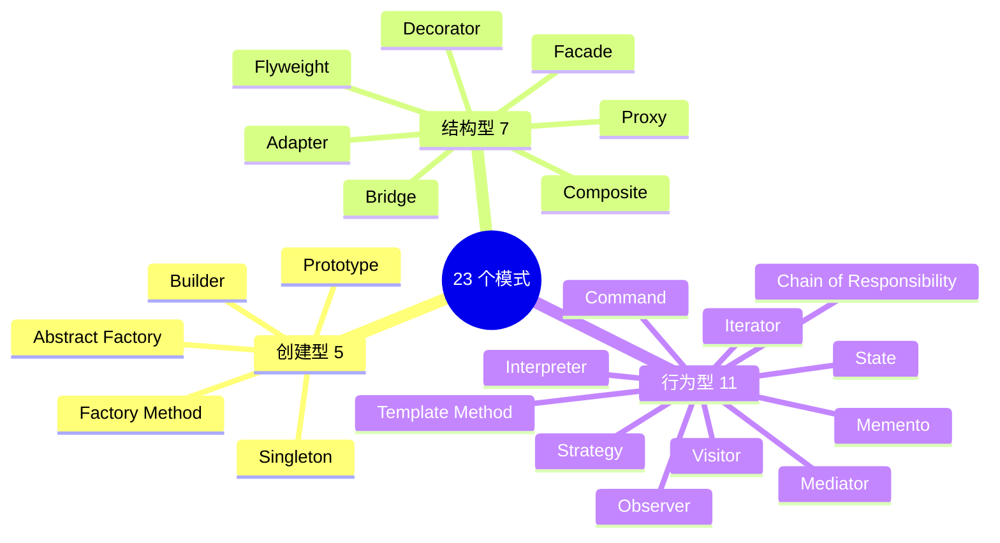

### 0.3 本书类图记号

| 记号 | mermaid 写法 | 含义 |
|------|--------------|------|
| 继承 | `A <\|-- B` | B 继承 A，三角指向父类 |
| 实现 | `A <\|.. B` | B 实现接口 A，虚线三角 |
| 关联 | `A --> B` | A 持有 B 的引用，长期关系 |
| 依赖 | `A ..> B` | A 临时使用 B，通常是方法参数或局部变量 |
| 聚合 | `A o-- B` | A 包含 B，但 B 可以独立存在 |
| 组合 | `A *-- B` | A 强拥有 B，生命周期一致 |
| 可见性 | `+` `-` `#` | public、private、protected |

类图中的 `<<interface>>` 表示接口，`<<abstract>>` 表示抽象类；
方法名后的 `*` 表示抽象方法，`$` 表示静态成员。这些记号在后面的图中会反复出现。

### 0.4 23 个模式一句话索引

| # | 模式 | 一句话 | 变化点 | 章 |
|---|------|--------|--------|----|
| 1 | Iterator | 不暴露内部结构地顺序访问聚合元素 | 遍历方式 | 1 |
| 2 | Adapter | 把不兼容的接口转换成客户端期望的接口 | 接口不兼容 | 2 |
| 3 | Template Method | 父类定流程，子类填步骤 | 算法步骤 | 3 |
| 4 | Factory Method | 父类定创建流程，子类定产品类型 | 产品类型 | 4 |
| 5 | Singleton | 保证一个类只有一个实例 | 实例数量 | 5 |
| 6 | Prototype | 通过复制现有实例来创建新实例 | 创建方式 | 6 |
| 7 | Builder | 分步构建复杂对象，构建与表示分离 | 构建过程与表示 | 7 |
| 8 | Abstract Factory | 创建一族相关产品，不指定具体类 | 产品族 | 8 |
| 9 | Bridge | 抽象与实现分离，各自独立扩展 | 两个维度的变化 | 9 |
| 10 | Strategy | 封装可互换的算法 | 算法 | 10 |
| 11 | Composite | 用树形结构统一对待单个与组合对象 | 部分-整体结构 | 11 |
| 12 | Decorator | 动态地给对象叠加职责 | 动态职责 | 12 |
| 13 | Visitor | 在不修改元素类的前提下增加操作 | 操作 | 13 |
| 14 | Chain of Responsibility | 请求沿处理者链传递，直到被处理 | 处理者 | 14 |
| 15 | Facade | 为子系统提供统一简化入口 | 子系统复杂度 | 15 |
| 16 | Mediator | 用中介者集中封装对象间交互 | 对象间交互 | 16 |
| 17 | Observer | 状态变化时通知所有依赖者 | 状态通知 | 17 |
| 18 | Memento | 保存并恢复对象内部状态 | 状态快照 | 18 |
| 19 | State | 用类表示状态，状态改变行为 | 状态相关行为 | 19 |
| 20 | Flyweight | 共享细粒度对象，避免重复创建 | 对象数量与内存 | 20 |
| 21 | Proxy | 用代理控制对真实对象的访问 | 访问控制 | 21 |
| 22 | Command | 把请求封装成对象 | 请求/动作 | 22 |
| 23 | Interpreter | 用类表示文法并解释句子 | 文法规则 | 23 |

### 0.5 结构相似、意图不同：最容易混淆的几组

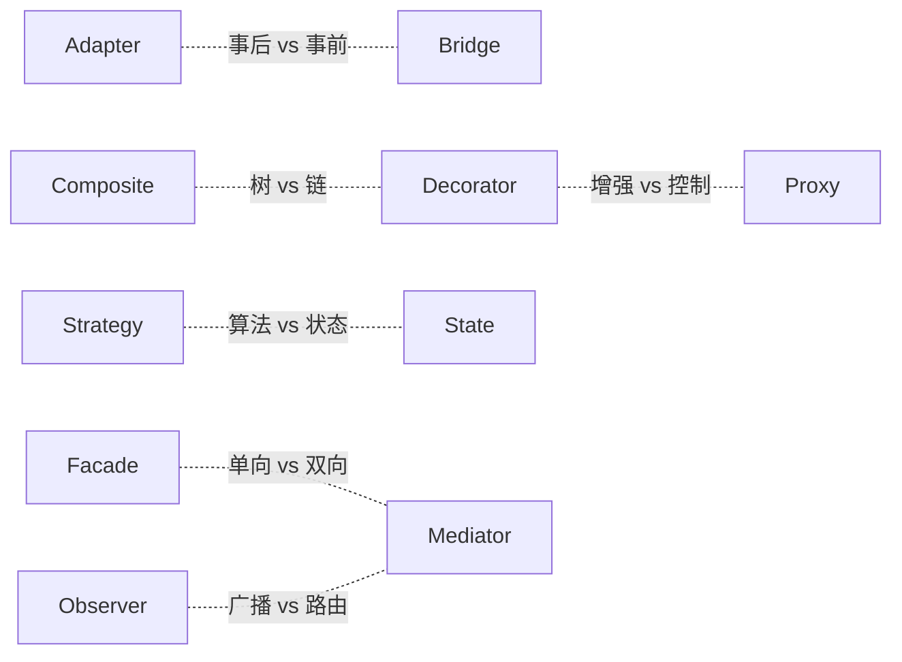

| 对比 | 一句话区别 |
|------|------------|
| Adapter vs Bridge | Adapter 事后适配已有接口；Bridge 事前分离抽象与实现 |
| Decorator vs Proxy | Decorator 增强功能；Proxy 控制访问 |
| Decorator vs Composite | Decorator 是一条包装链；Composite 是一棵树 |
| Strategy vs State | Strategy 由客户端选算法；State 由状态驱动迁移 |
| Template Method vs Strategy | 继承填步骤 vs 组合换算法 |
| Factory Method vs Abstract Factory | 一个产品 vs 一族产品 |
| Builder vs Abstract Factory | 分步构建一个复杂对象 vs 一次性创建一组产品 |
| Facade vs Mediator | Facade 单向简化子系统；Mediator 双向协调同事 |
| Observer vs Mediator | Observer 广播通知；Mediator 集中路由 |
| Chain vs Decorator | Chain 有一个处理者接手；Decorator 每层都执行 |
| Command vs Strategy | Command 把动作变成对象；Strategy 把算法变成对象 |
| Memento vs Prototype | Memento 恢复状态；Prototype 复制对象 |
| Flyweight vs Singleton | 多实例共享 vs 单实例 |
| Proxy vs Adapter | Proxy 保持同一接口；Adapter 换成另一个接口 |

---

## 第 1 部分 适应设计模式

### 第 1 章 Iterator 模式 —— 一个一个遍历

**意图**：提供一种方法顺序访问聚合中的元素，而不暴露聚合的内部表示。

**变化点**：遍历方式。聚合的底层存储从数组换成链表，客户端遍历代码不变。

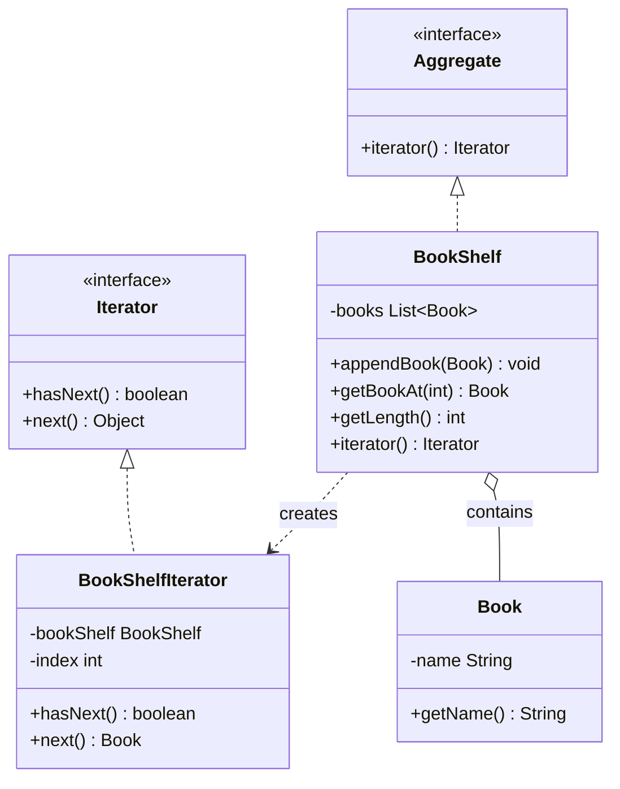

**角色**：

- `Iterator`：定义遍历接口，通常只有 `hasNext()` 和 `next()` 两个方法。
- `ConcreteIterator`：持有游标，负责“下一个是谁”和“还有没有下一个”。
- `Aggregate`：定义创建迭代器的接口。
- `ConcreteAggregate`：返回与自己绑定的具体迭代器。

**示例**（书中 `BookShelf` 例子，合并为单文件）

```java
import java.util.ArrayList;
import java.util.List;

interface Aggregate<T> {
    Iterator<T> iterator();
}

interface Iterator<T> {
    boolean hasNext();

    T next();
}

class Book {
    private final String name;

    Book(String name) {
        this.name = name;
    }

    String getName() {
        return name;
    }
}

class BookShelf implements Aggregate<Book> {
    private final List<Book> books = new ArrayList<>();

    void appendBook(Book book) {
        books.add(book);
    }

    Book getBookAt(int index) {
        return books.get(index);
    }

    int getLength() {
        return books.size();
    }

    public Iterator<Book> iterator() {
        return new BookShelfIterator(this);
    }
}

class BookShelfIterator implements Iterator<Book> {
    private final BookShelf bookShelf;
    private int index;

    BookShelfIterator(BookShelf bookShelf) {
        this.bookShelf = bookShelf;
    }

    public boolean hasNext() {
        return index < bookShelf.getLength();
    }

    public Book next() {
        return bookShelf.getBookAt(index++);
    }
}

public class IteratorDemo {
    public static void main(String[] args) {
        BookShelf shelf = new BookShelf();
        shelf.appendBook(new Book("图解设计模式"));
        shelf.appendBook(new Book("Java 编程思想"));
        shelf.appendBook(new Book("重构"));

        Iterator<Book> it = shelf.iterator();
        while (it.hasNext()) {
            System.out.println(it.next().getName());
        }
    }
}
```

**要点**：

- **遍历与存储分离**：客户端只依赖 `Iterator` 和 `Aggregate` 两个接口，书架的扩容、换存储结构都不影响遍历代码。
- **游标属于迭代器，不属于聚合**：同一个聚合可以同时有多个迭代器，各自停在不同的位置，互不干扰。
- **`next()` 的语义容易写错**：它返回“当前元素”并把游标后移，不是先移动再返回；`hasNext()` 只判断，不移动。
- **Java 已经把这件事做进了语言**：`java.util.Iterator`、`Iterable`、`for-each` 都是这个模式；
  `ListIterator` 支持双向遍历，`Stream` 则是把外部迭代换成了内部迭代。
- **不要为了用模式而自己造一套**：业务代码优先用 `Iterable`/`Iterator`；只有在需要自定义遍历规则
  （如树的中序、图的最短路径）时，才值得自己实现。

**相关**：Visitor（在遍历到的元素上执行操作）、Composite（遍历树形结构）、Factory Method（创建迭代器）。

### 第 2 章 Adapter 模式 —— 加个“适配器”以便复用

**意图**：把一个类的接口转换成客户端期望的另一个接口，让原本因接口不兼容而无法一起工作的类可以协同。

**变化点**：接口不兼容。已有类（Adaptee）不想改，客户端（Client）也不想改，中间加一层适配器。

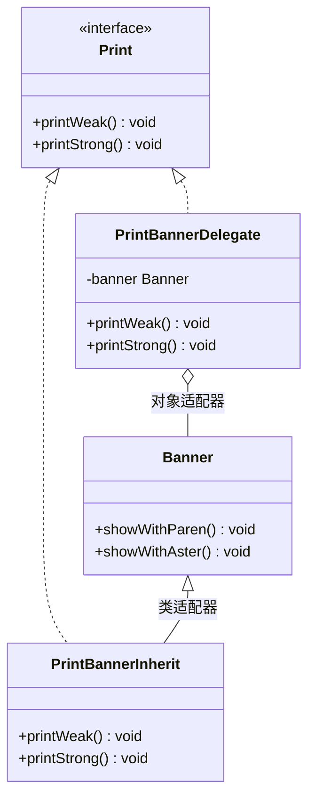

**角色**：

- `Target`（Print）：客户端期望的接口。
- `Adaptee`（Banner）：已经存在、但接口不兼容的类。
- `Adapter`（PrintBanner）：把 Adaptee 的接口转换成 Target。
- `Client`：只依赖 Target，不知道 Adaptee 的存在。

**示例**（类适配器与对象适配器两种写法）

```java
interface Print {
    void printWeak();

    void printStrong();
}

class Banner {
    private final String string;

    Banner(String string) {
        this.string = string;
    }

    void showWithParen() {
        System.out.println("(" + string + ")");
    }

    void showWithAster() {
        System.out.println("*" + string + "*");
    }
}

class PrintBannerInherit extends Banner implements Print {
    PrintBannerInherit(String string) {
        super(string);
    }

    public void printWeak() {
        showWithParen();
    }

    public void printStrong() {
        showWithAster();
    }
}

class PrintBannerDelegate implements Print {
    private final Banner banner;

    PrintBannerDelegate(String string) {
        this.banner = new Banner(string);
    }

    public void printWeak() {
        banner.showWithParen();
    }

    public void printStrong() {
        banner.showWithAster();
    }
}

public class AdapterDemo {
    public static void main(String[] args) {
        Print p1 = new PrintBannerInherit("Hello");
        Print p2 = new PrintBannerDelegate("World");
        p1.printWeak();
        p1.printStrong();
        p2.printWeak();
        p2.printStrong();
    }
}
```

**要点**：

- **两种实现方式的取舍**：类适配器用继承，代码短，但只能适配一个具体类，且会把 Adaptee 的方法暴露给客户端；
  对象适配器用委托，可以适配 Adaptee 的子类，封装更好，是更常用的写法。
- **Adapter 不改变 Adaptee**：它只是“翻译接口”，不增强功能。如果要给对象叠加职责，用 Decorator；
  如果要控制访问，用 Proxy。
- **与 Bridge 的区别**：Adapter 是事后补救（已有两个不兼容的接口），Bridge 是事前设计（一开始就把抽象和实现分开）。
- **JDK/框架中的影子**：`InputStreamReader` 把字节流适配成字符流；`Arrays.asList` 把数组适配成 List；
  Spring MVC 的 `HandlerAdapter` 把不同类型的 Controller 适配成统一的处理接口。

**相关**：Bridge、Decorator、Proxy。

---

## 第 2 部分 交给子类

### 第 3 章 Template Method 模式 —— 将具体处理交给子类

**意图**：在父类中定义算法的骨架，把某些可变步骤延迟到子类实现，使子类可以在不改变算法结构的前提下重定义步骤。

**变化点**：算法步骤。流程固定，每一步怎么做可变。

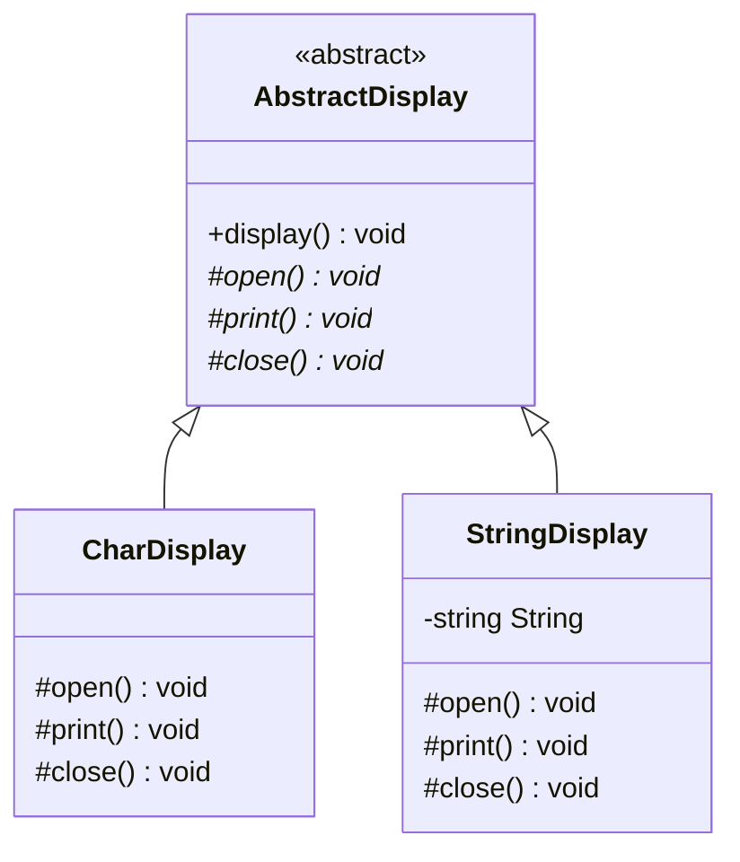

**角色**：

- `AbstractClass`：定义模板方法 `display()`，按固定顺序调用抽象步骤 `open()`/`print()`/`close()`；
  模板方法通常声明为 `final`。
- `ConcreteClass`：实现具体步骤，不控制流程。

**示例**（书中 `AbstractDisplay` 例子，修正了原笔记中的拼写与括号问题）

```java
abstract class AbstractDisplay {
    public abstract void open();

    public abstract void print();

    public abstract void close();

    public final void display() {
        open();
        for (int i = 0; i < 5; i++) {
            print();
        }
        close();
    }
}

class CharDisplay extends AbstractDisplay {
    private final char ch;

    CharDisplay(char ch) {
        this.ch = ch;
    }

    public void open() {
        System.out.print("<<");
    }

    public void print() {
        System.out.print(ch);
    }

    public void close() {
        System.out.println(">>");
    }
}

class StringDisplay extends AbstractDisplay {
    private final String string;

    StringDisplay(String string) {
        this.string = string;
    }

    public void open() {
        printLine();
    }

    public void print() {
        System.out.println("|" + string + "|");
    }

    public void close() {
        printLine();
    }

    private void printLine() {
        System.out.print("+");
        for (int i = 0; i < string.length(); i++) {
            System.out.print("-");
        }
        System.out.println("+");
    }
}

public class TemplateMethodDemo {
    public static void main(String[] args) {
        AbstractDisplay d1 = new CharDisplay('H');
        AbstractDisplay d2 = new StringDisplay("Hello");
        d1.display();
        d2.display();
    }
}
```

**运行时序**：

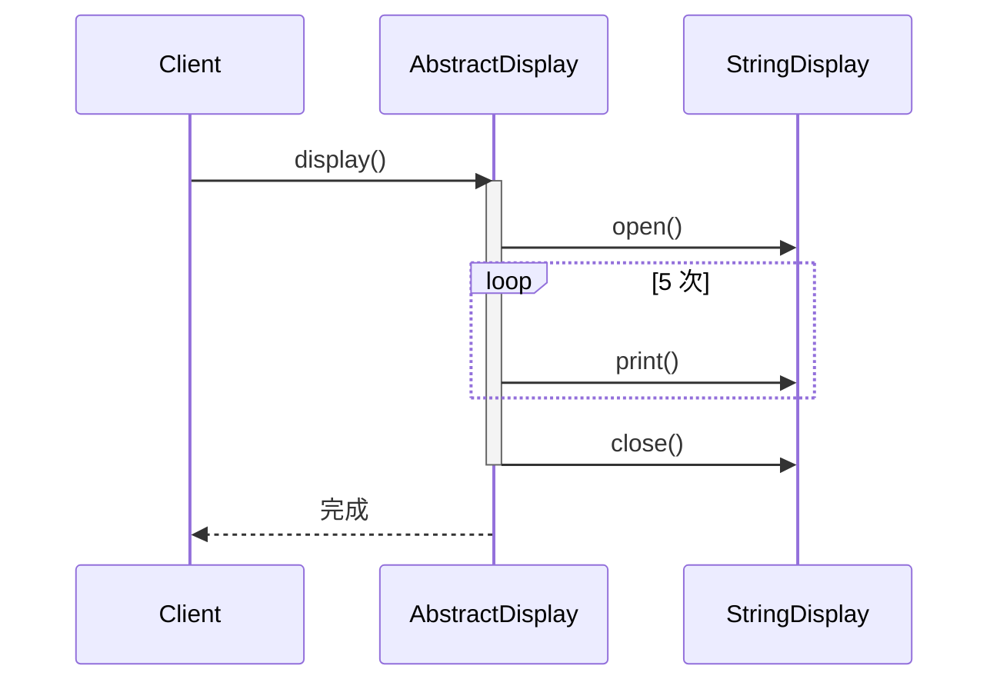

**要点**：

- **好莱坞原则**：Don't call us, we'll call you。父类调用子类，而不是子类调用父类；
  子类只负责填空，不决定什么时候填。
- **`final` 是设计约束**：模板方法声明 `final`，防止子类改写流程；抽象步骤声明 `abstract`，强制子类实现。
- **父类与子类的协作边界**：父类知道“先 open、再 print 五次、最后 close”，子类只知道“open 具体怎么做”。
  这是把“不变”和“可变”分开的最直接方式。
- **JDK 中的影子**：`AbstractList` 的 `addAll`、`InputStream.read(byte[])`、`HttpServlet.service()`
  都是模板方法；JUnit 的 `TestCase.runBare()` 也是先 setUp、再 test、最后 tearDown。
- **与 Strategy 的区别**：Template Method 用继承改变步骤，Strategy 用组合替换算法。
  如果步骤之间需要共享状态，Template Method 更自然；如果需要运行时切换，Strategy 更合适。

**相关**：Factory Method（模板方法用于创建对象）、Strategy、Hook（钩子方法）。

### 第 4 章 Factory Method 模式 —— 将实例的生成交给子类

**意图**：定义一个用于创建对象的接口，但让子类决定实例化哪个类；Factory Method 使一个类的实例化延迟到其子类。

**变化点**：产品类型。创建流程固定（创建 → 注册 → 返回），具体产品由子类决定。

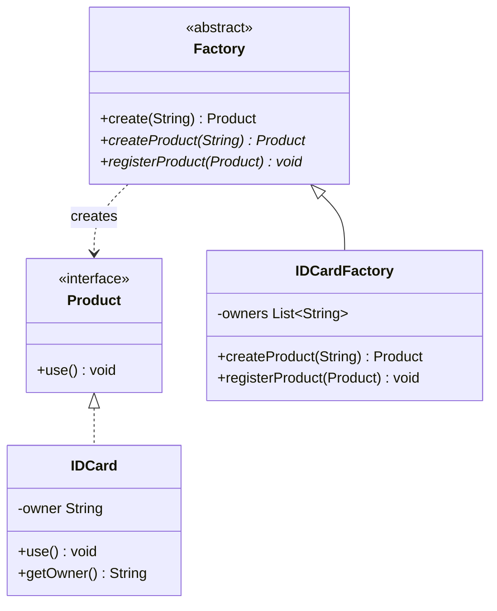

**角色**：

- `Product`：定义工厂所创建对象的接口。
- `ConcreteProduct`（IDCard）：实现 Product。
- `Creator`（Factory）：声明工厂方法 `createProduct()`，并在 `create()` 中调用它；`create()` 是模板方法。
- `ConcreteCreator`（IDCardFactory）：实现 `createProduct()`，返回具体产品。

**示例**（书中 `IDCard` 例子）

```java
import java.util.ArrayList;
import java.util.List;

interface Product {
    void use();
}

abstract class Factory {
    public final Product create(String owner) {
        Product product = createProduct(owner);
        registerProduct(product);
        return product;
    }

    protected abstract Product createProduct(String owner);

    protected abstract void registerProduct(Product product);
}

class IDCard implements Product {
    private final String owner;

    IDCard(String owner) {
        this.owner = owner;
    }

    public void use() {
        System.out.println("使用 " + owner + " 的 ID 卡。");
    }

    String getOwner() {
        return owner;
    }
}

class IDCardFactory extends Factory {
    private final List<String> owners = new ArrayList<>();

    protected Product createProduct(String owner) {
        return new IDCard(owner);
    }

    protected void registerProduct(Product product) {
        owners.add(((IDCard) product).getOwner());
    }

    List<String> getOwners() {
        return owners;
    }
}

public class FactoryMethodDemo {
    public static void main(String[] args) {
        Factory factory = new IDCardFactory();
        Product card1 = factory.create("小明");
        Product card2 = factory.create("小红");
        card1.use();
        card2.use();
    }
}
```

**要点**：

- **`create()` 是模板方法**：它固定了“创建 → 登记 → 返回”的流程，把“创建什么”和“怎么登记”留给子类。
  这正是 Factory Method 与 Template Method 的交汇点。
- **框架只依赖抽象**：`Factory` 只认识 `Product`，新增一种产品只需要新增 `Product` 子类和对应的 `Factory` 子类，
  不需要修改 `create()`。
- **三种常见实现**：抽象方法（书中写法）、默认实现（父类返回默认产品）、反射/注册表（按类名或 key 创建）。
  前两种编译期绑定，第三种更灵活但失去编译期检查。
- **JDK/框架中的影子**：`Collection.iterator()` 让具体集合决定返回哪种迭代器；
  `NumberFormat.getInstance()`、`DocumentBuilderFactory.newInstance()` 都是工厂方法；
  Spring 的 `FactoryBean` 把“创建对象”的逻辑从业务代码中剥离出来。
- **与 Abstract Factory 的区别**：Factory Method 创建一个产品；Abstract Factory 创建一族相关产品。

**相关**：Template Method、Singleton、Prototype、Abstract Factory。

---

## 第 3 部分 生成实例

### 第 5 章 Singleton 模式 —— 只有一个实例

**意图**：保证一个类仅有一个实例，并提供一个全局访问点。

**变化点**：实例数量。把“可以 new 很多个”限制为“全局只有一个”。

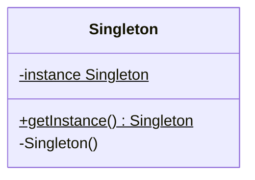

**角色**：

- `Singleton`：私有构造器，防止外部 `new`；静态字段持有唯一实例；静态方法返回该实例。

**示例**（四种写法：饿汉、静态内部类、双重检查、枚举）

```java
class EagerSingleton {
    private static final EagerSingleton INSTANCE = new EagerSingleton();

    private EagerSingleton() {
    }

    static EagerSingleton getInstance() {
        return INSTANCE;
    }
}

class HolderSingleton {
    private HolderSingleton() {
    }

    private static class Holder {
        private static final HolderSingleton INSTANCE = new HolderSingleton();
    }

    static HolderSingleton getInstance() {
        return Holder.INSTANCE;
    }
}

class DclSingleton {
    private static volatile DclSingleton instance;

    private DclSingleton() {
    }

    static DclSingleton getInstance() {
        if (instance == null) {
            synchronized (DclSingleton.class) {
                if (instance == null) {
                    instance = new DclSingleton();
                }
            }
        }
        return instance;
    }
}

enum EnumSingleton {
    INSTANCE;

    void doSomething() {
        System.out.println("枚举单例：线程安全，且天然防反射与反序列化");
    }
}

public class SingletonDemo {
    public static void main(String[] args) {
        System.out.println(EagerSingleton.getInstance() == EagerSingleton.getInstance());
        System.out.println(HolderSingleton.getInstance() == HolderSingleton.getInstance());
        System.out.println(DclSingleton.getInstance() == DclSingleton.getInstance());
        EnumSingleton.INSTANCE.doSomething();
    }
}
```

**四种写法对比**：

| 写法 | 懒加载 | 线程安全 | 防反射 | 防反序列化 | 备注 |
|------|--------|----------|--------|------------|------|
| 饿汉式 | 否 | 是 | 否 | 否 | 类加载即创建，简单但可能浪费 |
| 静态内部类 | 是 | 是 | 否 | 否 | 利用类加载机制，推荐 |
| 双重检查 + volatile | 是 | 是 | 否 | 否 | 必须加 volatile，否则可能拿到未初始化对象 |
| 枚举 | 是（首次访问） | 是 | 是 | 是 | Effective Java 推荐，最简洁安全 |

**要点**：

- **私有构造器是底线**：没有私有构造器，任何类都能 `new`，单例就名存实亡。
- **`volatile` 不是可选项**：`instance = new DclSingleton()` 不是原子操作，可能先分配内存、再赋值引用、最后初始化；
  没有 `volatile`，另一个线程可能看到非 null 但未初始化完成的对象。
- **反射与反序列化是两道后门**：反射可以 `setAccessible(true)` 调用私有构造器；反序列化会创建新对象。
  需要防这两者时，用枚举，或在 `readResolve()` 中返回单例。
- **类加载器也会破坏单例**：同一个类被不同 ClassLoader 加载，会产生多个 Class 对象，也就有多个“单例”。
- **JDK 中的影子**：`Runtime.getRuntime()`、`Desktop.getDesktop()` 都是单例；
  Spring 的 singleton bean 是“容器级单例”，不是 JVM 级单例——一个 JVM 里可以有多个 Spring 容器。

**相关**：Abstract Factory、Builder、Prototype、Facade（这些模式常把自身实现为单例）。

### 第 6 章 Prototype 模式 —— 通过复制生成实例

**意图**：用原型实例指定创建对象的种类，并通过复制这个原型来创建新对象。

**变化点**：创建方式。不依赖类名和 `new`，而是复制一个已经配置好的对象。

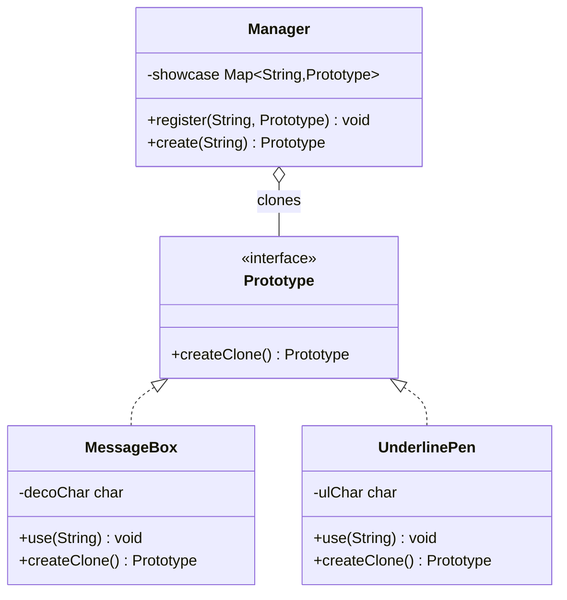

**角色**：

- `Prototype`：声明复制自身的接口。
- `ConcretePrototype`（MessageBox、UnderlinePen）：实现 `createClone()`。
- `Client`（Manager）：通过注册的原型复制新对象，不依赖具体类。

**示例**（书中 `MessageBox` / `UnderlinePen` 例子）

```java
import java.util.HashMap;
import java.util.Map;

interface Prototype extends Cloneable {
    Prototype createClone();
}

class MessageBox implements Prototype {
    private final char decoChar;

    MessageBox(char decoChar) {
        this.decoChar = decoChar;
    }

    public Prototype createClone() {
        try {
            return (Prototype) clone();
        } catch (CloneNotSupportedException e) {
            throw new AssertionError(e);
        }
    }

    void use(String s) {
        int length = s.length();
        for (int i = 0; i < length + 4; i++) {
            System.out.print(decoChar);
        }
        System.out.println();
        System.out.println(decoChar + " " + s + " " + decoChar);
        for (int i = 0; i < length + 4; i++) {
            System.out.print(decoChar);
        }
        System.out.println();
    }
}

class UnderlinePen implements Prototype {
    private final char ulChar;

    UnderlinePen(char ulChar) {
        this.ulChar = ulChar;
    }

    public Prototype createClone() {
        try {
            return (Prototype) clone();
        } catch (CloneNotSupportedException e) {
            throw new AssertionError(e);
        }
    }

    void use(String s) {
        System.out.println("\"" + s + "\"");
        for (int i = 0; i < s.length() + 2; i++) {
            System.out.print(ulChar);
        }
        System.out.println();
    }
}

class Manager {
    private final Map<String, Prototype> showcase = new HashMap<>();

    void register(String name, Prototype prototype) {
        showcase.put(name, prototype);
    }

    Prototype create(String name) {
        Prototype prototype = showcase.get(name);
        if (prototype == null) {
            throw new IllegalArgumentException("未注册：" + name);
        }
        return prototype.createClone();
    }
}

public class PrototypeDemo {
    public static void main(String[] args) {
        Manager manager = new Manager();
        manager.register("warning", new MessageBox('*'));
        manager.register("emphasis", new UnderlinePen('~'));

        MessageBox warning = (MessageBox) manager.create("warning");
        UnderlinePen emphasis = (UnderlinePen) manager.create("emphasis");
        warning.use("Hello");
        emphasis.use("Hello");
    }
}
```

**要点**：

- **`Cloneable` 是标记接口**：它没有方法，只告诉 `Object.clone()` 可以按字段复制；不实现它，`clone()` 会抛
  `CloneNotSupportedException`。
- **`Object.clone()` 是浅复制**：基本类型字段直接复制，引用类型字段只复制引用。
  如果原型里有 `List`、数组等可变对象，需要手动深复制，或通过序列化做深拷贝。
- **Prototype 的价值在“配置好的实例”**：当一个对象的创建需要读配置、查数据库、算很久，
  先做一个原型，之后复制它，比每次 `new` 再配置更高效。
- **注册表让框架与具体类解耦**：Manager 只认识 `Prototype` 接口，新增产品只需注册，不用改 Manager。
- **JDK/框架中的影子**：`Object.clone()`、`ArrayList.clone()`（浅复制）、DOM 的 `cloneNode(true)`；
  Spring 的 `@Scope("prototype")` 是“每次请求新 bean”，不是 GoF 的 Prototype，别混淆。

**相关**：Factory Method、Memento（保存/恢复状态）、Command（复制命令）。

### 第 7 章 Builder 模式 —— 组装复杂的实例

**意图**：将一个复杂对象的构建过程与它的表示分离，使同样的构建过程可以创建不同的表示。

**变化点**：构建过程与表示。步骤固定，最终产物可以是文本、HTML、PDF……

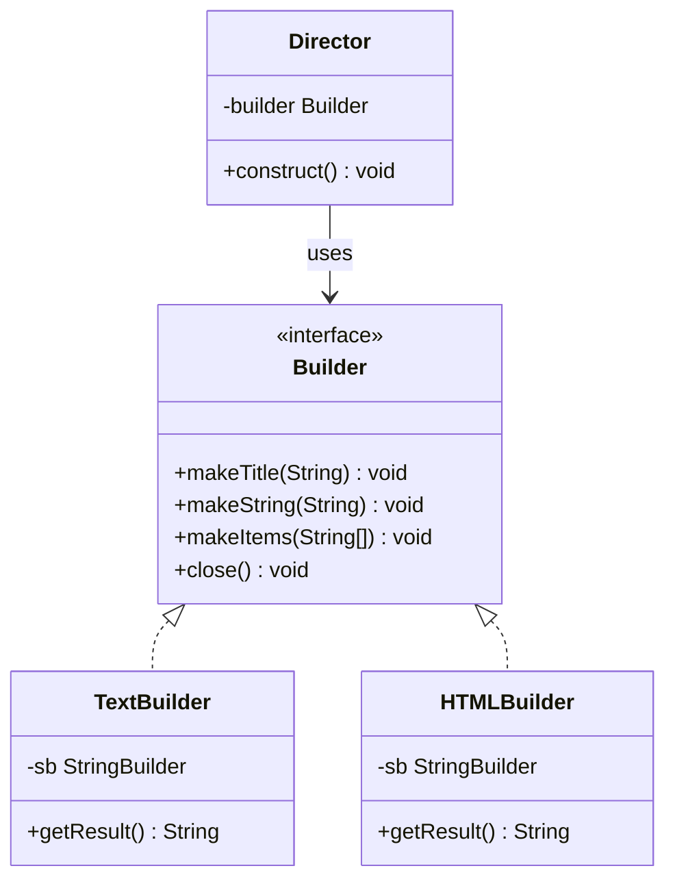

**角色**：

- `Builder`：定义构建过程的每一步。
- `ConcreteBuilder`（TextBuilder、HTMLBuilder）：实现步骤，维护最终产物。
- `Director`：只负责按顺序调用 Builder 的步骤，不知道最终产物是什么。
- `Product`：最终生成的复杂对象（这里就是 `getResult()` 返回的字符串）。

**示例**（书中 `TextBuilder` / `HTMLBuilder` 例子）

```java
interface Builder {
    void makeTitle(String title);

    void makeString(String str);

    void makeItems(String[] items);

    void close();
}

class Director {
    private final Builder builder;

    Director(Builder builder) {
        this.builder = builder;
    }

    void construct() {
        builder.makeTitle("Greeting");
        builder.makeString("从早上到下午");
        builder.makeItems(new String[] {"早上好", "下午好"});
        builder.makeString("晚上");
        builder.makeItems(new String[] {"晚上好", "晚安"});
        builder.close();
    }
}

class TextBuilder implements Builder {
    private final StringBuilder sb = new StringBuilder();

    public void makeTitle(String title) {
        sb.append("==============================\n");
        sb.append("『").append(title).append("』\n\n");
    }

    public void makeString(String str) {
        sb.append("■ ").append(str).append("\n\n");
    }

    public void makeItems(String[] items) {
        for (String item : items) {
            sb.append("  · ").append(item).append("\n");
        }
        sb.append("\n");
    }

    public void close() {
        sb.append("==============================\n");
    }

    String getResult() {
        return sb.toString();
    }
}

class HTMLBuilder implements Builder {
    private final StringBuilder sb = new StringBuilder();

    public void makeTitle(String title) {
        sb.append("<html><head><title>").append(title).append("</title></head><body>\n");
        sb.append("<h1>").append(title).append("</h1>\n");
    }

    public void makeString(String str) {
        sb.append("<p>").append(str).append("</p>\n");
    }

    public void makeItems(String[] items) {
        sb.append("<ul>\n");
        for (String item : items) {
            sb.append("<li>").append(item).append("</li>\n");
        }
        sb.append("</ul>\n");
    }

    public void close() {
        sb.append("</body></html>\n");
    }

    String getResult() {
        return sb.toString();
    }
}

public class BuilderDemo {
    public static void main(String[] args) {
        TextBuilder textBuilder = new TextBuilder();
        new Director(textBuilder).construct();
        System.out.println(textBuilder.getResult());

        HTMLBuilder htmlBuilder = new HTMLBuilder();
        new Director(htmlBuilder).construct();
        System.out.println(htmlBuilder.getResult());
    }
}
```

**要点**：

- **Director 不知道 Product**：它只知道 Builder 的四个步骤，因此同一个 Director 可以驱动文本、HTML、PDF 等不同产物。
- **Builder 隐藏内部表示**：客户端拿到的是 `getResult()`，不需要知道内部是用 `StringBuilder`、列表还是 DOM 构建的。
- **与 Abstract Factory 的区别**：Builder 分步构建**一个**复杂对象，强调“过程”；
  Abstract Factory 一次性创建**一组**相关产品，强调“产品族”。
- **与 Template Method 的关系**：`Director.construct()` 就是模板方法，只不过它把步骤委托给 Builder 对象，而不是子类。
- **JDK/框架中的影子**：`StringBuilder` 的链式 `append` 是 Builder 风格；
  `HttpRequest.newBuilder()`、`Locale.Builder`、`Stream.Builder`、Lombok `@Builder` 都是现代写法。

**相关**：Template Method、Composite、Abstract Factory。

### 第 8 章 Abstract Factory 模式 —— 将关联零件组装成产品

**意图**：提供一个创建一系列相关或相互依赖对象的接口，而无需指定它们的具体类。

**变化点**：产品族。不是换一个产品，而是整族产品一起换（如 List 风格 → Table 风格）。

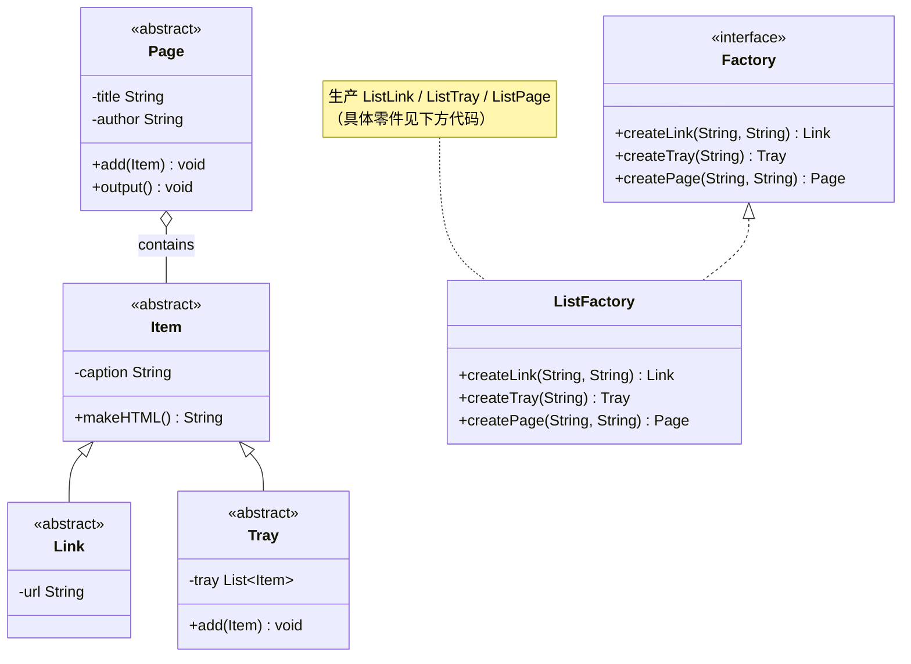

**角色**：

- `AbstractFactory`（Factory）：声明创建各类零件的接口。
- `ConcreteFactory`（ListFactory）：实现一整族零件的创建。
- `AbstractProduct`（Item、Link、Tray、Page）：定义零件的接口；Tray 和 Page 都能装 Item，
  Tray 里还能再嵌 Tray，形成树形结构（这一点类图没有画出来，见代码）。
- `ConcreteProduct`（ListLink、ListTray、ListPage）：具体工厂生产的具体零件。

**示例**（书中 `ListFactory` 例子；TableFactory 只是换一整族实现）

```java
import java.util.ArrayList;
import java.util.List;

abstract class Item {
    protected final String caption;

    Item(String caption) {
        this.caption = caption;
    }

    abstract String makeHTML();
}

abstract class Link extends Item {
    protected final String url;

    Link(String caption, String url) {
        super(caption);
        this.url = url;
    }
}

abstract class Tray extends Item {
    protected final List<Item> tray = new ArrayList<>();

    Tray(String caption) {
        super(caption);
    }

    void add(Item item) {
        tray.add(item);
    }
}

abstract class Page {
    protected final String title;
    protected final String author;
    protected final List<Item> content = new ArrayList<>();

    Page(String title, String author) {
        this.title = title;
        this.author = author;
    }

    void add(Item item) {
        content.add(item);
    }

    abstract String makeHTML();

    void output() {
        System.out.println(makeHTML());
    }
}

interface Factory {
    Link createLink(String caption, String url);

    Tray createTray(String caption);

    Page createPage(String title, String author);
}

class ListLink extends Link {
    ListLink(String caption, String url) {
        super(caption, url);
    }

    String makeHTML() {
        return "  <li><a href=\"" + url + "\">" + caption + "</a></li>\n";
    }
}

class ListTray extends Tray {
    ListTray(String caption) {
        super(caption);
    }

    String makeHTML() {
        StringBuilder sb = new StringBuilder();
        sb.append("<li>").append(caption).append("\n<ul>\n");
        for (Item item : tray) {
            sb.append(item.makeHTML());
        }
        sb.append("</ul></li>\n");
        return sb.toString();
    }
}

class ListPage extends Page {
    ListPage(String title, String author) {
        super(title, author);
    }

    String makeHTML() {
        StringBuilder sb = new StringBuilder();
        sb.append("<html><head><title>").append(title).append("</title></head>\n");
        sb.append("<body>\n<h1>").append(title).append("</h1>\n<ul>\n");
        for (Item item : content) {
            sb.append(item.makeHTML());
        }
        sb.append("</ul>\n<hr><address>").append(author).append("</address>\n</body></html>\n");
        return sb.toString();
    }
}

class ListFactory implements Factory {
    public Link createLink(String caption, String url) {
        return new ListLink(caption, url);
    }

    public Tray createTray(String caption) {
        return new ListTray(caption);
    }

    public Page createPage(String title, String author) {
        return new ListPage(title, author);
    }
}

public class AbstractFactoryDemo {
    public static void main(String[] args) {
        Factory factory = new ListFactory();
        Link blog = factory.createLink("博客", "https://example.com");
        Link wiki = factory.createLink("Wiki", "https://example.org");
        Tray links = factory.createTray("链接");
        links.add(blog);
        links.add(wiki);

        Page page = factory.createPage("我的主页", "duke");
        page.add(links);
        page.output();
    }
}
```

**要点**：

- **易于增加具体工厂，难以增加新零件**：新增 `TableFactory` 只需实现整族类，客户端换一行工厂即可；
  但要在 `Factory` 接口里加一个 `createImage()`，所有具体工厂都得改。这是开闭原则的非对称性。
- **产品族的一致性由工厂保证**：ListFactory 生产的所有零件都是 List 风格，不会出现“List 链接 + Table 表格”的混搭。
- **与 Factory Method 的区别**：Factory Method 用继承决定一个产品；Abstract Factory 用组合/接口创建一族产品，
  它的每个 `createXxx()` 往往就是一个 Factory Method。
- **JDK/框架中的影子**：`DocumentBuilderFactory`、`TransformerFactory`、`SAXParserFactory`
  都是抽象工厂；换一个实现（如 Xerces、Xalan）就能整族替换 XML 解析/转换组件。

**相关**：Factory Method、Singleton、Composite、Builder。

---

## 第 4 部分 分开考虑

### 第 9 章 Bridge 模式 —— 将类的功能层次与实现层次分离

**意图**：将抽象部分与它的实现部分分离，使它们都可以独立地变化。

**变化点**：两个维度的变化。功能可以扩展（Display → CountDisplay），实现也可以扩展（StringDisplayImpl → 其他实现），
两棵树用“桥”连接，而不是用继承绑死。

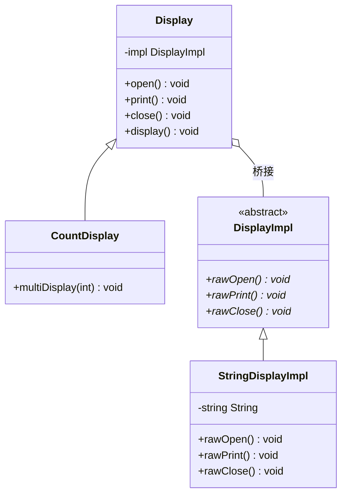

**角色**：

- `Abstraction`（Display）：功能层次的顶层，持有 `Implementor` 的引用。
- `RefinedAbstraction`（CountDisplay）：在功能层次上扩展，不关心实现细节。
- `Implementor`（DisplayImpl）：实现层次的顶层，定义原始操作。
- `ConcreteImplementor`（StringDisplayImpl）：实现原始操作。

**示例**（书中 `Display` / `CountDisplay` 例子）

```java
abstract class DisplayImpl {
    abstract void rawOpen();

    abstract void rawPrint();

    abstract void rawClose();
}

class StringDisplayImpl extends DisplayImpl {
    private final String string;

    StringDisplayImpl(String string) {
        this.string = string;
    }

    void rawOpen() {
        printLine();
    }

    void rawPrint() {
        System.out.println("|" + string + "|");
    }

    void rawClose() {
        printLine();
    }

    private void printLine() {
        System.out.print("+");
        for (int i = 0; i < string.length(); i++) {
            System.out.print("-");
        }
        System.out.println("+");
    }
}

class Display {
    private final DisplayImpl impl;

    Display(DisplayImpl impl) {
        this.impl = impl;
    }

    void open() {
        impl.rawOpen();
    }

    void print() {
        impl.rawPrint();
    }

    void close() {
        impl.rawClose();
    }

    final void display() {
        open();
        print();
        close();
    }
}

class CountDisplay extends Display {
    CountDisplay(DisplayImpl impl) {
        super(impl);
    }

    void multiDisplay(int times) {
        open();
        for (int i = 0; i < times; i++) {
            print();
        }
        close();
    }
}

public class BridgeDemo {
    public static void main(String[] args) {
        Display d1 = new Display(new StringDisplayImpl("Hello, China."));
        Display d2 = new CountDisplay(new StringDisplayImpl("Hello, World."));
        CountDisplay d3 = new CountDisplay(new StringDisplayImpl("Hello, Universe."));
        d1.display();
        d2.display();
        d3.multiDisplay(3);
    }
}
```

**要点**：

- **两棵继承树**：功能层次（Display → CountDisplay）和实现层次（DisplayImpl → StringDisplayImpl）各自扩展，
  组合数从“子类数量相乘”变成“子类数量相加”。
- **继承是强关联，委托是弱关联**：`Display` 持有 `DisplayImpl` 的引用，运行时可以换实现；
  继承则在编译期就把父子绑死。
- **与 Adapter 的区别**：Bridge 是事前设计，目的是让两个维度独立变化；Adapter 是事后补救，目的是让不兼容的接口能合作。
- **JDK/框架中的影子**：JDBC 是典型 Bridge——`Connection`/`Statement` 是抽象层，各数据库驱动是实现层；
  AWT 的 `Component` 与 `ComponentPeer` 也是功能与实现分离。

**相关**：Template Method、Abstract Factory、Adapter。

### 第 10 章 Strategy 模式 —— 整体地替换算法

**意图**：定义一系列算法，把它们分别封装起来，并使它们可以互相替换；Strategy 让算法的变化独立于使用它的客户端。

**变化点**：算法。猜拳策略、排序策略、折扣策略都可以整体替换。

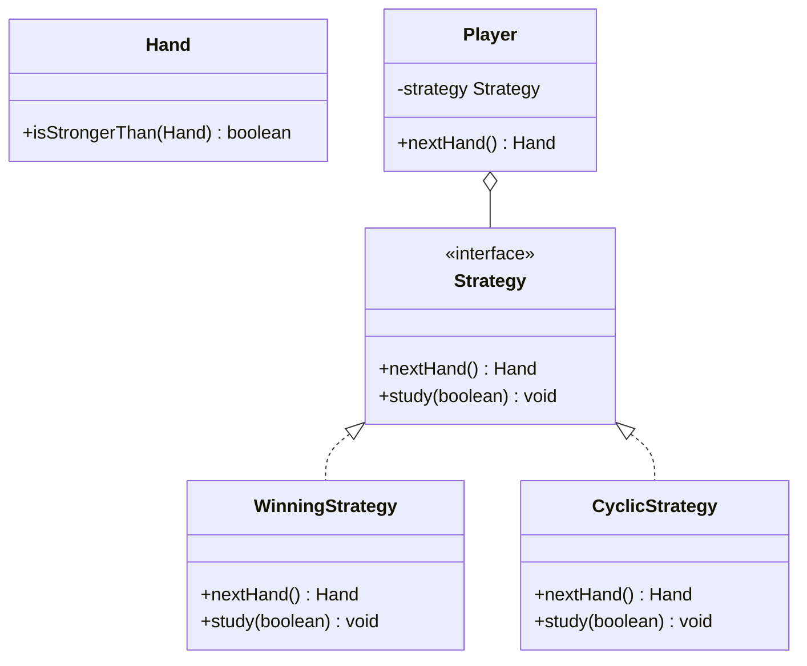

**角色**：

- `Strategy`：定义所有算法共有的接口。
- `ConcreteStrategy`（WinningStrategy、CyclicStrategy）：实现具体算法。
- `Context`（Player）：持有 Strategy，把请求委托给它；客户端可以在运行时替换 Strategy。

**示例**（书中猜拳例子；第二个策略改为确定性循环，便于观察）

```java
import java.util.Random;

class Hand {
    static final int ROCK = 0;
    static final int SCISSORS = 1;
    static final int PAPER = 2;
    private final int handValue;

    Hand(int handValue) {
        this.handValue = handValue;
    }

    boolean isStrongerThan(Hand h) {
        return fight(h) == 1;
    }

    private int fight(Hand h) {
        if (this.handValue == h.handValue) {
            return 0;
        }
        if ((this.handValue + 1) % 3 == h.handValue) {
            return 1;
        }
        return -1;
    }
}

interface Strategy {
    Hand nextHand();

    void study(boolean win);
}

class WinningStrategy implements Strategy {
    private final Random random = new Random(1);
    private boolean won = false;
    private Hand prevHand;

    public Hand nextHand() {
        if (!won) {
            prevHand = new Hand(random.nextInt(3));
        }
        return prevHand;
    }

    public void study(boolean win) {
        this.won = win;
    }
}

class CyclicStrategy implements Strategy {
    private int count;

    public Hand nextHand() {
        return new Hand(count++ % 3);
    }

    public void study(boolean win) {
        // 固定循环策略不学习
    }
}

class Player {
    private final String name;
    private final Strategy strategy;
    private int winCount;
    private int loseCount;
    private int gameCount;

    Player(String name, Strategy strategy) {
        this.name = name;
        this.strategy = strategy;
    }

    Hand nextHand() {
        return strategy.nextHand();
    }

    void win() {
        strategy.study(true);
        winCount++;
        gameCount++;
    }

    void lose() {
        strategy.study(false);
        loseCount++;
        gameCount++;
    }

    void even() {
        gameCount++;
    }

    public String toString() {
        return "[" + name + ":" + gameCount + " games, " + winCount + " win, " + loseCount + " lose]";
    }
}

public class StrategyDemo {
    public static void main(String[] args) {
        Player a = new Player("小明", new WinningStrategy());
        Player b = new Player("小红", new CyclicStrategy());
        for (int i = 0; i < 10; i++) {
            Hand h1 = a.nextHand();
            Hand h2 = b.nextHand();
            if (h1.isStrongerThan(h2)) {
                a.win();
                b.lose();
            } else if (h2.isStrongerThan(h1)) {
                b.win();
                a.lose();
            } else {
                a.even();
                b.even();
            }
        }
        System.out.println(a);
        System.out.println(b);
    }
}
```

**要点**：

- **策略是“可替换的算法”**：客户端持有 Strategy 接口，不关心具体算法；新增算法只需新增实现类。
- **运行时切换**：与 Template Method 不同，Strategy 可以在运行中替换；Template Method 的步骤在编译期由子类决定。
- **避免大量条件分支**：把 `if (type == A) ... else if (type == B) ...` 里的每个分支搬到一个策略类，
  新增类型时不需要改原方法。
- **策略的代价**：客户端必须知道有哪些策略、如何选择；策略类增多后，需要一个工厂或配置来管理。
- **JDK/框架中的影子**：`Comparator` 是最常见的 Strategy；`ThreadPoolExecutor` 的拒绝策略
  （`AbortPolicy`、`CallerRunsPolicy` 等）也是 Strategy；Spring 的 `PasswordEncoder` 同理。

**相关**：Template Method、State、Bridge。

---

## 第 5 部分 一致性

### 第 11 章 Composite 模式 —— 容器与内容的一致性

**意图**：将对象组合成树形结构以表示“部分-整体”的层次结构，使客户端对单个对象和组合对象的使用具有一致性。

**变化点**：部分-整体结构。文件与目录、控件与容器、表达式与子表达式，都可以用同一套接口处理。

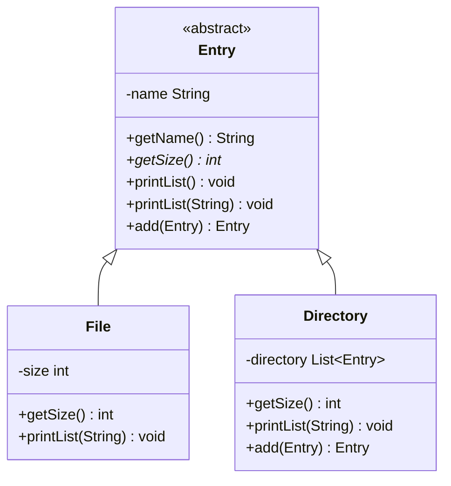

> `Directory` 的 `-directory List~Entry~` 字段说明它持有多个 `Entry`——聚合关系画在字段里就够了；
> `Directory` 既“是一个”Entry，又“装着”Entry，这正是递归组合的来源。

**角色**：

- `Component`（Entry）：定义叶子与容器的共同接口。
- `Leaf`（File）：没有子节点，直接实现业务方法。
- `Composite`（Directory）：持有子节点集合，把操作递归委托给子节点。
- `Client`：统一使用 Component 接口，不需要区分叶子和容器。

**示例**（书中文件系统例子）

```java
import java.util.ArrayList;
import java.util.List;

abstract class Entry {
    protected final String name;

    Entry(String name) {
        this.name = name;
    }

    String getName() {
        return name;
    }

    abstract int getSize();

    void printList() {
        printList("");
    }

    abstract void printList(String prefix);

    Entry add(Entry entry) {
        throw new UnsupportedOperationException();
    }

    public String toString() {
        return name + " (" + getSize() + ")";
    }
}

class File extends Entry {
    private final int size;

    File(String name, int size) {
        super(name);
        this.size = size;
    }

    int getSize() {
        return size;
    }

    void printList(String prefix) {
        System.out.println(prefix + "/" + this);
    }
}

class Directory extends Entry {
    private final List<Entry> directory = new ArrayList<>();

    Directory(String name) {
        super(name);
    }

    int getSize() {
        int size = 0;
        for (Entry entry : directory) {
            size += entry.getSize();
        }
        return size;
    }

    Entry add(Entry entry) {
        directory.add(entry);
        return this;
    }

    void printList(String prefix) {
        System.out.println(prefix + "/" + this);
        for (Entry entry : directory) {
            entry.printList(prefix + "/" + name);
        }
    }
}

public class CompositeDemo {
    public static void main(String[] args) {
        Directory root = new Directory("root");
        Directory bin = new Directory("bin");
        Directory tmp = new Directory("tmp");
        root.add(bin);
        root.add(tmp);
        bin.add(new File("vi", 10000));
        bin.add(new File("latex", 20000));
        root.add(new File("README.md", 500));
        root.printList();
        System.out.println("total size = " + root.getSize());
    }
}
```

**要点**：

- **递归组合**：`Directory.getSize()` 把请求递归委托给每个子项，叶子返回自身大小，容器返回子项之和。
  客户端调用 `root.getSize()` 时，不需要知道树有多深。
- **`add()` 放在哪里的取舍**：放在 `Entry` 里，客户端可以统一调用，但叶子必须抛异常（透明性优先）；
  放在 `Directory` 里，类型安全，但客户端要区分叶子和容器（安全性优先）。书中的做法是前者。
- **递归结构无处不在**：文件系统、DOM/XML、组织架构、菜单、表达式树、UI 容器都是 Composite。
- **JDK/框架中的影子**：AWT/Swing 的 `Component` 与 `Container`；XML DOM 的 `Node`；
  Spring 的 `CompositeCache` 等组合式缓存。

**相关**：Visitor（在树上执行操作）、Decorator（递归包装）、Iterator（遍历树）。

### 第 12 章 Decorator 模式 —— 装饰边框与被装饰物的一致性

**意图**：动态地给一个对象添加一些额外的职责。就增加功能而言，Decorator 比生成子类更灵活。

**变化点**：动态职责。基础对象不变，用一层层“边框”叠加功能。

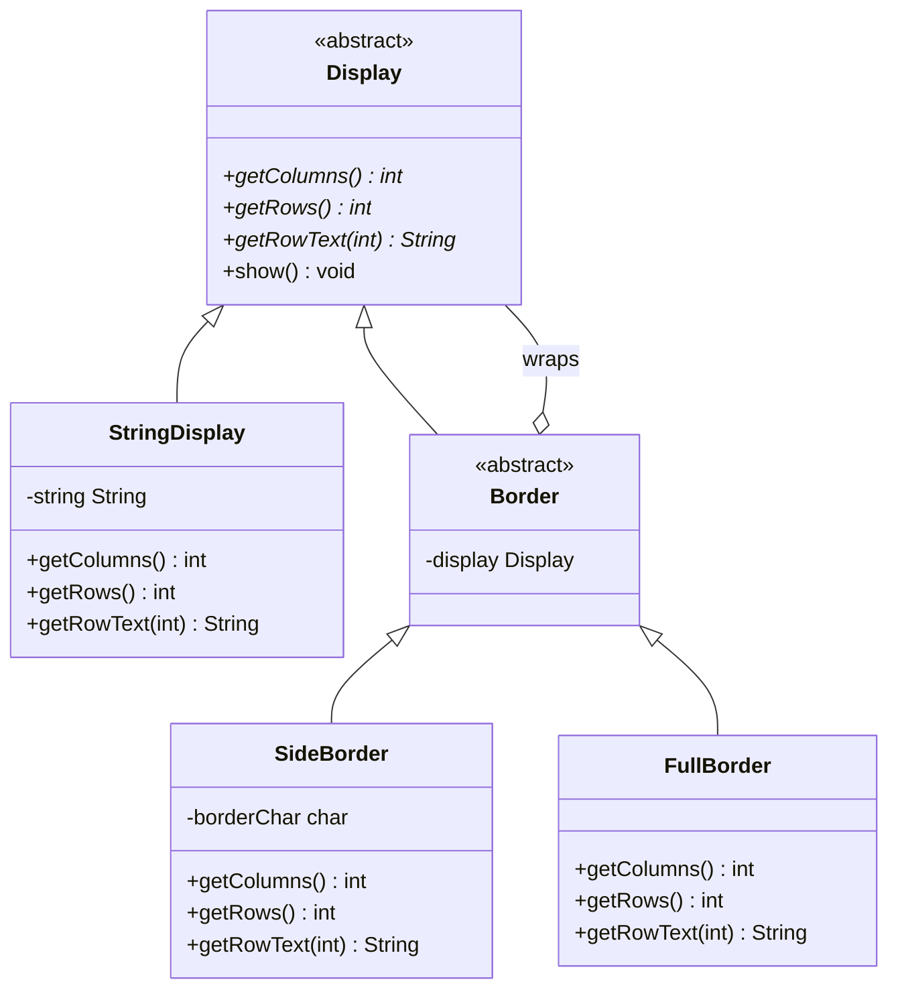

**角色**：

- `Component`（Display）：定义核心接口。
- `ConcreteComponent`（StringDisplay）：被装饰的原始对象。
- `Decorator`（Border）：持有一个 Component，并实现同一接口。
- `ConcreteDecorator`（SideBorder、FullBorder）：在委托前后增加行为。

**示例**（书中字符串边框例子）

```java
abstract class Display {
    abstract int getColumns();

    abstract int getRows();

    abstract String getRowText(int row);

    final void show() {
        for (int i = 0; i < getRows(); i++) {
            System.out.println(getRowText(i));
        }
    }
}

class StringDisplay extends Display {
    private final String string;

    StringDisplay(String string) {
        this.string = string;
    }

    int getColumns() {
        return string.length();
    }

    int getRows() {
        return 1;
    }

    String getRowText(int row) {
        return row == 0 ? string : null;
    }
}

abstract class Border extends Display {
    protected final Display display;

    Border(Display display) {
        this.display = display;
    }
}

class SideBorder extends Border {
    private final char borderChar;

    SideBorder(Display display, char borderChar) {
        super(display);
        this.borderChar = borderChar;
    }

    int getColumns() {
        return 1 + display.getColumns() + 1;
    }

    int getRows() {
        return display.getRows();
    }

    String getRowText(int row) {
        return borderChar + display.getRowText(row) + borderChar;
    }
}

class FullBorder extends Border {
    FullBorder(Display display) {
        super(display);
    }

    int getColumns() {
        return 1 + display.getColumns() + 1;
    }

    int getRows() {
        return 1 + display.getRows() + 1;
    }

    String getRowText(int row) {
        if (row == 0 || row == display.getRows() + 1) {
            return "+" + makeLine('-', display.getColumns()) + "+";
        }
        return "|" + display.getRowText(row - 1) + "|";
    }

    private String makeLine(char ch, int count) {
        StringBuilder sb = new StringBuilder();
        for (int i = 0; i < count; i++) {
            sb.append(ch);
        }
        return sb.toString();
    }
}

public class DecoratorDemo {
    public static void main(String[] args) {
        Display d1 = new StringDisplay("Hello, world.");
        Display d2 = new SideBorder(d1, '#');
        Display d3 = new FullBorder(d2);
        d1.show();
        d2.show();
        d3.show();
        Display d4 = new SideBorder(new FullBorder(new StringDisplay("你好，世界。")), '*');
        d4.show();
    }
}
```

**要点**：

- **一致性来自同一接口**：`Border` 继承 `Display`，又持有一个 `Display`，所以装饰后的对象仍然是一个 `Display`，
  可以继续被装饰。这是“自己包含自己”的递归结构。
- **动态叠加**：`new SideBorder(new FullBorder(new StringDisplay(...)), '*')` 在运行时组合功能，
  不需要为每种组合创建一个子类。
- **与 Composite 的区别**：Decorator 是一条链（每个装饰器只有一个被装饰对象），Composite 是一棵树（容器有多个子节点）。
- **与 Proxy 的区别**：Decorator 增强功能，Proxy 控制访问；Decorator 的接口通常一致，Proxy 也一致，但意图不同。
- **JDK/框架中的影子**：`java.io` 是教科书级例子——`BufferedInputStream(new FileInputStream(...))`；
  `Collections.unmodifiableList`、`HttpServletRequestWrapper` 也是装饰器。
- **代价**：会产生很多小类；调试时一层层剥开比较麻烦。

**相关**：Composite、Strategy、Proxy、Adapter。

---

## 第 6 部分 访问数据结构

### 第 13 章 Visitor 模式 —— 访问数据结构并处理数据

**意图**：表示一个作用于某对象结构中的各元素的操作，使你可以在不改变各元素类的前提下定义作用于这些元素的新操作。

**变化点**：操作。数据结构稳定（文件、目录），但操作经常增加（列出、统计、压缩、导出）。

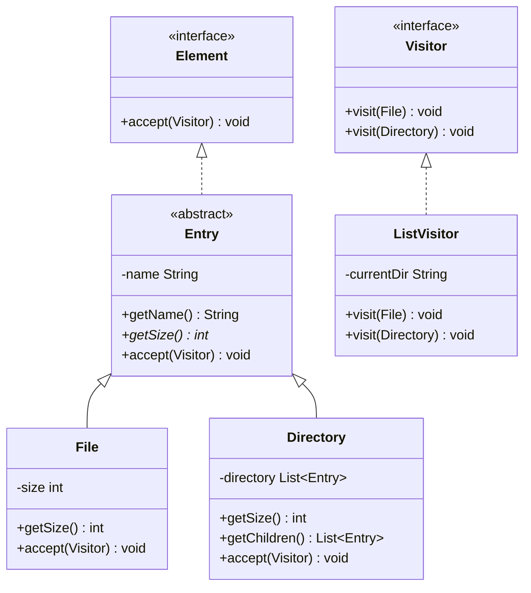

**角色**：

- `Visitor`：为每个 ConcreteElement 声明一个 `visit` 重载。
- `ConcreteVisitor`（ListVisitor）：实现每种元素上的具体操作。
- `Element`：声明 `accept(Visitor)`。
- `ConcreteElement`（File、Directory）：在 `accept` 中调用 `visitor.visit(this)`。
- `ObjectStructure`（Directory 的子树）：能枚举自己的元素，通常由 Composite 承担。

**示例**（书中文件系统例子）

```java
import java.util.ArrayList;
import java.util.List;

interface Visitor {
    void visit(File file);

    void visit(Directory directory);
}

interface Element {
    void accept(Visitor visitor);
}

abstract class Entry implements Element {
    protected final String name;

    Entry(String name) {
        this.name = name;
    }

    String getName() {
        return name;
    }

    abstract int getSize();

    public String toString() {
        return name + " (" + getSize() + ")";
    }
}

class File extends Entry {
    private final int size;

    File(String name, int size) {
        super(name);
        this.size = size;
    }

    int getSize() {
        return size;
    }

    public void accept(Visitor visitor) {
        visitor.visit(this);
    }
}

class Directory extends Entry {
    private final List<Entry> directory = new ArrayList<>();

    Directory(String name) {
        super(name);
    }

    int getSize() {
        int size = 0;
        for (Entry entry : directory) {
            size += entry.getSize();
        }
        return size;
    }

    void add(Entry entry) {
        directory.add(entry);
    }

    List<Entry> getChildren() {
        return directory;
    }

    public void accept(Visitor visitor) {
        visitor.visit(this);
    }
}

class ListVisitor implements Visitor {
    private String currentDir = "";

    public void visit(File file) {
        System.out.println(currentDir + "/" + file);
    }

    public void visit(Directory directory) {
        System.out.println(currentDir + "/" + directory);
        String savedDir = currentDir;
        currentDir = currentDir + "/" + directory.getName();
        for (Entry entry : directory.getChildren()) {
            entry.accept(this);
        }
        currentDir = savedDir;
    }
}

public class VisitorDemo {
    public static void main(String[] args) {
        Directory root = new Directory("root");
        Directory bin = new Directory("bin");
        root.add(bin);
        bin.add(new File("vi", 10000));
        bin.add(new File("latex", 20000));
        root.add(new File("README.md", 500));
        root.accept(new ListVisitor());
    }
}
```

**双重分发**：

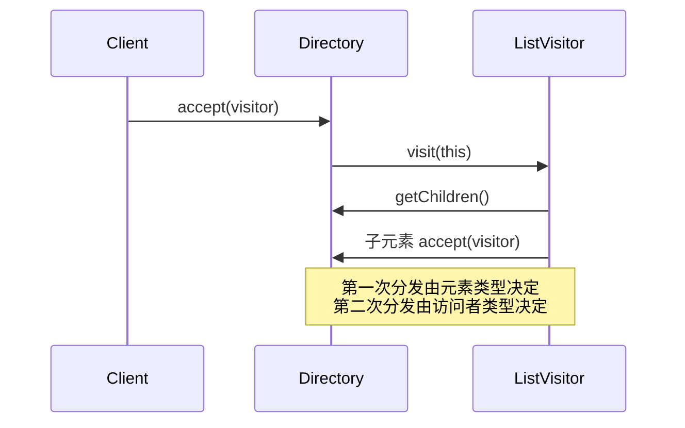

**要点**：

- **双重分发**：`entry.accept(visitor)` 先根据 `entry` 的实际类型决定调用哪个 `accept`，
  `accept` 里再调用 `visitor.visit(this)`，根据 `visitor` 的实际类型决定调用哪个 `visit` 重载。
  Java 没有真正的双重分发，这个模式是手工模拟。
- **易于增加 Visitor，难以增加 Element**：新增一个“统计大小”的 Visitor 不用改 File/Directory；
  但新增一种 Element（如 `Symlink`），`Visitor` 接口就要加一个 `visit(Symlink)`，所有 Visitor 都得改。
- **适用条件**：数据结构稳定、操作多变；如果元素类型也经常变，Visitor 会让代码更难维护。
- **JDK/框架中的影子**：`java.nio.file.FileVisitor`、`javax.lang.model.element.ElementVisitor`、
  `AnnotationValueVisitor`、ASM 的 `ClassVisitor`；编译器 AST 的遍历几乎都是 Visitor。

**相关**：Composite（被访问的对象结构）、Iterator（遍历元素）、Interpreter（文法树）。

### 第 14 章 Chain of Responsibility 模式 —— 推卸责任

**意图**：使多个对象都有机会处理请求，从而避免请求的发送者与接收者之间的耦合；将这些对象连成一条链，并沿链传递请求，直到有一个对象处理它。

**变化点**：处理者。请求不变，处理链可以动态增删、换顺序。

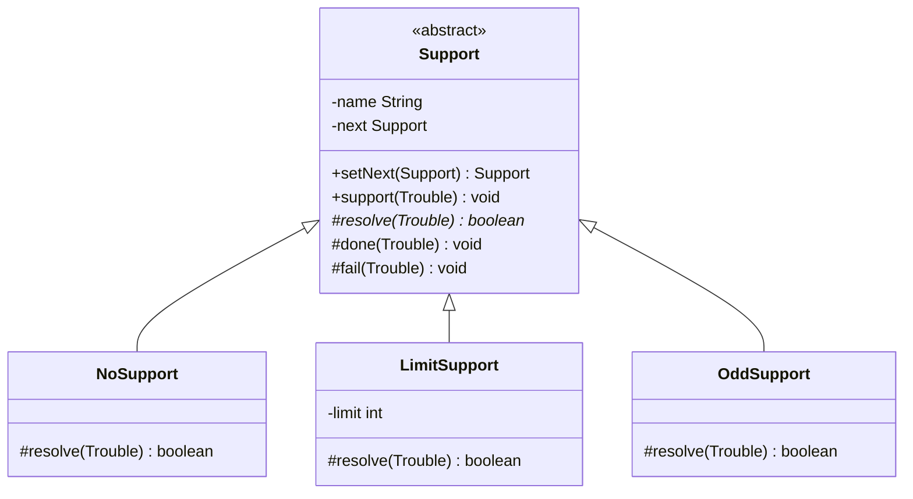

> 图中只画出三个代表性处理者；`SpecialSupport`（只解决指定编号的问题）见示例代码。
> `Support` 的 `-next Support` 字段就是“链”本身：每个处理者持有下一个处理者，
> 处理不了就调用 `next.support(trouble)`，因此类图上不需要再画一条自关联线。
> `Trouble` 只是请求对象（编号 + getter），见示例代码。

**角色**：

- `Handler`（Support）：定义处理请求的接口，并持有下一个处理者的引用。
- `ConcreteHandler`（NoSupport、LimitSupport、OddSupport、SpecialSupport）：判断自己能否处理，不能就转发。
- `Client`：把请求发给链首，不关心最终由谁处理。

**示例**（书中 `Trouble` / `Support` 例子，修正了原笔记中的拼写与缺失返回类型）

```java
class Trouble {
    private final int number;

    Trouble(int number) {
        this.number = number;
    }

    int getNumber() {
        return number;
    }

    public String toString() {
        return "[Trouble " + number + "]";
    }
}

abstract class Support {
    private final String name;
    private Support next;

    Support(String name) {
        this.name = name;
    }

    Support setNext(Support next) {
        this.next = next;
        return next;
    }

    final void support(Trouble trouble) {
        if (resolve(trouble)) {
            done(trouble);
        } else if (next != null) {
            next.support(trouble);
        } else {
            fail(trouble);
        }
    }

    protected abstract boolean resolve(Trouble trouble);

    protected void done(Trouble trouble) {
        System.out.println(trouble + " is resolved by " + this + ".");
    }

    protected void fail(Trouble trouble) {
        System.out.println(trouble + " cannot be resolved.");
    }

    public String toString() {
        return "[" + name + "]";
    }
}

class NoSupport extends Support {
    NoSupport(String name) {
        super(name);
    }

    protected boolean resolve(Trouble trouble) {
        return false;
    }
}

class LimitSupport extends Support {
    private final int limit;

    LimitSupport(String name, int limit) {
        super(name);
        this.limit = limit;
    }

    protected boolean resolve(Trouble trouble) {
        return trouble.getNumber() < limit;
    }
}

class OddSupport extends Support {
    OddSupport(String name) {
        super(name);
    }

    protected boolean resolve(Trouble trouble) {
        return trouble.getNumber() % 2 == 1;
    }
}

class SpecialSupport extends Support {
    private final int number;

    SpecialSupport(String name, int number) {
        super(name);
        this.number = number;
    }

    protected boolean resolve(Trouble trouble) {
        return trouble.getNumber() == number;
    }
}

public class ChainOfResponsibilityDemo {
    public static void main(String[] args) {
        Support alice = new NoSupport("Alice");
        Support bob = new LimitSupport("Bob", 100);
        Support charlie = new SpecialSupport("Charlie", 429);
        Support diana = new LimitSupport("Diana", 200);
        Support elmo = new OddSupport("Elmo");
        Support fred = new LimitSupport("Fred", 300);
        alice.setNext(bob).setNext(charlie).setNext(diana).setNext(elmo).setNext(fred);

        for (int i = 0; i < 500; i += 33) {
            alice.support(new Trouble(i));
        }
    }
}
```

**请求沿链传递**：

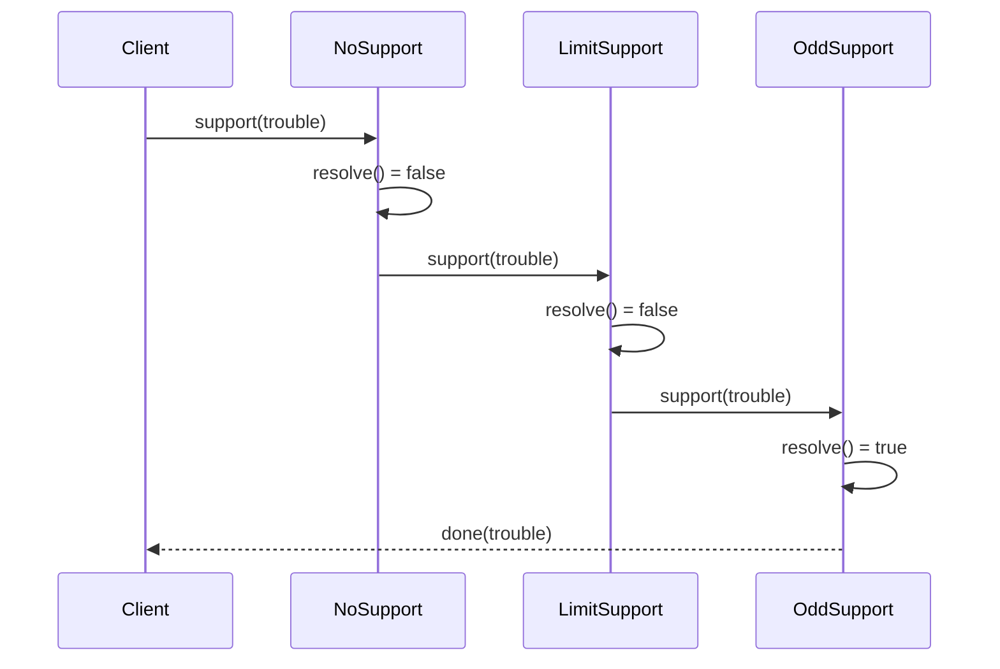

**要点**：

- **发送者与处理者解耦**：客户端只认识链首的 `Support` 接口，不知道链上有谁、谁会处理。
- **链可以动态改变**：`setNext` 可以在运行时重新组装；增删处理者不需要改客户端。
- **必须处理“无人处理”的情况**：链尾的 `next == null` 要有兜底（`fail`、抛异常、进死信队列），
  否则请求会静默丢失。
- **性能与递归**：链太长会带来遍历开销；链式调用是递归的，超长链可能栈溢出，必要时改成循环。
- **JDK/框架中的影子**：Servlet 的 `FilterChain`、Spring Security 的过滤器链、
  Netty 的 `ChannelPipeline`、`java.util.logging.Logger` 的父处理器链；ClassLoader 的双亲委派也常被拿来类比。

**相关**：Composite（树形结构 vs 链式传递）、Decorator（每层都执行 vs 一层接手）、Command（请求对象化）。

---

## 第 7 部分 简单化

### 第 15 章 Facade 模式 —— 简单窗口

**意图**：为子系统中的一组接口提供一个统一的高层接口，使子系统更容易使用。

**变化点**：子系统复杂度。内部类再多、调用顺序再复杂，对外只暴露一个简单方法。

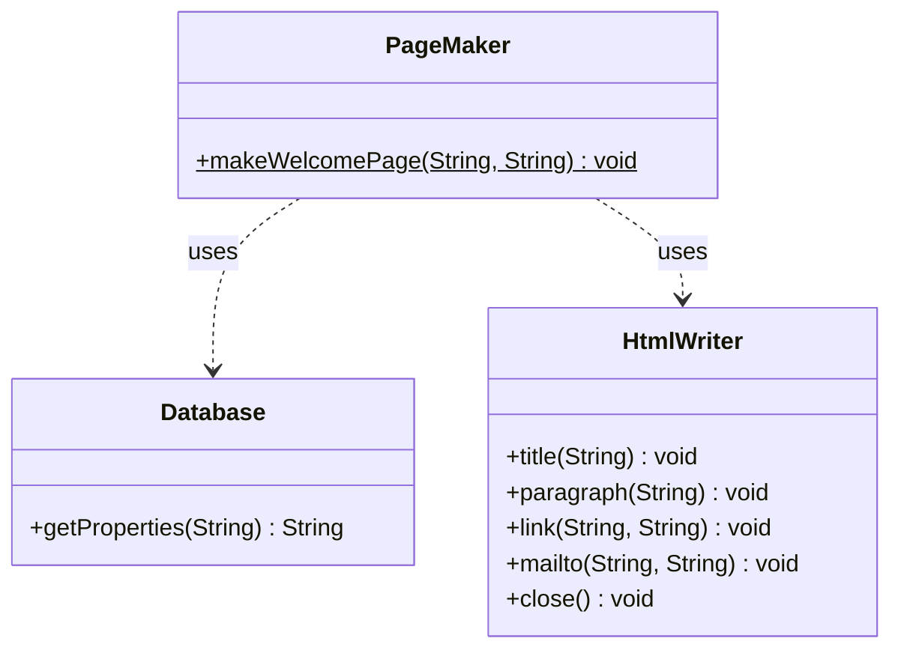

**角色**：

- `Facade`（PageMaker）：把子系统的多个类、多个调用步骤组合成一个简单接口。
- `Subsystem`（Database、HtmlWriter）：完成具体工作的类，不知道 Facade 的存在。
- `Client`：只调用 Facade，不直接和子系统打交道。

**示例**（书中生成欢迎页面的例子，数据库简化为内存 Map）

```java
import java.util.HashMap;
import java.util.Map;

class Database {
    private final Map<String, String> data = new HashMap<>();

    Database() {
        data.put("duke@example.com", "duke");
        data.put("alice@example.com", "alice");
    }

    String getProperties(String key) {
        return data.get(key);
    }
}

class HtmlWriter {
    private final StringBuilder sb = new StringBuilder();

    void title(String title) {
        sb.append("<html>\n<head><title>").append(title).append("</title></head>\n<body>\n");
        sb.append("<h1>").append(title).append("</h1>\n");
    }

    void paragraph(String msg) {
        sb.append("<p>").append(msg).append("</p>\n");
    }

    void link(String href, String caption) {
        sb.append("<p><a href=\"").append(href).append("\">").append(caption).append("</a></p>\n");
    }

    void mailto(String mailAddr, String userName) {
        link("mailto:" + mailAddr, userName);
    }

    void close() {
        sb.append("</body></html>\n");
    }

    public String toString() {
        return sb.toString();
    }
}

class PageMaker {
    private PageMaker() {
    }

    static void makeWelcomePage(String mailAddr, String fileName) {
        Database db = new Database();
        String userName = db.getProperties(mailAddr);
        HtmlWriter writer = new HtmlWriter();
        writer.title("Welcome to " + userName + "'s page!");
        writer.paragraph(userName + " 的欢迎页面。");
        writer.paragraph("请通过邮件联系我：");
        writer.mailto(mailAddr, userName);
        writer.close();
        System.out.println(fileName + " 已生成：");
        System.out.println(writer);
    }
}

public class FacadeDemo {
    public static void main(String[] args) {
        PageMaker.makeWelcomePage("duke@example.com", "welcome.html");
    }
}
```

**要点**：

- **Facade 不增加新功能**：它只是把子系统的调用顺序、参数组装、异常处理包起来，让客户端少写代码。
- **不强制隔离**：客户端仍然可以直接使用子系统类；Facade 是“方便的入口”，不是“唯一的入口”。
- **可以分层**：一个 Facade 可以调用另一个 Facade；子系统内部也可以有自己的 Facade。
- **与 Mediator 的区别**：Facade 是单向的（客户端 → 子系统），Mediator 是双向的（同事 ↔ 中介者 ↔ 同事）。
- **JDK/框架中的影子**：`DriverManager` 是 JDBC 的 Facade；SLF4J 是日志门面；
  Spring 的 `JdbcTemplate` 把“拿连接、建 Statement、处理异常、释放资源”封装成一个简单 API。

**相关**：Mediator、Abstract Factory、Singleton。

### 第 16 章 Mediator 模式 —— 只有一个仲裁者

**意图**：用一个中介对象来封装一系列对象之间的交互，使这些对象不需要显式地相互引用，从而降低耦合，并可以独立地改变它们之间的交互。

**变化点**：对象间交互。同事之间不直接说话，所有消息都经过中介者。

```mermaid
classDiagram
    class Mediator {
        <<interface>>
        +colleagueChanged(Colleague) void
    }
    class Colleague {
        <<abstract>>
        -mediator Mediator
        +setMediator(Mediator) void
        +setColleagueEnabled(boolean) void
    }
    class ColleagueButton {
        +setColleagueEnabled(boolean) void
    }
    class ColleagueTextField {
        +setText(String) void
        +getText() String
    }
    class ColleagueCheckbox {
        +setChecked(boolean) void
        +isChecked() boolean
    }
    class LoginFrame {
        +colleagueChanged(Colleague) void
    }
    Mediator <|.. LoginFrame
    Colleague <|-- ColleagueButton
    Colleague <|-- ColleagueTextField
    Colleague <|-- ColleagueCheckbox
    Colleague --> Mediator : notifies
    LoginFrame o-- Colleague : coordinates
```

**角色**：

- `Mediator`：定义同事与中介者通信的接口。
- `ConcreteMediator`（LoginFrame）：知道所有同事，负责协调它们的启用/禁用状态。
- `Colleague`：每个同事都持有 Mediator 的引用，状态变化时通知中介者。
- `ConcreteColleague`（Button、TextField、Checkbox）：只关心自己的状态，不直接操作其他同事。

**示例**（书中登录框例子的无界面版本，便于直接运行）

```java
interface Mediator {
    void colleagueChanged(Colleague colleague);
}

abstract class Colleague {
    protected Mediator mediator;

    void setMediator(Mediator mediator) {
        this.mediator = mediator;
    }

    abstract void setColleagueEnabled(boolean enabled);
}

class ColleagueButton extends Colleague {
    private boolean enabled = true;

    void setColleagueEnabled(boolean enabled) {
        this.enabled = enabled;
    }

    boolean isEnabled() {
        return enabled;
    }
}

class ColleagueTextField extends Colleague {
    private String text = "";

    void setText(String text) {
        this.text = text;
        mediator.colleagueChanged(this);
    }

    String getText() {
        return text;
    }

    void setColleagueEnabled(boolean enabled) {
        // 文本框始终可编辑，这里只演示协调关系
    }
}

class ColleagueCheckbox extends Colleague {
    private boolean checked;

    void setChecked(boolean checked) {
        this.checked = checked;
        mediator.colleagueChanged(this);
    }

    boolean isChecked() {
        return checked;
    }

    void setColleagueEnabled(boolean enabled) {
        // 复选框始终可操作
    }
}

class LoginFrame implements Mediator {
    private final ColleagueCheckbox checkGuest;
    private final ColleagueCheckbox checkLogin;
    private final ColleagueTextField textUser;
    private final ColleagueTextField textPass;
    private final ColleagueButton buttonOk;

    LoginFrame() {
        checkGuest = new ColleagueCheckbox();
        checkLogin = new ColleagueCheckbox();
        textUser = new ColleagueTextField();
        textPass = new ColleagueTextField();
        buttonOk = new ColleagueButton();

        Colleague[] colleagues = {checkGuest, checkLogin, textUser, textPass, buttonOk};
        for (Colleague colleague : colleagues) {
            colleague.setMediator(this);
        }
        checkLogin.setChecked(true);
    }

    public void colleagueChanged(Colleague colleague) {
        boolean guest = checkGuest.isChecked();
        boolean login = checkLogin.isChecked();
        boolean filled = !textUser.getText().isEmpty() && !textPass.getText().isEmpty();
        if (colleague == checkGuest || colleague == checkLogin) {
            textUser.setColleagueEnabled(!guest && login);
            textPass.setColleagueEnabled(!guest && login);
        }
        buttonOk.setColleagueEnabled(guest || (login && filled));
        System.out.println("OK 按钮状态：" + buttonOk.isEnabled());
    }

    void simulate() {
        textUser.setText("duke");
        textPass.setText("123456");
        checkGuest.setChecked(true);
    }
}

public class MediatorDemo {
    public static void main(String[] args) {
        new LoginFrame().simulate();
    }
}
```

**要点**：

- **把网状关系变成星形**：没有中介者时，n 个同事两两通信，最多 n(n-1)/2 条线；有中介者后，每个同事只连中介者，
  复杂度从 O(n²) 降到 O(n)。
- **控制逻辑集中**：登录框里“选了游客就禁用输入框、填了用户名密码才启用 OK”这类规则集中在中介者，
  同事类只负责自己的状态。
- **中介者可能变成上帝类**：逻辑越集中，中介者越容易膨胀；复杂系统要配合状态机、事件总线或领域服务拆分。
- **与 Facade 的区别**：Facade 是客户端对子系统的单向简化；Mediator 是同事之间的双向协调，同事会主动通知中介者。
- **JDK/框架中的影子**：`java.util.Timer` 协调定时任务；`ExecutorService` 协调生产者与消费者；
  Spring MVC 的 `DispatcherServlet` 协调 HandlerMapping、HandlerAdapter、ViewResolver；
  消息队列在分布式系统中扮演中介者。

**相关**：Facade、Observer、Command。

---

## 第 8 部分 管理状态

### 第 17 章 Observer 模式 —— 发送状态变化通知

**意图**：定义对象间的一种一对多依赖关系，当一个对象的状态发生改变时，所有依赖它的对象都得到通知并被自动更新。

**变化点**：状态通知。主题只管发通知，不关心谁在听、听了做什么。

```mermaid
classDiagram
    class Observer {
        <<interface>>
        +update(NumberGenerator) void
    }
    class NumberGenerator {
        <<abstract>>
        -observers List~Observer~
        +addObserver(Observer) void
        +deleteObserver(Observer) void
        +notifyObservers() void
        +getNumber() int*
        +execute() void*
    }
    class RandomNumberGenerator {
        -number int
        +getNumber() int
        +execute() void
    }
    class DigitObserver {
        +update(NumberGenerator) void
    }
    class GraphObserver {
        +update(NumberGenerator) void
    }
    Observer <|.. DigitObserver
    Observer <|.. GraphObserver
    NumberGenerator o-- Observer : notifies
    NumberGenerator <|-- RandomNumberGenerator
```

**角色**：

- `Subject`（NumberGenerator）：持有观察者列表，提供注册/注销/通知接口。
- `ConcreteSubject`（RandomNumberGenerator）：状态改变时调用 `notifyObservers()`。
- `Observer`：定义更新接口。
- `ConcreteObserver`（DigitObserver、GraphObserver）：实现更新逻辑。

**示例**（书中数字生成器例子）

```java
import java.util.ArrayList;
import java.util.List;
import java.util.Random;

interface Observer {
    void update(NumberGenerator generator);
}

abstract class NumberGenerator {
    private final List<Observer> observers = new ArrayList<>();

    void addObserver(Observer observer) {
        observers.add(observer);
    }

    void deleteObserver(Observer observer) {
        observers.remove(observer);
    }

    void notifyObservers() {
        for (Observer observer : observers) {
            observer.update(this);
        }
    }

    abstract int getNumber();

    abstract void execute();
}

class RandomNumberGenerator extends NumberGenerator {
    private final Random random = new Random(1);
    private int number;

    int getNumber() {
        return number;
    }

    void execute() {
        for (int i = 0; i < 5; i++) {
            number = random.nextInt(50);
            notifyObservers();
        }
    }
}

class DigitObserver implements Observer {
    public void update(NumberGenerator generator) {
        System.out.println("DigitObserver: " + generator.getNumber());
    }
}

class GraphObserver implements Observer {
    public void update(NumberGenerator generator) {
        StringBuilder sb = new StringBuilder("GraphObserver: ");
        for (int i = 0; i < generator.getNumber(); i++) {
            sb.append('*');
        }
        System.out.println(sb);
    }
}

public class ObserverDemo {
    public static void main(String[] args) {
        NumberGenerator generator = new RandomNumberGenerator();
        generator.addObserver(new DigitObserver());
        generator.addObserver(new GraphObserver());
        generator.execute();
    }
}
```

**通知过程**：

```mermaid
sequenceDiagram
    participant G as RandomNumberGenerator
    participant D as DigitObserver
    participant P as GraphObserver
    G->>G: execute()
    loop 5 次
        G->>G: number = nextInt(50)
        G->>D: update(this)
        D-->>G: getNumber()
        G->>P: update(this)
        P-->>G: getNumber()
    end
```

**要点**：

- **主题只依赖 Observer 接口**：新增观察者不需要改主题；主题也不知道观察者会做什么。
- **通知顺序不确定**：如果观察者之间有依赖，不能假设谁先收到通知；需要顺序时，用多个主题或显式排序。
- **不要在 `update` 里修改观察者列表**：遍历时增删观察者会抛 `ConcurrentModificationException`；
  需要延迟到通知结束后再改。
- **推模型 vs 拉模型**：`update(generator)` 是拉模型，观察者主动取数据；也可以在参数里直接传状态（推模型），
  但主题变化时接口要改。
- **JDK/框架中的影子**：`java.util.Observer` 从 Java 9 起已废弃；现代写法是 `PropertyChangeListener`、
  Java 9 的 `Flow` API、Spring 的 `ApplicationEvent`/`ApplicationListener`、GUI 的事件监听器。

**相关**：Mediator（集中协调 vs 广播通知）、MVC（Model 通知 View）。

### 第 18 章 Memento 模式 —— 保存对象状态

**意图**：在不破坏封装性的前提下，捕获一个对象的内部状态，并在该对象之外保存这个状态，以便以后将对象恢复到原先保存的状态。

**变化点**：状态快照。对象的状态会变，但需要能回滚到某个历史点。

```mermaid
classDiagram
    class Memento {
        -money int
        -fruits List~String~
        +getMoney() int
        +getFruits() List
    }
    class Gamer {
        -money int
        -fruits List~String~
        +bet() void
        +createMemento() Memento
        +restore(Memento) void
    }
    class Main
    Gamer ..> Memento : creates
    Main ..> Memento : keeps
    Main ..> Gamer : restores
```

**角色**：

- `Originator`（Gamer）：拥有内部状态，负责创建 Memento 和从 Memento 恢复。
- `Memento`：保存 Originator 的内部状态；对外只暴露必要的读取接口。
- `Caretaker`（Main）：保管 Memento，但不窥探其内容，也不知道状态细节。

**示例**（书中 `Gamer` 例子）

```java
import java.util.ArrayList;
import java.util.Collections;
import java.util.List;
import java.util.Random;

class Memento {
    private final int money;
    private final List<String> fruits;

    Memento(int money) {
        this.money = money;
        this.fruits = new ArrayList<>();
    }

    void addFruit(String fruit) {
        fruits.add(fruit);
    }

    int getMoney() {
        return money;
    }

    List<String> getFruits() {
        return Collections.unmodifiableList(fruits);
    }
}

class Gamer {
    private int money;
    private final List<String> fruits = new ArrayList<>();
    private final Random random = new Random(9);
    private static final String[] FRUITS = {"苹果", "葡萄", "香蕉", "橘子"};

    Gamer(int money) {
        this.money = money;
    }

    int getMoney() {
        return money;
    }

    void bet() {
        int dice = random.nextInt(6) + 1;
        if (dice == 1) {
            money += 100;
            System.out.println("所持金钱增加了。");
        } else if (dice == 2) {
            money /= 2;
            System.out.println("所持金钱减半了。");
        } else if (dice == 6) {
            String fruit = getFruit();
            System.out.println("获得了水果：" + fruit);
            fruits.add(fruit);
        } else {
            System.out.println("什么都没有发生。");
        }
    }

    Memento createMemento() {
        Memento memento = new Memento(money);
        for (String fruit : fruits) {
            if (fruit.startsWith("好吃的")) {
                memento.addFruit(fruit);
            }
        }
        return memento;
    }

    void restore(Memento memento) {
        this.money = memento.getMoney();
        this.fruits.clear();
        this.fruits.addAll(memento.getFruits());
    }

    private String getFruit() {
        String prefix = random.nextBoolean() ? "好吃的" : "";
        return prefix + FRUITS[random.nextInt(FRUITS.length)];
    }

    public String toString() {
        return "[money = " + money + ", fruits = " + fruits + "]";
    }
}

public class MementoDemo {
    public static void main(String[] args) {
        Gamer gamer = new Gamer(100);
        Memento memento = gamer.createMemento();
        for (int i = 0; i < 5; i++) {
            System.out.println("==== " + i);
            System.out.println("当前：" + gamer);
            gamer.bet();
            System.out.println("所持金钱为 " + gamer.getMoney() + " 元。");
            if (gamer.getMoney() > memento.getMoney()) {
                System.out.println("（保存当前状态）");
                memento = gamer.createMemento();
            } else if (gamer.getMoney() < memento.getMoney() / 2) {
                System.out.println("（恢复之前状态）");
                gamer.restore(memento);
            }
        }
        System.out.println("最终：" + gamer);
    }
}
```

**要点**：

- **Caretaker 不窥探 Memento**：Main 只负责保存和交还，不读 `money`/`fruits` 的具体值；
  这样 Originator 的内部表示可以自由修改，不影响 Caretaker。
- **窄接口与宽接口**：对外只暴露必要的 getter；如果语言支持（如 C++ 的 friend、Java 的包可见性），
  可以把宽接口只开放给 Originator。
- **快照的数量与有效期**：全量保存大对象会占内存；可以用增量快照、压缩、只保留最近 N 个，
  或者用持久化存储。
- **深拷贝**：Memento 里的可变字段要复制，不能直接持有 Originator 的引用，否则恢复时状态已经被改掉。
- **JDK/框架中的影子**：`javax.swing.undo.UndoManager` 保存 `UndoableEdit`；
  数据库的 savepoint、Git 的 commit 都是 Memento 思想；`Serializable` 也常用于做快照。

**相关**：Command（撤销）、State（状态迁移）、Prototype（复制对象）。

### 第 19 章 State 模式 —— 用类表示状态

**意图**：允许一个对象在其内部状态改变时改变它的行为，对象看起来似乎修改了它的类。

**变化点**：状态相关行为。状态不多但行为差异大时，用类代替 `switch`/`if`。

```mermaid
classDiagram
    class State {
        <<interface>>
        +doClock(Context, int) void
        +doUse(Context) void
        +doAlarm(Context) void
        +doPhone(Context) void
    }
    class DayState {
        +doClock(Context, int) void
        +doUse(Context) void
        +doAlarm(Context) void
        +doPhone(Context) void
    }
    class NightState {
        +doClock(Context, int) void
        +doUse(Context) void
        +doAlarm(Context) void
        +doPhone(Context) void
    }
    class Context {
        <<interface>>
        +setClock(int) void
        +changeState(State) void
        +callSecurityCenter(String) void
        +recordLog(String) void
    }
    class SafeFrame {
        -state State
        +setClock(int) void
        +changeState(State) void
    }
    State <|.. DayState
    State <|.. NightState
    SafeFrame ..> State : delegates
    State ..> Context : transitions
```

**角色**：

- `State`：定义与状态相关的行为接口。
- `ConcreteState`（DayState、NightState）：实现该状态下的行为，并在合适时机触发状态迁移。
- `Context`（SafeFrame）：持有当前 State，把请求委托给 State；提供状态迁移所需的服务。
- `Client`：通过 Context 触发事件，不直接操作 State。

**示例**（书中金库警报系统例子，改为控制台输出）

```java
interface State {
    void doClock(Context context, int hour);

    void doUse(Context context);

    void doAlarm(Context context);

    void doPhone(Context context);
}

interface Context {
    void setClock(int hour);

    void changeState(State state);

    void callSecurityCenter(String msg);

    void recordLog(String msg);
}

class DayState implements State {
    private static final DayState INSTANCE = new DayState();

    static DayState getInstance() {
        return INSTANCE;
    }

    public void doClock(Context context, int hour) {
        if (hour < 9 || 17 <= hour) {
            context.changeState(NightState.getInstance());
        }
    }

    public void doUse(Context context) {
        context.recordLog("使用金库（白天）");
    }

    public void doAlarm(Context context) {
        context.callSecurityCenter("按下警铃（白天）");
    }

    public void doPhone(Context context) {
        context.callSecurityCenter("正常通话（白天）");
    }

    public String toString() {
        return "[白天]";
    }
}

class NightState implements State {
    private static final NightState INSTANCE = new NightState();

    static NightState getInstance() {
        return INSTANCE;
    }

    public void doClock(Context context, int hour) {
        if (9 <= hour && hour < 17) {
            context.changeState(DayState.getInstance());
        }
    }

    public void doUse(Context context) {
        context.callSecurityCenter("紧急：晚上使用金库！");
    }

    public void doAlarm(Context context) {
        context.callSecurityCenter("按下警铃（晚上）");
    }

    public void doPhone(Context context) {
        context.recordLog("晚上的通话录音");
    }

    public String toString() {
        return "[晚上]";
    }
}

class SafeFrame implements Context {
    private State state = DayState.getInstance();

    public void setClock(int hour) {
        System.out.println("现在时间是 " + hour + ":00");
        state.doClock(this, hour);
        System.out.println("当前状态：" + state);
    }

    public void changeState(State state) {
        System.out.println("状态从 " + this.state + " 变为 " + state);
        this.state = state;
    }

    public void callSecurityCenter(String msg) {
        System.out.println("call! " + msg);
    }

    public void recordLog(String msg) {
        System.out.println("record ... " + msg);
    }

    void use() {
        state.doUse(this);
    }

    void alarm() {
        state.doAlarm(this);
    }

    void phone() {
        state.doPhone(this);
    }
}

public class StateDemo {
    public static void main(String[] args) {
        SafeFrame frame = new SafeFrame();
        frame.setClock(8);
        frame.use();
        frame.setClock(10);
        frame.use();
        frame.alarm();
        frame.phone();
        frame.setClock(20);
        frame.use();
    }
}
```

**要点**：

- **用类表示状态**：每个状态的行为独立成一个类，新增状态不需要改一长串 `if/else`；
  状态迁移由 State 或 Context 触发，规则集中且不容易漏。
- **谁来管理迁移**：放在 State 里，状态自己知道“下一步是谁”；放在 Context 里，迁移规则更集中。
  书中的做法是 State 调用 `context.changeState(...)`，两者协作。
- **与 Strategy 的区别**：结构几乎一样（都是把行为委托给接口），但意图不同——
  Strategy 由客户端选择算法，State 由状态变化驱动迁移；Strategy 的算法通常无状态，State 的行为依赖当前状态。
- **状态爆炸**：状态很多时，类数量会膨胀；可以用状态表、状态机引擎（如 Spring StateMachine）替代手写类。
- **JDK/框架中的影子**：`Thread.State` 是状态枚举，但不是 GoF State（没有行为委托）；
  TCP 连接状态、订单状态机、工作流引擎都是 State 的典型应用。

**相关**：Strategy、Bridge、Observer（状态变化通知）。

---

## 第 9 部分 避免浪费

### 第 20 章 Flyweight 模式 —— 共享对象，避免浪费

**意图**：运用共享技术有效地支持大量细粒度的对象。

**变化点**：对象数量与内存。把可共享的“内在状态”抽出来复用，把“外在状态”留给调用方传入。

```mermaid
classDiagram
    class BigChar {
        -charName char
        -fontData String
        +print() void
    }
    class BigCharFactory {
        -pool Map~Character,BigChar~
        +getBigChar(char) BigChar$
        +poolSize() int
    }
    class BigString {
        -bigChars BigChar[]
        +print() void
    }
    BigCharFactory o-- BigChar : caches
    BigString o-- BigChar : uses
```

**角色**：

- `Flyweight`（BigChar）：可共享的细粒度对象，保存内在状态。
- `FlyweightFactory`（BigCharFactory）：缓存并复用 Flyweight；请求相同 key 时返回同一个实例。
- `Client`（BigString）：维护外在状态（如字符位置），使用时传给 Flyweight。

**示例**（书中大字符例子，只实现 `0` 和 `1`）

```java
import java.util.HashMap;
import java.util.Map;

class BigChar {
    private final char charName;
    private final String fontData;

    BigChar(char charName) {
        this.charName = charName;
        this.fontData = loadFontData(charName);
    }

    void print() {
        System.out.print(fontData);
    }

    private String loadFontData(char c) {
        if (c == '0') {
            return "###\n# #\n# #\n# #\n###\n";
        }
        if (c == '1') {
            return " # \n## \n # \n # \n###\n";
        }
        return "???\n";
    }
}

class BigCharFactory {
    private final Map<Character, BigChar> pool = new HashMap<>();
    private static final BigCharFactory INSTANCE = new BigCharFactory();

    static BigCharFactory getInstance() {
        return INSTANCE;
    }

    BigChar getBigChar(char charName) {
        BigChar bigChar = pool.get(charName);
        if (bigChar == null) {
            bigChar = new BigChar(charName);
            pool.put(charName, bigChar);
        }
        return bigChar;
    }

    int poolSize() {
        return pool.size();
    }
}

class BigString {
    private final BigChar[] bigChars;

    BigString(String string) {
        bigChars = new BigChar[string.length()];
        BigCharFactory factory = BigCharFactory.getInstance();
        for (int i = 0; i < string.length(); i++) {
            bigChars[i] = factory.getBigChar(string.charAt(i));
        }
    }

    void print() {
        for (BigChar bigChar : bigChars) {
            bigChar.print();
        }
    }
}

public class FlyweightDemo {
    public static void main(String[] args) {
        BigString bs = new BigString("0101");
        bs.print();
        System.out.println("共享实例数：" + BigCharFactory.getInstance().poolSize());
    }
}
```

**要点**：

- **内在状态 vs 外在状态**：内在状态（字符形状）可以共享，存在 Flyweight 里；
  外在状态（字符在字符串中的位置）随场景变化，由 Client 保存并传入。
- **工厂缓存是核心**：没有缓存，每次 `new` 就退化成普通对象，起不到共享作用。
- **缓存的生命周期**：缓存会阻止对象被 GC；对象很多时要用弱引用（`WeakHashMap`）或软引用，
  避免缓存本身成为内存泄漏。
- **共享对象的不可变性**：Flyweight 的内在状态应该不可变，否则一处修改会影响所有使用者。
- **JDK/框架中的影子**：`Integer.valueOf` 缓存 -128～127；`String` 常量池/`intern()`；
  `Boolean.valueOf`、`Character.valueOf`；`java.util.logging` 的日志级别对象等。

**相关**：Proxy、Composite、Interpreter（终结符表达式可共享）。

### 第 21 章 Proxy 模式 —— 只在必要时生成实例

**意图**：为其他对象提供一种代理以控制对这个对象的访问。

**变化点**：访问控制。客户端以为自己在用真实对象，实际上中间隔了一层代理。

```mermaid
classDiagram
    class Printable {
        <<interface>>
        +setPrinterName(String) void
        +getPrinterName() String
        +print(String) void
    }
    class Printer {
        -name String
        +print(String) void
    }
    class PrinterProxy {
        -name String
        -real Printer
        +print(String) void
    }
    Printable <|.. Printer
    Printable <|.. PrinterProxy
    PrinterProxy --> Printer : creates on demand
```

**角色**：

- `Subject`（Printable）：真实对象和代理的共同接口。
- `RealSubject`（Printer）：真正干活的类，创建成本高。
- `Proxy`（PrinterProxy）：持有 RealSubject 的引用，控制访问；可以延迟创建、加权限、加缓存。
- `Client`：只依赖 Subject，不知道是代理还是真实对象。

**示例**（书中打印机代理例子）

```java
interface Printable {
    void setPrinterName(String name);

    String getPrinterName();

    void print(String string);
}

class Printer implements Printable {
    private String name;

    Printer() {
        heavyJob("正在生成 Printer 实例");
    }

    Printer(String name) {
        this.name = name;
        heavyJob("正在生成 Printer 实例（" + name + "）");
    }

    public void setPrinterName(String name) {
        this.name = name;
    }

    public String getPrinterName() {
        return name;
    }

    public void print(String string) {
        System.out.println("=== " + name + " ===");
        System.out.println(string);
    }

    private void heavyJob(String msg) {
        System.out.print(msg);
        for (int i = 0; i < 3; i++) {
            try {
                Thread.sleep(200);
            } catch (InterruptedException e) {
                Thread.currentThread().interrupt();
            }
            System.out.print(".");
        }
        System.out.println(" 完成。");
    }
}

class PrinterProxy implements Printable {
    private String name;
    private Printer real;

    PrinterProxy(String name) {
        this.name = name;
    }

    public synchronized void setPrinterName(String name) {
        if (real != null) {
            real.setPrinterName(name);
        }
        this.name = name;
    }

    public String getPrinterName() {
        return name;
    }

    public void print(String string) {
        realize();
        real.print(string);
    }

    private synchronized void realize() {
        if (real == null) {
            real = new Printer(name);
        }
    }
}

public class ProxyDemo {
    public static void main(String[] args) {
        Printable p = new PrinterProxy("Alice");
        System.out.println("名字现在是 " + p.getPrinterName() + "。");
        p.setPrinterName("Bob");
        System.out.println("名字现在是 " + p.getPrinterName() + "。");
        p.print("Hello, world.");
    }
}
```

**要点**：

- **虚拟代理（Virtual Proxy）**：延迟创建昂贵对象，真正用到时才初始化；上面的 PrinterProxy 就是。
- **其他代理类型**：保护代理（权限检查）、远程代理（RMI、gRPC stub）、缓存代理（缓存结果）、
  写时复制代理（Copy-on-Write）。
- **透明性**：代理与真实对象实现同一接口，客户端不需要改代码；这也是 Proxy 与 Adapter 的关键区别。
- **与 Decorator 的区别**：Proxy 控制访问，通常自己创建/管理真实对象；Decorator 增强功能，被装饰对象由客户端传入。
- **JDK/框架中的影子**：`java.lang.reflect.Proxy` + `InvocationHandler` 是动态代理；
  RMI stub、Spring AOP、MyBatis Mapper 接口、Hibernate 懒加载都是 Proxy。

**相关**：Decorator、Adapter、Facade。

---

## 第 10 部分 用类来表现

### 第 22 章 Command 模式 —— 命令也是类

**意图**：将一个请求封装为一个对象，从而使你可以用不同的请求对客户进行参数化，对请求排队或记录请求日志，以及支持可撤销的操作。

**变化点**：请求/动作。把“做什么”从调用者手里剥离出来，变成一个可传递、可存储、可撤销的对象。

```mermaid
classDiagram
    class Command {
        <<interface>>
        +execute() void
    }
    class MacroCommand {
        -commands List~Command~
        +execute() void
        +append(Command) void
        +undo() void
    }
    class DrawCommand {
        -drawable Drawable
        -x int
        -y int
        +execute() void
    }
    class Drawable {
        <<interface>>
        +draw(int, int) void
    }
    class DrawCanvas {
        -history MacroCommand
        +draw(int, int) void
        +paint() void
    }
    Command <|.. MacroCommand
    Command <|.. DrawCommand
```

> 其余关系都藏在字段里：`MacroCommand` 持有 `List~Command~`（组合，宏可以嵌套宏）、
> `DrawCommand` 持有 `Drawable`（接收者）、`DrawCanvas` 持有 `MacroCommand`（重放历史）。
> 为避免连线交叉，图中不再画这些关联线。

**角色**：

- `Command`：定义执行操作的接口。
- `ConcreteCommand`（DrawCommand）：把接收者（Drawable）和参数（x、y）绑定在一起。
- `Receiver`（DrawCanvas）：真正执行操作的对象。
- `Invoker`（MacroCommand 或客户端）：触发命令，不关心命令内部怎么做。
- `Client`：创建命令并绑定接收者。

**示例**（书中绘图例子，改为控制台字符画布）

```java
import java.util.ArrayList;
import java.util.List;

interface Command {
    void execute();
}

interface Drawable {
    void draw(int x, int y);
}

class DrawCommand implements Command {
    private final Drawable drawable;
    private final int x;
    private final int y;

    DrawCommand(Drawable drawable, int x, int y) {
        this.drawable = drawable;
        this.x = x;
        this.y = y;
    }

    public void execute() {
        drawable.draw(x, y);
    }
}

class MacroCommand implements Command {
    private final List<Command> commands = new ArrayList<>();

    public void execute() {
        for (Command command : commands) {
            command.execute();
        }
    }

    void append(Command command) {
        if (command != this) {
            commands.add(command);
        }
    }

    void undo() {
        if (!commands.isEmpty()) {
            commands.remove(commands.size() - 1);
        }
    }
}

class DrawCanvas implements Drawable {
    private final int width;
    private final int height;
    private final char[][] canvas;
    private final MacroCommand history;

    DrawCanvas(int width, int height, MacroCommand history) {
        this.width = width;
        this.height = height;
        this.canvas = new char[height][width];
        this.history = history;
        clearCanvas();
    }

    private void clearCanvas() {
        for (int y = 0; y < height; y++) {
            for (int x = 0; x < width; x++) {
                canvas[y][x] = '.';
            }
        }
    }

    public void draw(int x, int y) {
        if (x >= 0 && x < width && y >= 0 && y < height) {
            canvas[y][x] = '*';
        }
    }

    void paint() {
        clearCanvas();
        history.execute();
        for (int y = 0; y < height; y++) {
            System.out.println(new String(canvas[y]));
        }
    }
}

public class CommandDemo {
    public static void main(String[] args) {
        MacroCommand history = new MacroCommand();
        DrawCanvas canvas = new DrawCanvas(20, 8, history);
        history.append(new DrawCommand(canvas, 2, 2));
        history.append(new DrawCommand(canvas, 3, 3));
        history.append(new DrawCommand(canvas, 4, 4));
        canvas.paint();
        System.out.println("--- undo ---");
        history.undo();
        canvas.paint();
    }
}
```

**要点**：

- **命令把“动作”变成“数据”**：命令对象可以放进列表、队列、日志、栈，也可以序列化后跨进程传输。
- **宏命令是组合模式的应用**：`MacroCommand` 本身也是 `Command`，可以包含其他命令，也可以被包含。
- **撤销的两种实现**：命令自己保存反向操作（如 `undo()`），或者用 Memento 保存执行前状态。
  前者轻量，后者适合状态复杂、无法轻易反向的场景。
- **JDK/框架中的影子**：`Runnable` 是最小的 Command；`ExecutorService.submit` 把任务排队执行；
  `javax.swing.Action`、`UndoableEdit`、Spring 的 `TransactionCallback` 都是命令思想。

**相关**：Memento（撤销）、Interpreter（命令语言）、Chain of Responsibility（请求传递）。

### 第 23 章 Interpreter 模式 —— 语法规则也是类

**意图**：给定一个语言，定义它的文法表示，并定义一个解释器，这个解释器使用该表示来解释语言中的句子。

**变化点**：文法规则。文法稳定、句子多变时，把每条规则变成一个类，递归解释。

```mermaid
classDiagram
    class Node {
        <<interface>>
        +parse(Context) void
    }
    class ProgramNode {
        +parse(Context) void
    }
    class RepeatCommandNode {
        -number int
        +parse(Context) void
    }
    class PrimitiveCommandNode {
        -name String
        +parse(Context) void
    }
    Node <|.. ProgramNode
    Node <|.. RepeatCommandNode
    Node <|.. PrimitiveCommandNode
```

> 图中只画出三种代表性节点。`CommandListNode`、`CommandNode` 与示例代码一致，同样实现 `Node`。
> `Node.parse(Context)` 的参数说明每个节点都从 `Context` 中取 token（`Context` 提供
> `currentToken`/`nextToken`/`skipToken`，见示例代码）。非终结符节点（ProgramNode、RepeatCommandNode 等）
> 持有子 `Node` 并递归调用 `parse`——这正是 Composite 的结构，为避免连线交叉，图中省略了组合线。

**角色**：

- `AbstractExpression`（Node）：声明 `parse(Context)`。
- `TerminalExpression`（PrimitiveCommandNode）：终结符表达式，直接处理最小语法单元。
- `NonterminalExpression`（ProgramNode、CommandListNode、CommandNode、RepeatCommandNode）：非终结符表达式，
  递归调用子表达式。
- `Context`：保存输入 token 和当前解析位置。
- `Client`：构造语法树并调用 `parse`。

**示例**（书中迷你语言例子，支持 `program`、`repeat`、`go`、`right`、`end`）

```java
import java.util.ArrayList;
import java.util.List;

class ParseException extends Exception {
    ParseException(String msg) {
        super(msg);
    }
}

class Context {
    private final String[] tokens;
    private int index;

    Context(String text) {
        this.tokens = text.split("\\s+");
    }

    String currentToken() {
        return index < tokens.length ? tokens[index] : null;
    }

    String nextToken() {
        String token = currentToken();
        index++;
        return token;
    }

    int currentNumber() throws ParseException {
        String token = currentToken();
        try {
            return Integer.parseInt(token);
        } catch (NumberFormatException e) {
            throw new ParseException("需要数字，实际是：" + token);
        }
    }

    void skipToken(String token) throws ParseException {
        if (!token.equals(currentToken())) {
            throw new ParseException("期望 " + token + "，实际是 " + currentToken());
        }
        index++;
    }
}

interface Node {
    void parse(Context context) throws ParseException;
}

class ProgramNode implements Node {
    private Node commandListNode;

    public void parse(Context context) throws ParseException {
        context.skipToken("program");
        commandListNode = new CommandListNode();
        commandListNode.parse(context);
    }

    public String toString() {
        return "[program " + commandListNode + "]";
    }
}

class CommandListNode implements Node {
    private final List<Node> list = new ArrayList<>();

    public void parse(Context context) throws ParseException {
        while (context.currentToken() != null && !context.currentToken().equals("end")) {
            Node commandNode = new CommandNode();
            commandNode.parse(context);
            list.add(commandNode);
        }
    }

    public String toString() {
        return list.toString();
    }
}

class CommandNode implements Node {
    private Node node;

    public void parse(Context context) throws ParseException {
        if ("repeat".equals(context.currentToken())) {
            node = new RepeatCommandNode();
        } else {
            node = new PrimitiveCommandNode();
        }
        node.parse(context);
    }

    public String toString() {
        return node.toString();
    }
}

class RepeatCommandNode implements Node {
    private int number;
    private Node commandListNode;

    public void parse(Context context) throws ParseException {
        context.skipToken("repeat");
        number = context.currentNumber();
        context.nextToken();
        commandListNode = new CommandListNode();
        commandListNode.parse(context);
        context.skipToken("end");
    }

    public String toString() {
        return "[repeat " + number + " " + commandListNode + "]";
    }
}

class PrimitiveCommandNode implements Node {
    private String name;

    public void parse(Context context) throws ParseException {
        name = context.currentToken();
        context.skipToken(name);
        if (!name.equals("go") && !name.equals("right")) {
            throw new ParseException("未知命令：" + name);
        }
    }

    public String toString() {
        return name;
    }
}

public class InterpreterDemo {
    public static void main(String[] args) throws ParseException {
        Node program = new ProgramNode();
        program.parse(new Context("program go right repeat 2 go end end"));
        System.out.println(program);
    }
}
```

**要点**：

- **文法规则即类**：每条产生式对应一个 Node 子类，`parse` 递归下降；终结符直接消费 token，非终结符递归调用子节点。
- **易于扩展文法，难以应对复杂语言**：加一条规则就加一个类；但文法一大，类会爆炸，性能和错误恢复也难做。
  复杂语言应该用 ANTLR、JavaCC、Tree-sitter 等解析器生成器。
- **Context 的职责**：保存 token 流和当前位置，提供 `currentToken`、`nextToken`、`skipToken` 等原语；
  它不负责语法规则。
- **与 Composite 的关系**：语法树就是一棵 Composite，Node 是 Component，终结符是 Leaf，非终结符是 Composite。
- **JDK/框架中的影子**：`java.util.regex.Pattern` 是正则表达式的解释器；
  Spring EL、SQL 解析器、规则引擎（Drools）都是 Interpreter 的变体。

**相关**：Composite（语法树）、Flyweight（共享终结符）、Visitor（在语法树上执行操作）。

---

## 附录

### 附录 A：按变化点选模式

| 你遇到的变化 | 优先考虑 |
|--------------|----------|
| 遍历方式会变 | Iterator |
| 接口不兼容 | Adapter |
| 流程固定、步骤可变 | Template Method |
| 产品类型会变 | Factory Method |
| 实例数量要限制 | Singleton |
| 创建方式要灵活 | Prototype |
| 构建过程与表示要分离 | Builder |
| 产品族要整体替换 | Abstract Factory |
| 两个维度都要独立扩展 | Bridge |
| 算法要可替换 | Strategy |
| 要统一对待单个与组合对象 | Composite |
| 要动态叠加职责 | Decorator |
| 操作经常新增 | Visitor |
| 处理者要动态组装 | Chain of Responsibility |
| 子系统太复杂 | Facade |
| 对象间交互太乱 | Mediator |
| 状态变化要通知多方 | Observer |
| 要保存/恢复状态 | Memento |
| 状态相关行为差异大 | State |
| 对象太多、内存吃紧 | Flyweight |
| 要控制访问 | Proxy |
| 请求要排队/记录/撤销 | Command |
| 要解释一种小语言 | Interpreter |

> **提醒**：这张表是“变化点 → 模式”的索引，不是“看到关键词就用模式”。
> 先确认变化真的存在、真的会频繁发生，再引入模式；否则就是过度设计。

### 附录 B：常见误区

1. **把模式当目的**：模式是应对变化的手段，不是代码的装饰。没有变化点，就不需要模式。
2. **背类图，不理解意图**：Adapter 和 Bridge 的类图可能很像，但一个事后补救、一个事前设计；
   面试和评审时，先讲意图，再讲结构。
3. **过度使用继承**：Template Method、Factory Method 都依赖继承，但组合通常更灵活；
   能委托就不要继承。
4. **把 Spring 的作用域当 GoF 模式**：Spring 的 singleton/prototype 是 bean 的作用域，
   不是 JVM 级单例，也不是 Prototype 的克隆语义。
5. **认为 Abstract Factory 什么都能扩展**：新增产品族容易，新增零件很难；
   Visitor 则相反，新增操作容易，新增元素难。每个模式都有“开闭”的不对称性。
6. **忽视并发**：Singleton 的双重检查、Proxy 的延迟初始化、Flyweight 的缓存都需要考虑线程安全。
7. **把 `java.util.Observer` 当现代写法**：它从 Java 9 起已废弃；新代码用 `Flow`、事件总线或 Spring Events。
8. **忘记兜底**：Chain of Responsibility 没有处理者时要有失败路径；Strategy 没有默认策略时要报错；
   Proxy 创建真实对象失败时要能降级。

### 附录 C：模式背后的设计原则

| 原则 | 在模式中的体现 |
|------|----------------|
| 开闭原则 | 新增 Visitor/Strategy/Factory 子类，不改原有代码 |
| 依赖倒置 | 客户端依赖 Iterator、Strategy、Command 等抽象 |
| 单一职责 | 把“创建”“遍历”“通知”“状态”拆成独立角色 |
| 组合优于继承 | Strategy、Decorator、Bridge 用委托替代继承 |
| 封装变化 | 每个模式封装一个特定的变化点 |
| 面向接口编程 | 角色之间通过接口协作，不依赖具体类 |
| 最少知识 | Facade、Mediator 减少对象之间的直接引用 |

### 附录 D：JDK/Spring 中的模式地图

| 模式 | JDK / Spring 中的影子 |
|------|----------------------|
| Iterator | `java.util.Iterator`、`Iterable`、`for-each` |
| Adapter | `InputStreamReader`、Spring MVC `HandlerAdapter` |
| Template Method | `AbstractList`、`HttpServlet.service()`、JUnit `runBare()` |
| Factory Method | `Collection.iterator()`、`NumberFormat.getInstance()`、`FactoryBean` |
| Singleton | `Runtime.getRuntime()`、Spring singleton bean（容器级） |
| Prototype | `Object.clone()`、DOM `cloneNode(true)` |
| Builder | `HttpRequest.newBuilder()`、`Stream.Builder`、Lombok `@Builder` |
| Abstract Factory | `DocumentBuilderFactory`、`TransformerFactory` |
| Bridge | JDBC、AWT `Component`/`ComponentPeer` |
| Strategy | `Comparator`、线程池拒绝策略、`PasswordEncoder` |
| Composite | AWT `Container`、XML DOM、文件系统 |
| Decorator | `java.io` 流、`Collections.unmodifiableList`、`HttpServletRequestWrapper` |
| Visitor | `FileVisitor`、`ElementVisitor`、ASM `ClassVisitor` |
| Chain of Responsibility | Servlet `FilterChain`、Spring Security、Netty `ChannelPipeline` |
| Facade | `DriverManager`、SLF4J、`JdbcTemplate` |
| Mediator | `DispatcherServlet`、消息队列、`ExecutorService` |
| Observer | Java 9 `Flow`、Spring `ApplicationEvent`、GUI 监听器 |
| Memento | `UndoManager`、数据库 savepoint、Git commit |
| State | 订单状态机、TCP 连接状态、Spring StateMachine |
| Flyweight | `Integer.valueOf` 缓存、`String` 常量池、`Boolean.valueOf` |
| Proxy | `java.lang.reflect.Proxy`、RMI stub、Spring AOP、MyBatis Mapper |
| Command | `Runnable`、`ExecutorService.submit`、`javax.swing.Action` |
| Interpreter | `Pattern`、Spring EL、SQL 解析器、规则引擎 |

### 附录 E：延伸阅读

- [[java-core-technology|Java 核心技术]]：面向对象、接口、泛型与集合的基础。
- [[java8-in-action|Java 8 实战]]：Lambda、函数式接口与 Strategy/Command 的现代写法。
- [[spring5|Spring 5 核心]]：Bean 生命周期、AOP 与 Proxy 的工程实现。
- [[spring-aop|Spring AOP 写法手册]]：动态代理在 Spring 中的落地方式。
- [Design Patterns（GoF 原书）](https://www.oreilly.com/library/view/design-patterns-elements/0201633612/)：设计模式的源头。
- [Refactoring.Guru - Design Patterns](https://refactoring.guru/design-patterns)：类图、示例与适用场景的速查。
- [Java SE API Documentation](https://docs.oracle.com/en/java/javase/21/docs/api/)：核对 JDK 中的真实接口。

---

> **最后一句**：设计模式不是“写代码的模板”，而是“描述变化的词汇”。
> 真正要练的不是背出 23 个类图，而是在需求变化时，能指出“这里变的是算法/创建方式/对象结构/交互关系”，
> 然后选一个最小的模式把变化隔离出去。
