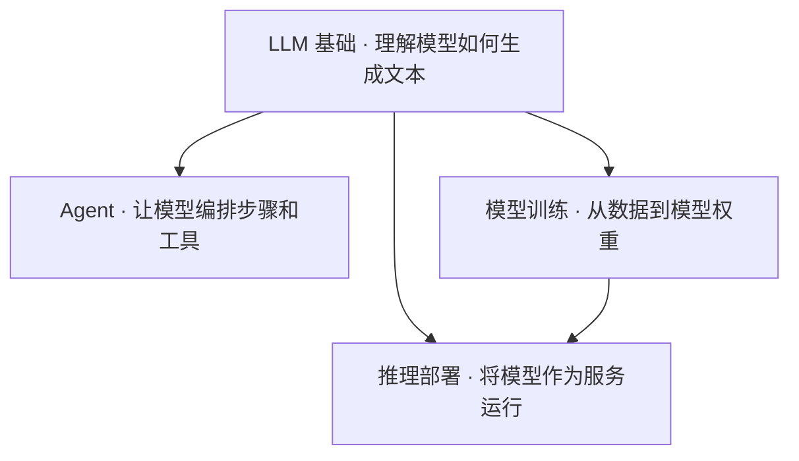

## 学习路线图

第一次接触大语言模型，可以从 LLM 基础开始。想开发应用时进入 Agent 路线，想理解模型如何学习时进入训练路线，
手上已有模型权重时可以从推理部署开始。训练示例用到的语言基础见 [[02-backend/python/index|Python]]。

## LLM 基础

目标是能解释一次文本生成经过的步骤，并用 Transformers 运行一次推理。

1. [[06-ai/huggingface/hf-course/llm-course/01-transformer-model|Transformer 模型]] 了解注意力机制与模型架构。
2. [[06-ai/llm/causal-language-model|因果语言模型]] 理解因果掩码与下一个 token 的预测。
3. [[06-ai/huggingface/hf-course/llm-course/02-using-transformers|使用 Transformers]] 跟着示例完成分词、模型推理和输出处理。

查看 [[06-ai/llm/index|LLM 笔记目录]]。

## Agent 应用

目标是能为一个任务画出模型、工具与状态之间的交互，并为步骤设置停止条件。

1. [[06-ai/agent/enterprise-agent|智能体设计模式]] 从 ReAct、工具调用和规划理解智能体如何执行任务。
2. [[06-ai/RAG|检索增强生成]] 为需要外部知识的任务加入检索步骤，并检查检索结果如何进入上下文。
3. [[06-ai/agent/agent-framework/spring-ai|Spring AI]] 沿后端框架笔记了解模型调用和工具接入。

查看 [[06-ai/agent/index|Agent 笔记目录]]。

## 模型训练

目标是能跑通小模型的训练与验证循环，保存权重后再尝试微调预训练模型。

1. [[06-ai/pytorch/02-tensor-operations|张量操作]] 与 [[06-ai/pytorch/03-autograd|自动求导]] 建立对输入形状与梯度的直觉。
2. [[06-ai/pytorch/04-data-loading|数据加载]] 与 [[06-ai/pytorch/05-nn-module|网络模块]] 定义训练数据和模型。
3. [[06-ai/pytorch/13-training-pipeline|模型训练完整流程]] 串联训练、验证、评估与模型保存。
4. [[06-ai/huggingface/hf-course/llm-course/03-fine-tuning|微调预训练模型]] 继续练习数据预处理与 Hugging Face Trainer。

查看 [[06-ai/pytorch/index|PyTorch 笔记目录]]。

## 推理部署

目标是能启动一个推理服务，并在相同的模型和输入下比较服务表现。

1. [[06-ai/llm/model-precision-quantization|模型精度与量化]] 理解权重精度如何影响显存使用。
2. [[06-ai/model-deploy/vllm|vLLM 推理服务]] 启动服务并完成一次请求。
3. [[06-ai/model-deploy/sglang|SGLang 推理服务]] 对照前缀缓存等机制，比较相同请求的延迟与吞吐。

查看 [[06-ai/model-deploy/index|模型部署笔记目录]]。

## 相关专题

- [[06-ai/machine-learning/index|机器学习]] 与 [[06-ai/deep-learning/index|深度学习]]
- [[06-ai/lvlm/index|LVLM 视觉语言模型]] 与 [[06-ai/lalm/index|LALM 音频语言模型]]
