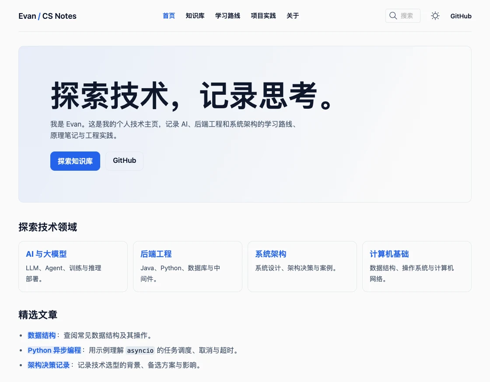

# CS Notes

[](https://github.com/evan1433/cs_notes/blob/master/LICENSE)

[](https://obsidian.md)
[](https://quartz.jzhao.xyz/)

> Evan 的技术主页、结构化知识库与工程实践记录。



## 📝 简介

这里汇集计算机科学、后端、前端、AI 与系统架构笔记，包含学习路线、原创文章与工程案例。使用 Obsidian 编辑，通过 Quartz 4 发布到 GitHub Pages。

**特点：**

- 📖 系统化知识分类，由浅入深
- 🔗 基于 Obsidian 的双向链接，知识点互联
- 🌐 GitHub Pages 在线浏览，无需本地安装
- 📊 Quartz 4.0 驱动，支持图谱视图、反向链接
- 💻 丰富的代码示例与实践案例
- ✅ 遵循 Markdown 规范，统一格式

## 📁 目录结构

```text
cs_notes/
├── 01-cs-fundamentals/       # 计算机科学核心基础
│   ├── data-structures.md
│   ├── computer-networks.md
│   └── operating-systems.md
├── 02-backend/              # 后端开发技术栈
│   ├── java-fundamentals/   # Java 基础
│   ├── databases/           # 数据库
│   ├── middleware/          # Redis、MQ、ES 等
│   ├── python/              # Python 学习笔记
│   └── spring/             # Spring 生态
├── 03-frontend/             # 前端开发技术栈
│   ├── html.md
│   ├── css.md
│   ├── javascript.md
│   └── vue3.md
├── 04-devtools/            # 工具、方法论、软技能
│   ├── git.md
│   ├── docker.md
│   └── kubernetes.md
├── 05-book-notes/          # 技术书籍阅读笔记
│   └── *.md
├── 06-ai/                  # 人工智能与机器学习
│   ├── pytorch/
│   ├── llm/
│   ├── lvlm/
│   └── agent/
├── sys-analyst/            # 系统分析师备考
├── architecture/           # 架构实践（非备考）
├── knowledge/               # 知识库首页
├── paths/                   # 学习路线入口
├── projects/                # 工程实践入口
├── quartz/                 # Quartz 4.0 核心组件
└── CONTRIBUTING.md         # 文档编写规范
```

## 🚀 使用方式

### 推荐：Obsidian 查看

1. 克隆仓库到本地

   ```bash
   git clone https://github.com/evan1433/cs_notes.git
   ```

2. 使用 [Obsidian](https://obsidian.md) 打开仓库文件夹

3. 享受完整的双向链接、图谱视图等功能

### 在线浏览：GitHub Pages

本仓库已部署到 GitHub Pages，可直接在线浏览：

- [首页](https://evan1433.github.io/cs_notes/)
- [知识库](https://evan1433.github.io/cs_notes/knowledge/)
- [学习路线](https://evan1433.github.io/cs_notes/paths/)
- [项目实践](https://evan1433.github.io/cs_notes/projects/)
- [关于 Evan](https://evan1433.github.io/cs_notes/about)

### 本地 Quartz 预览

如果想在本地预览网站效果：

```bash
# 安装依赖 (需要 Node.js 22+)
nvm use 22 && corepack enable && pnpm install --frozen-lockfile

# 构建网站
pnpm build

# 本地预览 (http://localhost:8080)
pnpm preview
```

### 其他方式

- **VS Code**: 配合 Markdown 插件阅读
- **Typora**: 优秀的 Markdown 编辑器
- **GitHub**: 直接在线浏览

## 📋 内容概览

### 计算机基础

- 数据结构与算法核心概念
- 计算机网络协议详解
- 操作系统原理

### 后端开发

- Spring Boot/Spring Cloud 微服务架构
- SSM 框架整合与最佳实践
- 分布式中间件（Redis、Kafka、Elasticsearch）
- 项目实战经验总结

### 前端开发

- 现代前端技术栈（Vue 3、JavaScript ES6+）
- 响应式设计与 CSS
- 前端工程化

### 人工智能

- PyTorch 深度学习框架
- 大语言模型（LLM）与视觉语言模型（LVLM）
- AI Agent 智能体开发
- 机器学习与深度学习理论

## 🤝 贡献指南

欢迎提交 Issue 或 PR 参与贡献！详细规范请参考 [[CONTRIBUTING|CONTRIBUTING.md]]。

### 快速规范

1. Fork 本仓库
2. 创建功能分支：`git checkout -b docs/add-feature`
3. 提交更改：`git commit -m "docs(domain): add feature description"`
4. 推送分支：`git push origin docs/add-feature`
5. 提交 Pull Request

### 提交规范

- `docs:` 新增或更新文档
- `fix:` 修正错误内容
- `refactor:` 重构笔记结构

### 命名规范

- **文件命名**：英文 kebab-case（如 `data-structures.md`、`vue3-core-concepts.md`）
- **目录命名**：英文 kebab-case（如 `java-fundamentals/`、`machine-learning/`）
- **禁止**：文件名含空格或中文

### Front Matter

所有文档应包含：

```yaml
---
title: 页面标题（中文）
description: 一句话描述
tags:
  - tag1
  - tag2
date: YYYY-MM-DD
---
```

## 🛠️ 开发工具

- [Obsidian](https://obsidian.md) - 知识管理工具
- [Quartz 4.0](https://quartz.jzhao.xyz/) - 静态站点生成器
- [Node.js](https://nodejs.org/) - JavaScript 运行时
- [markdownlint](https://github.com/DavidAnson/markdownlint) - Markdown 格式检查

## 📄 许可证

本项目采用 [MIT License](https://github.com/evan1433/cs_notes/blob/master/LICENSE) 开源许可。

## 🙏 致谢

- 感谢所有优质的学习资源与教程作者
- 感谢开源社区的知识分享
- 感谢 [Quartz](https://quartz.jzhao.xyz/) 提供优秀的静态站点生成器

---

> 💡 **提示**: 本仓库持续更新中，建议 Watch 获取最新动态
