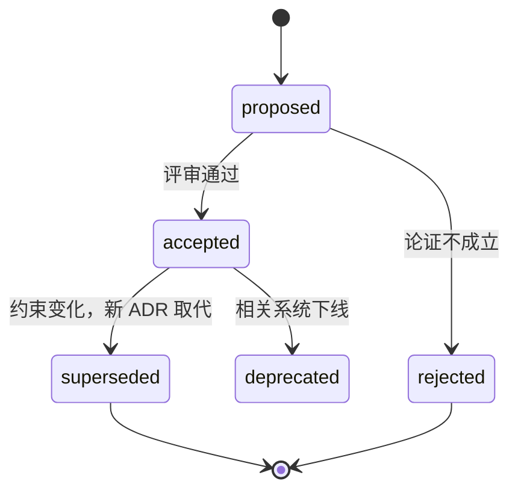

# 架构决策记录（ADR）

## 概述

架构图回答"系统长什么样"，**ADR 回答"为什么长这样"**。两者缺一不可，但绝大多数团队只留下前者。

新人接手系统时真正想问的三个问题——当初为什么不用 X、这个限制是谁加的、能不能改掉——都指向决策，而非结构。没有 ADR 的团队只能靠口耳相传和考古式读代码，架构知识随人员流动持续蒸发。

ADR（Architecture Decision Record）由 Michael Nygard 在 2011 年提出，本质极简：**一个决策一页纸，记下当时的约束、候选方案、结论和代价，写完冻结**。它的价值不在"记录"，而在**强迫决策者把否决别人的理由说清楚**。

> **架构师判断**：如果一个决策你写不成一页纸，通常不是"太复杂写不下"，而是**还没想清楚**——
> 大概率混了 2~3 个独立决策，或缺少明确的约束条件。

## 前置知识

- 理解架构质量属性（性能/可用性/可修改性）的基本含义，见 [[11-软件架构设计|软件架构设计]]
- 知道常见架构风格（分层/微服务/事件驱动）的取舍，见 [[19-microservices|微服务系统分析与设计]]
- 模板文件：`templates/adr-template.md`

## 什么决策值得记

不是所有决策都配得上一篇 ADR，否则文档会迅速烂掉。用**可逆性**和**影响面**两个维度筛：

| 判据 | 该记 ADR | 不必记（写进代码注释/commit 即可） |
|------|----------|--------------------------------|
| **可逆性** | 单向门：改回来代价 > 1 人月（选数据库、定协议、拆服务） | 双向门：改回来几小时（换个工具类、调个参数） |
| **影响面** | 跨团队 / 跨系统 / 影响外部契约 | 单模块内部实现 |
| **成本量级** | 涉及长期运维成本、许可费用、人力投入 | 无显著成本 |
| **争议度** | 会上有明确反对意见且未完全说服 | 无异议的常识选择 |

> **单向门 / 双向门** 来自 Bezos 的决策分类：单向门要慢、要论证、要留档；
> 双向门要快，快速试错比开会更高效。**把双向门当单向门决策，是组织效率最大的杀手**。

### 反向清单：什么不该写成 ADR

- **技术原理解释**——那是笔记，不是决策（如"Nacos 的 AP/CP 模式区别"）。
- **会议纪要**——记录"谁参加了、讨论了什么"，不含结论与代价。
- **已经实施完才补的说明**——事后补写会不可避免地把决策**合理化**，失去记录价值。
  如果不得不补，在文末注明"本篇为回溯补写"。
- **操作手册**——怎么部署、怎么扩容，属于 Runbook。

## 一份 ADR 的最小结构

### 三段式骨架

| 段落 | 必须回答的问题 | 常见错误 |
|------|----------------|----------|
| **Context（背景与约束）** | 现状有多疼（带数字）？必须满足什么？什么不能动？ | 写成技术介绍，没有痛点数据，读者看不出为什么要决策 |
| **Decision（决策）** | 一句话决定做什么？ | 一句话说不清，说明混了多个决策 |
| **Consequences（后果）** | 得到了什么？**付出了什么**？ | 只写好处，风险栏留空 |

**Consequences 必须包含负面后果**。一条负面都写不出来的决策，要么是常识（不必写 ADR），要么是没想透。这一节是未来复盘时唯一能救你的东西。

### 状态机

ADR 是**不可变**的。结论变了不改原文，而是新开一篇并建立取代关系：



被 `rejected` 的决策**也要留档**——它记录了"我们曾经以为 X 可行"，避免两年后有人重新踩一遍。

### 与常见文档的区别

| 文档类型 | 回答的问题 | 生命周期 | 谁写 |
|----------|-----------|----------|------|
| **ADR** | 为什么这么定？否决了什么？ | 不可变，靠 supersede 演进 | 决策者 |
| 架构设计文档 | 系统由哪些组件构成？如何交互？ | 随实现持续更新 | 架构师/开发 |
| RFC / 技术方案 | 打算怎么做？请评审 | 评审后归档，结论进 ADR | 提案人 |
| 会议纪要 | 谁说了什么？ | 归档即可 | 记录人 |
| Runbook | 出事怎么办？ | 随系统演进 | 值班人 |

一个常见误区是**用技术方案文档代替 ADR**。方案文档写的是"我要建什么"，ADR 写的是"我在 A/B/C 之间为什么选 B"——后者才是半年后被追问的东西。

## 把"否决理由"写对

ADR 里最容易被写坏、也最值钱的是候选方案对比。判断标准只有一条：**理由是否绑在约束上**。

| 写法 | 例子 | 半年后能否自辩 |
|------|------|----------------|
| ❌ 主观偏好 | "Kafka 太重了，我们不需要" | 不能。"重"无法度量，业务量涨了就无法复用 |
| ❌ 绝对化 | "Consul 不适合我们" | 不能。没说明在什么条件下不适合 |
| ✅ 约束绑定 | "Consul 无配置版本管理与发布审批，需自研回滚脚本约 3 人周；团队无 Raft 运维经验，当前 6 人规模下不可接受" | 能。约束（人力、时间）变了就能重评估 |

**约束绑定是 ADR 可复审的前提**。写成"在 6 人团队、无专职运维的约束下不成立"，就把复审条件显式写出来了：团队扩到 20 人时，这条否决理由自动失效，该重新评估。

## 组织与落地

### 存放位置

**与代码同仓**，放在 `docs/adr/` 或 `architecture/decisions/`（本库的做法）。
不要放 Confluence 或 Wiki——决策必须和代码一起被 `git log`、code review、分支切换所覆盖，
离开代码库的文档在 18 个月内必然与实现脱节。

```text
architecture/decisions/
├── index.md                          # 决策清单 + 待决策 Backlog
├── adr-001-config-center-nacos.md
├── adr-002-order-service-split.md
└── adr-003-....md
```

编号规则：**只增不减**，被否决的决策也占用编号。文件名 `adr-{三位编号}-{kebab-case 标题}.md`。

### 引入节奏（从 0 到 1）

不要一上来要求全团队写 ADR，会立刻流于形式。按这个顺序推：

1. **先补 3 篇回溯 ADR**：挑最近半年争议最大的三个决策，作为样例供人品读。
2. **把 ADR 绑进架构评审**：评审会不通过"没有 ADR 的方案"，见 [[architecture-review|架构评审与 ATAM]]。
3. **只对新决策强制**：存量不追缴，避免产生大量低质量的补写文档。
4. **季度复审**：扫一遍 `accepted` 状态的 ADR，检查复审触发条件是否已满足。

### 常见反模式

| 反模式 | 表现 | 后果 | 纠正 |
|--------|------|------|------|
| 只写结论 | 全篇只有"我们决定用 Nacos" | 无法自辩，变成教条 | 强制填写候选方案表与否决理由 |
| 事后合理化 | 实施完补写，只留采纳方案的优点 | 记录失真，误导后人 | 注明回溯补写；或直接不写 |
| 一个 ADR 装多个决策 | 标题写成"技术架构选型" | 无法单独 supersede | 拆成一决策一篇 |
| 写成技术百科 | 大段介绍 Kafka 原理 | 与笔记重复，读者找不到决策 | 原理链到笔记，正文只留决策逻辑 |
| 从不复审 | 全是三年前的 `accepted` | 决策僵尸化，约束早已失效 | 每篇必须写复审触发条件 + 季度巡检 |
| 无 owner | 决策者写"架构组" | 无人对后果负责 | 写具体人名 |

## 工具：ADR 完整性校验

结构合规靠人自觉必然衰减，用脚本卡住下限。脚本已入库：`scripts/check_adr.py`。

```bash
# 校验
python3 scripts/check_adr.py architecture/decisions

# CI 场景：警告也算失败
python3 scripts/check_adr.py architecture/decisions --strict
```

核心逻辑（脚本全文见 `scripts/check_adr.py`）：

```python
#!/usr/bin/env python3
"""校验 ADR 的完整性：必备章节、状态值、候选方案数量、否决理由。"""

from __future__ import annotations

import re
import sys
from pathlib import Path

REQUIRED_SECTIONS = ("背景与约束", "决策", "候选方案与否决理由", "后果", "验证方式")
VALID_STATUS = {"proposed", "accepted", "rejected", "deprecated", "superseded"}


def table_rows(section_body: str) -> int:
    """统计 markdown 表格的数据行数（剔除表头与分隔行）。"""
    rows = [ln for ln in section_body.splitlines() if ln.lstrip().startswith("|")]
    return max(len(rows) - 2, 0)


def check(path: Path) -> tuple[list[str], list[str]]:
    text = path.read_text(encoding="utf-8")
    errors, warnings = [], []

    for name in REQUIRED_SECTIONS:
        if not re.search(rf"^##\s+{name}\s*$", text, re.M):
            errors.append(f"缺章节「{name}」")

    status = re.search(r"\|\s*\*\*状态\*\*\s*\|\s*([^|\n]+)", text)
    if not status:
        errors.append("缺元信息表中的「状态」行")
    else:
        value = status.group(1).strip().split()[0].lower()
        if value not in VALID_STATUS:
            errors.append(f"状态值非法：{value}")

    options = re.search(r"^##\s+候选方案与否决理由\s*$(.*?)(?=^##\s)", text, re.M | re.S)
    if options:
        if table_rows(options.group(1)) < 2:
            errors.append("候选方案少于 2 个，无法证明做过对比")
        if "否决" not in options.group(1):
            warnings.append("候选方案未写明否决理由")

    if not re.search(r"^###\s+负面\s*$", text, re.M):
        warnings.append("未写「负面后果」，通常意味着风险没想透")
    if not re.search(r"复审触发条件", text):
        warnings.append("未定义复审触发条件")

    return errors, warnings


if __name__ == "__main__":
    root, strict = Path(sys.argv[1]), "--strict" in sys.argv
    files, failed = sorted(root.glob("adr-*.md")), 0
    for path in files:
        errors, warnings = check(path)
        print(f"{path.name}: {len(errors)} 错误 / {len(warnings)} 警告")
        for item in errors + warnings:
            print(f"    {item}")
        failed += bool(errors or (strict and warnings))
    raise SystemExit(1 if failed else 0)
```

输出示例（本库实际运行结果）：

```text
ADR                                       错误    警告
--------------------------------------------------------
adr-001-config-center-nacos.md            0     0
adr-002-order-service-split.md            0     0
--------------------------------------------------------
共 2 篇，2 篇通过
```

## 怎么衡量 ADR 做得好不好

| 指标 | 说明 | 健康值 |
|------|------|--------|
| **覆盖率** | 单向门决策中有 ADR 的比例 | > 80% |
| **否决率** | 有明确否决理由的候选方案占比 | 每篇至少 1 个 |
| **复审命中率** | 季度复审中被标记 superseded 的比例 | 5%~15%（0 说明没在复审，过高说明决策轻率） |
| **新人问题数** | 新人入职提出的"为什么"问题中，能靠 ADR 回答的比例 | > 60% |
| **决策到记录时延** | 决策形成到 ADR 落库的时间 | < 3 天 |

最后一条最关键：**超过一周才补的 ADR，基本等于回忆录**。

## 相关笔记

- [[architecture-review|架构评审与 ATAM]] —— 决策形成前的论证过程，ADR 的上游
- [[domain-driven-design|领域驱动设计（DDD）]] —— 服务边界类决策的理论依据
- [[high-availability|高可用与稳定性设计]] —— 稳定性相关决策的常见权衡点
- [[architecture/decisions/index|本库的 ADR 存档]] —— 两篇实例：配置中心选型、订单服务拆分
- [[service-governance-config-center|服务治理与配置中心：Nacos / Consul / Apollo]] —— ADR-001 的技术底稿

## 参考

- Michael Nygard, *Documenting Architecture Decisions*（2011），ADR 概念的原始出处
- [adr.github.io](https://adr.github.io/) —— ADR 生态与多种模板变体（MADR、Y-Statement）
- 《软件架构：架构模式、特征及实践指南》第 19 章，Mark Richards 关于"架构决策与设计原则"的论述
