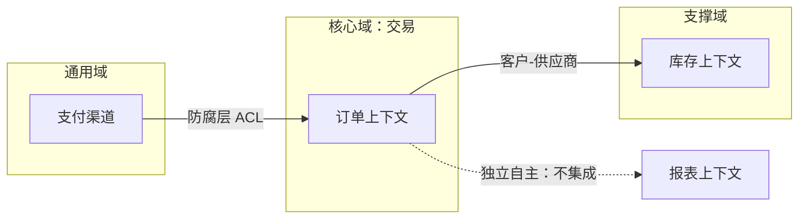

# 领域驱动设计（DDD）

## 概述

DDD 最常被误解成一堆术语（聚合、值对象、防腐层），实际上它只回答一个问题：**系统的边界该划在哪**。

微服务拆错的典型症状是"分布式单体"——服务拆开了，但改一个需求仍要同时改 5 个服务、跨服务事务满天飞、
联调周期比单体时更长。根因几乎都是同一个：**按技术分层或按团队组织拆分，而不是按业务边界拆分**。

DDD 提供的正是**找边界的方法**：先用战略设计（子域、限界上下文、通用语言）划出业务边界，
再用战术设计（聚合、领域事件、仓储）在边界内组织代码。战略设计决定架构成败，战术设计只是实现细节。

> **架构师判断**：如果只能记住一件事，那就是 **限界上下文（Bounded Context）**。
> 它说的是"同一个词在不同上下文里可以有不同的含义，边界内必须自洽"——
> "商品"在商品上下文里指 SKU + 价格 + 库存，在营销上下文里指活动素材。
> 强行统一成一个"商品中心"，就是把两个上下文焊死，将来任何一边变更都要两边联动。

## 前置知识

- 微服务拆分的常见模式与代价，见 [[19-microservices|微服务系统分析与设计]]
- 服务拆分前的论证方法，见 [[architecture-review|架构评审与 ATAM]]
- 拆分类决策的记录方式，见 [[architecture/decisions/adr-002-order-service-split|ADR-002 订单服务拆分]]

---

## 战略设计：先划边界

### 子域：业务本来就分主次

把一个业务系统切成若干子域，并按**对业务的价值**分三类，投入必须区别对待：

| 子域类型 | 定义 | 判断问题 | 投入策略 |
|----------|------|----------|----------|
| **核心域**（Core） | 公司的竞争力所在，做不好就失去市场 | 这块业务是我们独有的吗？同行会来抄我们吗？ | 自研，最强的人做，最高设计标准 |
| **支撑域**（Supporting） | 业务必需但无差异化 | 不做不行，但做好了也没人夸？ | 自研但降标准，能用即可 |
| **通用域**（Generic） | 行业通用能力 | 有没有成熟产品/开源方案？ | 买或开源，绝不自研 |

**最大的浪费是把核心域当支撑域做，把通用域当核心域自研**。
典型例子：电商的核心域是交易与履约，很多团队却在自研短信网关、自研权限系统、自研 IM——
这些是通用域，投入的每一人天都是从核心域偷来的。

### 限界上下文：边界的载体

限界上下文是**领域模型的适用边界**。同一概念在不同上下文里有不同的模型，这不是缺陷，是事实。

```text
┌──────────────────┐      ┌──────────────────┐
│  商品上下文        │      │  营销上下文        │
│  商品 = SKU + 价格 │      │  商品 = 活动素材    │
│       + 库存       │      │       + 折扣规则    │
│  语言：可售/缺货    │      │  语言：选品/坑位    │
└──────────────────┘      └──────────────────┘
        ↑ 各自有独立的 Product 类，不共享
```

实践上，限界上下文与微服务的对应关系是 **1:1 或 1:N（一个上下文可以是一个服务内的模块，也可以先不拆服务）**。
**不要反过来做——不要为了拆微服务而造上下文**。先有边界，再决定要不要独立部署。

### 通用语言：边界内的共同词汇

通用语言指**业务方和开发方使用同一套词，且这套词直接出现在代码里**（类名、方法名、事件名）。

判断一个团队有没有通用语言，看一件事：**业务方说"改价"，代码里能不能找到 `changePrice`**。
如果代码里是 `updateProductInfoByAdmin`，说明中间存在翻译层，每次需求都要翻译一遍，翻译就会失真。

| 反例（技术语言） | 正例（业务语言） |
|------------------|------------------|
| `OrderServiceImpl.updateStatus(3)` | `order.pay()`、`order.ship()` |
| `flag = 1` 表示已支付 | `Status.PAID` |
| `checkStock()` 返回 boolean | `inventory.reserve(sku, qty)` 抛出 `InsufficientStock` |

### 上下文映射：上下文的七种关系

上下文之间必然有关系，DDD 把关系归纳为七种模式，**选哪种直接决定团队的协作成本和耦合度**：

| 模式 | 关系 | 适用场景 | 代价 |
|------|------|----------|------|
| **合作关系**（Partnership） | 双向依赖，成败与共 | 两个团队目标一致、同步迭代 | 需要频繁沟通，任一方延迟都会拖对方 |
| **共享内核**（Shared Kernel） | 共享一小块模型和代码 | 同一团队内的紧密子域 | 修改需双方同意，容易腐化 |
| **客户-供应商**（Customer-Supplier） | 下游提需求，上游排期 | 有明确上下游且话语权不对等 | 上游优先级可能压过下游 |
| **遵奉者**（Conformist） | 下游直接顺从上游模型，不做转换 | 上游模型稳定且可接受（如买来的 SaaS） | 失去自己的领域表达，模型被污染 |
| **防腐层**（Anti-Corruption Layer） | 下游加一层转换隔离上游模型 | 上游模型糟糕或频繁变动（老系统、第三方） | 多一层代码与映射维护成本 |
| **独立自主**（Separate Ways） | 干脆不集成，各自实现 | 集成成本 > 收益 | 数据可能重复，需接受不一致 |
| **大泥球**（Big Ball of Mud） | 无边界，混乱耦合 | 反面模式 | 技术债指数增长 |



**防腐层是 DDD 里性价比最高的模式**：任何与遗留系统、第三方 API 对接的地方都应该加一层，
否则对方的模型会顺着调用链渗透进你的核心域。一旦渗透，你的核心域就再也说不清自己的业务了。

### 事件风暴：怎么真的找到边界

上面都是概念，落地需要一个**具体的找边界动作**，业界最有效的是事件风暴（Event Storming）。
它本质是一场 2~4 小时的贴纸工作坊：

| 步骤 | 做什么 | 产出 | 要点 |
|------|--------|------|------|
| 1 | 贴**领域事件**（橙色）：过去发生的业务事实 | 一组"XX已创建/已支付/已发货" | 用**过去时**，这是最关键的一条规则 |
| 2 | 贴**命令**（蓝色）：触发事件的动作 | "提交订单"→"订单已提交" | 一个命令至少产生一个事件 |
| 3 | 贴**聚合**（黄色）：命令作用的对象 | 命令与事件之间的名词 | 聚合边界 = 事务一致性边界 |
| 4 | 标**热点**（红色）：争论、未知、跨系统 | 争议清单 | 热点处往往就是边界所在 |
| 5 | 圈**限界上下文**：把相关聚合圈在一起 | 上下文草图 | 圈内语言自洽、圈间交互最少 |
| 6 | 标**读模型**（绿色）：谁需要看什么 | 查询需求清单 | 读写分离需求的来源 |

判据很简单：**如果你画不出事件流，说明业务还没理解到可以拆分的程度**。
这时候拆微服务，等于用组织架构赌业务模型。

---

## 战术设计：边界内怎么组织代码

### 聚合：一致性边界的物理形态

聚合（Aggregate）是一组**必须保持一致**的对象的集合，聚合根是外部唯一入口。
聚合边界就是**事务边界**——一个事务只改一个聚合。

聚合设计三条规则，违反任一条都会在生产上出问题：

| 规则 | 含义 | 违反后的后果 |
|------|------|--------------|
| **一条事务只改一个聚合** | 跨聚合一致性靠领域事件 + 最终一致 | 跨服务事务、分布式锁、锁表 |
| **聚合要小** | 只放真正需要强一致的字段 | 大聚合导致并发冲突、更新丢失 |
| **聚合间用 ID 引用** | 不要持有其他聚合的对象引用 | 一次加载拖出整个对象图，延迟不可控 |

判断聚合该多大，问一句：**这些字段是否必须在同一个事务里同时更新？**
不是，就拆出去，用事件同步。

### 代码：不变量必须由聚合自己守

下面这段是可编译可运行的完整示例（JDK 8）。重点看三件事：
**值对象没有 setter、总金额由聚合计、非法状态变更在领域层就被拦住**。

```java
import java.math.BigDecimal;
import java.util.ArrayList;
import java.util.Collections;
import java.util.List;

/** 订单聚合根：所有不变量只能通过聚合自身的方法维护。 */
public class OrderDemo {

    /** 值对象：构造时自校验，无 setter，天然不可变。 */
    static final class Money {
        private final BigDecimal amount;

        private Money(BigDecimal amount) {
            if (amount.signum() < 0) {
                throw new IllegalArgumentException("金额不能为负: " + amount);
            }
            this.amount = amount;
        }

        static Money of(String yuan) {
            return new Money(new BigDecimal(yuan));
        }

        Money multiply(int quantity) {
            return new Money(amount.multiply(BigDecimal.valueOf(quantity)));
        }

        Money add(Money other) {
            return new Money(amount.add(other.amount));
        }

        @Override
        public String toString() {
            return "¥" + amount.setScale(2, BigDecimal.ROUND_HALF_UP);
        }
    }

    enum Status { CREATED, PAID, SHIPPED, CANCELLED }

    /** 领域事件：聚合只负责"记下来"，发布交给仓储/应用层。 */
    static final class OrderPaid {
        final String orderId;

        OrderPaid(String orderId) {
            this.orderId = orderId;
        }

        @Override
        public String toString() {
            return "OrderPaid(" + orderId + ")";
        }
    }

    static final class OrderLine {
        private final String sku;
        private final Money unitPrice;
        private final int quantity;

        OrderLine(String sku, Money unitPrice, int quantity) {
            this.sku = sku;
            this.unitPrice = unitPrice;
            this.quantity = quantity;
        }

        Money subtotal() {
            return unitPrice.multiply(quantity);
        }

        @Override
        public String toString() {
            return sku + " x" + quantity + " @" + unitPrice;
        }
    }

    static final class Order {
        private static final int MAX_LINES = 20;

        private final String orderId;
        private Status status = Status.CREATED;
        private final List<OrderLine> lines = new ArrayList<>();
        private final List<Object> events = new ArrayList<>();

        Order(String orderId) {
            this.orderId = orderId;
        }

        /** 唯一入口：加商品行。行数上限是业务规则，不是技术限制。 */
        void addLine(String sku, Money unitPrice, int quantity) {
            if (status != Status.CREATED) {
                throw new IllegalStateException("已支付的订单不能改商品: " + status);
            }
            if (quantity <= 0) {
                throw new IllegalArgumentException("数量必须大于 0");
            }
            if (lines.size() >= MAX_LINES) {
                throw new IllegalStateException("单笔订单最多 " + MAX_LINES + " 行");
            }
            lines.add(new OrderLine(sku, unitPrice, quantity));
        }

        /** 总金额由聚合计，外部无法直接设置——这是最容易写错的地方。 */
        Money total() {
            Money sum = Money.of("0");
            for (OrderLine line : lines) {
                sum = sum.add(line.subtotal());
            }
            return sum;
        }

        void pay() {
            if (status != Status.CREATED) {
                throw new IllegalStateException("只有待支付订单可以支付，当前: " + status);
            }
            if (lines.isEmpty()) {
                throw new IllegalStateException("空订单不能支付");
            }
            status = Status.PAID;
            events.add(new OrderPaid(orderId));  // 事件在状态变更处产生
        }

        /** 取走即清空，避免重复发布——生产环境的重复扣款常源于此。 */
        List<Object> pullEvents() {
            List<Object> pulled = new ArrayList<>(events);
            events.clear();
            return pulled;
        }

        List<OrderLine> lines() {
            return Collections.unmodifiableList(lines);
        }

        @Override
        public String toString() {
            return orderId + "[" + status + ", " + lines.size() + " 行, 总额 " + total() + "]";
        }
    }

    public static void main(String[] args) {
        Order order = new Order("SO-20261113-0001");
        order.addLine("SKU-COFFEE-500G", Money.of("89.00"), 2);
        order.addLine("SKU-MUG-350ML", Money.of("39.90"), 1);

        order.pay();
        System.out.println("下单成功: " + order);
        for (Object event : order.pullEvents()) {
            System.out.println("  待发布事件: " + event);
        }

        // 不变量兜底：非法调用在领域层就被拦住，而不是靠数据库约束和人工检查
        try {
            order.addLine("SKU-LATE", Money.of("1.00"), 1);
        } catch (IllegalStateException e) {
            System.out.println("拦截非法操作: " + e.getMessage());
        }
        try {
            Money.of("-1");
        } catch (IllegalArgumentException e) {
            System.out.println("拦截非法金额: " + e.getMessage());
        }
    }
}
```

实际运行输出：

```text
下单成功: SO-20261113-0001[PAID, 2 行, 总额 ¥217.90]
  待发布事件: OrderPaid(SO-20261113-0001)
拦截非法操作: 已支付的订单不能改商品: PAID
拦截非法金额: 金额不能为负: -1
```

对比一下**贫血模型**（大多数 Spring 项目的写法）：`Order` 只有 getter/setter，
金额由 Service 层计算，状态由 `updateStatus(3)` 修改。业务规则散落在多个 Service 里，
新增一条规则就要改 N 处，测试必须启动 Spring 容器。**这就是"业务逻辑泄漏到应用层"的实质代价。**

### 分层与依赖倒置

| 层 | 职责 | 依赖方向 | 典型内容 |
|----|------|----------|----------|
| **接口层**（Interface） | 协议适配、参数校验 | 依赖应用层 | Controller、MQ 消费者、定时任务入口 |
| **应用层**（Application） | 编排用例、事务边界、权限 | 依赖领域层 | `OrderApplicationService.placeOrder()` |
| **领域层**（Domain） | 业务规则、不变量 | **不依赖任何层** | 聚合、值对象、领域服务、领域事件 |
| **基础设施层**（Infrastructure） | 持久化、外部调用实现 | 依赖领域层（实现其接口） | Repository 实现、ACL、MQ 发送 |

关键在最后一行：**领域层定义接口，基础设施层实现**。这是依赖倒置（DIP）的唯一目的——
让业务规则不依赖数据库、不依赖框架，从而可以脱离容器做单元测试。

---

## 从限界上下文到微服务

划出上下文之后才轮到"拆不拆服务"。映射关系：

| 上下文特征 | 部署形态 | 理由 |
|------------|----------|------|
| 核心域、独立扩容曲线、独立发版节奏 | 独立服务 + 独立库 | 收益最大，见 [[architecture/decisions/adr-002-order-service-split|ADR-002]] |
| 核心域但规模小、变更频繁 | 模块化单体（同进程、模块边界严格） | 保住边界，不付分布式代价 |
| 支撑域、读多写少 | 独立服务或共享库 | 视团队带宽 |
| 通用域 | 外部服务/SaaS | 不自研 |

**默认答案是模块化单体**。只有当"独立部署、独立扩容、独立技术栈"至少一项带来明确收益时，
才把模块升级为服务——因为每多一个服务，就多一份链路追踪、分布式事务、灰度发布、值班的成本。

### 什么时候不该用 DDD

DDD 有明确的不适用场景，硬套会显著降低效率：

- **纯 CRUD 系统**：业务规则只有增删改查，聚合里没有任何不变量，投入 DDD 只增加代码量。
- **报表/数据分析类**：以查询为主，应该直接建读模型，不需要聚合。
- **生命周期短于半年的内部工具**：边界还没稳定，模型会白做。
- **业务方给不出通用语言**：连业务方自己都说不清规则，说明业务还在探索期，此时任何模型都是错的。

## 常见反模式

| 反模式 | 表现 | 后果 | 纠正 |
|--------|------|------|------|
| 贫血模型 | 实体只有 getter/setter，逻辑全在 Service | 规则分散、无法复用、测不动 | 规则搬进聚合，Service 只做编排 |
| 按技术分层拆服务 | controller 服务、dao 服务 | 每次需求改全部服务 | 按限界上下文拆 |
| 大聚合 | 订单聚合里塞进商品、用户、优惠券对象 | 并发冲突、加载慢、锁范围大 | 聚合间改 ID 引用 |
| 共享数据库 | 多个服务连同一个库 | 边界形同虚设，改表即改架构 | 一服务一库或一 schema |
| 把 DDD 当分层规范 | 建了 `domain` 包，里面还是贫血对象 | 只有形式没有收益 | 先做战略设计，再谈代码结构 |
| 一次拆到底 | 第一天就拆 10 个服务 | 分布式单体，团队崩 | 模块化单体先行，按证据拆 |

## 相关笔记

- [[architecture-decision-records|架构决策记录（ADR）]] —— 边界决策必须落成 ADR，否则半年后无人记得理由
- [[architecture-review|架构评审与 ATAM]] —— 拆分方案的质量属性论证
- [[high-availability|高可用与稳定性设计]] —— 拆分后的分布式一致性、幂等与重试
- [[service-governance-config-center|服务治理与配置中心：Nacos / Consul / Apollo]] —— 多服务形态下的治理基础设施
- [[19-microservices|微服务系统分析与设计]] —— 微服务拆分原则的考点版本

## 参考

- Eric Evans, *Domain-Driven Design: Tackling Complexity in the Heart of Software*（2003），DDD 原始著作
- Vaughn Vernon, *Implementing Domain-Driven Design*（2013），聚合设计与上下文映射的实践细化
- Alberto Brandolini, *Introducing EventStorming*，事件风暴方法论出处
- Martin Fowler, [BoundedContext](https://martinfowler.com/bliki/BoundedContext.html)，限界上下文的简明定义
