从参考架构图查看各层的职责，再通过 ADR 和案例了解选型约束、替代方案和落地代价。

## 参考架构全景

```mermaid
flowchart LR
    subgraph A [接入层]
        direction LR
        Nginx["Nginx / Kong"]
        SLB["SLB / F5"]
    end

    subgraph B [网关与路由层]
        Gateway["Spring Cloud Gateway"]
        Zuul["Zuul"]
    end

    subgraph C [业务服务层]
        direction TB
        Web["Spring Boot<br>（Web/服务治理）"]
        Security["Sa-Token / Security<br>（认证授权）"]
        Cache["Redis<br>（缓存）"]
        Job["XXL-JOB<br>（定时任务）"]
        MQ["RocketMQ / Kafka<br>（消息队列）"]
    end

    subgraph D [数据与基础设施层]
        DB["MySQL / PostgreSQL<br>（关系库）"]
        NoSQL["MongoDB / ES<br>（文档/搜索）"]
        OSS["OSS / MinIO<br>（对象存储）"]
        Tracing["SkyWalking / Zipkin<br>（链路追踪）"]
        Logging["ELK / Loki<br>（日志聚合）"]
        Config["Nacos / Apollo<br>（配置中心）"]
    end

    A --> B --> C --> D
    C -.-> D
```

图中的组件是各层可选的实现。配置中心的选型和订单服务的拆分分别记录在下面两份 ADR 中。

## 架构决策

| 决策 | 记录中的取舍 |
| --- | --- |
| [[architecture/decisions/adr-001-config-center-nacos\|ADR-001 配置中心选型]] | 比较 Nacos、Consul、Apollo 及迁移约束。 |
| [[architecture/decisions/adr-002-order-service-split\|ADR-002 订单能力拆分]] | 比较局部拆分与整体微服务化，记录拆分后的分布式协作成本。 |

[[architecture/decisions/index|查看全部 ADR 与待决策议题]]

## 案例集合

- [[architecture/service-governance-config-center|配置中心选型]] · 对比配置发布、服务发现与运维成本。
- [[architecture/domain-driven-design|领域建模与边界划分]] · 从限界上下文推导服务和聚合边界。
- [[architecture/high-availability|服务稳定性设计]] · 结合超时、重试预算、限流和降级分析故障传播。
- [[02-backend/projects/gulimall-project|谷粒商城实践]] · 查阅 Nacos 服务注册、网关路由和对象存储的接入记录。

## 设计与评审方法

1. 阅读 [[architecture/architecture-decision-records|架构决策记录写法]]，梳理约束、备选方案与后果。
2. 使用 [[architecture/architecture-review|架构评审与 ATAM]]，用具体场景检查质量属性和风险。
3. 记录领域边界后，再用稳定性案例核对跨服务依赖、故障处理和监控。

仓库提供 `templates/adr-template.md` 和 ADR 校验命令 `python3 scripts/check_adr.py architecture/decisions`。

## 基础理论

- [[sys-analyst/11-软件架构设计|软件架构设计]] · 架构风格、4+1 视图与质量属性。
- [[sys-analyst/19-microservices|微服务系统分析与设计]] · 服务拆分和治理。
- [[sys-analyst/07-软件工程|软件工程]] · 需求、设计、测试与维护。
- [[sys-analyst/06-企业信息化|企业信息化]] · ERP、CRM、数据湖与 BPM。
- [[sys-analyst/index|系统分析师考试笔记目录]]
