# 架构实践

面向"能独立负责一个系统架构"的能力建设，**不是备考资料**。
按**方法 → 工程 → 决策存档**三层组织：方法层教怎么想，工程层教怎么落地，决策存档留下当时的判断依据。

> 软考的系统分析师 / 系统架构设计师考点在 [[sys-analyst/index|sys-analyst]]，
> 其中软件工程、企业信息化两章已吸收本项目早期零散的架构师考试笔记。

## 目录

### 一、方法层：怎么想、怎么定（最核心）

- [[architecture-decision-records|架构决策记录（ADR）]] —— 决策力：什么该记、怎么写否决理由、怎么复审
- [[architecture-review|架构评审与 ATAM]] —— 论证力：质量属性效用树、六要素场景、90 分钟评审会
- [[domain-driven-design|领域驱动设计（DDD）]] —— 边界力：子域、限界上下文、上下文映射、聚合设计

### 二、工程层：怎么落地、怎么不出事

- [[high-availability|高可用与稳定性设计]] —— 限流/熔断/降级/隔离、超时链、重试预算、多活、混沌工程
- [[service-governance-config-center|服务治理与配置中心：Nacos / Consul / Apollo]] —— 服务发现与配置管理的选型实战

### 三、决策存档

- [[architecture/decisions/index|ADR 决策清单]] —— 已记录的架构决策与待决策议题
  - [[architecture/decisions/adr-001-config-center-nacos|ADR-001 配置中心选用 Nacos]]
  - [[architecture/decisions/adr-002-order-service-split|ADR-002 订单能力从单体拆分为独立服务]]

### 四、延伸阅读：考试向

架构风格、质量属性、4+1 视图这些基础理论写在考试笔记里，这里只做指路，不重复抄：

- [[11-软件架构设计|软件架构设计]] —— 架构风格、4+1 视图、质量属性与架构评估（系统分析师）
- [[19-microservices|微服务系统分析与设计]] —— 微服务拆分与治理（系统分析师）
- [[07-软件工程|软件工程]] —— 过程模型、需求工程、设计方法、测试与维护（系统分析师）
- [[06-企业信息化|企业信息化]] —— 信息化、ERP/CRM/SCM、EAI、数据湖与 BPM（系统分析师）

## 建议阅读顺序

1. **先读 ADR 与架构评审** —— 这两篇改变的是工作方式，不依赖任何前置知识，收益最快。
2. **再读 DDD** —— 有了"决策"和"论证"的语言，才谈得上划定边界。
3. **最后读高可用** —— 这是拆分之后必须偿还的工程债，也最容易在生产上翻车。
4. 第四层是查漏补缺用的指路，不必顺序读。

## 参考资料

- [[sys-analyst/index|系统分析师考试笔记]] —— 基础理论部分高度重叠，考试向内容都在那边
- `templates/adr-template.md` —— 写决策时从这里开始，不要从空白文件开始
- `scripts/check_adr.py` —— ADR 完整性校验，`python3 scripts/check_adr.py architecture/decisions`

## 参考架构全景

```mermaid
flowchart LR
    subgraph A [接入层]
        direction LR
        Nginx["Nginx / Kong"]
        SLB["SLB / F5"]
    end

    subgraph B [网关与路由层]
        Gateway["Spring Cloud Gateway"]
        Zuul["Zuul"]
    end

    subgraph C [业务服务层]
        direction TB
        Web["Spring Boot<br>（Web/服务治理）"]
        Security["Sa-Token / Security<br>（认证授权）"]
        Cache["Redis<br>（缓存）"]
        Job["XXL-JOB<br>（定时任务）"]
        MQ["RocketMQ / Kafka<br>（消息队列）"]
    end

    subgraph D [数据与基础设施层]
        DB["MySQL / PostgreSQL<br>（关系库）"]
        NoSQL["MongoDB / ES<br>（文档/搜索）"]
        OSS["OSS / MinIO<br>（对象存储）"]
        Tracing["SkyWalking / Zipkin<br>（链路追踪）"]
        Logging["ELK / Loki<br>（日志聚合）"]
        Config["Nacos / Apollo<br>（配置中心）"]
    end

    A --> B --> C --> D
    C -.-> D
```

> 这张图回答"系统长什么样"；**"为什么长这样"要看 [[architecture/decisions/index|ADR 存档]]**。
> 两者的分工见 [[architecture-decision-records|架构决策记录（ADR）]]。
