# 计算机网络与分布式系统

> 对应第二版教材第 4 章。

**第二版变化**：

- 增加数据通信基础、数据编码
- 增加 IP 数据包头、TCP 包头格式
- 删除传输介质
- 增加局域网和广域网细节
- 增加网络工程
- 增加分布式系统
- 增加构件与中间件
- 增加 Web 服务
- 增加云计算

**本章纲要**：

```text
数据通信基础 → 网络功能和分类 → 局域网和广域网 → OSI七层模型
→ TCP/IP协议 → IP地址 → IPv6 → 网络工程 → 分布式系统
→ 构件与中间件 → Web服务 → 云计算
```

## 1. 数据通信基础

### 1.1 通信子网与资源子网

计算机网络按照数据通信和数据处理的功能可分为两层：

- **内层——通信子网**：由结点计算机和高速通信线路组成独立的数据系统，承担全网的数据传输、交换、加工和变换等通信处理工作。
- **外层——资源子网**：包括计算机、终端、通信子网接口设备、外部设备（如打印机、磁带机和绘图机等）及各种软件资源等，负责全网的数据处理，并向网络用户提供网络资源及网络服务。

### 1.2 数据通信模型

数据通信模型的基本要素：

| 要素 | 说明 |
|------|------|
| **信源** | 数据的发送方 |
| **信宿** | 数据的接收方 |
| **信道** | 信号传输的通道（传输介质） |
| **编码** | 将原始数据转换为可传输的信号 |
| **解码** | 将接收到的信号还原为原始数据 |
| **干扰（噪声）** | 传输过程中对信号的干扰因素 |

### 1.3 信道带宽与码元速率

- **模拟信道的带宽**：$W = f_2 - f_1$。其中 $f_1$ 是信道能通过的最低频率，$f_2$ 是信道能通过的最高频率，两者都由信道的物理特性决定。
- **数字信道**是一种离散信道，只能传送取离散值的数字信号。一个数字脉冲称为一个**码元**，用**码元速率**表示单位时间内信号波形的变换次数，即单位时间内通过信道传输的码元个数。若信号码元宽度为 $T$ 秒，则码元速率 $B = 1/T$，单位为**波特（Baud）**，因此码元速率也叫**波特率**。

### 1.4 奈奎斯特定理（无噪声极限速率）

若信道带宽为 $W$，则最大码元速率为：

$$
B = 2W \ (\text{Baud})
$$

一个码元携带的信息量 $n$（位）与码元的种类数 $N$ 有如下关系：

$$
n = \log_2 N \quad (N = 2^n)
$$

因此数据速率（单位 b/s）为：

$$
R = B \log_2 N = 2W \log_2 N
$$

> **注意**：数据速率和波特率是不同的概念，仅当码元取两个离散值时，两者的数值才相等。

### 1.5 香农定理（有噪声极限速率）

$$
C = W \log_2 \left(1 + \frac{S}{N}\right)
$$

- $W$：信道带宽
- $S$：信号的平均功率
- $N$：噪声平均功率
- $S/N$：**信噪比**

由于实际使用中 $S$ 与 $N$ 的比值太大，常取其分贝数（dB）：

$$
dB = 10 \log_{10} \frac{S}{N}
$$

### 1.6 误码率

误码率表示传输二进制位时出现差错的概率：

$$
P_c = \frac{N_e \ (\text{出错的位数})}{N \ (\text{传送的总位数})}
$$

误码率一般要求低于 $10^{-6}$，即平均每传送 1Mb 才允许错 1b。

### 1.7 调制技术（数字信号 → 模拟信号）

在计算机中，数据是以离散的二进制比特流方式表示的（数字数据）；网络传输时，通信信道有模拟信道和数字信道两种类型。数字信号转换为模拟信号，需要进行**调制**。最基本的调制方法有 3 种：

| 调制方法 | 别名 | 原理 | 特点 |
|---------|------|------|------|
| **调幅（AM）** | 幅移键控（ASK） | 载波的振幅随基带数字信号而变化 | 容易实现、技术简单，但**抗干扰能力差** |
| **调频（FM）** | 频移键控（FSK） | 载波的频率随基带数字信号而变化 | 容易实现、技术简单，**抗干扰能力较强** |
| **调相（PM）** | 相移键控（PSK） | 载波的初始相位随基带数字信号而变化 | **抗干扰能力较强**，但实现技术比较复杂 |

### 1.8 数字信号编码（基带传输）

在数字信道中传输时，要对计算机中的数字信号重新编码后进行基带传输。主要编码方式如下：

| 编码方式 | 规则 | 特点 |
|---------|------|------|
| **不归零编码（NRZ）** | 低电平表示 0，高电平表示 1 | 简单，但无自同步能力 |
| **曼彻斯特编码（ME）** | 每比特**中间**均有一个跳变，既作时钟信号又作数据信号；**高→低表示 1，低→高表示 0** | 自带时钟同步，但波特率是数据速率的 2 倍（效率 50%） |
| **差分曼彻斯特编码（DME）** | 每比特中间的跳变仅作同步之用，取值由**开始边界**是否跳变决定：**开始无跳变表示 1，有跳变表示 0** | 抗干扰性更好（跳变方向无关紧要） |
| **多电平编码** | 码元可取多个电平之一，每个码元可代表几个二进制位 | 频带利用率高 |
| **4B/5B 编码** | 用 5bit 二进制码来代表 4bit 数据 | 解决曼彻斯特编码效率低的问题，效率提升至 80%，典型应用为快速以太网 |

> **记忆技巧（曼彻斯特）**："高跌(1)低涨(0)"。
> **4B/5B 背景**：曼彻斯特编码和差分曼彻斯特编码每位中间都有一次电平跳变，波特率是数据速率的两倍。为了提高编码效率、降低电路成本，采用 4B/5B 编码。

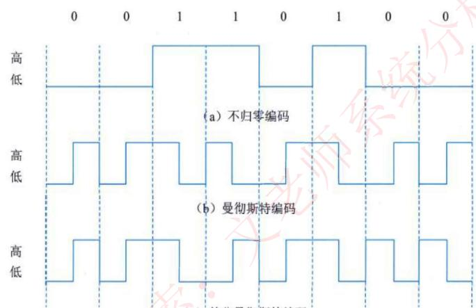
*(a) 不归零编码　(b) 曼彻斯特编码　(c) 差分曼彻斯特编码*

## 2. 网络功能和分类

### 2.1 网络功能

计算机网络是计算机技术与通信技术相结合的产物，实现了远程通信、远程信息处理和资源共享。

**计算机网络的功能**：数据通信、资源共享、负载均衡、高可靠性。

### 2.2 按分布范围分类

| 网络分类 | 缩写 | 分布距离 | 计算机分布范围 | 传输速率范围 |
|---------|------|---------|--------------|-------------|
| 局域网 | LAN | 10m 左右 | 房间 | 4Mbps~1Gbps |
| | | 100m 左右 | 楼寓 | |
| | | 1000m 左右 | 校园 | |
| 城域网 | MAN | 10km | 城市 | 50Kbps~100Mbps |
| 广域网 | WAN | 100km 以上 | 国家或全球 | 9.6Kbps~45Mbps |

### 2.3 按拓扑结构分类

| 拓扑结构 | 特点 |
|---------|------|
| **总线型** | 利用率低、干扰大、价格低 |
| **星型** | 交换机形成的局域网、中央单元负荷大 |
| **环型** | 流动方向固定、效率低、扩充难 |
| **树型** | 总线型的扩充、分级结构 |
| **分布式** | 任意节点连接、管理难、成本高 |

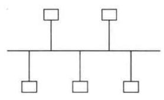
*(a) 总线型*

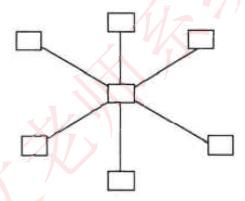
*(b) 星型*

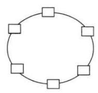
*(c) 环型*

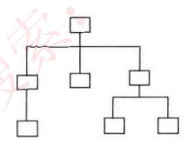
*(d) 树型*

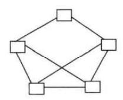
*(e) 分布式*

## 3. 局域网和广域网

### 3.1 以太网规范（IEEE 802.3）

以太网规范 IEEE 802.3 是重要的局域网协议：

| 标准 | 名称 | 速率 | 传输介质 |
|------|------|------|---------|
| IEEE 802.3 | 标准以太网 | 10Mb/s | 细同轴电缆 |
| IEEE 802.3u | 快速以太网 | 100Mb/s | 双绞线 |
| IEEE 802.3z | 千兆以太网 | 1000Mb/s | 光纤或双绞线 |
| IEEE 802.3ae | 万兆以太网 | 10Gb/s | 光纤 |

### 3.2 CSMA/CD（带冲突检测的载波监听多路访问）

以太网采用 CSMA/CD 技术，包括载波监听和冲突检测两部分。

**（1）载波监听**。通过精心设计的监听算法来缓解冲突：

| 监听算法 | 信道空闲时 | 信道忙时 | 特点 |
|---------|-----------|---------|------|
| 非坚持型监听算法 | 立即发送 | 等待 N，再监听 | 减少冲突，信道利用率降低 |
| 1-坚持型监听算法 | 立即发送 | 继续监听 | 提高信道利用率，增大了冲突 |
| P-坚持型监听算法 | 以概率 P 发送 | 继续监听 | 有效平衡，但复杂 |

**（2）冲突检测**。载波监听只能减少冲突的概率，无法完全避免冲突。为了高效地实现冲突检测，CSMA/CD 中采用"**边发边听**"的冲突检测方法：发送者一边发送数据，一边自己接收回来，如果发现结果不同，马上停止发送并发出冲突信号；所有节点收到阻塞信息后，都随机等待一段时间之后再重新监听。

### 3.3 无线局域网（WLAN）

- WLAN 技术标准：**IEEE 802.11**
- **IEEE 802.11b** 速率可达 11Mb/s；**IEEE 802.11a** 传输速率可达 54Mb/s；**IEEE 802.11g** 具有与 802.11a 一样的接入速率；**IEEE 802.11n** 传输速率可达 200Mb/s 以上。

**WLAN 拓扑结构**：

- **点对点**：通过单频或扩频微波电台、红外发光二极管、红外激光等方法，连接两个固定的有线 LAN 网段，实际上是作为一种网络互连方案。无线链路与有线 LAN 通过桥路器或中继器完成连接。
- **HUB 型**：由一个中心节点（HUB）和若干外围节点组成，外围节点既可以是独立的节点，也可与多个用户相连。任何两个外围节点间的数据通信都须经过 HUB，是典型的集中控制式通信。
- **完全分布型**：目前还无具体应用，仅处于理论探讨阶段。它要求相关节点在数据传输过程中发挥作用，类似于分组无线网的概念。对每一个节点而言，一般只有网络的部分拓扑信息，但它可与邻近节点以某种方式分享各自的拓扑结构信息，基于此完成一种分布路由算法。

### 3.4 广域网相关技术

广域网覆盖范围广、通信距离远，没有固定拓扑结构。广域网可以分为**公共传输网络、专用传输网络和无线传输网络**。

相关技术：

1. **同步光网络（SONET）**：使用光纤进行数字化信息通信的一个标准。
2. **数字数据网（DDN）**：利用数字信道提供半永久性连接电路以传输数据。

## 4. OSI 七层模型

| 层 | 功能 | 单位 | 协议 | 设备 |
|---|------|------|------|------|
| 1. 物理层 | 在链路上透明地传输位。需要完成的工作包括线路配置、确定数据传输模式、确定信号形式、对信号进行编码、连接传输介质。为此定义了建立、维护和拆除物理链路所具备的**机械特性、电气特性、功能特性以及规程特性** | 比特 | EIA/TIA RS-232、RS-449、V.35、RJ-45、FDDI | 中继器、集线器 |
| 2. 数据链路层 | 把不可靠的信道变为可靠的信道。将比特组成帧，在链路上提供点到点的帧传输，并进行差错控制、流量控制等 | 帧 | SDLC、HDLC、LAPB、PPP、STP、帧中继、IEEE802、ATM | 交换器、网桥 |
| 3. 网络层 | 在源节点—目的节点之间进行**路由选择、拥塞控制**、顺序控制、传送包，保证报文的正确性。控制着通信子网的运行，又称**通信子网层** | IP 分组 | IP、ICMP、IGMP、ARP、RARP | 路由器 |
| 4. 传输层 | 提供**端—端**间可靠的、透明的数据传输，保证报文顺序的正确性、数据的完整性 | 报文段 | TCP、UDP | 网关 |
| 5. 会话层 | 建立通信进程的逻辑名字与物理名字之间的联系，提供进程之间建立、管理和终止会话的方法，处理同步与恢复问题 | — | RPC、SQL、NFS | 网关 |
| 6. 表示层 | 实现数据转换（包括格式转换、压缩、加密等），提供标准的应用接口、公用的通信服务、公共数据表示方法 | — | JPEG、ASCII、GIF、MPEG、DES | 网关 |
| 7. 应用层 | 对用户不透明地提供各种服务，如 E-mail | 数据 | Telnet、FTP、HTTP、SMTP、POP3、DNS、DHCP 等 | 网关 |

## 5. TCP/IP 协议

### 5.1 网络协议三要素

| 要素 | 说明 |
|------|------|
| **语法** | 规定传输数据的格式 |
| **语义** | 规定所要完成的功能 |
| **时序** | 规定执行各种操作的条件、顺序关系等 |

**TCP/IP 与 OSI 的层次对应关系**：

| TCP/IP 体系结构 | 对应 OSI 层次 |
|----------------|--------------|
| 应用层 | 应用层、表示层、会话层 |
| 传输层 | 传输层 |
| Internet 层 | 网络层 |
| 网络接口层 | 数据链路层、物理层 |

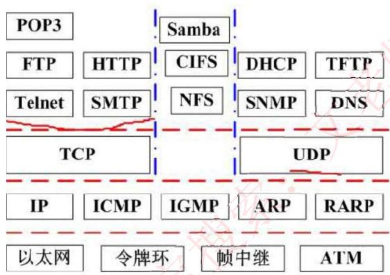

### 5.2 网络层协议

- **IP**：网络层最重要的核心协议，在源地址和目的地址之间传送数据报，**无连接、不可靠**。
- **ICMP**：因特网控制报文协议，用于在 IP 主机、路由器之间传递控制消息（网络通不通、主机是否可达、路由是否可用等网络本身的消息）。
- **ARP 和 RARP**：地址解析协议。**ARP 将 IP 地址转换为物理地址（MAC）**；**RARP 将物理地址转换为 IP 地址**。
- **IGMP**：网络组管理协议，允许因特网中的计算机参加多播，是计算机用来向相邻多目路由器报告多目组成员的协议，支持**组播**。

### 5.3 传输层协议

- **TCP**：整个 TCP/IP 协议族中最重要的协议之一。在 IP 协议提供的不可靠数据基础上，采用**重发技术**，为应用程序提供**可靠的、面向连接的、全双工的**数据传输服务。一般用于传输数据量比较少，且对可靠性要求高的场合。
- **UDP**：**不可靠、无连接**的协议，有助于提高传输速率。一般用于传输数据量大、对可靠性要求不高但要求速度快的场合。

### 5.4 应用层协议

基于 TCP 的 FTP、HTTP 等都是可靠传输；基于 UDP 的 DHCP、DNS 等都是不可靠传输。

- **FTP**：可靠的文件传输协议，用于因特网上的控制文件的双向传输。
- **HTTP**：超文本传输协议，用于从 WWW 服务器传输超文本到本地浏览器。使用 SSL 加密后的安全网页协议为 **HTTPS**。
- **SMTP 和 POP3**：简单邮件传输协议，是一组用于由源地址到目的地址传送邮件的规则，邮件报文采用 ASCII 格式表示。
- **Telnet**：远程连接协议，是因特网远程登录服务的标准协议和主要方式。
- **TFTP**：不可靠的、开销不大的小文件传输协议。
- **SNMP**：简单网络管理协议，由一组网络管理的标准协议组成，包含一个应用层协议、数据库模型和一组资源对象。能够支持网络管理系统，用以监测连接到网络上的设备是否有任何引起管理上关注的情况。
- **DHCP**：动态主机配置协议，基于 UDP，基于 C/S 模型，为主机动态分配 IP 地址。有三种方式：**固定分配、动态分配、自动分配**。
- **DNS**：域名解析协议，通过域名解析出 IP 地址。

### 5.5 IP 数据报头格式

一个 IP 数据报由**首部**和**数据**两部分组成。首部由固定 **20 个字节**的基本首部和 **0～40 字节**可变长度的任选项组成。

| 字段 | 说明 |
|------|------|
| 版本号 | 协议的版本号，IPv4 或 IPv6 |
| IHL | IP 头长度，以 32 位字（4B）计数，最小为 5，即 20 字节 |
| 服务类型 | 用于区分不同的可靠性、优先级、延迟和吞吐率的参数 |
| 段总长度 | 包含 IP 头在内的数据单元的总长度（字节数） |
| 标识符 | 唯一标识数据报的标识符 |
| 标志 | 包括 3 个标志：M 标志用于分段和重装配；一个是禁止分段标志；第 3 个标志当前没有启用 |
| 段偏置值 | 指明该段处于原来数据报中的位置 |
| 生存期 | 用经过的路由器个数表示 |
| 协议 | 上层协议（TCP 或 UDP） |
| 头校验和 | 对 IP 头的校验序列 |
| 任选数据 | 可变长，包含发送者想要发送的任何数据 |
| 补丁 | 补齐 32 位的边界 |
| 用户数据 | 以字节为单位的用户数据，和 IP 头加在一起的长度**不超过 65535 字节** |

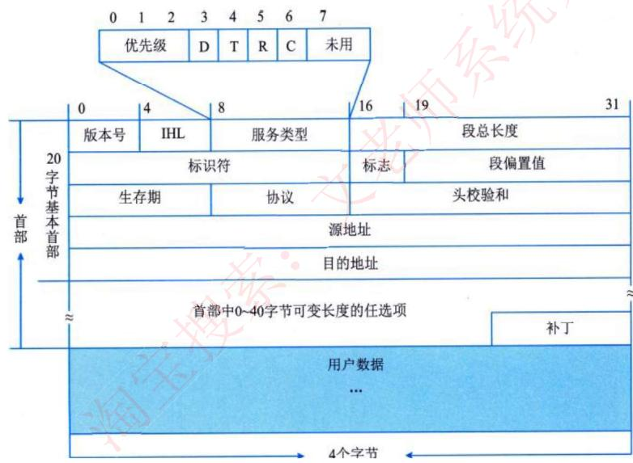

### 5.6 TCP 传输头格式

| 字段 | 说明 |
|------|------|
| 源端口（16 位） | 说明源服务访问点 |
| 目标端口（16 位） | 表示目标服务访问点 |
| 发送顺序号（32 位） | 本段中第一个数据字节的顺序号 |
| 接收顺序号（32 位） | 捎带接收的顺序号，指明接收方期望接收的下一个数据字节的顺序号 |
| 偏置值（4 位） | 传输头中 32 位字的个数 |
| 保留字段（6 位） | 未用，所有实现必须把这个字段置全 0 |
| 标志字段（6 位） | URG：紧急指针有效；ACK：接收顺序号有效；PSH：推进功能有效；RST：连接复位为初始状态，通常用于连接故障后的恢复；SYN：对顺序号同步，用于连接的建立；FIN：数据发送完，连接可以释放 |
| 窗口（16 位） | 为流控分配的信息量 |
| 校验和（16 位） | 检查完整性 |
| 紧急指针（16 位） | 从发送顺序号开始的偏置值，指向字节流中的一个位置，此位置之前的数据是紧急数据 |
| 任选项（长度可变） | 目前只有一个任选项，即建立连接时指定的最大段长 |
| 补丁 | 补齐 32 位字边界 |

### 5.7 协议端口号对照表

| 端口 | 服务 | 端口 | 服务 |
|------|------|------|------|
| 20 | 文件传输协议（数据） | 80 | 超文本传输协议（HTTP） |
| 21 | 文件传输协议（控制） | 110 | POP3 服务器（邮箱接收服务器） |
| 23 | Telnet 终端仿真协议 | 69 | 简单文件传输协议（TFTP） |
| 67 | DHCP（服务端） | 68 | DHCP（客户端） |
| 25 | SMTP 简单邮件发送协议 | 161 | SNMP（轮询） |
| 53 | 域名服务器（DNS） | 162 | SNMP（陷阱） |

### 5.8 考试真题

1. 在 OSI 参考模型中能实现路由选择、拥塞控制与互连功能的层是（C）。
   A. 传输层　B. 应用层　C. 网络层　D. 物理层

2. 在 TCP/IP 体系结构中，将 IP 地址转化为 MAC 地址的协议是（B）。
   A. RARP　B. ARP　C. ICMP　D. TCP

   > 解析：网络层协议 ARP，地址转换协议，将网络层的 IP 地址转换为物理 MAC 地址。

3. 下列网络互连设备中，属于物理层的是（B）。
   A. 交换机　B. 中继器　C. 路由器　D. 网桥

## 6. IP 地址

### 6.1 IP 地址表示

机器中存放的 IP 地址是 **32 位的二进制代码**，每隔 8 位插入一个空格可提高可读性。为了便于理解和设置，一般采用**点分十进制**方法来表示：将 32 位二进制代码每 8 位转换成十进制，变成 4 个十进制数，在每个十进制数之间插入 `.`，如 `128.11.3.31`。

因为每个十进制数由 8 个二进制数转换而来，因此每个十进制数的取值范围为 **0～255**（掌握二进制转十进制的快速计算方法，牢记 2 的幂指数值）。


### 6.2 分类 IP 地址

IP 地址分四段，每段八位，共 32 位二进制数组成。在逻辑上，这 32 位 IP 地址分为**网络号**和**主机号**，依据网络号位数的不同，可将 IP 地址分为以下几类：

| 类别 | 点分十进制 | 二进制（前 8 位） |
|------|-----------|-----------------|
| **A 类** | 0.0.0.0 ~ 127.255.255.255 | `00000000` ~ `01111111`（首位 0） |
| **B 类** | 128.0.0.0 ~ 191.255.255.255 | `10000000` ~ `10111111`（前两位 10） |
| **C 类** | 192.0.0.0 ~ 223.255.255.255 | `11000000` ~ `11011111`（前三位 110） |
| **D 类（组播）** | 224.0.0.0 ~ 239.255.255.255 | `11100000` ~ `11101111`（前四位 1110） |
| **E 类（保留）** | 240.0.0.0 ~ 255.255.255.255 | `11110000` ~ `11111111`（前四位 1111） |

### 6.3 无分类编址（CIDR）

不按照 A、B、C 类规则，自动规定网络号。无分类编址格式为：**IP 地址/网络号位数**。

示例：`128.168.0.11/20` 表示 IP 地址为 128.168.0.11，其网络号占 20 位，主机号占 $32-20=12$ 位，也可以划分子网。

### 6.4 公有地址、私有地址与特殊 IP 地址

- **公有地址**：通过它直接访问因特网，是全网唯一的 IP 地址。
- **私有地址**：属于非注册地址，专门为组织机构内部使用，不能直接访问因特网。

| 类别 | IP 地址范围 | 网络号 | 网络数 |
|------|------------|--------|--------|
| A | 10.0.0.0 ~ 10.255.255.255 | 10 | 1 |
| B | 172.16.0.0 ~ 172.31.255.255 | 172.16 ~ 172.31 | 16 |
| C | 192.168.0.0 ~ 192.168.255.255 | 192.168.0 ~ 192.168.255 | 256 |

**其他特殊地址**：

| 网络号 | 主机号 | 源地址使用 | 目的地址使用 | 代表的意思 |
|--------|--------|-----------|-------------|-----------|
| 0 | 0 | 可以 | 不可 | 在本网络上的本主机 |
| 全 1 | 全 1 | 不可 | 可以 | 在本网络上进行广播 |
| Net-ID | 全 1 | 不可 | 可以 | 对 net-ID 上的所有主机进行广播 |
| 127 | 非全 0 或全 1 的数 | 可以 | 可以 | 用作本地软件环回测试之用 |
| 169.254 | 非全 0 或全 1 的数 | 可以 | 可以 | Windows 主机 DHCP 服务器故障分配 |

### 6.5 子网划分与超网

- **子网划分**：一般公司在申请网络时会直接获得一个范围很大的网络（如一个 B 类地址），因为主机数之间相差太大，不利于分配。一般采用子网划分的方法，即**自定义网络号位数，就能自定义主机号位数**，根据主机个数划分出最适合的方案，不会造成资源浪费。
- 一般的 IP 地址按标准划分为 A、B、C 类后，可以进一步划分：将**主机号拿出几位作为子网号**，就可以划分出多个子网。此时 IP 地址组成为：**网络号 + 子网号 + 主机号**。
- **子网掩码**：网络号和子网号都为 1，主机号都为 0。
- **注意**：子网号可以为全 0 和全 1，主机号不能为全 0 或全 1。因此**主机数需要 -2，而子网数不用**。
- **超网（网络聚合）**：划分子网的逆过程，将网络号取出几位作为主机号，此时这个网络内的主机数量变多，成为一个更大的网络。

### 6.6 考试真题

1. 把网络 117.15.32.0/23 划分为 117.15.32.0/27，得到的子网是（C）个，每个子网中可使用的主机地址是（A）个。

   - A. 4　B. 8　C. 16　D. 32
   - A. 30　B. 31　C. 32　D. 34

   > 解析：网络号从 23 变为 27，拿出了 4 位作为子网号，可划分出 $2^4 = 16$ 个子网；主机号是 $32-27=5$ 位，共 $2^5-2=30$ 个主机地址（主机地址不能为全 0 和全 1）。

2. 分配给某公司网络的地址块是 220.17.192.0/20，该网络被划分为（C）个 C 类子网，不属于该公司网络的子网地址是（D）。

   - A. 4　B. 8　C. 16　D. 32
   - A. 220.17.203.0　B. 220.17.205.0　C. 220.17.207.0　D. 220.17.213.0

   > 解析：共 20 位网络号，C 类子网有 24 位网络号，可从主机位中取 4 位划分 C 类子网，共 $2^4=16$ 个。判断是否属于该公司网络，看前 20 位网络号是否相同，将选项一一转化为二进制即可。

## 7. IPv6

### 7.1 IPv6 的特性

IPv6 主要是为了解决 IPv4 地址数不够用的情况而提出的设计方案，具有以下特性：

- IPv6 地址长度为 **128 位**，地址空间增大了 $2^{96}$ 倍；
- 灵活的 IP 报文头部格式：使用一系列固定格式的**扩展头部**取代了 IPv4 中可变长度的选项字段。IPv6 中选项部分的出现方式也有所变化，使路由器可以简单略过选项而不做任何处理，加快了报文处理速度；
- IPv6 简化了报文头部格式，加快报文转发，提高了吞吐量；
- 提高安全性：**身份认证和隐私权**是 IPv6 的关键特性；
- 支持更多的服务类型；
- 允许协议继续演变，增加新的功能，使之适应未来技术的发展。

### 7.2 IPv4 与 IPv6 的过渡技术

IPv4 和 IPv6 的过渡期间，主要采用三种基本技术：

1. **双协议栈**：主机同时运行 IPv4 和 IPv6 两套协议栈，同时支持两套协议。一般来说 IPv4 和 IPv6 地址之间存在某种转换关系，如 IPv6 的低 32 位可以直接转换为 IPv4 地址，实现互相通信。
2. **隧道技术**：在 IPv4 网络之上建立一条能够传输 IPv6 数据报的隧道。例如可以将 IPv6 数据报当做 IPv4 数据报的数据部分加以封装，只需要加一个 IPv4 的首部，就能在 IPv4 网络中传输 IPv6 报文。
3. **翻译技术**：利用一台专门的翻译设备（如转换网关），在纯 IPv4 和纯 IPv6 网络之间转换 IP 报头的地址，同时根据协议不同对分组做相应的语义翻译，从而使纯 IPv4 和纯 IPv6 站点之间能够透明通信。

## 8. 网络工程

网络工程可分为**网络规划、网络设计和网络实施**三个阶段。网络规划应该以需求为基础，同时考虑技术和工程的可行性。具体来说，网络规划包括网络需求分析、可行性研究和对现有网络的分析与描述。

### 8.1 网络规划

**1. 网络需求分析**

在网络组建之前，首先要进行需求分析，根据用户提出的要求进行网络的设计。需求分析通常采用**自顶向下的结构化方法**，从以下几个方面着手：

1. **功能需求**：用户希望利用网络来完成什么功能，然后依据使用需求、实现成本、未来发展和总预算投资等因素对网络的组建方案进行认真的设计和推敲。
2. **通信需求**：了解用户需要的通信类型、通信频度、通信时间和通信量等。
3. **性能需求**：包括容量（带宽）、利用率、吞吐量、可提供负载、效率、延迟（等待时间）、延时变化量、响应时间、端到端的差错率和网络效率等。
4. **可靠性需求**：包括精确度、错误率、稳定性、无故障时间、数据备份等。
5. **安全需求**：衡量网络安全的指标是**可用性、完整性和保密性**。
6. **运行与维护需求**：网络运行和维护费用方面的需求。
7. **管理需求**：包括用户管理、资源管理、配置管理、性能管理和网络维护。

**2. 可行性研究**

通常从**技术可行性、经济可行性、法律可行性和用户使用可行性**等方面进行论证。

**3. 对现有网络的分析与描述**

包括：服务器的数量和位置、客户机的数量和位置、同时访问的数量、每天的用户数、每次使用的时间、每次数据传输的数据量、网络拥塞的时间段、采用的协议、通信模式。

### 8.2 网络设计

网络设计的工作是在网络规划的基础上，设计一个能够解决用户问题的方案。在整个设计过程中，首先要确定网络总体目标和设计原则，然后设计网络的逻辑结构，再设计网络的物理结构。

1. **确定网络总体目标**：明确采用哪些网络技术和标准，构筑一个满足哪些应用的多大规模的网络，包括是否分期实施、网络的实施成本和运行成本等方面的问题。
2. **确定总体设计原则**：对主要设计原则进行选择和权衡，并确定其在方案设计中的优先级。
3. **通信子网设计**：包括拓扑结构与网络总体规划、分层的设计，以及远程接入访问的设计。
4. **资源子网设计**：主要考虑服务器的接入和子网连接的问题。
5. **设备选型**：包括网络设备和各个层次的交换机的选择策略。
6. **网络操作系统与服务器资源设备**：选择服务器时，首先要看具体的网络应用，然后确定网络操作系统，再进行服务器选型。
7. **网络安全设计**：确定面临的攻击和风险，明确安全策略，建立安全模型，选择并实现安全服务，对安全产品的选型进行测试。

### 8.3 网络实施

网络实施是在网络设计的基础上进行设备的购买、安装、调试和系统切换工作，包括以下步骤：

1. **工程实施计划**：列出需实施的项目、费用和负责人等，以便控制投资，按进度要求完成实施任务。
2. **网络设备到货验收**：网络设备到货后，在安装调试前必须先进行严格的功能和性能测试。
3. **设备安装**：安装项目一般分为综合布线系统、机房工程、网络设备、服务器、系统软件和应用软件等几个部分。
4. **系统测试**：包括网络设备测试、网络系统测试和网络应用测试三个层次。
5. **系统试运行**：验证系统在功能和性能上是否达到预期目标的重要阶段。
6. **用户培训**。
7. **系统转换**：可以采用三种方法——**直接转换、并行转换和分段转换**。

### 8.4 网络规划与设计：三层模型

三层模型将网络划分为**核心层、汇聚层和接入层**，每一层都有着特定的作用：

- **核心层**：提供不同区域之间的**最佳路由和高速数据传送**；
- **汇聚层**：将网络业务连接到接入层，并且实施与**安全、流量、负载和路由**相关的策略；
- **接入层**：为用户提供在本地网段访问应用系统的能力，还要解决相邻用户之间的互访需要；负责一些用户信息（例如用户 IP 地址、MAC 地址和访问日志等）的收集工作和用户管理功能（包括认证和计费等）。

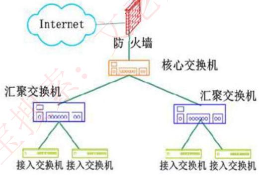

### 8.5 建筑物综合布线系统（PDS）

| 子系统         | 功能                                            |
| ----------- | --------------------------------------------- |
| **工作区子系统**  | 实现工作区终端设备到水平子系统的信息插座之间的互联                     |
| **水平布线子系统** | 实现信息插座和管理子系统之间的连接                             |
| **设备间子系统**  | 实现中央主配线架与各种不同设备之间的连接                          |
| **垂直干线子系统** | 实现各楼层设备间子系统之间的互连                              |
| **管理子系统**   | 连接各楼层水平布线子系统和垂直干缆线，负责连接控制其他子系统，为连接其他子系统提供连接手段 |
| **建筑群子系统**  | 各个建筑物通信系统之间的互联                                |

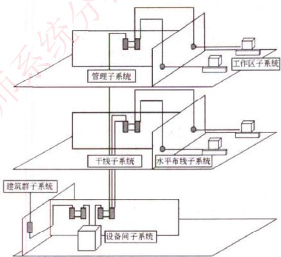

### 8.6 考试真题

1. 以下关于层次化局域网模型中核心层的叙述，正确的是（B）。
   A. 为了保障安全性，对分组要进行有效性检查
   B. 将分组从一个区域高速地转发到另一个区域
   C. 由多台二、三层交换机组成
   D. 提供多条路径来缓解通信瓶颈

2. 结构化布线系统分为六个子系统，其中水平子系统（B）。
   A. 由各种交叉连接设备以及集线器和交换机等设备组成
   B. 连接了干线子系统和工作区子系统
   C. 由终端设备到信息插座的整个区域组成
   D. 实现各楼层设备间子系统之间的互连

   > 解析：水平子系统是指从楼层管理间到信息插口这一段，它连接了垂直干线子系统与工作区子系统。

## 9. 分布式系统

### 9.1 分布式系统的定义与挑战

**分布式系统**是其组件分布在联网的计算机上，组件之间通过**消息传递**进行通信和动作协调的系统。

构建分布式系统的挑战是处理其组件的以下特性：

1. **异构性**。互联网使得用户能在大量异构计算机和网络上访问服务和运行应用程序。虽然互联网由多种不同种类的网络组成，但所有连接到互联网的设备都使用相同的网络协议来通信，所以这些不同网络的区别被屏蔽了。
2. **开放性**。是决定系统能否以不同方式被扩展和重新实现的特征。分布式系统的开放性主要取决于新的资源共享服务能被增加和供多种客户程序使用的程度。
3. **安全性**。包括三个部分：**机密性、完整性、可用性**。
4. **可伸缩性**。分布式系统可以在不同的规模下有效且高效运转。如果资源数量和用户数量激增，系统仍能保持其有效性，那么这个系统称为可伸缩的。
5. **故障处理**。分布式系统的故障是**部分的**（有些组件出了故障，而有些组件运行正常），因此故障的处理相当困难。常见处理技术：
   - **检测故障**：有些故障可以被检测到，如校验和可用于检测消息或文件中出错的数据；
   - **掩盖故障**：有些被检测到的故障能被隐藏起来或降低它的严重程度；
   - **容错**：服务的客户能被设计成容错的，这通常也涉及客户的错误容忍度；
   - **故障恢复**：涉及软件的设计，以便在服务器崩溃后，永久数据的状态能被恢复或回滚。
6. **并发性**。在分布式系统中，服务和应用均提供可被客户共享的资源，通常允许并发地处理多个客户请求。
7. **透明性**。见下节。
8. **服务质量**。系统的主要非功能特性，即影响客户和用户体验的服务质量是**可靠性、安全性和性能**。

### 9.2 分布式系统的透明性

透明性定义为对用户和开发人员**屏蔽分布式系统的组件分离性**，使系统被认为是一个整体，而不是独立组件的集合。包括：

| 透明性 | 说明 |
|--------|------|
| **访问透明性** | 用相同的操作访问本地资源和远程资源，对不同数据表示形式及资源访问方式进行隐藏 |
| **位置透明性** | 为资源分配逻辑名，用户不需要知道资源的物理位置或网络位置就能访问它们 |
| **并发透明性** | 几个进程能并发地使用共享资源进行操作且互不干扰 |
| **复制透明性** | 使用资源的多个实例提升可靠性和性能，而用户和开发人员无须知道副本的相关信息 |
| **故障透明性** | 屏蔽错误，无论是硬件故障还是软件故障，用户不会注意到资源的故障以及系统对于该故障的恢复过程 |
| **移动透明性** | 资源和客户能够在系统内移动而不会影响用户或程序的操作 |
| **性能透明性** | 当负载变化时，系统能被重新配置以适配性能 |
| **伸缩透明性** | 系统和应用能够进行扩展而不改变系统结构或应用算法 |

> **注意**：有时也将访问透明性和位置透明性统称为**网络透明性**。

### 9.3 典型的分布式系统

#### 9.3.1 分布式文件系统

目的是通过廉价的服务器为大规模、高并发场景下的网页访问场景提供服务。目前主流的分布式文件系统有 GFS、HDFS、TFS、Ceph、Lustre、MogileFS、MooseFS、FastDFS、GridFS 等。

1. **GFS**：运行于廉价的普通硬件上，并提供容错功能。它可以给大量的用户提供总体性能较高的服务。
2. **HDFS（Hadoop 分布式文件系统）**：一个具备高度容错性的系统，适合部署在廉价的机器上，系统使用多台计算机存储文件，并且提供统一的访问接口，像是访问一个普通文件系统一样。HDFS 采用**主从结构模型**。
3. **TFS**：一个高可扩展、高可用、高性能、面向互联网服务的分布式文件系统，主要针对海量的非结构化数据，构筑在普通的 Linux 机器集群上，可为外部提供高可靠和高并发的存储访问。TFS 为淘宝提供海量小文件存储，通常文件大小不超过 1MB。
4. **MooseFS**：一款相对小众的分布式文件系统，不需要修改上层应用接口即可直接使用。由 4 部分组成：
   - **管理服务器**：负责各个数据服务器的管理、文件读写调度、文件空间回收及恢复，可多节点拷贝；
   - **数据服务器**：负责连接管理服务器，听从管理服务器调度，提供存储空间，并为客户提供数据传输；
   - **元数据备份服务器**：可以是任何数量的服务器，负责备份管理服务器的变化日志文件；
   - **客户机**：访问 MooseFS 中文件的任意数量的机器。

#### 9.3.2 分布式缓存系统

指缓存数据分布在不同的服务器上，通过缓存技术实现数据的快速访问和高并发的请求处理。典型应用是缓存经过复杂计算得到的数据，或者缓存系统中频繁访问的热点数据，以减轻数据库压力。常见的有 Memcache、Redis、Tair 等。

1. **Memcache**：
   - 通过在内存里维护一个统一且巨大的哈希（Hash）表来提高读取速度，能够存储各种格式的数据，包括图像、视频、文件以及数据库检索的结果等；
   - 使用物理内存作为缓存区，使用键值（key/value）对的方式来存储数据，可独立运行在服务器上；
   - 采用 **LRU 缓存淘汰策略**；
   - **不支持持久化**，重启服务会导致数据丢失；
   - Memcache 服务器之间**彼此不通信**，其分布式能力是**依赖客户端**来实现的。

2. **Redis**：一个开源的高性能的键值对存储系统，支持多种数据结构，包括字符串、哈希、列表、集合和有序集合等。
   - 分布式缓存技术使用了"**一致性哈希**"算法：将缓存分散在多个节点上，每个节点存储部分缓存数据。读取或写入数据时，客户端将键值通过哈希函数计算出哈希值，再根据哈希值选择一个节点进行读写操作；
   - 特点是快速、可扩展、高效和可靠，可以处理高并发的读写请求；
   - 优点：高性能读写、多数据类型支持、数据持久化、高可用架构、支持自定义虚拟内存、支持分布式分片集群、单线程读写性能极高；
   - 缺点：多线程读写较 Memcache 慢。

3. **Tair**：分为**持久化和非持久化**两种使用方式。非持久化的 Tair 可以看成是一个分布式缓存，持久化的 Tair 将数据存放于磁盘中。由一个**中心控制节点**和一系列的**服务节点**组成：中心控制节点负责管理所有的服务节点，维护服务节点的状态信息；服务节点对外提供各种数据服务，并以心跳的形式将自身状况汇报给中心控制节点。

## 10. 构件与中间件

### 10.1 构件的概念

**构件**又称为组件，是一个**自包容、可复用**的程序集，通过源程序或二进制代码的方式提供，整体向外提供统一的访问接口。构件外部只能通过接口来访问构件，而不能直接操作构件的内部。

构件的两个最重要的特性：**自包容与可重用**。

### 10.2 构件模型

构件模型定义了构件实现、文档化以及开发的标准。目前主流的构件模型是 **Web Services 模型、Sun 公司的 EJB 模型和微软的 .NET 模型**。

构件模型包含以下模型要素：

1. **接口**：构件通过构件接口来定义，构件模型规定应如何定义构件接口以及在接口定义中应该包含的要素，如操作名、参数以及异常等。
2. **使用信息**：为使构件远程分布和访问，必须给构件一个特定的、全局唯一的名字或句柄。构件元数据是构件本身相关的数据（比如构件的接口和属性信息），用户可以通过元数据发现构件提供的服务。
3. **部署**：构件模型包括一个规格说明，指出应该如何打包构件使其部署成为一个独立的可执行实体。

构件模型还提供了一组被构件使用的通用服务，包括**平台服务**和**支持服务**：平台服务允许构件在分布式环境下通信和互操作；支持服务是很多构件需要的共性服务，例如身份认证服务。

### 10.3 构件组装

构件组装是指构件相互直接集成或是用专门编写的"胶水代码"将它们整合在一起来创造一个系统或另一个构件的过程。常见的 3 种组装方式：

| 组装方式 | 说明 |
|---------|------|
| **顺序组装** | 通过按顺序调用已经存在的构件，可以用两个已经存在的构件来创造一个新的构件 |
| **层次组装** | 发生在一个构件直接调用由另一个构件所提供的服务时，被调用的构件为调用的构件提供所需的服务 |
| **叠加组装** | 发生在两个或两个以上构件放在一起来创建一个新构件的时候，新构件合并了原构件的功能，对外提供了新的接口 |

当编写构件时（尤其为了组装来编写构件时），可能经常面临**接口不兼容**的问题，即所要组装的构件的接口不一致。一般会出现 3 种不兼容情况：

1. **参数不兼容**：接口每一侧的操作有相同的名字，但参数类型或参数个数不相同。
2. **操作不兼容**：提供接口和请求接口的操作名不同。
3. **操作不完备**：一个构件的提供接口是另一个构件请求接口的一个子集，或者相反。

### 10.4 中间件的概念与基本功能

**中间件**是一种独立的系统软件或服务程序，分布式应用软件借助这种软件在不同的技术之间共享资源。中间件位于**操作系统之上**，管理计算资源和网络通信，实现应用之间的互操作。数据管理、应用服务、消息传递、身份验证和 API 管理通常都要通过中间件。

中间件的基本功能包括以下 6 个方面：

1. 负责客户机与服务器之间的**连接和通信**，以及客户机与应用层之间的高效率通信机制；
2. 提供应用层不同服务之间的**互操作机制**，以及应用层与数据库之间的连接和控制机制；
3. 提供一个**多层架构的应用开发和运行的平台**，以及一个应用开发框架，支持模块化的应用开发；
4. **屏蔽**硬件、操作系统、网络和数据库的差异；
5. 提供应用的**负载均衡和高可用性**、安全机制与管理功能，以及交易管理机制，保证交易的一致性；
6. 提供一组**通用的服务**去执行不同的功能，避免重复的工作并使应用之间可以协作。

### 10.5 中间件的分类

按照中间件在分布式系统中承担的职责不同，可以划分为以下几类：

1. **通信处理（消息）中间件**：在分布式系统中，人们要建网和制定通信协议，以保证系统能在不同平台之间通信，实现分布式系统中可靠的、高效的、实时的跨平台数据传输。
2. **事务处理（交易）中间件**：使大量事务在多台应用服务器上能实时并发运行，并进行负载平衡的调度，要求中间件系统具有监视和调度整个系统的功能。
3. **数据存取管理中间件**：为在网络上虚拟缓冲存取、格式转换、解压等带来方便。
4. **Web 服务器中间件**：浏览器图形用户界面已成为公认的规范，然而它的会话能力差、不擅长做数据写入、受 HTTP 协议的限制等，必须进行修改和扩充，就形成了 Web 服务器中间件。
5. **安全中间件**：产生不安全因素是由操作系统引起的，但必须要用中间件去解决，以适应灵活多变的要求。
6. **跨平台和架构的中间件**：当前开发大型应用软件通常采用基于架构和构件的技术，在分布式系统中，还需要集成各节点上的不同系统平台上的构件或新老版本的构件，由此产生了架构中间件。
7. **专用平台中间件**：为特定应用领域设计领域参考模式，建立相应架构，配置相应的构件库和中间件，为应用服务器开发和运行特定领域的关键任务（如电子商务、网站等）。
8. **网络中间件**：包括网管、接入、网络测试、虚拟社区、虚拟缓冲等。

### 10.6 中间件与构件的关系

中间件与软件架构实际上是从两种不同的角度看待软件的中间层次。从某种程度上说，**中间件就是架构，是构件存在的基础，中间件促进了构件化的实现**。中间件与构件的关系：

1. **面向需求**：基于中间件开发的应用是真正面向需求的，从本质上符合构件化设计的思想。
2. **业务的分隔和包容性**：在提供业务的分隔和包容性方面，架构和中间件有同样的目标。例如，消息中间件规定了消息是有属性的，其中部分属性与业务的划分有关。构件只进行相应类型的消息交互，至于如何保证业务的分类运行与管理，则是中间件的任务。
3. **设计与实现分离**：构件对外发生作用或构件间的交互，都是通过接口进行的，构件使用者只需要知道构件的接口，而不必关心其内部实现，这是设计与实现分离的关键。中间件在分布交互模式上也规定了接口（或类似）机制。
4. **隔离复杂的系统资源**：架构很重要的一个功能就是将系统资源与应用构件隔离，这是保证构件可复用甚至即插即用的基础，与中间件的意图也是一致的。
5. **符合标准的交互模型**：架构是一种抽象的模型，但模型中应当定义一些可操作的成分。基于中间件的构件是符合标准模型的。
6. **软件复用**：软件复用是构件化软件开发的根本目标之一，中间件提供了构件封装、交互规则、与环境的隔离等机制，为软件复用提供了方便的解决方案。
7. **提供对应用构件的管理**：基于中间件的软件可以方便地进行管理，因为构件总可以通过标识机制进行划分。

## 11. Web 服务

### 11.1 Web 服务的定义

所谓 **Web 服务**是指由企业发布的、完成其特别商务需求的在线应用服务，其他公司或应用软件能够通过互联网来访问并使用这种在线服务。关于 Web 服务的定义有很多种，其核心是**面向服务的架构（SOA）**。

Web 服务的典型角色包括**服务提供者、服务注册中心、服务请求者**三方。

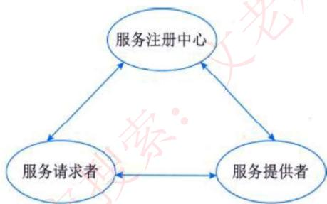

### 11.2 Web 服务模型的三种操作

| 操作 | 说明 |
|------|------|
| **发布服务描述** | 服务提供者将服务描述发布到服务注册中心 |
| **查找服务描述** | 服务请求者通过服务注册中心查找所需的服务 |
| **绑定/调用服务** | 服务请求者根据服务描述绑定或调用服务 |

### 11.3 Web 服务的技术平台

主要包括 HTTP、XML、SOAP、WSDL、UDDI、WSIF 和 WSFL 等。

- **SOAP**：目前被广泛接受的消息传输协议，用于在网络应用程序之间交换结构化数据，是一种**基于 XML** 的机制。
- **WSDL**：Web 服务的接口由基于 XML 的 WSDL 定义，它提供了应用访问指定的 Web 服务所必需的全部信息，描述**服务提供了什么功能、服务位于何处以及服务如何调用**。
- **UDDI**：一套基于 Web 的、分布式的、为 Web 服务提供的信息注册中心实现标准规范，同时也包含一组使企业能将自身提供的 Web 服务注册以使别的企业能够发现的访问协议的实现标准。

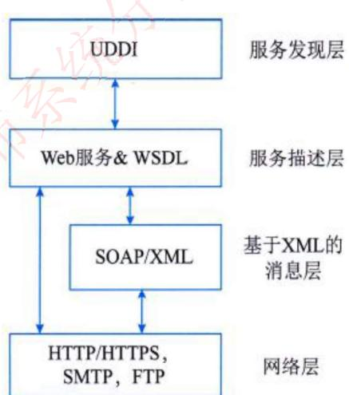

## 12. 云计算

### 12.1 云计算的概念

云计算指通过计算机网络（多指因特网）形成的计算能力极强的系统，可存储、集合相关资源，并可**按需配置**，向用户提供个性化服务。

### 12.2 云计算的服务方式

| 服务方式 | 说明 |
|---------|------|
| **软件即服务（SaaS）** | 服务提供商将应用软件统一部署在云计算平台上，客户根据需要通过互联网向服务提供商订购应用软件服务，服务提供商根据客户所订购软件的数量、时间的长短等因素收费，并通过**标准浏览器**向客户提供应用服务 |
| **平台即服务（PaaS）** | 厂商提供**开发环境、服务器平台、硬件资源**等服务给客户，客户在服务提供商平台的基础上定制开发自己的应用程序，并通过其服务器和互联网传递给其他客户 |
| **基础设施即服务（IaaS）** | 服务提供商将内存、I/O 设备、存储和计算能力等整合为一个**虚拟的资源池**，为客户提供所需要的存储资源、虚拟化服务器等服务 |

对这 3 种服务方式进行分析后，可以看出如下特征：

1. **灵活性**方面：SaaS → PaaS → IaaS **灵活性依次增强**；
2. **方便性**方面：IaaS → PaaS → SaaS **方便性依次增强**；
3. **PaaS 是云计算服务模式中最为关键的一层**，在整个云计算体系中起着支撑的作用。PaaS 通常以特定的互联网资源为中心，采用开放平台的形式，对外提供基于 Web 的 API 服务。PaaS 的地位相当于系统软件，需要为上层 SaaS 应用提供 API，以支持各种 SaaS 应用的开发。

### 12.3 云计算的部署模式

1. **公有云**：云基础设施是公开的，可以自由地分配给公众。企业、学术界与政府机构都可以拥有和管理公有云，并实现对公有云的操作。
2. **社区云**：云基础设施分配给一些社区组织所专有，这些组织共同关注任务、安全需求、政策等信息。云基础设施被社区内的一个或多个组织所拥有、管理及操作。
3. **私有云**：云基础服务设施分配给由多种用户组成的单个组织。它可以被这个组织或其他第三方组织所拥有、管理及操作。
4. **混合云**：是公有云、私有云和社区云的组合。
