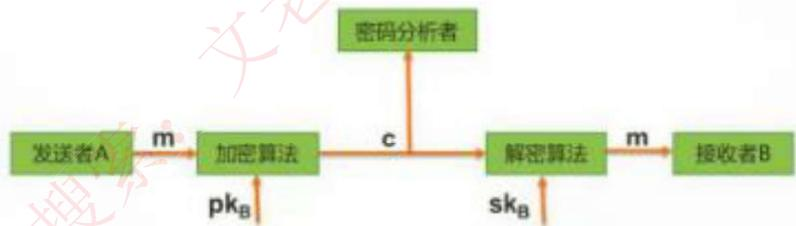
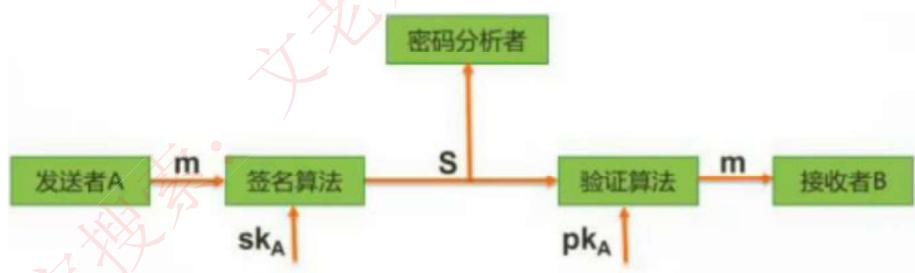
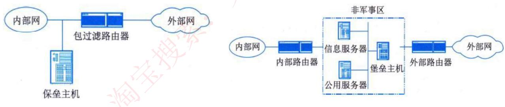
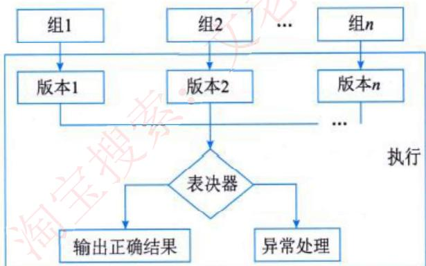
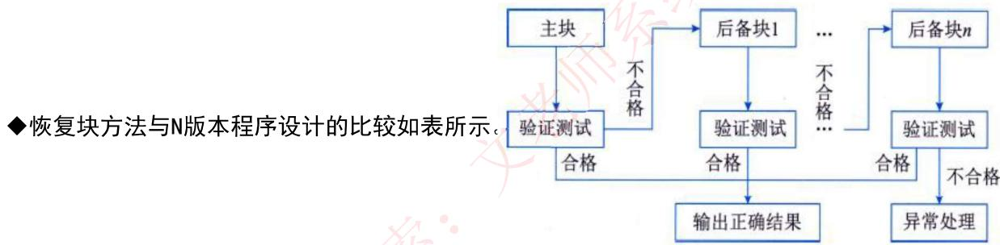

# 信息安全

> 对应第二版教材第 9 章。本章知识体系：信息系统安全体系 → 数据安全与保密 → 通信与网络安全技术 → 系统访问控制技术 → 容灾与业务持续 → 安全管理措施 → 系统可靠性（冗余技术、软件容错技术）。

## 1. 信息系统安全体系

### 1.1 系统安全分类

| 分类 | 说明 |
|------|------|
| **实体安全** | 保护计算机设备、设施和其他媒体免遭地震、水灾、火灾、有害气体和其他环境事故（如电磁辐射等）破坏的措施和过程。可分为环境安全、设备安全和媒体安全三个方面 |
| **运行安全** | 包括系统风险管理、审计跟踪、备份与恢复、应急 4 个方面，是信息系统安全的重要环节，其实质是保证系统的正常运行 |
| **信息安全** | 防止系统中的信息被故意或偶然的非法授权访问、更改、破坏或使信息被非法系统识别和控制。即确保信息的**保密性、完整性、可用性和可控性**。可分为操作系统安全、数据库安全、网络安全、病毒防护、访问控制、数据加密和认证（鉴别）7 个方面 |
| **人员安全** | 主要包括计算机使用人员的安全意识、法律意识和安全技能等 |

### 1.2 系统安全体系结构

| 层次 | 安全问题 |
|------|---------|
| **物理层安全** | 通信线路、物理设备和机房的安全。体现在通信线路的可靠性、软硬件设备的安全性、设备的备份、防灾害能力、防干扰能力、设备的运行环境和不间断电源保障等 |
| **操作系统安全** | 来自网络内使用的操作系统。3 个方面：①操作系统本身的缺陷（身份认证、访问控制、系统漏洞等）；②操作系统的安全配置问题；③病毒对操作系统的威胁 |
| **网络安全** | 网络层身份认证、网络资源的访问控制、数据传输的保密与完整性、远程接入的安全、域名系统的安全、路由系统的安全、入侵检测的手段和网络设施防病毒等 |
| **应用安全** | 由提供服务所采用的应用软件和数据的安全性产生，包括 Web 服务、电子邮件系统和 DNS 等，还包括病毒对系统的威胁 |
| **安全管理** | 安全技术和设备的管理、安全管理制度、部门与人员的组织规则等 |

### 1.3 安全保护等级

| 等级 | 名称 | 要点 | 适用范围 |
|------|------|------|---------|
| 第一级 | **用户自主保护级** | 通过隔离用户与数据，使用户具备自主安全保护的能力 | 普通内联网用户 |
| 第二级 | **系统审计保护级** | 实施了粒度更细的自主访问控制 | 通过内联网或互联网进行商务活动、需要保密的非重要单位 |
| 第三级 | **安全标记保护级** | 提供安全策略模型、数据标记及主体对客体强制访问控制的非形式化描述；能准确标记输出信息；消除测试发现的错误 | 地方各级国家机关、金融机构、邮电通信、能源与水源供给、交通运输、大型工商与信息技术企业、重点工程建设等单位 |
| 第四级 | **结构化保护级** | 将自主和强制访问控制扩展到所有主体与客体；考虑隐蔽通道；可信计算机结构化为关键/非关键保护元素，接口明确定义；加强鉴别机制；支持管理员和操作员职能；具有相当抗渗透能力 | 中央级国家机关、广播电视部门、重要物资储备单位、社会应急服务部门、尖端科技企业集团、国家重点科研机构和国防建设等部门 |
| 第五级 | **访问验证保护级** | 满足访问监控器需求，访问监控器仲裁主体对客体的全部访问，本身抗篡改且足够小、可分析和测试；支持安全管理员职能；扩充审计机制；提供系统恢复机制；具有很高的抗渗透能力 | 国防关键部门和依法需要对计算机信息系统实施特殊隔离的单位 |

### 1.4 系统安全保证系统

1. **建立统一的身份认证体系**：身份认证是信息交换最基础的要素，不能确认交换双方的实体身份，系统安全就无从保证。
2. **建立统一的安全管理体系**：对计算机网络系统中的所有计算机、输出端口、存储设备、网络、应用程序和其他设备进行有效的集中管理。
3. **建立规范的安全保密体系**：既提供完善的技术解决方案，也建立相应的信息保密管理制度。
4. **建立完善的网络边界防护体系**：使内部网络既能与外部网络进行信息交流，也能防止从外网发起的对内部网络的攻击等安全威胁。

## 2. 数据安全与保密

### 2.1 对称加密技术

加密和解密的**密钥相同**，属于不公开密钥加密算法。

- **优点**：加密速度快，适合加密大数据
- **缺点**：加密强度不高（密钥位数少），且密钥分发困难

| 算法 | 要点 |
|------|------|
| **DES** | 替换 + 移位，56 位密钥、64 位数据块，速度快，密钥易产生 |
| **3DES** | 三重 DES，使用 K1、K2 两个密钥，执行 K1→K2→K1 的加密过程（解密反序），强度更高 |
| **AES** | 美国联邦政府采用的区块加密标准，用来替代 DES，要求"至少像 3DES 一样安全" |
| **RC-5** | 由 RSA 公司设计的可变参数分组密码算法 |
| **IDEA** | 128 位密钥、64 位数据块，安全性优于 DES |

### 2.2 非对称加密技术

加密和解密的**密钥不同**，分为公钥和私钥，是公开密钥加密算法。

- **优点**：安全性高，不容易破解，无需传输密钥
- **缺点**：加密速度慢

**原理**：发送者发送数据时，使用**接收者的公钥**作加密密钥、**接收者的私钥**作解密密钥，这样只有接收者才能解密密文得到明文。但**无法保证完整性**。

常见非对称加密算法：**RSA**（512/1024 位）、**Elgamal**、**ECC**、**Rabin**、**D-H** 等。

### 2.3 数字信封

对称加密密钥一般只有 56 位，加密强度不高；非对称加密密钥有 1024 位，难以破解但不适合加密大数据。将两个技术组合使用，就是**数字信封**的原理。

**数字信封原理**：信是对称加密的密钥，数字信封就是对此密钥进行非对称加密。过程：

1. 发送方将数据用**对称密钥**加密传输；
2. 将对称密钥用**接收方公钥**加密发送给对方；
3. 接收方收到数字信封，用自己的**私钥**解密信封，取出对称密钥，再解密得原文。

> 数字信封运用了对称加密和非对称加密技术，本质是**用对称密钥加密数据，用非对称密钥加密对称密钥**，解决了对称密钥的传输问题。

### 2.4 信息摘要

**信息摘要**就是一段数据的特征信息，数据发生改变，信息摘要也会发生改变。发送方将数据和信息摘要一起传给接收方，接收方根据收到的数据重新生成信息摘要，若与收到的摘要相同，则说明数据正确。信息摘要由**哈希函数**生成。

**信息摘要的特点**：

1. 不管数据多长，都会产生**固定长度**的信息摘要；
2. 任何不同的输入数据，都会产生不同的信息摘要；
3. **单向性**：只能由数据生成信息摘要，不能由信息摘要还原数据。

常见算法：**MD5**（128 位输出）、**SHA-1**（160 位输出，安全性更高）。

### 2.5 数字签名

数字签名用于**唯一标识一个发送方**。

发送者发送数据时，使用**发送者的私钥**进行加密（签名），接收者收到数据后，只能使用**发送者的公钥**进行解密（验签），这样就能唯一确定发送方。但**无法保证机密性**。

### 2.6 公钥基础设施 PKI

PKI 是以不对称密钥加密技术为基础，以数据机密性、完整性、身份认证和行为不可抵赖性为安全目的，来实施和提供安全服务的具有普适性的安全基础设施。

**（1）数字证书**：一个数据结构，是由可信任的权威机构签署的信息集合。X.509 证书必须包含：①版本号；②序列号；③签名算法标识符；④认证机构；⑤有效期限；⑥主题信息；⑦认证机构的数字签名；⑧公钥信息。

公钥证书主要用于确保**公钥及其与用户绑定关系**的安全。任何用户只要知道签证机构的公钥，就能检查证书签名的合法性（类比驾照）。

**（2）签证机构 CA**：负责**签发证书、管理和撤销证书**，是所有注册用户信赖的权威机构。CA 在给用户签发证书时要加上自己的数字签名，以保证证书信息的真实性。任何机构可以用 CA 的公钥来验证该证书的合法性。

### 2.7 常用身份认证方式

| 方式 | 说明 |
|------|------|
| **口令认证** | 用户名/密码，最简单也最常用，但是一种**极不安全**的身份认证方式 |
| **动态口令认证** | 密码按时间或使用次数不断变化、每个密码只能使用一次。采用动态令牌专用硬件（内置电源、密码生成芯片和显示屏），认证服务器采用相同算法计算有效密码，一次一密 |
| **生物特征识别** | 通过可测量的身体或行为特征进行认证。**身体特征**：指纹、掌型、视网膜、虹膜、人体气味、脸型、手的血管、DNA 等；**行为特征**：签名、语音、行走步态等。视网膜/虹膜/指纹识别为高级生物识别技术，掌型/脸型/语音/签名识别为次级，血管纹理/人体气味/DNA 识别为深奥的生物识别技术 |

### 2.8 密钥管理体制

密钥管理是处理密钥自产生到销毁的整个过程中的有关问题，包括系统的初始化、密钥的产生、存储、备份/恢复、装入、分配、保护、更新、控制、丢失、吊销和销毁等。

**1. KMI 机制**：设定一个密钥分发中心（KDC）负责发放密钥，经历了从静态分发到动态分发的发展过程，都基于秘密信道（物理通道）进行。

| 分发类型 | 技术 | 特点 |
|---------|------|------|
| 静态分发 | 点对点分发 | 可用对称或非对称加密实现。对称加密分发是最简单、有效的密钥管理技术，能为鉴别提供可靠参数，但不能提供不可否认服务；有数字签名要求时需用非对称加密实现 |
| 静态分发 | 一对多分发 | 点对点配置的扩展。KDC 保留所有密钥，用户端只保留自己的密钥。银行清算、军事指挥、数据库系统中的主流技术，也是建立秘密通道的主要方法 |
| 静态分发 | 网格状分发 | 也称端端密钥，密钥配置量为 $C_n^2$，其中 $n$ 为用户端数量 |
| 动态分发 | 对称加密分发 | 首先用静态分发方式下的星形密钥配置，在此基础上解决会话密钥的分发，简单易行 |
| 动态分发 | 非对称加密分发 | 将公钥和私钥都当作秘密变量；也可只将私钥当作秘密变量，公钥当作公开变量 |

**2. PKI 机制**：遵循既定标准的密钥管理平台，为所有网络应用提供加密和数字签名等服务，以及所必需的密钥和证书管理体系。PKI 机制解决了分发密钥时**依赖秘密信道**的问题。

完整的 PKI 系统必须具有：CA、数字证书库、密钥备份及恢复系统、证书作废系统和应用接口等基本构成部分。

| 比较项目 | PKI | KMI |
|---------|-----|-----|
| 作用特性 | 良好的扩展性，适于开放业务 | 很好的封闭性，适于专用业务 |
| 服务功能 | 只提供数字签名服务 | 提供数据加密和数字签名功能 |
| 信任逻辑 | 第三方管理模式 | 集中式的主管方管理模式 |
| 负责性 | 个人负责的技术体系 | 单位负责制 |
| 应用角度 | 主外 | 主内 |

**3. SPK 机制**：可以通过两种方法实现：

- **（1）多重公钥（LPK）**：用 RSA 算法实现。缺点：①将种子私钥以原码形式分发给署名用户；②层次越多，运算时间越长。
- **（2）组合公钥（CPK）**：基于 DLP 和 ECC 实现。不暴露种子，公钥的运算几乎不占时间，是一种比较理想的密钥管理解决方案。

## 3. 通信与网络安全技术

### 3.1 防火墙

**防火墙**是位于两个或多个网络之间，执行访问控制策略的一个或一组系统，是一类防范措施的总称。通常放置在**外部网络和内部网络的中间**，执行网络边界的过滤封锁机制。

**防火墙的功能**：访问控制功能、内容控制功能、全面的日志功能、集中管理功能、自身的安全和可用性、流量控制、网络地址转换（NAT）、虚拟专用网（VPN）等。

**防火墙技术的分类**：

- **网络级防火墙**：防止整个网络出现外来非法入侵；
- **应用级防火墙**：由应用程序进行接入控制，通常使用应用网关或代理服务器来区分各种应用。

按应用细分：**包过滤型、电路级网关型、应用网关型、代理服务型、状态检测型、自适应代理型**防火墙。

**防火墙的体系结构**：

**（1）双宿/多宿主机模式**：拥有两个或多个连接到不同网络上的网络接口的防火墙。通常用一台装有两块或多块网卡的堡垒主机做防火墙，两块（或多块）网卡各自与内部网和外部网相连，一般采用代理服务的办法，必须禁止网络层的路由功能。

**（2）屏蔽主机模式**：由包过滤路由器和堡垒主机组成。将堡垒主机安装在内部网络上，通常在路由器上设立过滤规则，并使这个堡垒主机成为从外部网络**唯一可直接到达**的主机。过滤路由器是否配置正确是防火墙安全与否的关键。

**（3）屏蔽子网模式**：采用**两个包过滤路由器和一个堡垒主机**，在内外网络之间建立一个被隔离的子网，称为非军事区（DMZ）或边界网络。网络管理员将堡垒主机、Web 服务器、Mail 服务器等公用服务器放在 DMZ 中。内部网络和外部网络均可访问屏蔽子网，但**禁止它们穿过屏蔽子网通信**。即使堡垒主机被入侵者控制，内部网仍能受到内部包过滤路由器的保护。

**防火墙的局限性**：

1. 为了提高安全性，限制或关闭一些有用但存在安全缺陷的网络服务，给用户带来使用上的不便；
2. 对于来自**网络内部的攻击**无能为力；作为被动防护手段，不能阻止 Internet 不断出现的新的威胁和攻击，不能有效防范数据驱动式攻击；
3. 不能防范**不经过防火墙**的攻击；
4. 对用户不完全透明，可能带来传输延迟、瓶颈和单点失效等问题；
5. 不能完全防止受病毒感染的文件或软件的传输。

### 3.2 虚拟专用网 VPN

VPN 是企业网在 Internet 等公共网络上的延伸，通过一个私有的通道在公共网络上创建一个安全的私有连接。从本质上说，VPN 是一个**虚信道**，可用来连接两个专用网，通过可靠的加密技术保证其安全性，并且作为公共网络的一部分存在。

**VPN 的关键技术**：

1. 隧道技术；
2. **加解密技术**：数据通信中一项较成熟的技术，VPN 可直接利用现有技术；
3. **密钥管理技术**：主要任务是如何在公用数据网上安全地传递密钥而不被窃取；
4. **身份认证技术**：通常使用名称与密码或卡片式认证等方式。

### 3.3 SSL 协议

SSL 是一个**传输层**的安全协议，用于在 Internet 上传送机密文件。由**握手协议、记录协议和警报协议**组成：

- **握手协议**：在客户与服务器真正传输应用层数据之前建立安全机制；
- **记录协议**：根据握手协议协商的参数，对应用层送来的数据进行加密、压缩和计算消息鉴别码，然后经传输层发送给对方；
- **警报协议**：在客户和服务器之间传递 SSL 出错信息。

SSL 主要提供三方面服务：**用户和服务器的合法性认证、加密数据以隐藏被传送的数据、保护数据的完整性**。

**SSL 会话的六个阶段**：

1. **接通阶段**：客户机通过网络向服务器打招呼，服务器回应；
2. **密码交换阶段**：客户机与服务器之间交换双方认可的密码；
3. **会谈密码阶段**：客户机与服务器间产生彼此交谈的会谈密码；
4. **检验阶段**：客户机检验服务器取得的密码；
5. **客户认证阶段**：服务器验证客户机的可信度；
6. **结束阶段**：客户机与服务器之间相互交换结束的信息。

### 3.4 HTTPS、PGP 与 IPSec

| 协议 | 要点 |
|------|------|
| **HTTPS** | HTTP + SSL，对传输数据进行加密保护，为防御 Web 攻击提供合理保护，端口号 **443** |
| **PGP** | 基于 RSA 的邮件加密软件，可对邮件保密以防止非授权者阅读，还能对邮件加上数字签名，使收信人确信邮件发送者 |
| **IPSec** | 工业标准网络安全协议，为 IP 网络通信提供**透明的安全服务**，保护 TCP/IP 通信免遭窃听和篡改。两个基本目标：**保护 IP 数据包安全**和**为抵御网络攻击提供防护措施**。结合密码保护服务、安全协议组和动态密钥管理三者实现目标 |

### 3.5 单点登录 SSO

单点登录技术是通过用户的一次性认证登录，即可获得需要访问系统和应用软件的授权。

单点登录系统采用基于数字证书的加密和数字签名技术，基于统一策略的用户身份认证和授权控制功能，对用户实行集中、统一的管理和身份认证，作为各应用系统的统一登录入口，为通过身份认证的合法用户签发针对各个应用系统的登录票据（ticket），从而实现"**一点登录，多点漫游**"。

**SSO 系统的特征与功能**：

1. **常规特征**：支持多种系统、设备和接口；
2. **终端用户管理灵活性**：包括账号创建、口令管理和用户识别；口令管理包括口令维护、历史记录和文法规则等；支持各种类型的令牌设备和生物学设备；
3. **应用管理灵活性**：设备场景管理保证其中一个会话发生改变，其他相关会话自动更新；能监控特定信息的使用；可将各种应用绑定在一起保证一致性；
4. **移动用户管理**：保证用户在不同的地点对信息资源进行访问；
5. **加密和认证**：加密保证信息传输的安全性，认证保证用户的真实性；
6. **访问控制**：保证只有用户被授权访问的应用可以提供给用户；
7. **可靠性和性能**：包括 SSO 和其他访问控制程序之间接口的可靠性和性能。

**Kerberos**：一种网络身份认证协议，基于**信任第三方**，提供了在开放型网络中进行身份认证的方法，认证实体可以是用户也可以是用户服务。其安全机制在于：首先对发出请求的用户进行身份验证，确认其是否合法；如是合法用户，再审核该用户是否有权对其所请求的服务或计算机进行访问。验证建立在**对称加密**的基础上，KDC 保存与所有密钥持有者通信的保密密钥。

**外壳脚本机制**：通过原始认证进入系统外壳，然后外壳激发各种专用平台的脚本，来激活目标平台的账号和资源的访问。

## 4. 系统访问控制技术

### 4.1 访问控制三要素

访问控制是策略和机制的集合，它允许对限定资源的授权访问。包括三个要素：

1. **主体**：可以对其他实体施加动作的主动实体，有时也称为用户或访问者；
2. **客体**：被操作的对象（资源）；
3. **控制策略**：主体对客体的操作行为集合约束条件集（访问规则集）。

### 4.2 访问控制模型

访问控制模型是一种从访问控制的角度出发，描述系统安全、建立安全模型的方法。

**1. BLP（Bell-LaPadula）模型**：第一个正式的安全模型，基于**强制访问控制（MAC）**系统，是典型的信息**保密性**多级安全模型，主要应用于军事系统。数据和用户安全等级划分为**公开、受限、秘密、机密、高密**5 个等级。

> BLP 模型基于"**下读、上写**"两种规则保障数据的机密度与敏感度：
> - **下读（no read up）**：主体不可读取安全级别**高于**它的数据；
> - **上写（no write down）**：主体不可写入安全级别**低于**它的数据。

**2. Lattice 模型**：每个资源和用户都服从于一个安全类别。将用户和资源进行分类，并允许它们之间交换信息，这是多边安全体系的基础。BLP 模型中的下读和上写原则在此仍然适用，但前提条件必须是各对象位于相同的安全集束中。

**3. Biba 模型**：对数据提供了分级别的**完整性**保证，也使用 MAC 系统。

> Biba 模型基于"**上读、下写**"两种规则保障数据的完整性：
> - **上读（no read down）**：主体不能读取安全级别**低于**它的数据；
> - **下写（no write up）**：主体不能写入安全级别**高于**它的数据。

### 4.3 访问控制的分类

| 分类 | 说明 |
|------|------|
| **自主访问控制 DAC** | 在确认主体身份以及它们所属组的基础上，对访问进行限定的方法。允许某个主体显式地指定其他主体对该主体所拥有的资源是否可以访问及可执行的访问类型 |
| **强制访问控制 MAC** | 每个主体都有既定的安全属性，每个客体也都有既定的安全属性，主体对客体是否能执行特定的操作取决于两者安全属性之间的关系。通常要求满足 BLP 模型的两个基本特性 |
| **基于角色的访问控制 RBAC** | 引入角色和层次化管理，特别适用于用户数量庞大、系统功能不断扩展的大型系统。用户与特定的一个或多个角色相联系，角色与一个或多个访问许可权相联系 |
| **基于任务的访问控制 TBAC** | 从应用和企业层角度解决安全问题，采用面向任务的观点，在任务处理过程中提供动态实时的安全管理。由**工作流、授权结构体、授权步和许可集**4 个部分组成 |
| **基于对象的访问控制 OBAC** | 控制策略和控制规则是其核心。将 ACL 与受控对象及其属性相关联，并将访问控制选项设计成为用户、组或角色及其对应权限的集合 |

## 5. 容灾与业务持续

### 5.1 灾难备份与灾难恢复

- **灾难备份**：为了灾难恢复而对数据、数据处理系统、网络系统、基础设施、技术支持能力和运行管理能力进行备份的过程。与普通数据备份的不同在于：不仅备份系统中的数据，还备份应用程序、数据库系统、用户设置、系统参数等信息，以便在需要时迅速恢复整个系统。
- **灾难恢复**：为了将信息系统从灾难造成的故障或瘫痪状态恢复到可正常运行状态，并将其支持的业务功能从灾难造成的不正常状态恢复到可接受状态而设计的活动和流程。

### 5.2 RPO 与 RTO

| 指标 | 含义 |
|------|------|
| **RPO（Recovery Point Objective）** | 灾难发生后，容灾系统能将数据恢复到灾难发生前时间点的数据，是衡量企业在灾难发生后会**丢失多少数据**的指标。可简单描述为**企业能容忍的最大数据丢失量** |
| **RTO（Recovery Time Objective）** | 灾难发生后，从系统宕机导致业务停顿时刻开始，到系统恢复至可以支持业务部门运作、业务恢复运营之时的时间。可简单描述为**企业能容忍的恢复时间** |

### 5.3 灾难恢复等级

第 1 级为基本支持 → 第 2 级为备用场地支持 → 第 3 级为电子传输和部分设备支持 → 第 4 级为电子传输及完整设备支持 → 第 5 级为实时数据传输及完整设备支持 → 第 6 级为**数据零丢失和远程集群支持**。

### 5.4 容灾技术的分类

从对系统的保护程度来分，容灾系统可分为**数据容灾**和**应用容灾**，它们的高可用性级别逐渐提高：

- **数据容灾**：关注点在于数据，确保灾难发生后用户原有的数据不会丢失或遭到破坏，数据丢失时能保证应用系统可以重新得到所有数据。数据备份属于数据容灾的范畴。花费较低、构建简单，但灾难恢复时间较长，应用会被中断。
- **应用容灾**：在数据容灾的基础上，再将执行应用处理能力复制一份，即在备份站点同样构建一套应用系统。能提供不间断的应用服务，让用户的服务请求透明地继续运行而感受不到灾难发生，保证服务完整、可靠和安全。

### 5.5 灾难恢复规划

信息系统的灾难恢复工作包括：灾难恢复规划和灾难备份中心的日常运行、灾难发生后的应急响应、关键业务功能在灾难备份中心的恢复和重续运行，以及主系统的灾后重建和回退工作。灾难恢复规划是一个周而复始、持续改进的过程，包含以下环节：

**1. 灾难恢复需求的确定**：

- **风险分析**：标识信息系统的资产价值，识别面临的自然和人为威胁，识别脆弱性，分析威胁发生的可能性，定量或定性描述可能造成的损失，确定风险防范与控制措施；
- **业务影响评估**：分析业务功能和相关资源配置，明确保密性、完整性和可用性要求；评估各种业务功能中断造成的影响；
- **确定灾难恢复目标**：根据风险分析和业务影响分析的结果确定。

**2. 灾难恢复策略的制定**：支持灾难恢复各个等级所需的资源包括 **7 个要素**：数据备份系统、备用数据处理系统、备用网络系统、备用基础设施、技术支持能力、运行维护管理能力和灾难恢复预案。不同的业务功能可采用不同的灾难恢复策略。

**3. 灾难恢复策略的实现**：

1. 灾难备份系统技术方案的实现（数据备份系统、备用数据处理系统、备用网络系统，应获得与主系统相当的安全保护，且具有可扩展性）；
2. 灾难备份中心的选择和建设（避免与主中心同时遭受同类风险；具有方便的交通条件以及数据备份和灾难恢复所需的通信与电力等资源）；
3. 技术支持能力的实现（建立技术支持组织，定期技能培训）；
4. 运行维护管理能力的实现（建立各种操作和管理制度，保证数据备份的及时性和有效性）；
5. 灾难恢复预案的实现（按 GB/T 20988—2007 的具体要求制定相应的灾难恢复预案）。

**4. 灾难恢复预案的制定、落实和管理**：制定过程为——**起草、评审、测试、修订、审核和批准**。

### 5.6 业务持续性规划 BCP

业务持续性规划是在非计划的业务中断情况下，使业务继续或恢复其关键功能的一系列预定义的过程。

**BCP 的 8 个主要阶段**：项目启动、风险评估与消减、业务影响分析、业务持续性策略、开发 BCP、人员培训与训练、测试与演练、BCP 的持续维护及变更管理。

BCP 本身也应看作是一个流程，企业范围内的 BCP 流程主体框架主要由 4 个部分组成：灾难恢复（DRP）、业务恢复（BRP）、危机管理（CMP）和危机沟通（CA）。

为衡量 BCP 流程，可以使用 **BCP 平衡计分卡**，内容包括价值综述、价值计划、BCP 风险度量标准、执行协议和有效方法。在平衡计分卡中，企业需要确定 BCP 流程的远景目标，然后规划人员勾画出 BCP 流程改进中的关键成功因素。

## 6. 安全管理措施

### 6.1 安全管理体系

安全管理体系是企业在整体或特定范围内建立的系统安全方针和目标，以及完善这些目标所采用的方法和手段所构成的体系，可表示为策略、原则、目标、方法、程序和资源等总体集合。包括：

1. **密码管理**：被保护信息的机密性和完整性等安全特性由相应密码模块的功能来实现，将密码模块置于系统中及相应的密码管理尤为重要；
2. **网络管理**：一般包括配置管理、性能管理、安全管理、计费管理和故障管理等。需要建立整体网络安全管理解决方案，实现对各种网络安全资源的集中监控、统一策略管理；
3. **设备管理**：包括设备的选型、检测、安装、登记、使用、维护和存储管理等；
4. **人员管理**：绝大多数安全威胁来自人类自己，人员管理是信息系统安全管理的关键。全面提高相关人员的技术水平、道德品质和安全意识是重要保证。

### 6.2 安全审计

安全审计是指由专业审计人员根据有关法律法规、财产所有者的委托和管理当局的授权，对计算机网络环境下的有关活动或行为进行系统的、独立的检查验证，并作出相应评价。

**1. 安全审计涉及的 4 个基本要素**：

| 要素 | 说明 |
|------|------|
| **控制目标** | 企业根据具体的计算机应用，结合单位实际制定出的安全控制要求 |
| **安全漏洞** | 系统的安全薄弱环节，容易被干扰或破坏的地方 |
| **控制措施** | 企业为实现其安全控制目标所制定的安全控制技术、配置方法及各种规范制度 |
| **控制测试** | 将企业的各种安全控制措施与预定的安全标准进行一致性比较，确定各项控制措施是否存在、是否得到执行、对漏洞的防范是否有效，评价安全措施的可依赖程度 |

**2. CC 标准将安全审计功能分为 6 个部分**：

1. **安全审计自动响应**：定义在被测事件指示出一个潜在的安全攻击时做出的响应；
2. **安全审计数据生成**：记录与安全相关的事件的出现，包括鉴别审计层次、列举可被审计的事件类型等；
3. **安全审计分析**：分析系统活动和审计数据来寻找可能的或真正的安全违规操作；
4. **安全审计浏览**：审计系统能够使授权的用户有效地浏览审计数据；
5. **安全审计事件选择**：系统管理员能够维护、检查或修改审计事件的集合，能够选择对哪些安全属性进行审计；
6. **安全审计事件存储**：提供控制措施以防止由于资源的不可用丢失审计数据；能够创造、维护、访问它所保护的对象的审计踪迹，并保护其不被修改、非授权访问或破坏。

## 7. 系统可靠性

### 7.1 可靠性概念

系统可靠性是系统在规定的时间内及规定的环境条件下，完成规定功能的能力，也就是系统无故障运行的概率。包括**成熟性、容错性、易恢复性和可靠性的依从性**4 个子特性。

### 7.2 故障与错误的分类

**系统故障**是指由于部件的失效、环境的物理干扰、操作错误或不正确的设计所引起的硬件或软件中的错误（或差错）状态，其中错误是指故障在系统中的具体位置。故障或错误的表现形式：

- **永久性**：连续稳定的失效、故障或错误。硬件中永久性失效反映了不可恢复的物理改变；
- **间歇性**：由于不稳定的硬件或软件状态所引起的、仅仅偶然出现的故障或错误；
- **瞬时性**：由于暂时的环境条件而引起的故障或错误。

### 7.3 各级别的故障表现

**逻辑级故障**：硬件逻辑上出现的故障，一般指电路中元器件的输入或输出固定为 0（或 1）。可分为：

| 类型 | 说明 |
|------|------|
| **短路故障** | 一个元件的输出线的逻辑值恒等于输入线的逻辑值 |
| **开路故障** | 元件的输出线悬空，逻辑值可根据具体电路来决定 |
| **桥接故障** | 两条不应相连的线连接在一起而发生的故障 |

**数据结构级故障**：故障在数据结构上的表现称为差错，常见的有：

- **独立差错**：一个故障的影响表现为使一个二进制位发生改变；
- **算术差错**：一个故障的影响表现为使一个数据的值增加或减少；
- **单向差错**：一个故障的影响表现为使一个二进制向量中的某些位朝一个方向（0 或 1）改变。

**软件差错**：软件故障是指软件设计过程造成的与设计说明的不一致。软件不会因环境应力而疲劳，也不会因时间推移而衰老，软件故障只与设计有关。常见的软件差错：

1. **非法转移**：程序执行了说明中不存在的转移；
2. **误转移**：程序执行了尽管说明中存在，但依据当前控制数据不应进行的转移；
3. **死循环**：程序执行时间超过了规定界限；
4. **空间溢出**：程序使用的空间超过了规定的界限；
5. **数据执行**：指令计数器指向数据单元；
6. **无理数据**：程序输出的数据不合理。

**系统级故障**：故障在系统级上的表现为功能错误，即系统输出与系统设计说明的不一致。如果系统输出无故障保护机构，则故障在系统级上的表现就会造成系统失效。

### 7.4 可靠性指标

| 指标 | 含义 |
|------|------|
| **MTTF**（Mean Time To Failure） | 平均无故障时间 |
| **MTTR**（Mean Time To Repair） | 平均修复时间 |
| **MTBF**（Mean Time Between Failure） | 平均故障间隔时间，MTBF = MTTF + MTTR |

### 7.5 系统可靠性模型

1. **时间模型**：基于"系统中的故障数目在 t=0 时是常数，随着故障被纠正，故障数目逐渐减少"的假设；
2. **故障植入模型**：面向错误数的数学模型，以系统中的错误数作为衡量可靠性的标准。基本假设：①系统中的固有错误数是一个未知的常数；②系统中的人为错误数按均匀分布随机植入；③系统中的固有错误数和人为错误被检测到的概率相同；④检测到的错误立即改正；
3. **数据模型**：对于一个预先确定的输入环境，系统的可靠度定义为在 n 次连续运行中系统完成指定任务的概率。

系统可靠性分析（串联系统、并联系统、N 模冗余系统等）见 [[01-计算机系统]]。

## 8. 冗余技术

提高系统可靠性的技术可分为**避错（排错）技术**和**容错技术**：

- **避错**：通过技术评审、系统测试和正确性证明等技术，在系统正式运行之前避免、发现和改正错误；
- **容错**：系统在运行过程中发生一定的硬件故障或软件错误时，仍能保持正常工作而不影响正确结果。容错技术主要是采用**冗余方法**来消除故障的影响。

### 8.1 冗余技术的分类

**1. 结构冗余**：按工作方式分为静态冗余、动态冗余和混合冗余三种：

- **静态冗余**：又称屏蔽冗余或被动冗余，常用的有**三模冗余和多模冗余**，通过表决和比较来屏蔽系统中出现的错误；
- **动态冗余**：又称主动冗余，通过故障检测、故障定位及故障恢复等手段达到容错的目的。主要方式是多重模块待机储备，当系统检测到某工作模块出现错误时，就用一个备用的模块来顶替它并重新运行；
- **混合冗余**：将静态冗余和动态冗余结合起来，先使用静态冗余中的故障屏蔽技术，对无法屏蔽的故障则采用主动冗余中的故障检测、故障定位和故障恢复等技术。成本很高。

**2. 信息冗余**：在实现正常功能所需要的信息外，再添加一些信息，以保证运行结果正确性的方法。

**3. 时间冗余**：以时间（即降低系统运行速度）为代价来减少硬件冗余和信息冗余的开销，以提高可靠性。基本概念是重复多次进行相同的计算，称为**重复执行（复执）**，以达到故障检测的目的。

**4. 冗余附加**：为实现上述冗余技术所需的资源和技术，包括程序、指令、数据，以及存放和调用它们的空间等。

### 8.2 冗余系统

将各种冗余技术融合在一个系统中，就称之为冗余系统。一个较为完整的冗余系统，在处理运行中出现的故障时，大致有 **10 个步骤**：

**故障检测 → 故障屏蔽 → 故障限制 → 复执 → 故障诊断 → 系统重配置 → 系统恢复 → 系统重新启动 → 修复 → 系统重组合**

## 9. 软件容错技术

软件容错的主要方法是提供足够的冗余信息和算法程序，使系统在实际运行时能够及时发现程序设计错误，采取补救措施，以提高系统可靠性，保证整个系统的正常运行。

软件容错技术主要有：**N 版本程序设计、恢复块方法和防卫式程序设计**。

### 9.1 N 版本程序设计

N 版本程序设计是一种**静态的故障屏蔽技术**，采用**前向恢复**的策略。设计思想是用 n 个具有相同功能的程序同时执行一项计算，结果通过**多数表决**来选择。n 个版本的程序必须由**不同的人（小组）独立设计**，使用不同的方法、不同的设计语言、不同的开发环境和工具来实现，目的是减少 n 个版本的程序在表决点上相关错误的概率。

**与通常软件开发过程相比，N 版本程序设计增加了三个新的阶段**：

1. **相异成分规范评审**：每个版本的工作组均接收到一份相同的 SRS。为保证相异性，工作组之间不允许进行任何形式的交流，有关 SRS 的问题只能在工作组和项目管理人员之间通过问题单的形式交换；
2. **相异性确认**：在相异成分详细设计后进行，目的是对相异性进行评估；
3. **背对背测试**：使用同样的测试数据对 N 版本程序进行测试，将 n 个版本程序的运行结果进行比较，用以发现版本中的软件故障。

**N 版本程序设计需要注意的问题**：

1. N 版本程序的同步；
2. N 版本程序之间的通信；
3. **表决算法**：通常有三种——**全等表决**（主要适用于布尔量的表决）、**非精确表决**（允许设置一个偏差，主要适用于数值量的表决）和 **Cosmetic 表决**（适用于字符串的表决）；
4. **一致比较问题**：在进行有限精度运算的情况下，计算的结果与所使用的特定算法和计算的顺序有关，虽然这些计算量能满足 SRS 要求，但比较结果可以全然不同，最终导致在 N 版本表决时不能得出正确的结果；
5. **数据相异性**：对数据空间的任一点，往往允许有一定的误差，只要数据点在允许的误差范围内，则可看作是逻辑上等效的。

### 9.2 恢复块方法

恢复块方法是一种**动态的故障屏蔽技术**，采用**后向恢复**策略。提供具有相同功能的**主块和几个后备块**，一个块就是一个执行完整的程序段。主块首先投入运行，结束后进行**验证测试**，如果没有通过验证测试，系统经现场恢复后由后备块运行。

**恢复块方法与 N 版本程序设计的比较**：

| 比较项目 | 恢复块方法 | N 版本程序设计 |
|---------|-----------|--------------|
| 硬件运行环境 | 单机 | 多机 |
| 错误检测方法 | 验证测试程序 | 表决 |
| 恢复策略 | 后向恢复 | 前向恢复 |
| 实时性 | 差 | 好 |

### 9.3 防卫式程序设计

防卫式程序设计是一种**不采用任何传统的容错技术**就能实现软件容错的方法。基本思想是通过在程序中包含**错误检查代码和错误恢复代码**，使得一旦发生错误，程序就能撤销错误状态，恢复到一个已知的正确状态中去。其实现策略包括错误检测、破坏估计和错误恢复三个方面：

**1. 错误检测**：在程序中插入状态断言（包含状态变量的逻辑谓词），插入到一些重要的赋值语句之前，使可能导致错误的赋值在变量状态发生变化之前被检测出来。

**2. 破坏估计**：插入断言法试图在变量状态改变之前对可能引起错误的操作予以避免，而破坏估计的任务是在变量可能已经遭到破坏的情况下，判断破坏是否已发生，以及状态空间的哪些部分受到了错误的影响。

**3. 错误恢复**：既可使用前向恢复策略，也可使用后向恢复策略，其中**后向恢复**是更易于实现的技术，可以保持一个安全状态的细节，发生错误时再对该状态进行恢复。通常有两种处理办法：

- 一种是数据状态的变换先不写入，等到处理全部完毕而没有出现错误时，才写入变换后的状态（多用于数据库系统）；
- 另一种是在一定时间间隔的检查点制作安全状态的备份，当发生错误时，恢复最近检查点的状态。

## 10. 考试真题精选

### 真题 1：数字签名的安全属性

数字签名技术属于信息系统安全管理中保证信息（ C ）的技术。

A. 保密性  B. 可用性  C. 完整性  D. 可靠性

> **【答案】C**
> 解析：数字签名是保证信息传输的完整性、发送者的身份认证、防止交易中的抵赖发生。

### 真题 2：对称密码算法的特点

为保障数据的存储和运输安全，防止信息泄露，需要对一些数据进行加密。由于对称密码算法（ C ），所以特别适合对大量的数据进行加密。

A. 比非对称密码算法更安全  B. 比非对称密码算法密钥更长  C. 比非对称密码算法效率更高  D. 还能同时用于身份认证

> **【答案】C**
> 解析：对称加密速度快、效率高，适合加密大数据；非对称加密安全但速度慢，一般用来加密对称密钥。

### 真题 3：非对称加密流程

假设 A 和 B 之间要进行加密通信，则正确的非对称加密流程是（ A ）。

①A 和 B 都要产生一对用于加密和解密的加密密钥和解密密钥；②A 将公钥传送给 B，将私钥自己保存，B 将公钥传送给 A，将私钥自己保存；③A 发送消息给 B 时，先用 B 的公钥对信息进行加密，再将密文发送给 B；④B 收到 A 发来的消息时，用自己的私钥解密。

> **【答案】A**（①→②→③→④）
> 解析：公钥加密、私钥解密；加密使用**接收方**的公钥。

### 真题 4：验证数字签名

甲向乙发送其数据签名，要验证该签名，乙可使用（ B ）对该签名进行解密。

> **【答案】B**（甲的公钥）
> 解析：数字签名用发送方（甲）的私钥签名，验证时使用发送方（甲）的公钥解密。

### 真题 5：IPSec 协议

IPSec 是网络层的安全协议，以下关于该协议说法错误的是（ D ）。

A. 可以用 IPSec 实现 VPN，实现方式包括传输模式和隧道模式
B. IPSec 协议包含认证头 AH，用于数据完整性和数据源的认证
C. IPSec 协议包含封装安全载荷 ESP，提供数据保密性
D. IPSec 只能应用于 IPv6，不能应用于 IPv4

> **【答案】D**
> 解析：IPSec 可同时应用于 IPv4 和 IPv6。

### 真题 6：系统安全分类

信息系统的安全是个复杂的综合体，涉及系统的方方面面，其中（ 61 ）是指保护计算机设备、设施和其他媒体免遭地震、水灾、火灾、有害气体和其他环境事故（例如，电磁辐射等）破坏的措施和过程。（ 62 ）是计算机信息系统安全的重要环节，其实质是保证系统的正常运行，不因偶然的或恶意的侵扰而遭到破坏，使系统可靠、连续地运行，服务不被中断。

> **【答案】61 选 D（实体安全）；62 选 C（运行安全）**

### 真题 7：防火墙技术

以下关于防火墙技术的描述中，正确的是（ B ）。

A. 防火墙不能支持网络地址转换
B. 防火墙可以检查、过滤进入内部网络的流量
C. 防火墙可以查、杀各种病毒
D. 防火墙可以过滤垃圾邮件

> **【答案】B**
> 解析：防火墙可支持 NAT（A 错）；不能查杀各种病毒（C 错）；垃圾邮件过滤不是防火墙的功能（D 错）。

### 真题 8：TBAC 模型

基于任务的访问控制（TBAC）模型由（ D ）组成。

A. 主体、客体、属性、角色、策略
B. 主体、客体、角色、权限、访问策略
C. 业务流程、授权主体、受托客体、策略集
D. 工作流、授权结构体、授权步、许可集

> **【答案】D**
> 解析：TBAC 模型由工作流、授权结构体、授权步和许可集 4 个部分组成。
