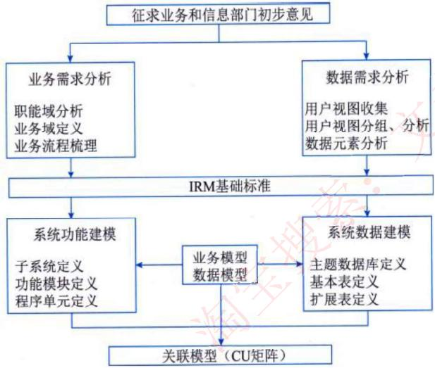
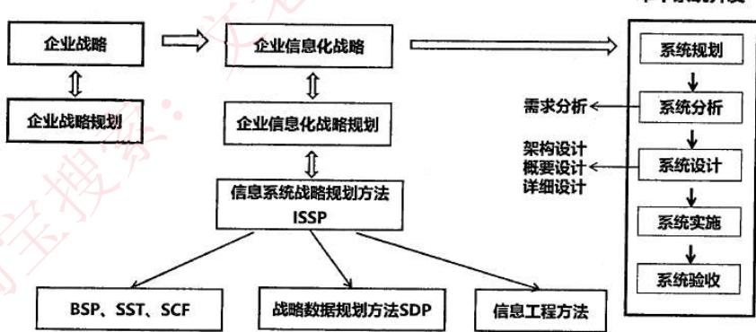
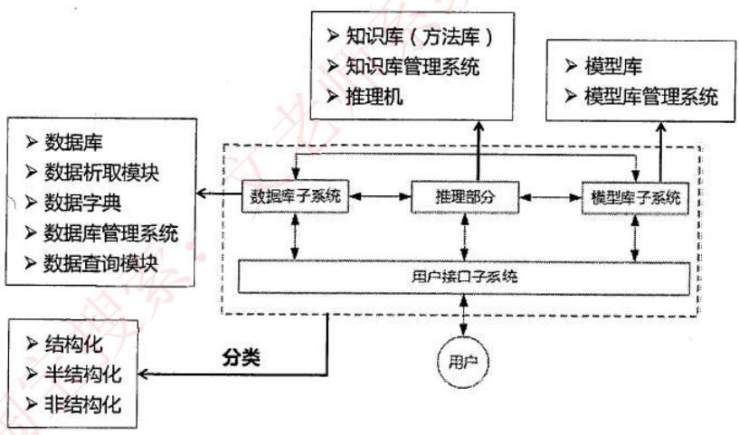
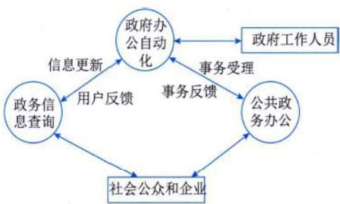
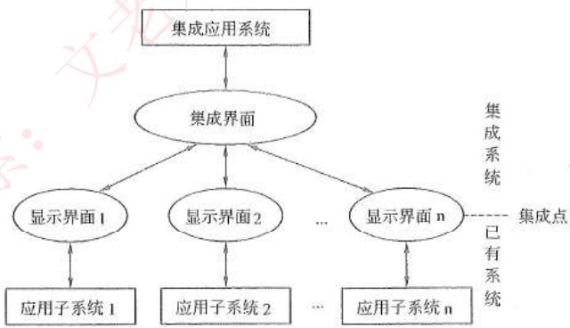
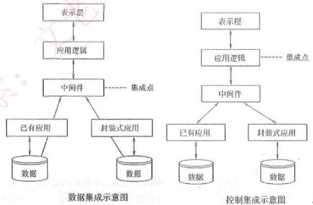
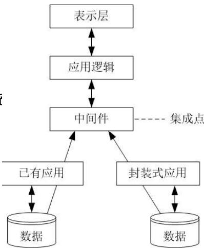
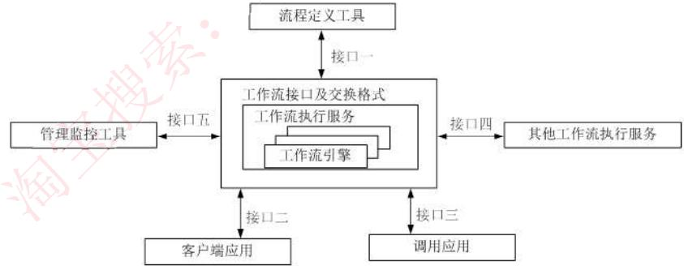

# 企业信息化

> 对应**第二版教材第 6 章**。
>
> 第二版相比第一版的主要变化：删除"信息、信息化基本概念"；**新增信息资源管理**；**新增企业信息化规划**；**新增商业智能**；信息系统开发方法移至数据库章节讲解；业务流程重组（BPR）移至软件工程章节讲解；删除"企业集成平台"，**新增事件驱动的企业应用集成**；补充**工作流**。
>
> 本章纲要：企业信息化概述 → 信息资源管理 → 企业信息化规划 → 企业信息系统 → 电子商务 → 电子政务 → 企业应用集成 → 补充：工作流。

## 1. 企业信息化概述

### 1.1 企业信息化的概念

企业信息化是指企业以业务流程的优化和重构为基础，在一定的深度和广度上利用计算机技术、网络技术和数据库技术，控制和管理企业生产经营活动中的各种信息，**实现企业内、外部信息的共享和有效利用**，不断提高企业生产、经营、管理与决策的效率和水平，从而提高企业经济效益和市场竞争力的过程。

### 1.2 企业信息化方法

企业推进信息化的常见方法有五种：

| 方法 | 核心思想 | 备注 |
| --- | --- | --- |
| 业务流程重组方法 | 利用信息技术对企业组织结构和工作方法进行"彻底的、根本性的"重新设计 | 即 BPR（详见软件工程章节） |
| 核心业务应用方法 | 围绕核心业务应用信息技术 | 很多企业信息化成功的秘诀 |
| 信息系统建设方法 | 建设好信息系统是企业信息化的重点和关键 | 最具普遍意义的企业信息化方法 |
| 主题数据库方法 | 面向企业业务主题（核心业务）建设数据库 | 数据相对稳定，业务/流程多变 |
| 资源管理方法 | 管理好企业资源，信息技术的应用为其提供强大支持 | 资源管理是永恒主题 |

## 2. 信息资源管理（IRM）

### 2.1 信息资源概述

**信息和材料、能源**共同构成了国民经济和社会发展的**三大战略资源**，三者可在一定条件下相互转换。信息资源具有以下特点：

- **无限性**：可被反复使用，不会因使用而消耗。
- **可再生性**：使用过程中可产生新的信息。
- **可共享性**：可被多个主体同时利用。
- **低污染**：开发利用过程几乎不产生新的污染，反而能减少材料与能源的消耗。

### 2.2 IRM 的概念

信息资源管理（Information Resource Management, **IRM**）包括：

- **数据资源管理**：强调对数据的控制（维护和安全）。
- **信息处理管理**：关心管理人员如何获取和处理信息（流程和方法）。

IRM 的基础是**数据管理**，即确定数据规划、数据应用、数据标准、数据内容、数据范围等。

### 2.3 IRM 的三个基本主题

1. **资源管理的方向和控制**：从企业整体管理层面分析资源管理。指导方针是数据可共享、数据处理机构提出应用项目、资源的有效性。
2. **企业信息资源指导委员会**：负责制定方针政策，控制和监督信息资源功能的实施。
3. **信息资源组织机构**：从事数据的计划和控制、数据获取、数据的经营管理，并包括企业应用系统的开发。

### 2.4 信息资源分类的三个维度

信息资源分类的起点和基础是建立**信息资源目录**。一般从以下三个维度展开：

| 维度 | 特点 |
| --- | --- |
| 管理维度 | 来自业务信息化过程；分为业务部门自身分类与综合部门登记管理分类 |
| 信息来源维度 | 按信息资源提供部门设置一/二/三级类目；简化分类工作量，查找简单直接 |
| 应用需求维度 | 政府部门、企业、公众等不同使用者的应用需求产生不同的分类方式 |

### 2.5 IRM 的基础标准

| 标准 | 说明 |
| --- | --- |
| 数据元素标准 | 最小的不可再分的信息单位；含命名、标识、一致性标准 |
| 信息分类编码标准 | 按属性/特征进行区分归类，建立分类系统和排列顺序；**最基础的标准** |
| 用户视图标准 | 数据元素的集合，反映最终用户对数据实体的看法；是系统输入/输出的媒介 |
| 概念数据库标准 | 最终用户对数据存储的看法；含名称、标识、主关键字、数据内容列表 |
| 逻辑数据库标准 | 系统分析与设计的基础，对概念数据库进一步分解细化；由规范化的基本表构成 |

### 2.6 制定和实施 IRM 基础标准的原则（威廉·德雷尔）

1. 不能把例外当成正规。
2. 管理部门必须支持并乐于帮助执行标准。
3. 标准必须是从实际出发的、有生命力的、切实可行的。
4. 标准不是绝对的，必须有某种灵活的余地。
5. 标准不应该迁就落后。
6. 标准必须是容易执行的。
7. 标准必须加以宣传推广，而不是靠强迫命令。
8. 关于标准的细节本身并不重要，重要的是**制定了某些标准**。
9. 标准应该逐渐地制定出来，不要企图一次搞完。
10. 数据管理最重要的标准是**一致性标准**（数据命名、属性、设计和使用的一致性）。

### 2.7 信息资源规划（IRP）

**信息资源规划**（Information Resource Planning, IRP）是信息化建设的基础工程，指对企业生产经营活动所需要的信息，从产生、获取、处理、存储、传输到利用等方面进行全面规划。

IRP 强调**将需求分析与系统建模紧密结合**：需求分析是系统建模的准备，系统建模是用户需求的定型和规范化表达。

IRP 大致分 **7 个步骤**，按**业务**和**数据**两条主线开展：

1. 定义职能域
2. 各职能域业务分析
3. 各职能域数据分析
4. 建立整个企业的 IRM 基础标准
5. 建立信息系统功能模型
6. 建立信息系统数据模型
7. 建立关联矩阵

#### 业务需求分析（业务模型）

IRP 第一阶段进行业务需求分析，成果是**业务模型**（也称系统功能模型/企业模型），包括：

1. 企业的**职能域模型**。
2. 识别每个职能域的**业务过程**。
3. 列出每个业务过程的各项**业务活动**。
4. 业务模型的**复查与确认**。

#### 数据需求分析

数据需求分析是 IRP 中**最重要、工作量最大且最复杂**的工作，强调对整个企业或主要部分进行分析。主要工作内容：

1. **用户视图**的采集、整理和分析（数据需求分析）。
2. 建立**基本表**和**主题数据库**（系统数据建模）。

### 2.8 信息资源网

信息资源网是各相关经济信息提供部门和使用部门建立的各种**数据库、信息中心和信息应用系统**。与信息通信网（侧重传输）相比，信息资源网涵盖了从信息采集、加工直至最终利用的众多环节。

信息资源网建设包括：

- 数据库和数据仓库建设
- 数据分布（分散存储、集中存储）
- 分布式数据库建设

## 3. 企业信息化规划

### 3.1 规划体系

企业信息化涉及**多层次规划**，需厘清其关系：

- **企业战略规划**：利用机会和威胁评价现在和未来环境，用优势和劣势评价企业现状，选择和确定企业的总体和长远目标，制定和抉择实现目标的行动方案。
- **信息系统战略规划（ISSP）**：关注如何通过信息系统支撑业务流程的运作，进而实现关键业务目标；重点是信息系统的远景、组成架构及逻辑关系。
- **信息技术战略规划（IT 战略规划）**：在信息系统规划的基础上，对支撑信息系统运行的硬件、软件、支撑环境等进行具体规划，更关心技术层面问题。
- **信息资源规划（IRP）**：在以上规划基础上，为开展具体信息化建设项目而进行的数据需求分析、信息资源标准建立、信息资源整合工作。
- **系统规划**：单个项目的立项分析，是信息系统生命周期的第一个阶段。其任务是对企业环境、目标及现有系统进行初步调查，根据企业目标和发展战略确定信息系统发展战略，对建设新系统的需求做出分析和预测，同时考虑各种约束，研究必要性和可能性。

### 3.2 信息化战略与企业战略的一致性

企业信息化建设的核心问题是保证**企业信息化战略与企业战略的一致性**，把企业战略目标转换为信息系统的战略目标。信息化规划与企业战略规划的关系表现为以下三种情况：

| 信息化阶段 | 信息化需求来源 | 实施方式 |
| --- | --- | --- |
| 初级阶段 | 业务部门根据现有业务流程或管理需要，直接提出信息化需求 | IT 部门按需求实施 |
| 中级阶段 | 业务部门根据企业战略对业务流程和组织结构进行改进后提出需求 | IT 部门分别独立实施 |
| 高级阶段 | 根据整体战略规划通盘考虑各业务部门的信息化需求 | 制定整体信息化战略，统一规划、分步实施 |

### 3.3 BITA 与 EITA

| 方法 | 全称 | 关注点 | 适用场景 |
| --- | --- | --- | --- |
| **BITA** | Business-IT Alignment（业务与 IT 整合） | 以业务为导向的全面 IT 管理咨询方法论 | 信息系统不能满足当前管理中的业务需要，业务和 IT 之间存在不一致 |
| **EITA** | Enterprise IT Architecture（企业 IT 架构） | 分析企业战略、制定 IT 战略并指导投资决策 | 现有信息系统和 IT 基础架构不一致、不兼容、缺乏统一整体管理 |

BITA 主要步骤：评估和分析企业当前业务和 IT 不一致的领域 → 整理业务远景和未来战略 → 建立业务模型 → 提出达到未来目标的转变过程建议和初步计划 → 执行计划。

EITA 在技术、信息系统、信息、IT 组织和 IT 流程方面建立 IT 原则规范、模式和标准，并指出 IT 需改进的方面、制订行动计划。

### 3.4 信息系统战略规划的三阶段与方法

企业信息系统战略规划可分为三个阶段，对应不同的规划方法：

| 阶段 | 核心 | 代表方法 |
| --- | --- | --- |
| 第一阶段 | 以**数据处理**为核心，围绕职能部门需求 | BSP、CSF、SST |
| 第二阶段 | 以企业内部 **MIS** 为核心，围绕企业整体需求 | SDP、IE、SG |
| 第三阶段 | 综合考虑企业内外环境，以**集成**为核心，围绕企业战略需求 | VCA、SAM |

#### 第一阶段方法

- **企业系统规划法（BSP）**：自上而下识别企业目标、企业过程和数据，对数据进行分析，再自下而上设计信息系统。重视数据的创建和使用，提供 CU 矩阵（创建/使用矩阵）。
- **关键成功因素法（CSF）**：每个企业在某阶段都有关键因素，抓住关键信息。
- **战略集合转化法（SST）**：将企业战略信息（环境、目标等）作为一个"信息集合"并转换为信息系统的战略信息。

#### 第二阶段方法

- **战略数据规划法（SDP）**：强调建立**企业模型**和**主题数据库**（重点和关键，面向业务主题，跨越整个企业）。数据类基本稳定，业务和流程多变。
- **信息工程法（IE）**：以工程方法建立信息系统，以数据为中心。三要素：企业的各种信息、企业的业务过程、企业采用的信息技术。实施分四阶段：**信息规划 → 业务领域分析 → 系统设计 → 系统构建**。
- **战略栅格法（SG）**：建立 2×2 矩阵，元素代表过程对数据类的创建和使用等。

#### 第三阶段方法

- **价值链分析法（VCA）**：将对企业有影响的信息作为一个个活动，分析其中对企业增值最大的信息。
- **战略一致性模型（SAM）**：保证企业战略和信息系统战略一致。

### 3.5 考试真题

> 在综合考虑企业内外环境、以集成为核心、围绕企业战略需求进行信息系统规划时，适合采用的方法是（）。
> - A. 战略栅格法　B. 价值链分析法　C. 信息工程法　D. 战略集合转化法
> **答案：B**

> 用于管理信息系统规划的方法有很多，其中（）将整个过程看成是一个"信息集合"，并将组织的战略目标转变为管理信息系统的战略目标；（）通过自上而下地识别企业目标、企业过程和数据，再对数据进行分析，自下而上地设计信息系统。
> - A. 关键成功因素法　B. 战略目标集转化法　C. 企业系统规划法　D. 阶石法
> **答案：B、C**

## 4. 企业信息系统

### 4.1 企业资源规划（ERP）

**ERP（Enterprise Resource Planning）** 是一套为企业运营提供辅助决策和日常管理信息的大规模集成化软件，也是辅助企业管理向零缺陷趋近的一整套现代化管理思想和办公手段。它将供应商与企业内部的采购、生产、销售以及客户紧密联系起来，对供应链上的所有环节进行有效管理，实现对企业的动态控制和资源的集成与优化。

**企业资源 = 三个"流"**（有时也将人力资源作为第四大资源）：

- 物流 → 物流管理
- 资金流 → 财务管理
- 信息流 → 生产控制管理

对 ERP 的三层理解：

| 层面 | 含义 |
| --- | --- |
| 管理思想 | 将企业资源分类管理，是管理思想的变革 |
| 软件产品 | 为企业提供一体化解决方案，需个性化开发与部署 |
| 管理系统 | 由众多互联互通的子系统组成，便于事前/事中监控 |

**ERP 的核心作用**：在协调与整合企业各方面资源运营的过程中，全面实现信息共享和企业对市场变化的快速反应，降低市场波动带来的经营风险，以更少的资源投入获得更多的投资回报。

#### 典型功能模块

| 模块 | 包含 |
| --- | --- |
| 财会管理 | 会计核算、财务管理等 |
| 物流管理 | 分销管理、库存控制、采购管理等 |
| 生产控制管理 | 主生产计划、物料需求计划、能力需求计划、车间控制、制造标准等 |
| 人力资源管理 | 人力资源规划辅助决策、招聘管理、工资核算、工时管理、差旅费核算等 |

#### 两种典型开发模式

1. **二次开发**：在 ERP 供应商的套装软件基础上进行二次开发。投资相对较少，建设期明显缩短。
2. **定制开发**：从企业个性化需求出发进行系统定制。开发周期长、效率不高、投资较大、实施风险大。

### 4.2 客户关系管理（CRM）

**CRM（Customer Relationship Management）** 以客户为中心，以提高客户满意度、增加客户忠诚度为目标。它是一个集成化的信息管理系统，存储企业现有和潜在客户的信息，并自动处理这些信息从而产生更人性化的市场管理策略。

#### CRM 涵盖的要素

1. **以信息技术为手段，但 CRM 更是以客户为中心的商业策略**，企业以客户为中心运营，而非以产品或市场为中心。
2. 在提高客户满意度的同时，把帮助企业**提高获取利润的能力**作为重要指标。
3. 实施 CRM 要求企业对业务功能进行重新设计，并对工作流程进行重组（BPR），将业务中心转移到客户，针对不同客户群体采取不同策略。

#### 主要模块

**销售自动化、营销自动化、客户服务与支持、商业智能**。

#### 支柱性功能

- **客户服务**：对客户提供服务，是 CRM 的关键内容，能提高客户忠诚度。
- **市场营销**：包括商机产生、商机获取和管理、商业活动管理和电话营销等。
- **共享的客户资料库**：连接市场营销和客户服务的基础与依托。
- **分析能力**：使客户价值最大化的分析能力。

#### 有效 CRM 解决方案的要素

1. 畅通有效的客户交流渠道（**触发中心**）。
2. 对所获信息进行有效分析（**挖掘中心**）。
3. CRM 与 ERP 在财务、制造、库存等环节连接，构成闭环结构。

#### CRM 的实现过程

- 客户服务与支持（控制服务品质以赢得顾客忠诚度）
- 客户群维系（通过与顾客交流实现新销售）
- 商机管理（利用数据库开展销售）

### 4.3 供应链管理（SCM）

**SCM（Supply Chain Management）** 是一种集成的管理思想和方法：在满足服务水平要求的同时，为使系统成本最低，把供应商、制造商、仓库和商店有效地结合成一体来生产商品，有效控制和管理信息流、资金流和物流，把正确数量的商品在正确的时间配送到正确地点。

#### 五个核心特征

1. **以客户为中心**：客户满意度是衡量 SCM 绩效的最重要指标。
2. **集成化管理**：SCM 的本质在于集成化管理。
3. **扩展性管理**：现代 SCM 使传统企业向扩展性企业发展。
4. **合作管理**：强调企业之间合作，打破传统封闭经营意识。
5. **多层次管理**：包括公司战略、战术、作业三个层次。

#### 供应链节点

供应商 → 制造商 → 分销商 → 零售商 → 仓库 → 配送中心 → 客户。每个企业都处于供应链的某个节点中，SCM 关注**供应网络的构造**与节点企业的协作运营。

#### 五大基本内容

| 内容 | 说明 |
| --- | --- |
| 计划 | 策略部分；管理所有资源以满足客户需求；建立监控方法 |
| 采购 | 选择能为企业提供产品和服务的供应商 |
| 制造 | 安排生产、测试、打包和准备送货所需的活动（测量内容最多的部分） |
| 配送 | 即物流；调整用户订单收据、建立仓库网络、拣货送货、计价与收款 |
| 退货 | 供应链中的问题处理部分 |

#### 实施 SCM 需注意的问题

1. **配送网络的重构**：需求模式或外部条件变化时对配送网络的调整。
2. **配送战略问题**：直接转运战略、经典配送战略、直接运输战略。
3. **供应链集成与战略伙伴**：对节点企业的销售业绩和市场份额产生显著影响。
4. **库存控制问题**：包括应持有的库存量、订货量与需求预测的关系、库存周转率等。
5. **产品设计**：有效的产品设计在 SCM 中起多方面的关键作用。
6. **信息技术和决策支持系统**：
   - 基础层：标识代码、自动识别与数据采集、EDI、互联网技术；
   - 应用层：基于信息技术开发的支持企业生产的信息系统。
7. **顾客价值的衡量**：衡量企业对顾客贡献大小的指标。

### 4.4 产品数据管理（PDM）与产品生命周期管理（PLM）

**PDM（Product Data Management）** 是管理所有与产品相关的数据（包括零部件信息、配置、文档、CAD 文件、结构、权限信息等）和所有与产品相关过程（包括过程定义和管理）的技术。PDM 系统是一种**软件框架**，可帮助企业实现对产品相关数据、开发过程以及使用者的集成与管理，对设计、制造和生产过程中需要的大量数据进行跟踪和支持。

**PLM（Product Lifecycle Management）** 是企业及其供应链组成产品信息的框架，由多种信息化元素构成（基础技术和标准、信息生成工具、核心/应用功能、业务解决方案）。

产品生命周期一般包括 **5 个阶段**：培育期（概念期） → 成长期 → 成熟期 → 衰退期 → 结束期（报废期）。

PLM 的主要功能：

- **总体功能**：构建完整的数字化产品数据模型和安全的产品信息库；实现产品开发过程自动化（由工作流和生命周期驱动）。
- **核心创造、协作和控制功能**。
- **细化功能**：文档管理、一体化搜索引擎和工作流管理等。

### 4.5 决策支持系统（DSS）

DSS 帮助决策者提高决策水平和质量，起到辅助作用。

DSS 由四个子系统组成：

| 子系统 | 作用 |
| --- | --- |
| 数据库子系统 | 建立与决策相关的信息 |
| 推理部分（知识库） | 包含智能推理分析算法 |
| 模型库子系统 | 最复杂的子系统；提供一系列应用场景模型；用户主要据此决策 |
| 用户接口子系统 | 人机交互界面，将上述三个子系统完美结合供用户使用 |

**决策类型**：

- **结构化决策**：对决策过程规则进行确定性描述与建模，以适当算法产生方案并从中选择最优解。
- **非结构化决策**：决策过程复杂，不可能用确定的模型和语言描述，更无所谓最优解。
- **半结构化决策**：介于两者之间。

半结构化和非结构化决策一般用于企业的中、高级管理层。决策通常不可能一次完成，而是一个**迭代过程**。

### 4.6 知识管理

明确**知识**和**信息**的区别：知识是由信息推导出来的，是人类智慧和经验的集合。

| 类别 | 特点 | 例子 |
| --- | --- | --- |
| 显性知识 | 可被记录、传播、共享 | 文档、资料、视频 |
| 隐性知识 | 存在于人脑海中 | 记忆、经验技巧、理想抱负 |

知识管理的核心是**将隐性知识转化为显性知识**以实现共享，需要借助三类工具：

1. **知识生成工具**：获取知识（含知识获取、知识合成、知识创新）。
2. **知识编码工具**：如何表达知识的工具。
3. **知识转移工具**：使知识传播共享；需克服**时间差异、空间差异和社会差异**。

### 4.7 企业门户

企业门户是企业优化业务模式的重要手段。按应用领域特点可划分为以下类型：

| 类型 | 核心 | 特点 |
| --- | --- | --- |
| **企业网站** | 消息单向传送展示 | 缺乏信息互动，是企业门户的雏形 |
| **企业信息门户（EIP）** | 将各种应用系统、数据资源和互联网资源统一集成 | 面向产品和用户的信息共享，外部供应链和客户通过门户获取信息 |
| **企业知识门户（EKP）** | 在企业网站基础上增加知识性内容 | 建立企业知识库，提高员工工作效率 |
| **企业应用门户（EAP）** | 对企业业务流程的集成 | 以业务流程和企业应用为核心，通过门户技术集成模块；支持移动办公 |
| **企业通用门户** | 将上述四者有机融合 | 综合形态 |

### 4.8 考试真题

> ERP 对企业的物流、资金流和（）流进行全面集成管理。ERP 系统中，（）管理模块主要是对企业物料的进、出、存进行管理。
> - 20. A. 业务　B. 控制　C. 信息　D. 人力
> - 21. A. 库存　B. 销售　C. 财务　D. 人力资源
> **答案：20. C　21. A**

> 供应链中的信息流覆盖了从供应商、制造商到分销商，再到零售商等所有环节，分为**需求信息流**和**供应信息流**。下面属于需求信息流的是（），属于供应信息流的是（）。
> - 18. A. 客户订单　B. 入库单　C. 库存记录　D. 提货发运单
> - 19. A. 完工报告单　B. 采购合同　C. 提货发运单　D. 客户订单
> **答案：18. B（需求信息：客户订单、生产计划、采购合同等）　19. C（供应信息：入库单、完工报告单、库存记录、可供销售量、提货发运单等）**

> 以下关于 CRM 的叙述中，**错误**的是（）。
> - A. 销售自动化是 CRM 系统中最基本的模块
> - B. 营销自动化作为销售自动化的扩充，包括营销计划的编制和执行、计划结果分析
> - C. CRM 能与 ERP 在财务、制造、库存等环节连接，**两者关系相对松散，一般不会形成闭环结构**
> - D. 客户服务与支持是 CRM 系统的重要功能，主要手段是通过呼叫中心和互联网实现
> **答案：C**

> （）不属于客户关系管理（CRM）系统的基本功能。
> - A. 自动化销售　B. 自动化项目管理　C. 自动化市场营销　D. 自动化客户服务
> **答案：B**（CRM 的三个基本模块：销售自动化、市场营销自动化、客户服务自动化）

> 以下关于决策支持系统的叙述，**错误**的是（）。
> - A. 结构化决策是指对某一决策过程的规则进行确定性描述与建模，形成**唯一**的解决方案
> - B. 非结构化决策的决策过程复杂，不可能用确定的模型和语言描述其决策过程
> - C. 半结构化和非结构化决策一般用于企业的中、高级管理层
> - D. 决策往往不可能一次完成，而是一个迭代的过程
> **答案：A**（结构化决策可从多种方案中**选择最优解**，并非唯一）

> 知识管理是企业信息化过程中的重要环节，知识可分为显性知识和隐性知识。其中，（）分别属于显性知识和隐性知识。
> - A. 主观洞察力和产品说明书
> - B. 科学原理和个人直觉
> - C. 企业文化和资料手册
> - D. 可以用规范方式表达的知识和可编码结构化的知识
> **答案：B**（科学原理属显性知识，个人直觉属隐性知识）

> 企业门户按照实际应用领域特点可划分为多种类型，其中（）注重信息的单向传递，面向特定的使用人群，缺乏用户与企业之间的互动；（）以业务流程为核心，将业务流程中的功能模块通过门户集成在一起。
> - A. 企业网站　B. 企业信息门户　C. 企业知识门户　D. 企业应用门户
> **答案：A、D**

## 5. 电子商务

### 5.1 电子商务模式

按**交易对象**分类，主流模式包括：

| 模式 | 含义 | 示例 |
| --- | --- | --- |
| **B2B** | 企业对企业 | 阿里巴巴 |
| **B2C** | 企业对消费者 | 京东、天猫 |
| **C2C** | 消费者对消费者 | 淘宝、eBay |
| **B2G** | 企业对政府 | — |
| **C2B** | 个人对企业 | 团购、定制 |
| **C2G** | 个人对政府 | — |
| **O2O** | Online To Offline | 线上购买，线下提货或享受服务 |

> 备注：除 B2B、B2C、C2C 外，其他均为**非主流模式**。

### 5.2 电子商务急需建立标准的三个领域

1. **用户接口**：用户界面、图像、对话设计原则等。
2. **基本功能**：交易协议、支付方式、安全机制、签名与鉴别、记录的核查与保留等。
3. **数据及客体**（包括组织机构、商品等）的定义与编码。

### 5.3 我国电子商务技术标准现状

国家电子商务标准体系由 **4 个分体系** 构成：

- 基础技术标准
- 业务标准
- 支撑体系标准
- 监督管理标准

内容上包含 **4 方面**：

- 数据交换标准
- 识别卡标准
- 通信网络标准
- 其他相关标准

### 5.4 电子商务的特征

| 特征 | 说明 |
| --- | --- |
| **普遍性** | 行业、地域、多种形式、社会普遍性 |
| **方便性** | 不受地域限制，以简捷方式完成复杂商业活动 |
| **整体性** | 全部组成部分和功能具有整体性 |
| **安全性** | 安全是至关重要的核心问题 |
| **协调性** | 系统中各部分和环节有效协调，形成紧密整体 |

### 5.5 电子商务的优劣势

- **优势**：降低营销成本、提高销售效率、扩大销售渠道、提高服务质量、支持大数据分析。
- **劣势**：搜索功能不完善、网络局限性导致无法获得商品全部信息、交易安全性难以保障等。

### 5.6 电子商务技术

电子商务技术划分为**五大类**：

1. 网络数据通信技术
2. 电子数据交换（EDI）技术
3. 安全技术
4. 电子支付技术
5. 数据库技术

## 6. 电子政务

### 6.1 电子政务的概念

电子政务是指政府机构在其**管理和服务职能**中运用现代信息技术，实现政府组织结构和工作流程的重组优化，超越时间、空间和部门分隔的制约，建成一个精简、高效、廉洁、公平的政府运作模式。

电子政务模型可简单概括为两方面：

1. **政府部门内部**利用先进的网络信息技术实现办公自动化、管理信息化、决策科学化。
2. **政府部门与社会各界**利用网络信息平台充分进行信息共享与服务、加强群众监督、提高办事效率及促进政务公开。

### 6.2 三个应用领域

电子政务通常主要包括三个应用领域：

1. **政务信息查询**：面向社会公众和企业组织，提供政策、法规、条例和流程的查询服务。
2. **公共政务办公**：借助互联网实现政府机构的对外办公。
3. **政府办公自动化**：以信息化手段提高政府机构内部办公的效率。

### 6.3 三种信息流

在电子政务系统中主要存在三种信息流：

| 信息流 | 范围 |
| --- | --- |
| 政务办公信息流 | 存在于政府机构内部办公的过程中 |
| 公共事务信息流 | 存在于政府机构对外办公的过程中 |
| 政务咨询信息流 | 存在于社会公众和企业查询相关信息的过程中 |

### 6.4 应用模式

| 模式 | 全称 | 说明 | 示例 |
| --- | --- | --- | --- |
| **G2G** | Government to Government | 政府与政府之间的电子政务（上下级、跨地区跨部门） | 档案互调 |
| **G2B** | Government to Business | 政府与企业之间的电子政务（政府向企业提供公共服务） | 企业报税 |
| **G2C** | Government to Citizen | 政府与公众之间的电子政务（面向公众提供服务） | 社保、公积金查询 |
| **G2E** | Government to Employee | 政府与公务员之间的电子政务 | 公务员办公 |

## 7. 企业应用集成（EAI）

### 7.1 EAI 概述

**企业应用集成（Enterprise Application Integration, EAI）** 适用于大多数实施电子商务的企业，以及企业之间的应用集成。

EAI 包括**表示集成、数据集成、控制集成和业务流程集成**等多个层次和方面。

#### 7.1.1 表示集成（界面集成）

- 集成层次：最原始的集成，也称**黑盒集成**。
- 方式：将多个信息系统的界面集成在一起，统一入口，为用户提供一个看上去统一、但由多个系统组成的应用系统。
- 示例：桌面门户。

#### 7.1.2 数据集成

- 集成层次：**白盒集成**。
- 方式：把不同来源、格式、特点性质的数据在逻辑上或物理上有机集中，为企业提供全面的数据共享。
- 示例：数据仓库。

#### 7.1.3 控制集成（功能集成 / 应用集成）

- 集成层次：黑盒集成，业务逻辑层次的集成。
- 方式：借助远程过程调用（RPC）、远程方法调用（RMI）、面向消息的中间件等技术，将多个应用系统功能进行绑定，使之像一个实时运行的系统一样接受信息输入和产生数据输出，实现多个系统功能的叠加。
- 示例：钉钉。

#### 7.1.4 业务流程集成（过程集成）

- 集成层次：最彻底、最综合的集成，超越了数据和系统。
- 方式：由一系列基于标准的、统一数据格式的工作流组成；对各种业务信息的交换进行定义、授权和管理。
- 内容：包括应用集成、B2B 集成、自动化业务流程管理、人工流程管理、企业门户以及对所有应用系统和流程的管理与监控等。
- 示例：电子购物网站 ↔ 第三方支付平台 ↔ 银行 ↔ 物流等流程集成。

### 7.2 事件驱动架构（EDA）

**事件驱动架构（Event-Driven Architecture, EDA）** 是一种设计和构建应用的方法：事件触发消息在**独立的、非耦合的模块之间**（它们之间不需要知道对方）传递。事件源通常发送消息到中间件或消息代理，订阅者订阅这个消息。由于事件消息用**发布/订阅**方式通过消息代理传输，**一个事件可以传送给多个订阅者**。

#### EDA 的主要特点

| 特点 | 说明 |
| --- | --- |
| **异步** | 消息发出后不必关心是否能收到响应；不必在源和目的系统之间维持活的链路 |
| **发布/订阅** | 支持多对多交互；一个事件可被多个已订阅和授权的系统接收并响应 |
| **解耦** | 消息的发布者不知道订阅者是谁，反之亦然 |

#### 支持事件和消息技术的主要模块

1. **异步消息机制**：事件发生时能发送异步消息。
2. **事件管理**：识别、定义和聚集事件。

#### EAI 架构的服务层次（5 层）

| 层次 | 说明 |
| --- | --- |
| **企业服务总线（ESB）** | 面向服务体系中的基础架构；各个服务通过总线互相访问 |
| **应用服务层** | 需要集成的各个应用系统和数据库 |
| **总线接入层** | 提供适配器服务，支持多种主流应用的接入协议；通过消息机制使应用接入 ESB |
| **核心服务层** | 提供多种 ESB 所需的必要服务支持 |
| **业务支持层** | 通过通用、标准的对象和服务模型，定义可复用的、基于企业标准的业务流程；提供统一的用户交互服务 |

**事件驱动的 EAI 框架**基于面向服务技术，通过各类适配器服务接口将企业应用封装成统一的应用服务，发布到目录服务中心，并通过 ESB 中的基础核心服务（统一数据格式、消息传递等）实现各应用系统之间的通信交互，实现**"即插即用"**。

### 7.3 考试真题

> EAI 可以包括表示集成、数据集成、控制集成和业务流程集成等多个层次和方面，下图所示的是（），适合于使用这种集成方式的情况是（）。
>
> 
>
> - 集成方式：A. 表示集成　B. 数据集成　C. 控制集成　D. 业务流程集成
> - 适用情况：A. 为用户提供一个看上去统一，但由多个系统组成的应用系统　B. 在现有的基于终端的应用系统上配置基于 PC 的用户界面　C. 当只有可能在显示界面上实现集成时　D. 让现有系统的功能能够被新系统调用
> **答案：B、A**

## 8. 补充：工作流

### 8.1 WFMS 概述

**工作流管理系统（WFMS）** 将业务流程中"工作如何组织与协调"的规则抽象出来，在其协助下，开发人员遵从一定的编程接口和约定即可开发出更具灵活性的事务处理系统；用户无需重新开发即可更改工作流程以适应业务变更。

> 注意：**工作流对应现实世界的业务处理过程，不能改变真实业务的处理逻辑**。

### 8.2 WFMS 的基本功能

1. **工作流建模**：定义工作流，包括具体的活动和规则等；所创建的模型可同时被人和计算机"理解"。
2. **工作流执行**：遵循工作流模型创建和执行实际的工作流，可同时执行多个工作项。
3. **业务过程的管理和分析**：监控和管理执行中的业务（工作流），例如进度完成情况、数据所处状态、工作分配与均衡情况等。

### 8.3 工作流参考模型（WRM）

工作流参考模型（Workflow Reference Model, WRM）包括 **5 个组件**：

| 组件 | 作用 |
| --- | --- |
| 工作流引擎 | 驱动工作流的执行 |
| 流程定义工具 | 建模与定义工作流 |
| 客户端应用 | 用户操作入口 |
| 调用应用 | 被工作流调用的外部应用 |
| 管理监控工具 | 监控、管理与分析 |

