# 系统架构师

软考系统架构师考试相关知识整理。

## 目录

### 核心知识
- [[02-systems-engineering|系统工程与信息系统基础]]
- [[03-software-engineering|软件工程]]

### 架构设计与选型
- [[service-governance-config-center|服务治理与配置中心：Nacos / Consul / Apollo]]

## 相关资源

- [[../sys-analyst/index|系统分析师]] — 相关考试内容

```mermaid
flowchart LR
    subgraph A [接入层]
        direction LR
        Nginx[“Nginx / Kong”]
        SLB[“SLB / F5”]
    end

    subgraph B [网关与路由层]
        Gateway[“Spring Cloud Gateway”]
        Zuul[“Zuul”]
    end

    subgraph C [业务服务层]
        direction TB
        Web[“Spring Boot<br>（Web/服务治理）”]
        Security[“Sa-Token / Security<br>（认证授权）”]
        Cache[“Redis<br>（缓存）”]
        Job[“XXL-JOB<br>（定时任务）”]
        MQ[“RocketMQ / Kafka<br>（消息队列）”]
    end

    subgraph D [数据与基础设施层]
        DB[“MySQL / PostgreSQL<br>（关系库）”]
        NoSQL[“MongoDB / ES<br>（文档/搜索）”]
        OSS[“OSS / MinIO<br>（对象存储）”]
        Tracing[“SkyWalking / Zipkin<br>（链路追踪）”]
        Logging[“ELK / Loki<br>（日志聚合）”]
        Config[“Nacos / Apollo<br>（配置中心）”]
    end

    A --> B --> C --> D
    C -.-> D
```

